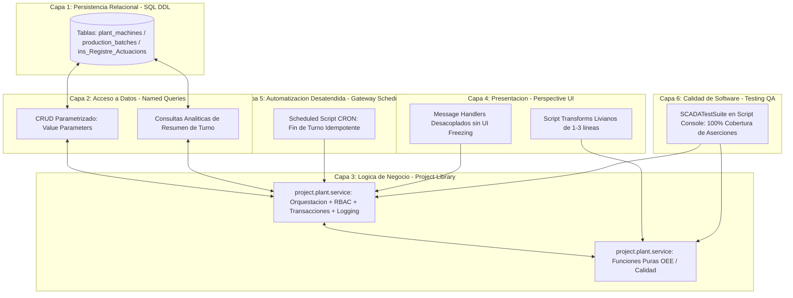

# Sesión 11

### 1. Apertura y Encuadre de la Sesión Final

#### Objetivos

* Revisar el estado de partida de los entornos individuales y verificar los requisitos del Proyecto Final Integrador.
* Establecer la dinámica de integración autónoma basada en directrices de ingeniería, presentación técnica y evaluación global del curso.

#### Contenidos

* Repaso de las dudas finales sobre testing funcional, plantillas canónicas de módulo (`service_template`) y directrices de estilo PEP 8.
* Verificación de la disponibilidad del esquema de base de datos en `SANDBOX_DB` y del proveedor de tags `[default]`.
* Presentación del cronograma de la sesión de cierre:
  * Bloque 1: Desarrollo e integración asistida de las 6 capas del proyecto (guiada por especificaciones técnicas, sin código prediseñado).
  * Bloque 2: Batería de validación funcional y certificación QA en Script Console.
  * Bloque 3: Sesión de defensa técnica y revisión de código por pares (*Live Peer Code Review*).
  * Bloque 4: Evaluación teórica final de certificación y clausura formal del curso.

#### Resultado esperado

* Alineación de todos los participantes sobre los entregables y preparación para la fase de construcción guiada y defensa técnica.

***

### 2. Tema 26: Arquitectura e Integración del Proyecto Final Integrador

#### Objetivos

* Comprender la interacción desacoplada entre las 6 capas arquitectónicas abordadas durante las 35 horas de formación.
* Justificar técnicamente el flujo de datos: desde el modelo relacional DDL, Named Queries parametrizadas, librerías puras y de orquestación, transforms ligeros en Perspective, automatizaciones desatendidas en Gateway y suite de validación funcional en consola.
* Consolidar el proyecto como un estándar corporativo de referencia para futuros desarrollos en planta.

#### Contenidos

**1. Descomposición Multicapa y Principio de Responsabilidad Única (SRP)**

* **El peligro de las arquitecturas monolíticas en SCADA:**
  * En sistemas industriales tradicionales es frecuente encontrar scripts extensos incrustados directamente en botones de interfaz que realizan lecturas de tags en bucle, abren conexiones a base de datos mediante SQL concatenado y actualizan propiedades gráficas en el mismo bloque.
  * *Consecuencias:* Vulnerabilidades de inyección SQL, bloqueos de interfaz (*UI Freezing*), código imposible de testear de forma aislada y un mantenimiento extremadamente costoso ante cualquier cambio de esquema.
* **La solución desacoplada en 6 capas:**
  * **Capa 1 (Persistencia Relacional):** Tablas maestras de equipos (`plant_machines`), lotes transaccionales (`production_batches`) y pistas de auditoría inmutables (`ins_Registre_Actuacions`).
  * **Capa 2 (Acceso a Datos):** Named Queries parametrizadas mediante *Value Parameters* (lectura analítica agrupada y escrituras atómicas protegidas).
  * **Capa 3 (Lógica de Negocio en `Project Library`):**
    * *Funciones Puras de Cálculo:* Motores matemáticos deterministas sin efectos secundarios para Disponibilidad, Rendimiento, Calidad y OEE.
    * *Funciones de Servicio y Orquestación:* Transaccionalidad ACID, aduana RBAC en servidor, logging contextual estructurado y captura dual de excepciones.
  * **Capa 4 (Presentación en Perspective):** Script Transforms puros de 3 líneas que delegan el cálculo a la librería y Message Handlers desacoplados para actualización no bloqueante.
  * **Capa 5 (Automatización Desatendida en Gateway):** Gateway Scheduled Script con expresión CRON y diseño estrictamente idempotente para consolidación automática de fin de turno 24/7.
  * **Capa 6 (Aseguramiento de Calidad - QA):** Test Runner en Script Console con datos simulados (*Mocks*) y aserciones automáticas para certificar el 100% de los algoritmos antes del despliegue.

**2. Matriz de Flujo de Datos y Fronteras de Confianza**

| Capa | Responsabilidad Exclusiva | Qué Tiene Estrictamente Prohibido |
| :--- | :--- | :--- |
| **Persistencia (SQL)** | Almacenar estado de entidades con integridad referencial. | Ejecutar lógica de presentación o depender de APIs de Ignition. |
| **Named Queries** | Canalizar consultas parametrizadas tipadas (*Value Parameters*). | Usar concatenación de texto (`+`) o parámetros de sustitución dinámica (`{...}`). |
| **Project Library (Puras)** | Calcular algoritmos matemáticos (OEE) recibiendo primitivos. | Llamar a `system.tag.*`, `system.db.*` o depender de la UI. |
| **Project Library (Servicio)** | Validar RBAC, orquestar llamadas a BD/Tags y auditar maniobras. | Manipular componentes visuales directamente (`self.props.*`). |
| **Perspective UI** | Capturar entradas del operario y renderizar visualmente estados. | Ejecutar consultas SQL directas o cálculos analíticos pesados en transforms. |
| **Gateway Scheduler** | Ejecutar consolidaciones desatendidas mediante expresiones CRON. | Usar sentencias `print` o asumir la existencia de sesiones web de usuario. |
| **QA Test Suite** | Validar aserciones y contratos de datos mediante casos en 4 cuadrantes. | Modificar esquemas de producción sin entorno de aislamiento. |

#### Resultado esperado

* Dominio de la arquitectura integral de scripting en Ignition SCADA, demostrando la capacidad de estructurar soluciones robustas, escalables y ciberseguras.

***

### 3. Laboratorio 11.1: Desarrollo e Integración Multicapa del Proyecto Final

#### Objetivos

* Construir de forma autónoma las 6 capas del proyecto integrador en el sandbox de Ignition siguiendo **directrices de ingeniería concisas y contratos técnicos**, sin depender de bloques de código prehechos para copiar y pegar.
* Conectar cada capa mediante contratos de datos verificados: desde el modelo DDL en base de datos hasta el panel de visualización en Perspective y la automatización en Gateway.
* Superar con éxito la batería de pruebas de QA en la Script Console antes de la presentación técnica.

#### Directrices de Construcción Concisa por Capas

> [!NOTE]
> En este laboratorio, cada alumno debe escribir e integrar su propio código aplicando los patrones y plantillas asimilados en las sesiones previas (especialmente `service_template` y `SCADATestSuite` de la Sesión 10). A continuación se proporcionan las especificaciones de diseño exactas para cada capa.

---

#### 1. Directrices para la Capa 1: Persistencia Relacional (SQL DDL)
* **Objetivo:** En **Tools -> Database Query Browser** (conexión `SANDBOX_DB`), crear las tablas maestras y transaccionales:
  * Tabla `plant_machines`: Clave primaria `machine_id` (`VARCHAR`), `line_name`, `ideal_cycle_time_sec` (`DOUBLE PRECISION`) e `is_active` (`BOOLEAN`).
  * Tabla `production_batches`: Clave primaria `batch_id` (`VARCHAR`), clave foránea `machine_id`, `shift_id` (`INT`), `target_units`, `good_units`, `scrap_units`, `operating_time_min` (`DOUBLE PRECISION`), `status` (`VARCHAR`, estados: `'IN_PROGRESS'`, `'CLOSED'`), `created_at`, `closed_at`, `closed_by`.
  * Tabla `ins_Registre_Actuacions`: Utilizar la tabla de auditoría corporativa existente.
* **Poblado inicial:** Insertar al menos dos máquinas de prueba y un lote en estado `'IN_PROGRESS'` para habilitar las pruebas de integración.
* **Criterio de Validación:** Ejecutar `SELECT * FROM production_batches;` y verificar que el registro semilla existe con su máquina relacionada.

---

#### 2. Directrices para la Capa 2: Named Queries Parametrizadas
* **Objetivo:** En el Project Browser, crear en la carpeta `Production/` dos Named Queries con *Value Parameters*:
  * **`Production/GetShiftSummary`:**
    * *Tipo:* `Query` (retorna `Dataset`).
    * *Parámetros:* `shiftId` (`Integer`), `startDate` (`DateTime`), `endDate` (`DateTime`).
    * *Lógica SQL:* `INNER JOIN` entre lotes y máquinas. Filtrado estricto por turno y rango temporal sargable. Agrupación por máquina. Cálculo de totales (`SUM`) y ratio de rechazo porcentual protegido con `NULLIF` para evitar división por cero.
  * **`Production/CloseBatchWithAudit`:**
    * *Tipo:* `Update Query` (retorna entero de filas afectadas).
    * *Parámetros:* `batchId` (`String`), `goodUnits` (`Integer`), `scrapUnits` (`Integer`), `user` (`String`).
    * *Lógica SQL:* Sentencia `UPDATE` fijando unidades finales, `status = 'CLOSED'`, `closed_at = CURRENT_TIMESTAMP` y `closed_by = :user`.
    * *Cláusula Crítica:* Filtrar obligatoriamente por `WHERE batch_id = :batchId AND status = 'IN_PROGRESS'`.
* **Criterio de Validación:** Probar ambas consultas en la pestaña **Testing** del Designer verificando que se ejecutan sin errores de sintaxis ni violaciones de tipo.

---

#### 3. Directrices para la Capa 3: Lógica de Negocio en `Project Library` (`project.plant.service`)
* **Objetivo:** Crear el script `plant.service` aplicando la estructura de la plantilla canónica (`service_template`):
  * **Inicialización:** Constantes de módulo, logger contextual SLF4J (`system.util.getLogger("SCADA.PlantService")`), y roles autorizados (`Supervisor`, `Administrator`, `LeadOperator`).
  * **Función Pura de Cálculo Matemático (`calculate_batch_kpis`):**
    * *Firma:* `calculate_batch_kpis(target_units, good_units, scrap_units, operating_min, ideal_cycle_sec)`
    * *Reglas:*
      1. Cláusula de guarda: si algún parámetro es `None` o no numérico, retornar `0.0` en todas las métricas.
      2. Calidad: `(buenas / (buenas + scrap)) * 100`. Si la producción total es 0, retornar `100.0`.
      3. Rendimiento: `(producción_real / capacidad_teórica) * 100`, donde la capacidad teórica es `(operating_min * 60) / ideal_cycle_sec`. Acotar a un máximo de `100.0%`.
      4. OEE: `(Calidad * Rendimiento) / 100`, redondeado a 2 decimales.
      5. Retornar diccionario estructurado con claves `'availability'`, `'performance'`, `'quality'` y `'oee'`.
  * **Función de Orquestación y Servicio Transaccional (`finalize_batch_service`):**
    * *Firma:* `finalize_batch_service(batch_id, equip, good_units, scrap_units, username, user_roles)`
    * *Reglas:*
      1. Aduana RBAC en servidor: validar intersección de `user_roles` con roles autorizados. Si no está autorizado, registrar advertencia en log y retornar `(False, u"Acceso Denegado")`.
      2. Validaciones defensivas de entrada (lote no vacío, unidades `>= 0`).
      3. Invocar la Named Query `Production/CloseBatchWithAudit`. Validar que devuelva exactamente 1 fila afectada.
      4. Registrar la pista de auditoría en `ins_Registre_Actuacions` mediante `system.db.runPrepUpdate`.
      5. Envolver en captura dual (`SQLException`, `JavaException`, `Exception`) con log de errores y retorno de mensajes limpios y seguros.
* **Criterio de Validación:** El script debe compilar sin errores en Designer y cumplir con la directriz de cero sentencias `print`.

---

#### 4. Directrices para la Capa 4: Presentación e Interfaz en Perspective
* **Objetivo:** En una vista de Perspective (`Views/Laboratorios/Lab11_OEE_Dashboard`), integrar los componentes visuales:
  * **Script Transform en Tarjeta de KPIs:** Transform liviano de 3-4 líneas que recibe el payload del lote, delega a `calculate_batch_kpis` y formatea las métricas con colores condicionales (verde `>= 85%`, naranja `>= 65%`, rojo `< 65%`). Prohibido hacer consultas o I/O en el transform.
  * **Acción del Botón "Cerrar Lote":** En `onActionPerformed`, extraer `user` y `roles` de `self.session.props.auth`, llamar a `finalize_batch_service` y emitir un mensaje broadcast con `system.perspective.sendMessage("OnBatchStatusChanged", ..., scope="page")` para actualizar la vista de forma reactiva y no bloqueante.
* **Criterio de Validación:** Comprobar en el navegador que las métricas se muestran correctamente y que la interfaz permanece 100% interactiva al accionar el botón.

---

#### 5. Directrices para la Capa 5: Automatización Desatendida en Gateway (Quartz Scheduler)
* **Objetivo:** En **Server Scripting -> Gateway Event Scripts -> Scheduled**, configurar la tarea `ConsolidacionFinTurno`:
  * *Expresión CRON:* `0 0 6,14,22 * * ?` (ejecución automática en los cambios de turno).
  * *Diseño Idempotente Obligatorio:*
    1. Ejecutar consulta previa (`system.db.runScalarPrepQuery`) para comprobar si hay lotes en `'IN_PROGRESS'`.
    2. Si no hay lotes pendientes, registrar aviso informativo en el logger y finalizar la ejecución sin realizar escrituras innecesarias.
    3. Si existen lotes, ejecutar un `UPDATE` masivo fijando `status = 'CLOSED'` y `closed_by = 'GATEWAY_CRON_AUTO'`.
    4. Control defensivo contra excepciones para garantizar que el planificador nunca se interrumpa.
* **Criterio de Validación:** Ejecutar manualmente la función desde Script Console para certificar que la primera vez consolida los lotes y la segunda vez no produce ninguna acción repetida.

---

#### 6. Directrices para la Capa 6: Suite de Validación de QA en Script Console
* **Objetivo:** En la Script Console, estructurar un banco de pruebas utilizando la clase `SCADATestSuite` para auditar la solución ante 3 casos obligatorios:
  * *Test 1 (Motor Matemático):* Verificar con datos semilla conocidos que el OEE, Rendimiento y Calidad coinciden exactamente con los valores teóricos esperados (Calidad: 98.68%, Rendimiento: 48.76%, OEE: 48.12%).
  * *Test 2 (Seguridad RBAC):* Invocar el servicio con roles no autorizados (`["Operator"]`) y verificar que la operación es rechazada con `False`.
  * *Test 3 (Cierre Autorizado):* Invocar el servicio con rol `Supervisor` y verificar que el cierre y la auditoría se completan con `True`.
* **Criterio de Validación:** La suite debe ejecutarse en un solo clic emitiendo un informe consolidado con **100% de verificaciones superadas (`[ PASS ]`)**.

#### Resultado esperado

* Solución SCADA completamente operativa en el entorno de cada alumno, estructurada de forma modular, cibersegura y certificada por pruebas funcionales automáticas.

***

### 4. Test Final de Conceptos Global

#### Objetivos

* Evaluar el grado de asimilación global de los contenidos teóricos y prácticos impartidos a lo largo de las 11 sesiones (35 horas).
* Certificar la adquisición de competencias en Scopes de ejecución, interoperabilidad Jython/Java, transacciones ACID, optimización SQL, seguridad RBAC y diseño modular.

#### Cuestionario Técnico Integrador

* [Cuestionario Sesión 10](https://docs.google.com/forms/d/e/1FAIpQLSca5RJfunwZEwJs1myBwAPwzB85mQ5nx7OXkQZW4K2jRmy1Rg/viewform?usp=header)
#### Resultado esperado

* Certificación individual del aprovechamiento técnico del curso y acreditación de los conocimientos exigidos para el desarrollo profesional en Ignition SCADA.

***

### 5. Decálogo de Buenas Prácticas y Consejos Finales para Producción Real

#### Objetivos

* Sintetizar las 10 reglas de oro de la ingeniería de scripting en Ignition para su aplicación directa en proyectos de planta en producción.
* Proveer pautas de mantenimiento, gobernanza y evolución de sistemas SCADA a largo plazo.

#### Las 10 Reglas de Oro de Scripting en Ignition SCADA

1. **Cero SQL Concatenado:** Utilizar exclusivamente Named Queries con *Value Parameters* o Prepared Statements con parámetros posicionales (`?`). Toda concatenación es una vulnerabilidad de inyección SQL.
2. **Cero E/S en Bucles:** Agrupar lecturas y escrituras de tags en llamadas masivas por lote (`system.tag.readBlocking` y `system.tag.writeBlocking`). Prohibido llamar a tags dentro de bucles `for`.
3. **Transforms Livianos y Puros:** Los Script Transforms de Perspective deben limitarse a formateo cosmético de 1-3 líneas. Cero llamadas a base de datos o lecturas de tags en transforms.
4. **Captura Dual de Excepciones:** Interceptar siempre tanto errores de Jython como `java.lang.Exception` / `java.lang.Throwable` de Java para garantizar que ningún fallo de Gateway quede sin control.
5. **Logging Contextual Estructurado:** Erradicar por completo las sentencias `print` en Gateway y utilizar `system.util.getLogger` identificando módulo, máquina, acción y usuario.
6. **Seguridad Defensiva en Servidor:** Toda función crítica debe validar roles (RBAC) en el backend en `Project Library` y no fiarse de las protecciones cosméticas de la interfaz gráfica.
7. **Idempotencia en Tareas Desatendidas:** Diseñar scripts de Gateway y tareas CRON de forma que su reejecución repetida no genere efectos secundarios ni registros duplicados.
8. **Consultas SQL Sargables:** Filtrar rangos temporales directamente sobre columnas indexadas (`created_at >= :start AND created_at <= :end`) sin aplicar transformaciones ni funciones sobre el campo en la cláusula `WHERE`.
9. **Organización por Dominios de Planta:** Estructurar `Project Library` por áreas funcionales del proceso (`project.production.*`, `project.water_treatment.*`) y jamás por nombres de programador.
10. **Testing Funcional Antes del Despliegue:** Validar algoritmos y contratos de datos en la Script Console mediante baterías de pruebas y datos simulados (*Mocks*) antes de pulsar `Save Project` en el Gateway de producción.

#### Resultado esperado

* Asimilación de un marco metodológico y técnico consolidado que guíe el desarrollo de futuros proyectos industriales en entornos reales.

***

### 6. Feedback Individual, Balance y Cierre del Curso

#### Objetivos

* Resolver dudas avanzadas sobre casos particulares de las plantas de los asistentes.
* Clausurar formalmente el curso de 35 horas y hacer entrega de las acreditaciones técnicas.

#### Contenidos

* [Feedback Sesión 11](https://imagina-formacion.typeform.com/to/LQzhO2AR)

#### Resultado esperado

* Finalización formal del curso con todos los alumnos evaluados, proyectos validados y un conjunto de herramientas y estándares listos para su aplicación inmediata en planta.
