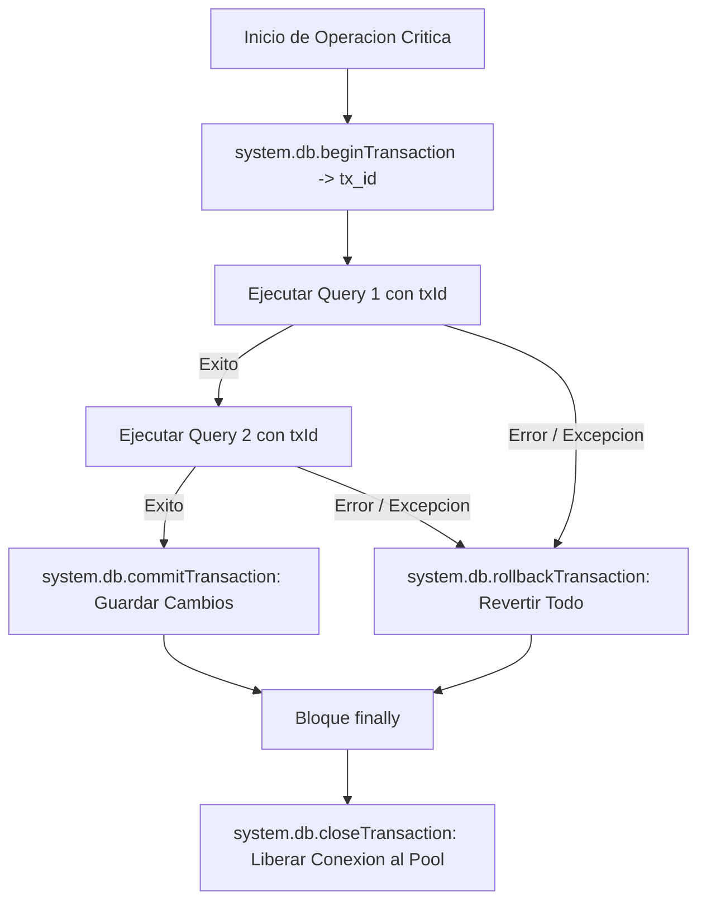
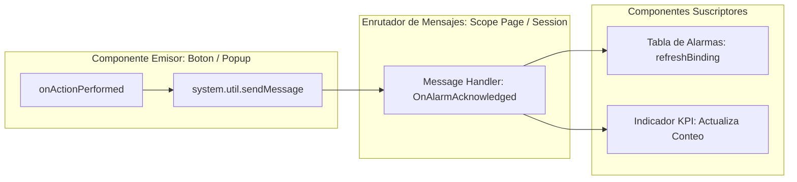
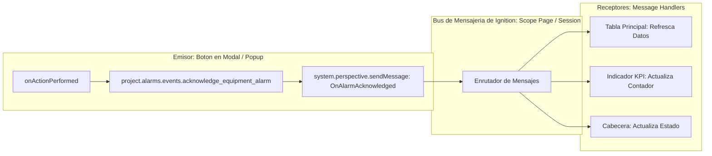

# Sesión 6

### 1. Repaso Inicial y Resolución de Dudas de la Sesión 5

#### Objetivos

* Consolidar los conceptos de escrituras seguras, control de filas afectadas, borrado lógico y auditoría industrial.
* Revisar la creación y tipado de parámetros en Named Queries dentro de Ignition Designer.

#### Contenidos

* Repaso de las consultas sobre la diferenciación técnica entre _Value Parameters_ y _Query Strings_.
* Revisión de las buenas prácticas de validación previa de límites de ingeniería antes de persistir en base de datos.
* Comprobación del correcto registro de pistas de auditoría en la tabla `ins_Registre_Actuacions` / `audit_log` del sandbox.

#### Resultado esperado

* Fijación de los estándares de acceso a datos mediante Named Queries, base requerida para abordar transacciones complejas multiconsulta.

***

### 2. Tema 12: Prepared Statements y Ecosistema de Funciones `system.db.*`

#### Objetivos

* Conocer la matriz comparativa de funciones del módulo `system.db.*` y sus casos de uso específicos.
* Dominar la sintaxis de sentencias preparadas (_Prepared Statements_) utilizando marcadores de posición posicionales `?` y listas de argumentos.
* Gestionar consultas dirigidas a múltiples conexiones de base de datos dentro del Gateway de Ignition.

#### Contenidos

**1. Taxonomía y Matriz Comparativa del Ecosistema `system.db.*`**

* **Contratos de retorno y optimización de memoria en la JVM:**
  * `system.db.runQuery` vs. `system.db.runPrepQuery`: erradicación definitiva de consultas construidas con concatenación de texto plano en favor de sentencias preparadas; `runPrepQuery` retorna un objeto `PyDataSet` que permite acceso indexado natural en Jython (`row["columna"]` o `row[0]`) sin sobrecargar la memoria.
  * `system.db.runScalarPrepQuery`: optimización quirúrgica para la obtención directa de un único valor atómico 1x1 (conteos masivos `COUNT(*)`, identificadores autogenerados, valores máximos o comprobaciones rápidas de existencias); retorna directamente el objeto primitivo (`int`, `float`, `str`, `Date`) o `None` si la consulta no devuelve coincidencias, eliminando por completo el coste de instanciar y desenvolver un dataset.
  * `system.db.runPrepUpdate`: ejecución de sentencias de manipulación (`INSERT`, `UPDATE`, `DELETE`) con retorno obligatorio del número entero de filas modificadas (`rows_affected`) para verificar la unicidad de la operación (`rows_affected == 1`), incorporando soporte opcional para recuperar claves primarias autogeneradas mediante el argumento `getKey=True`.
  * `system.db.runNamedQuery`: estándar arquitectónico preferente para desacoplar el SQL de los scripts y vistas, centralizando la persistencia en el Designer con gestión de permisos, tipado estricto y optimización de caché en el Gateway.
* **Erradicación de funciones heredadas vulnerables:** Prohibición terminante de `system.db.runQuery` y `system.db.runUpdateQuery` en entornos industriales modernos debido al riesgo crítico de inyección SQL accidental y degradación de rendimiento.

**2. Mecánica de Parameter Binding y Resolución en Driver JDBC**

* **Separación de planos sintáctico y de datos:**
  * La consulta se transmite al motor SQL utilizando marcadores de posición posicionales (`?`), precompilando la estructura y el plan de ejecución antes de la llegada de los valores.
  * Los argumentos se envían en una lista ordenada de Python (`args=[val1, val2]`), vinculándose por canal binario desacoplado en el driver JDBC.
  * Inmunidad absoluta ante caracteres conflictivos: comillas simples en observaciones de operadores (ej. `"Válvula 2" no cierra'`) o fragmentos maliciosos (`' OR '1'='1`) se interpretan estrictamente como literales de texto, nunca como sentencias ejecutables.
* **Tipado estricto en la JVM:** Conversión automática y segura de tipos entre Jython y JDBC (`Types.VARCHAR`, `Types.DOUBLE`, `Types.INTEGER`, `Types.TIMESTAMP`), previniendo errores de conversión derivados de formatos regionales de fecha (`DD/MM/YYYY`) o delimitadores decimales.

**3. Enrutamiento Multi-Base de Datos en Arquitecturas SCADA de Planta**

* **Obligatoriedad del parámetro explícito `database="NombreConexion"`:** Prevención de escrituras no autorizadas o accidentales en la base de datos por defecto (*Default Database*) del proyecto cuando esta es modificada en el Gateway.
* **Coexistencia de fuentes industriales de datos:**
  * Conexiones transaccionales y de recetas: `MES_TRANSACTIONS` o `SANDBOX_DB`.
  * Conexiones de series temporales y telemetría: `HISTORIAN_DB`.
  * Conexiones de laboratorio y calidad: `LAB_LIMS_DB`.
* **Portabilidad entre motores RDBMS:** Estandarización de sentencias y compatibilidad con PostgreSQL, Microsoft SQL Server y MySQL en entornos multi-planta.

#### Resultado esperado

* Capacidad para seleccionar y parametrizar la función exacta de `system.db.*` según el tipo de retorno requerido y la conexión de base de datos de destino.

***

### 3. Tema 13: Transacciones Atómicas (ACID), Consistencia y Operaciones Críticas

#### Objetivos

* Comprender los principios de atomicidad, consistencia, aislamiento y durabilidad (ACID) aplicados a procesos de planta.
* Dominar el ciclo de vida de una transacción JDBC en Ignition mediante `system.db.beginTransaction`, `commitTransaction` y `rollbackTransaction`.
* Prevenir fugas de conexiones en el pool del Gateway mediante la liberación obligatoria en bloques `finally`.

#### Contenidos

**1. La Unidad Lógica de Trabajo en Operaciones Industriales y Riesgos de Consistencia**

* **El desastre del modo *Auto-Commit* por defecto:** Cada sentencia individual ejecutada de forma aislada confirma sus cambios de manera inmediata e irrevocable en disco; una interrupción posterior deja la base de datos en un estado inconsistente (*Split-Brain* industrial).
* **Análisis de fallos en operaciones compuestas (código heredado de planta, PDF págs. 14-15):**
  * El riesgo de escrituras parciales: inserción de la cabecera de un lote de producción sin que se descuente el inventario de reactivos o materias primas asociadas.
  * Desfase irreversible entre el stock real de planta, la trazabilidad de calidad y el sistema ERP corporativo ante caídas de red o fallos de PLC a mitad del script.
* **Los cuatro principios ACID aplicados a la fabricación industrial:**
  * *Atomicidad (Atomicity):* O se ejecutan todas las operaciones del proceso (cabecera + consumo de reactivos + auditoría), o no se ejecuta ninguna (*All or Nothing*).
  * *Consistencia (Consistency):* La transacción respeta todas las restricciones de integridad y reglas de validación (ej. impedir que las existencias queden en valores negativos mediante restricciones `CHECK stock_qty >= 0`).
  * *Aislamiento (Isolation):* Control de concurrencia y bloqueos de fila (*Row-level locks*) para asegurar que dos líneas de producción que descuentan existencias simultáneamente no interfieran entre sí ni generen lecturas sucias (*Dirty Reads*).
  * *Durabilidad (Durability):* Una vez confirmado el cambio con `COMMIT`, los datos del lote permanecen inmutables en disco frente a apagones o cortes de tensión en el Gateway gracias al registro previo en el diario de transacciones (WAL).

**2. Ciclo de Vida y Control Transaccional JDBC en Ignition**

* **Identificador de transacción (`tx_id`):** Apertura mediante `tx_id = system.db.beginTransaction(database=db_conn, timeout=10000)`, extrayendo una conexión física del pool del Gateway y desactivando el Auto-Commit.
* **Uso obligatorio del parámetro `timeout`:** Establecimiento de tiempos límite (ej. 10 segundos) para abortar automáticamente transacciones congeladas por bloqueos de tabla.
* **Propagación estricta de `txId`:** Necesidad imperativa de pasar `txId=tx_id` en todas y cada una de las consultas que formen parte de la unidad atómica (`runPrepUpdate`, `runScalarPrepQuery`, `runNamedQuery`). Si se omite en una consulta intermedia, esa sentencia se ejecutará por fuera en modo Auto-Commit rompiendo la atomicidad.
* **Confirmación y reversión:**
  * `system.db.commitTransaction(tx_id)`: Consolidación atómica simultánea de todas las operaciones.
  * `system.db.rollbackTransaction(tx_id)`: Reversión inmediata e íntegra de la totalidad de las modificaciones ante cualquier excepción o anomalía operativa.
* **Descuento atómico de existencias en el motor SQL:**
  * Uso del patrón SQL defensivo: `UPDATE raw_materials_stock SET stock_qty = stock_qty - ? WHERE material_id = ? AND stock_qty >= ?`.
  * Comprobación en script: si `rows_affected == 0`, significa rotura de stock y se dispara una excepción para forzar el rollback automático.

**3. Gestión Estricta del Pool JDBC y Prevención de *Connection Pool Starvation***

* **Anatomía del pool de conexiones del Gateway:** Los pools JDBC (HikariCP / DBCP) poseen límites estrictos de conexiones concurrentes (habitualmente entre 8 y 16 conexiones activas).
* **El peligro mortal del *Connection Leak* (Fuga de conexiones):**
  * Si `closeTransaction(tx_id)` se sitúa después de `commit` o dentro del bloque principal, cualquier excepción previa impedirá que se ejecute.
  * La conexión física permanece secuestrada en la memoria del Gateway. Tras varias ejecuciones fallidas, el pool se satura al 100%.
  * *Consecuencia catastrófica en planta:* Todas las pantallas SCADA de la fábrica quedan inutilizadas arrojando el error `Cannot get a connection, pool error: Timeout waiting for idle object`, obligando al reinicio forzado del servidor de Ignition.
* **El patrón canónico sénior `try / except / finally`:**
  * Obligatoriedad absoluta de incluir `system.db.closeTransaction(tx_id)` de forma incondicional dentro del bloque `finally`, garantizando que la conexión física regrese al pool tanto en caso de éxito (`commit`) como de fallo (`rollback`).



#### Resultado esperado

* Dominio del diseño de transacciones ACID en Jython, asegurando la consistencia total de datos en procesos de fabricación y la estabilidad del pool JDBC del Gateway.

***

### 4. Laboratorio 6.1: Transacción Atómica de Cierre de Lote con Control de Stock y Rollback

#### Objetivos

* Implementar una función en `Project Library` (`project.production.batch`) que ejecute una transacción compuesta: inserción de cabecera de lote y descuento de existencias de materias primas en una sola unidad lógica.
* Proteger la ejecución mediante `commit`/`rollback` y liberación estricta de la transacción en `finally`, verificando la reversión automática si no existe stock suficiente.

#### Resultado esperado

* Función probada desde la Script Console que ejecuta satisfactoriamente el cierre de lote y actualización de existencias ante datos válidos, y revierte la totalidad de los cambios en base de datos cuando se fuerza un error de stock insuficiente.


#### 4. Paso a Paso para la Realización

**Paso 1: Preparación de Tablas Transaccionales en el Sandbox (SQL)**

1. En **Ignition Designer**, abrir **Tools -> Database Query Browser**.
2. Seleccionar la conexión `SANDBOX_DB`.
3. Ejecutar el siguiente script DDL para crear las tablas de históricos de lotes e inventario de reactivos/materias primas:

```sql
-- 1. Tabla de Historico de Lotes
CREATE TABLE IF NOT EXISTS production_batch_history (
    batch_code VARCHAR(50) PRIMARY KEY,
    equip VARCHAR(100) NOT NULL,
    units_produced INT NOT NULL,
    closed_by VARCHAR(100) NOT NULL,
    closed_at TIMESTAMP NOT NULL DEFAULT CURRENT_TIMESTAMP
);

-- 2. Tabla de Inventario de Materias Primas / Reactivos
CREATE TABLE IF NOT EXISTS raw_materials_stock (
    material_id VARCHAR(50) PRIMARY KEY,
    description VARCHAR(255) NOT NULL,
    stock_qty DOUBLE PRECISION NOT NULL,
    unit VARCHAR(20) NOT NULL
);

-- Poblado inicial de stock de prueba
INSERT INTO raw_materials_stock (material_id, description, stock_qty, unit)
VALUES 
    ('REACTIVO_COAGULANTE', 'Sulfato de alúmina para EDAR', 1500.0, 'kg'),
    ('REACTIVO_FLOCULANTE', 'Polielectrolito catiónico', 350.0, 'kg'),
    ('ENVAS_BOTELLA_1L',     'Botella PET 1L Línea Envasado', 10000.0, 'unidades')
ON CONFLICT (material_id) DO UPDATE 
SET stock_qty = EXCLUDED.stock_qty;
```

**Paso 2: Creación del Módulo en Project Library**

1. En el _Project Browser_, desplegar **Server Scripting -> Project Library**.
2. Crear el script: `production.batch` (carpeta `production`, script `batch`).

**Paso 3: Implementación de la Lógica Transaccional ACID**

Copiar y guardar el siguiente código en `project.production.batch`:

```python
"""
Modulo: project.production.batch
Descripcion: Gestion transaccional atomica (ACID) de cierre de lotes y actualizacion de stock.
Autor: Equipo SCADA
"""

def close_production_batch(batch_code, equip, units_produced, material_consumptions, username, db_conn="SANDBOX_DB"):
    """
    Ejecuta el cierre formal de un lote de produccion descontando stock dentro de una transaccion JDBC.
    
    Args:
        batch_code (str): Codigo identificador del lote (ej. 'LOT-2026-X1').
        equip (str): Identificador del equipo (ej. 'EDAR_BOMBA_01', 'LINEA_ENVASADO_01').
        units_produced (int): Cantidad producida.
        material_consumptions (list of dict): [{'material_id': 'REACTIVO_COAGULANTE', 'qty': 120.5}, ...]
        username (str): Operador que autoriza el cierre.
        db_conn (str): Conexion de base de datos en Ignition.
        
    Returns:
        tuple: (bool success, unicode message)
    """
    logger = system.util.getLogger("SCADA.Transactions.Batch")
    
    # 1. Validaciones previas de entrada
    if not batch_code or not equip or not username:
        return (False, u"Parámetros de cabecera incompletos")
        
    if units_produced is None or int(units_produced) <= 0:
        return (False, u"La cantidad producida debe ser superior a cero")
        
    if not material_consumptions or not isinstance(material_consumptions, list):
        return (False, u"Se requiere una lista válida de consumos de materia prima")
        
    # 2. Iniciar transaccion JDBC con timeout de 10 segundos
    tx_id = system.db.beginTransaction(database=db_conn, timeout=10000)
    
    try:
        logger.info("Iniciando transacción [{}] para el cierre de lote: {}".format(tx_id, batch_code))
        
        # 3. Sentencia 1: Insercion de la cabecera del lote
        header_sql = """
            INSERT INTO production_batch_history (batch_code, equip, units_produced, closed_by, closed_at)
            VALUES (?, ?, ?, ?, CURRENT_TIMESTAMP)
        """
        h_rows = system.db.runPrepUpdate(
            header_sql, 
            [str(batch_code), str(equip), int(units_produced), str(username)], 
            database=db_conn, 
            txId=tx_id
        )
        
        if h_rows != 1:
            raise Exception("No se pudo insertar la cabecera del lote en el histórico")
            
        # 4. Sentencias 2..N: Descuento de stock de cada materia prima
        stock_sql = """
            UPDATE raw_materials_stock 
            SET stock_qty = stock_qty - ? 
            WHERE material_id = ? AND stock_qty >= ?
        """
        for item in material_consumptions:
            mat_id = item.get("material_id")
            qty = float(item.get("qty", 0.0))
            
            if qty <= 0.0:
                raise Exception("Cantidad de consumo no válida para el material: {}".format(mat_id))
                
            # La clausula AND stock_qty >= ? asegura que NO se descuente si no hay suficiente existencia
            rows_updated = system.db.runPrepUpdate(
                stock_sql, 
                [qty, mat_id, qty], 
                database=db_conn, 
                txId=tx_id
            )
            
            if rows_updated != 1:
                # Disparo de excepcion que forzara el Rollback completo
                raise Exception("Stock insuficiente o material inexistente para: {}".format(mat_id))
                
            # 5. Sentencia Final: Registro en auditoria de actuaciones (mismo txId)
        audit_sql = """
            INSERT INTO ins_Registre_Actuacions (Equip, Descripcio, Usuari, DataHora)
            VALUES (?, ?, ?, CURRENT_TIMESTAMP)
        """
        audit_desc = u"Cierre de Lote {} ({:.0f} unidades) y regularización de stock".format(
            unicode(batch_code), float(units_produced)
        )
        system.db.runPrepUpdate(
            audit_sql, 
            [str(equip), audit_desc, str(username)], 
            database=db_conn, 
            txId=tx_id
        )
        
        # 6. Confirmacion atomica de todos los cambios
        system.db.commitTransaction(tx_id)
        logger.info("Transacción [{}] confirmada (COMMIT) con éxito".format(tx_id))
        return (True, u"Lote {} cerrado y stock actualizado correctamente".format(batch_code))
        
    except Exception as err:
        # Reversion inmediata de todas las sentencias ejecutadas bajo este txId
        system.db.rollbackTransaction(tx_id)
        err_msg = str(err)
        logger.error("Transacción [{}] REVERTIDA (ROLLBACK) por error: {}".format(tx_id, err_msg))
        return (False, u"Operación abortada: {}".format(err_msg))
        
    finally:
        # REGLA OBLIGATORIA: Retorno incondicional de la conexion fisica al pool JDBC
        system.db.closeTransaction(tx_id)
```

**Paso 4: Guardar el Proyecto**

1. Guardar en el Designer (**File -> Save** o `Ctrl+S`).

**Paso 5: Pruebas y Validación de Rollback en la Script Console**

1. Abrir la **Script Console**.
2. Ejecutar las pruebas comparando un cierre nominal contra un cierre con rotura de stock forzada:

```python
print "=== VALIDACION LABORATORIO 6.1: TRANSACCIONES ACID ==="

# Caso 1: Cierre Nominal con Stock Suficiente (Exito -> COMMIT)
consumos_validos = [
    {"material_id": "REACTIVO_COAGULANTE", "qty": 150.0},
    {"material_id": "REACTIVO_FLOCULANTE",  "qty": 25.0}
]

ok1, msg1 = project.production.batch.close_production_batch(
    batch_code="LOT-2026-EDAR-01",
    equip="EDAR_BOMBA_01",
    units_produced=5000,
    material_consumptions=consumos_validos,
    username="marti.sanchez"
)
print "\nCaso 1 (Nominal) -> Exito: {} | Mensaje: {}".format(ok1, msg1)

# Caso 2: Cierre con Stock Insuficiente (Fallo -> ROLLBACK AUTOMATICO)
# Se solicitan 99.000 kg de floculante cuando solo quedan ~325 kg en inventario
consumos_excesivos = [
    {"material_id": "REACTIVO_COAGULANTE", "qty": 50.0},
    {"material_id": "REACTIVO_FLOCULANTE",  "qty": 99000.0} # Falla y dispara Rollback
]

ok2, msg2 = project.production.batch.close_production_batch(
    batch_code="LOT-2026-EDAR-02",
    equip="EDAR_BOMBA_02",
    units_produced=3000,
    material_consumptions=consumos_excesivos,
    username="laura.vidal"
)
print "Caso 2 (Rollback) -> Exito: {} | Mensaje: {}".format(ok2, msg2)
```

**Paso 6: Verificación de Integridad en Base de Datos**

1.  En el **Database Query Browser**, ejecutar:

    ```sql
    -- 1. Verificar lotes registrados
    SELECT * FROM production_batch_history;

    -- 2. Verificar inventario
    SELECT * FROM raw_materials_stock;
    ```
2. **Verificación crítica:** Comprobar que el lote `LOT-2026-EDAR-01` existe y su stock se descontó, mientras que el lote `LOT-2026-EDAR-02` **no aparece en la tabla y el reactivo coagulante del Caso 2 no sufrió ningún descuento**, demostrando la atomicidad absoluta de la transacción.

***

### 5. Tema 14: Script Transforms en Bindings: Buenas Prácticas y Rendimiento en Perspective

#### Objetivos

* Comprender el ciclo de vida, propósito y limitaciones de los _Script Transforms_ en la arquitectura web de Perspective.
* Identificar y erradicar anti-patrones críticos que provocan congelamientos en la interfaz gráfica y saturación de hilos en el Gateway.
* Aplicar el estándar de diseño basado en funciones puras delegadas a `Project Library`.

#### Contenidos

**1. Ciclo de Vida Reactivo y Mecánica de los Script Transforms en Perspective**

* **Arquitectura web reactiva de Perspective vs. Vision clásico:**
  * En Vision (Swing), el código corre en el cliente local; en Perspective (HTML5/WebSockets), **todos los scripts se ejecutan en el servidor Gateway** dentro de hilos vinculados a la sesión web del usuario.
  * Múltiples operadores conectados con decenas de componentes reactivos pueden generar miles de ejecuciones de scripts por segundo en la CPU del Gateway.
* **Contrato de entrada y salida:**
  * Entrada automática (`value`): dato original emitido por el binding (tag, Named Query o propiedad de componente).
  * Objeto de contexto opcional (`self`): referencia al componente visual de Perspective.
  * Salida obligatoria (`return`): valor transformado final consumido por la propiedad visual de destino.
* **Naturaleza reactiva:** El transform se reevalúa automáticamente ante cualquier modificación del dato entrante o refresco del binding.

**2. Anti-Patrones Críticos de Rendimiento y Bloqueo de Hilos**

* **Prohibición absoluta de consultas SQL (`system.db.*`) y Named Queries dentro de transforms:**
  * Cada cambio de tag abre una conexión JDBC y bloquea el hilo web mientras espera la respuesta de la base de datos (latencia de 50-200 ms).
  * Concurrencia masiva: cientos de hilos del Gateway quedan retenidos esperando al motor SQL, provocando el congelamiento de la interfaz web, la aparición de círculos de carga (*Spinning Wheels*) y desconexiones de clientes.
* **Prohibición de lecturas síncronas bloqueantes de tags (`system.tag.readBlocking`) y peticiones HTTP:**
  * Riesgo de paralizar la reactividad visual si un PLC o servicio externo responde con demora o pierde la comunicación; el acceso a datos adicionales debe resolverse mediante Tag Bindings directos o propiedades personalizadas (*Custom Properties*).
* **Prohibición de efectos secundarios (*Side Effects*):**
  * Un transform debe ser estrictamente un formateador de datos en memoria; jamás debe escribir en tags (`writeBlocking`) ni realizar modificaciones en base de datos (`UPDATE`/`INSERT`).
* **Eliminación de código espagueti monolítico embebido:**
  * Evitar scripts extensos de decenas de líneas dentro del componente; dificultan la depuración, carecen de versionado modular y multiplican la duplicación de código.

**3. Guía de Estilo Sénior y Programación Defensiva**

* **Delegación estricta a funciones puras en `Project Library`:**
  * Construcción de transformadores en módulos reutilizables (ej. `project.ui.transforms`).
  * Ejecución en memoria RAM con tiempos de evaluación de fracciones de microsegundo (< 0.1 ms).
  * El transform en Perspective se reduce a una sola línea limpia:
    ```python
    return project.ui.transforms.format_equipment_status_card(value)
    ```
* **Tratamiento defensivo ante valores nulos (`value is None`) en arranques asíncronos:**
  * Durante la carga inicial de una vista, los bindings pueden tardar unos milisegundos en resolver su primer dato real, entregando `None` o diccionarios vacíos.
  * Comprobación obligatoria en la cabecera de la función (`if value is None: return default_dict`), erradicando excepciones de tipo `TypeError` y recuadros de error visual (*Overlay Errors*) en pantalla.
* **Generación de estructuras visuales compuestas:** Retorno de diccionarios con estilos dinámicos (colores hexadecimales, textos explicativos, iconos y clases CSS) para alimentar simultáneamente múltiples aspectos del componente en una sola evaluación.

#### Resultado esperado

* Capacidad para construir bindings reactivos y ligeros en Perspective que no degraden la experiencia de usuario ni sobrecarguen los hilos del servidor.

***

### 6. Laboratorio 6.2: Script Transform Defensivo y Estilizado en Perspective

#### Objetivos

* Construir una función en `Project Library` (`project.ui.transforms`) que reciba un objeto de telemetría y genere una estructura visual completa (texto descriptivo, código de color, icono y bandera de parpadeo).
* Conectar la función a un Script Transform en una vista de Perspective asegurando un tiempo de evaluación casi instantáneo.

#### Resultado esperado

* Script Transform operativo en una vista de Perspective que delega la lógica en `Project Library` y actualiza dinámicamente el estilo y contenido de una tarjeta de máquina según su estado operativo (producción, parada, mantenimiento, sin comunicación).


#### 4. Paso a Paso para la Realización

**Paso 1: Creación del Módulo de Transforms en Project Library**

1. En el _Project Browser_, desplegar **Server Scripting -> Project Library**.
2. Crear el script: `ui.transforms` (carpeta `ui`, script `transforms`).

**Paso 2: Implementación de la Función Pura de Formateo Visual**

Copiar y guardar el siguiente código en `project.ui.transforms`:

```python
"""
Modulo: project.ui.transforms
Descripcion: Funciones puras para Script Transforms en Perspective.
             Cero I/O, ejecucion instantanea en memoria RAM.
Autor: Equipo SCADA
"""

def format_equipment_status_card(raw_state_data):
    """
    Transforma un diccionario o valor de estado crudo en metadatos visuales para UI.
    
    Args:
        raw_state_data (dict|any): Objeto que contiene {'status_code': int, 'flow_val': float, ...}
        
    Returns:
        dict: Propiedades listas para enlazar a estilos, texto e iconos de Perspective.
    """
    # 1. Tratamiento defensivo ante estados nulos o arranque de pantalla
    if raw_state_data is None or not isinstance(raw_state_data, dict):
        return {
            "status_text": "SIN COMUNICACION",
            "bg_color": "#7f8c8d",       # Gris oscuro
            "text_color": "#ffffff",
            "icon_path": "material/cloud_off",
            "blink_animation": True,
            "badge_class": "badge-offline"
        }
        
    state_code = raw_state_data.get("status_code", -1)
    flow_val = raw_state_data.get("flow_val", 0.0)
    
    # 2. Mapeo de estados y estilos condicionales
    if state_code == 1: # En Marcha / Produciendo
        flow_str = "{:.1f} m3/h".format(flow_val) if flow_val is not None else "0.0 m3/h"
        return {
            "status_text": "EN PRODUCCION ({})".format(flow_str),
            "bg_color": "#27ae60",       # Verde
            "text_color": "#ffffff",
            "icon_path": "material/play_circle_filled",
            "blink_animation": False,
            "badge_class": "badge-running"
        }
    elif state_code == 2: # Parada / Alarma
        return {
            "status_text": "PARADA DE EMERGENCIA / ALARMA",
            "bg_color": "#e74c3c",       # Rojo
            "text_color": "#ffffff",
            "icon_path": "material/error",
            "blink_animation": True,
            "badge_class": "badge-alarm"
        }
    elif state_code == 3: # En Mantenimiento
        return {
            "status_text": "MANTENIMIENTO PREVENTIVO",
            "bg_color": "#f39c12",       # Ambar
            "text_color": "#000000",
            "icon_path": "material/build",
            "blink_animation": False,
            "badge_class": "badge-maintenance"
        }
    elif state_code == 0: # En Espera / Standby
        return {
            "status_text": "STANDBY / EN ESPERA",
            "bg_color": "#95a5a6",       # Gris claro
            "text_color": "#000000",
            "icon_path": "material/pause_circle_outline",
            "blink_animation": False,
            "badge_class": "badge-standby"
        }
    else:
        return {
            "status_text": "ESTADO INDEFINIDO (Código: {})".format(state_code),
            "bg_color": "#34495e",       # Azul oscuro
            "text_color": "#ffffff",
            "icon_path": "material/help_outline",
            "blink_animation": False,
            "badge_class": "badge-unknown"
        }
```

**Paso 3: Guardar el Proyecto**

1. Guardar en el Designer (**File -> Save** o `Ctrl+S`).

**Paso 4: Validación desde la Script Console**

1. Abrir la **Script Console** y probar los casos posibles:

```python
print "=== VALIDACION LABORATORIO 6.2: SCRIPT TRANSFORMS ==="

casos_ui = [
    {"name": "Bomba 1 en Marcha",     "data": {"status_code": 1, "flow_val": 64.8}},
    {"name": "Compresor en Alarma",   "data": {"status_code": 2, "flow_val": 0.0}},
    {"name": "Decantador Mantenimiento","data": {"status_code": 3, "flow_val": 0.0}},
    {"name": "Valvula en Standby",     "data": {"status_code": 0, "flow_val": 0.0}},
    {"name": "Desconexion / None",    "data": None}
]

for c in casos_ui:
    res = project.ui.transforms.format_equipment_status_card(c["data"])
    print "Caso: {:<25} -> Texto: {:<32} | Color: {:<8} | Icon: {}".format(
        c["name"], res["status_text"], res["bg_color"], res["icon_path"]
    )
```

**Paso 5: Configuración en la Vista de Perspective**

1. En **Perspective -> Views**, abrir cualquier vista de prueba (o crear una vista llamada `Test_Card`).
2. Añadir un componente **Label** o **Flex Container**.
3. En la propiedad `props.text` o `custom.cardStyle`, crear un **Tag Binding** o **Property Binding**.
4. Añadir un **Script Transform** al binding.
5.  Escribir **exclusivamente** esta línea en el transform:

    ```python
    # Codigo limpio en el Script Transform de Perspective
    return project.ui.transforms.format_equipment_status_card(value)
    ```
6. **Verificación:** Comprobar que el componente se actualiza inmediatamente al cambiar el valor del tag de origen, sin latencia ni congelamiento visual

***

### 7. Tema 15: Arquitectura de Eventos en Perspective, Vision y Gateway

#### Objetivos

* Comprender la taxonomía y ámbitos de ejecución de los diferentes tipos de eventos en Ignition.
* Dominar la configuración de tareas programadas (_Gateway Scheduled Scripts_) y cíclicas (_Timer Scripts_) para automatizaciones desatendidas.
* Aplicar el patrón publicador-suscriptor mediante _Message Handlers_ (`system.util.sendMessage`) para desacoplar la comunicación entre componentes y vistas.

#### Contenidos

**1. Taxonomía Integral de Eventos y Ámbitos de Ejecución en Ignition**

* **Component Events (Front-End Reactivo):**
  * Disparados por la interacción directa del operario: `onActionPerformed` (botones), `onClick`, `onSelectionChanged`, `onFileReceived`.
  * Diseñados para validaciones inmediatas de interfaz y delegación a la capa de servicios en `Project Library`.
* **Session Events (Ciclo de Vida de Usuario):**
  * `sessionStartup`, `sessionShutdown`, `pageStartup`: gestión del inicio y cierre de sesión, control de permisos de usuario, perfiles IdP e inicialización de parámetros de navegación.
* **Gateway Event Scripts (Back-End Desatendido 24/7):**
  * Procesos que corren permanentemente en el servidor central con independencia total de si hay clientes o navegadores abiertos:
  * *_Timer Scripts:_ Ejecución cíclica basada en intervalos fijos en milisegundos (ej. cada 5.000 ms). Selección estratégica entre hilos compartidos (*Shared Pool*) para tareas ligeras e hilos dedicados (*Dedicated Thread*) para evitar bloqueos cruzados en tareas con latencia de red.
  * *_Scheduled Scripts (Expresiones CRON):_ Ejecución en instantes exactos de calendario industrial (ej. cálculo de fin de turno a las 06:00, 14:00 y 22:00 con `0 0 6,14,22 * * ?`, balances mensuales de OEE y gestión robusta del cambio de hora invierno/verano DST).
  * *_Tag Change Scripts:_ Reacción en tiempo real ante flancos o cambios de valor en variables de PLC; uso obligatorio de la bandera `if not initialChange:` para prevenir disparos accidentales durante el arranque del Gateway, y evaluación de `previousValue` frente a `currentValue` y calidad `QualityCode`.

**2. Erradicación del Acoplamiento Rígido en Interfaces SCADA**

* **Análisis del anti-patrón de navegación relativa (código real del cliente, PDF pág. 8):**
  * `self.parent.parent.parent.getChild("TabContainer").refreshBinding('props.tabs')`
  * *Fragilidad estructural:* Si un diseñador reorganiza la vista, agrega un contenedor intermedio o recoloca el botón, la ruta relativa se destruye lanzando un error fatal `AttributeError: NoneType has no attribute getChild`.
* **Principio de desacoplamiento:** Los componentes deben comunicarse sin conocer la estructura jerárquica de la pantalla ni la ubicación física de sus vecinos en el árbol de componentes.

**3. El Bus de Mensajería Desacoplado: Patrón Publicador-Suscriptor**

* **Emisión de eventos en el bus del sistema:**
  * Uso de `system.perspective.sendMessage(messageHandler, payload, scope)` en Perspective y `system.util.sendMessage(project, messageHandler, payload, scope)` en Gateway/Vision.
  * *Estructura del mensaje:* Nombre descriptivo del evento (ej. `'OnAlarmAcknowledged'`) y datos contextuales encapsulados en un diccionario (`payload`).
* **Matriz de Scopes de Difusión:**
  * `scope="page"`: El mensaje se difunde exclusivamente dentro de la página/pestaña activa del navegador web (incluye vistas principales, docks laterales y ventanas modales emergentes). Es el ámbito preferente para refrescos visuales de pantalla sin sobrecargar la red.
  * `scope="session"`: El mensaje alcanza a todas las ventanas y pestañas abiertas por esa sesión de usuario.
  * `scope="gateway"`: El mensaje viaja por toda la red del Gateway, permitiendo notificaciones entre múltiples operadores o disparo de scripts de servidor.
* **Recepción y refresco controlado en Message Handlers:**
  * Configuración del manejador con el mismo identificador en componentes suscriptores (tablas, tarjetas, indicadores).
  * Invocación de `self.refreshBinding("props.data")` en el componente receptor: actualización quirúrgica de los datos desde la base de datos sin necesidad de recargar la página completa ni perturbar la navegación del operario.



#### Resultado esperado

* Capacidad para seleccionar el tipo de evento adecuado para cada requerimiento industrial y comunicar componentes de interfaz de forma desacoplada y mantenible.

***

### 8. Laboratorio 6.3: Desacoplamiento de Eventos mediante Message Handlers

#### Objetivos

* Configurar un Message Handler en una vista de Perspective que escuche eventos de reconocimiento de alarmas.
* Implementar un script de disparo en un botón que ejecute la lógica de reconocimiento y emita un mensaje con `system.util.sendMessage` para actualizar componentes dependientes sin recargar la página completa.

#### Resultado esperado

* Sistema de eventos desacoplado y funcional en Perspective donde la interacción con un componente actualiza selectivamente las propiedades de otros componentes de la vista a través del bus de mensajes.


#### 4. Paso a Paso para la Realización

**Paso 1: Creación del Módulo de Gestión de Alarmas en Project Library**

1. En **Ignition Designer**, navegar a **Server Scripting -> Project Library**.
2. Abrir o crear el módulo: `project.alarms.events` (carpeta `alarms`, script `events`).
3. Copiar y guardar la función que procesa el reconocimiento formal de la alarma y emite la auditoría en base de datos:

```python
"""
Modulo: project.alarms.events
Descripcion: Logica de reconocimiento y broadcast de eventos de alarma.
Autor: Equipo SCADA
"""

def acknowledge_equipment_alarm(alarm_id, equip, username, reason="Reconocimiento Operativo"):
    """
    Reconoce una alarma, registra la actuacion en base de datos y prepara el payload de difusion.
    
    Args:
        alarm_id (int|str): Identificador unico de la alarma o enclavamiento.
        equip (str): Identificador del equipo (ej. 'EDAR_BOMBA_01').
        username (str): Usuario que reconoce la alarma.
        reason (str): Justificacion o motivo operativo.
        
    Returns:
        tuple: (bool success, dict payload_or_error)
    """
    logger = system.util.getLogger("SCADA.Alarms.Events")
    
    if not alarm_id or not equip:
        return (False, {"error": u"Identificador de alarma o equipo no válido"})
        
    user_str = str(username) if username else "SYSTEM"
    
    try:
        # 1. Registrar la actuacion en la tabla ins_Registre_Actuacions (SANDBOX_DB)
        audit_desc = u"Alarma [{}] reconocida para {}. Motivo: {}".format(
            unicode(alarm_id), unicode(equip), unicode(reason)
        )
        sql = """
            INSERT INTO ins_Registre_Actuacions (Equip, Descripcio, Usuari, DataHora)
            VALUES (?, ?, ?, CURRENT_TIMESTAMP)
        """
        system.db.runPrepUpdate(sql, [str(equip), audit_desc, user_str], database="SANDBOX_DB")
        
        logger.info("Alarma {} reconocida por {} en el equipo {}".format(alarm_id, user_str, equip))
        
        # 2. Retornar payload para el Message Handler
        broadcast_payload = {
            "alarm_id": alarm_id,
            "equip": equip,
            "ack_by": user_str,
            "ack_timestamp": system.date.format(system.date.now(), "dd/MM/yyyy HH:mm:ss")
        }
        return (True, broadcast_payload)
        
    except Exception as ex:
        logger.error("Error al reconocer alarma {}: {}".format(alarm_id, str(ex)))
        return (False, {"error": u"Error interno de base de datos"})
```

**Paso 2: Guardar el Proyecto**

1. En el menú superior, guardar el proyecto (**File -> Save** o `Ctrl+S`).

**Paso 3: Configuración del Message Handler Receptor en Perspective**

1. En el **Project Browser**, navegar a **Perspective -> Views** y abrir la vista principal de supervisión (o crear una vista llamada `Supervisio_Alarmes`).
2. Seleccionar el contenedor raíz (_Root Container_) o la tabla principal de alarmas.
3. En la esquina superior derecha del panel de componentes, hacer clic derecho sobre el componente receptor y seleccionar **Configure Scripts...**.
4. En la sección **Message Handlers** (menú lateral izquierdo):
   * Hacer clic en el botón `+` para añadir un nuevo handler.
   * **Message Type:** Nombrarlo exactamente: `OnAlarmAcknowledged`.
   * **Listen Scopes:** Marcar las casillas **Session** y **Page**.
5. En el editor de script del handler, pegar el siguiente código:

```python
# Script dentro del Message Handler 'OnAlarmAcknowledged'
# Parametros disponibles por defecto: self, payload

logger = system.util.getLogger("SCADA.UI.MessageReceiver")

alarm_id = payload.get("alarm_id")
equip = payload.get("equip")
ack_by = payload.get("ack_by")

logger.info("Mensaje recibido en el receptor UI: Alarma {} reconocida por {}".format(alarm_id, ack_by))

# Refrescar de forma desacoplada el binding de la tabla o contenedor sin recargar la pagina
# Esto reemplaza el patron fragil self.parent.parent.getChild(...)
if hasattr(self, "refreshBinding"):
    self.refreshBinding("props.data")
    self.refreshBinding("props.instances")
```



**Paso 4: Configuración del Script Emisor en el Botón (o Componente Disparador)**

1. En la misma vista (o en un popup modal), añadir un botón llamado **btn\_Reconocer**.
2. Hacer clic derecho sobre el botón -> **Configure Actions...**.
3. En **Events -> onActionPerformed**, seleccionar la acción **Script**.
4. Pegar el siguiente código:

```python
# Evento onActionPerformed en el boton de reconocimiento

equip = self.view.params.equip if hasattr(self.view.params, "equip") else "EDAR_BOMBA_01"
alarm_id = 104 # ID de la alarma seleccionada
user = self.session.props.auth.user.userName if hasattr(self.session.props.auth, "user") else "marti.sanchez"

# 1. Ejecutar la logica de negocio en Project Library
ok, result = project.alarms.events.acknowledge_equipment_alarm(
    alarm_id=alarm_id,
    equip=equip,
    username=user,
    reason="Parada verificada por operador de campo"
)

if ok:
    # 2. Emitir mensaje desacoplado a toda la pagina activa
    # El emisor no necesita conocer la ruta ni jerarquia de la tabla receptora
    system.perspective.sendMessage(
        messageHandler="OnAlarmAcknowledged",
        payload=result,
        scope="page"
    )
    
    # 3. Notificacion visual amigable al operador
    system.perspective.openPopup(
        id="ack_confirm_popup",
        view="Popups/ConfirmNotification",
        params={"msg": "Alarma reconocida correctamente"},
        showCloseIcon=True
    )
else:
    logger = system.util.getLogger("SCADA.UI.Button")
    logger.warn("Error al reconocer alarma: {}".format(result.get("error")))
```

**Paso 5: Simulación y Validación desde la Script Console**

Para verificar la lógica de negocio y la emisión del mensaje antes de probar en el navegador web:

1. Abrir la **Script Console** (**Tools -> Script Console**).
2. Ejecutar la prueba:

```python
print "=== VALIDACION LABORATORIO 6.3: DESACOPLAMIENTO DE EVENTOS ==="

# Ejecutar el servicio simulando el evento del boton
ok, payload = project.alarms.events.acknowledge_equipment_alarm(
    alarm_id=205,
    equip="EDAR_COMPRESOR_01",
    username="laura.vidal",
    reason="Nivel de aceite restablecido"
)

print "Servicio ejecutado con exito:", ok
print "Payload generado para el bus de mensajes:"
for k, v in payload.items():
    print " - {}: {}".format(k, v)
```

**Paso 6: Salida Esperada en Consola**

```
=== VALIDACION LABORATORIO 6.3: DESACOPLAMIENTO DE EVENTOS ===
Servicio ejecutado con exito: True
Payload generado para el bus de mensajes:
 - alarm_id: 205
 - equip: EDAR_COMPRESOR_01
 - ack_by: laura.vidal
 - ack_timestamp: 26/08/2026 19:35:12
```
***

### 9. Test de Conceptos de la Sesión 6

#### Objetivos

* Evaluar la comprensión sobre el control transaccional ACID y la prevención de fugas de conexiones JDBC.
* Validar el criterio técnico para evitar llamadas pesadas en Script Transforms.
* Comprobar el dominio sobre la selección de scopes y la comunicación mediante Message Handlers.

#### Contenidos

* Cuestionario técnico de opción múltiple y resolución de casos prácticos sobre concurrencia, transforms y eventos de Gateway.
* [Cuestionario Sesión 6](https://docs.google.com/forms/d/e/1FAIpQLScoVlHDorDBCewEhUE4wNgG5-g2I_b0td1b0eY6wW59QEayCA/viewform?usp=publish-editor)

#### Resultado esperado

* Fijación de los principios de consistencia transaccional, optimización de interfaces y desacoplamiento de eventos.

***

### 10. Feedback Individual y Cierre de la Sesión

#### Objetivos

* Verificar que todos los alumnos han ejecutado la transacción del Laboratorio 6.1 controlando los estados de `commit` y `rollback`.
* Revisar que los Script Transforms implementados carecen de sentencias bloqueantes.
* Presentar los contenidos de la Sesión 7.

#### Contenidos

* Comprobación individual de la correcta liberación de transacciones en la base de datos sandbox.
* Resolución de dudas sobre la sintaxis de expresiones CRON en Gateway Scheduled Scripts.
* Avance de la Sesión 7: Ecosistema de Tags, lecturas y escrituras por lotes con `readBlocking`/`writeBlocking`, manejo de calidades (`QualityCode`) y tratamiento de calendarios industriales, fechas y turnos nocturnos.

#### Resultado esperado

* Cada alumno concluye la sesión intensiva con sus tres laboratorios validados, su base de datos consistente y preparación para el módulo de scripting operativo con tags y ventanas temporales.
