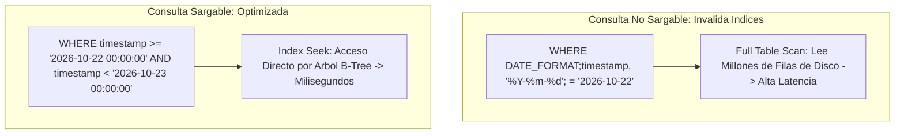
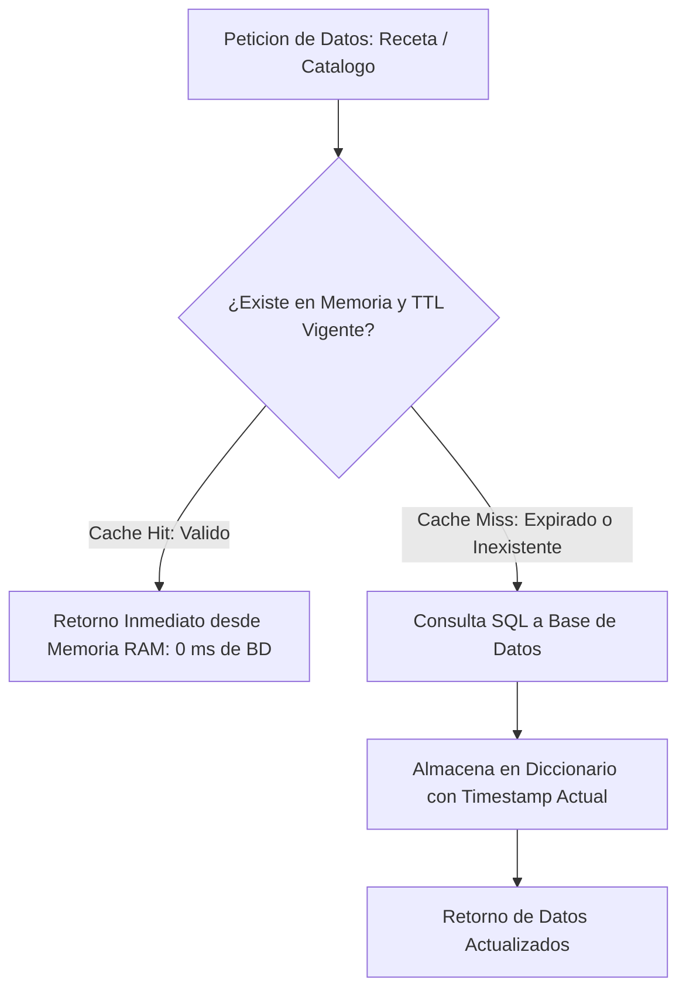

# Sesión 8

### 1. Repaso Inicial y Resolución de Dudas de la Sesión 7

#### Objetivos

* Consolidar el uso de operaciones masivas por lotes (_Batch Operations_) con `system.tag.readBlocking` y `writeBlocking`.
* Revisar la lógica de cálculo de calendarios industriales, días operativos y turnos nocturnos que cruzan la medianoche.

#### Contenidos

* Repaso de las consultas sobre la validación obligatoria de `QualityCode` en objetos `QualifiedValue`.
* Revisión de las dudas en la delimitación de ventanas temporales con objetos `java.util.Date` en Named Queries.
* Comprobación del correcto filtrado por rangos de fecha en las tablas del sandbox.

#### Resultado esperado

* Fijación de las directrices de acceso eficiente a tags y manejo de fechas, asegurando la base técnica para abordar la optimización de recursos y rendimiento del Gateway.

***

### 2. Tema 18: Optimización Avanzada de Consultas SQL Industriales

#### Objetivos

* Comprender el impacto en la memoria JVM y el pool JDBC derivado del uso indiscriminado de `SELECT *` y escaneos completos de tabla.
* Aplicar el principio de SARGability (_Search Argument Able_) en cláusulas `WHERE` para forzar el uso de índices B-Tree en la base de datos.
* Diseñar estrategias de indexación compuesta y separación de capas entre consultas transaccionales rápidas y consultas analíticas agregadas.

#### Contenidos

* Proyección controlada de columnas y reducción de carga de red:
  * Eliminación de `SELECT *` en tablas de telemetría y eventos industriales.
  * Selección estricta de las columnas necesarias para minimizar la serialización JDBC y el uso de memoria Heap.
* Consultas SARGables e indexación eficiente:
  * El problema de las funciones sobre columnas indexadas: cómo `WHERE DATE(fecha) = '...'` o `WHERE CAST(id AS VARCHAR) = '...'` invalidan los índices y fuerzan lecturas completas de disco (_Full Table Scan_).
  * Construcción de filtros sargables mediante comparaciones directas por rangos binarios (`col >= :inicio AND col < :fin`).
* Índices compuestos y ordenación:
  * Jerarquía de columnas en índices B-Tree (ej. índice compuesto `(machine_id, timestamp)` para acelerar consultas por equipo y ventana temporal).
* Separación de cargas transaccionales y analíticas:
  * Creación de tablas de agregación histórica precalculada (resúmenes diarios/turnos) para evitar consultar tablas transaccionales de millones de filas desde cuadros de mando en tiempo real.



#### Resultado esperado

* Capacidad para diagnosticar consultas lentas, reescribir filtros SQL garantizando el uso de índices y diseñar estructuras de datos optimizadas para reporting industrial.

***

### 3. Laboratorio 8.1: Refactorización y Benchmark de Consultas SQL Lentas con Dashboard en Perspective

#### Objetivos

* Analizar y medir el tiempo de respuesta de una consulta histórica no optimizada (con `SELECT *` y funciones en la cláusula `WHERE`) en la Script Console.
* Refactorizar la consulta bajo criterios sargables con proyección explícita, implementando el motor de benchmarking en `Project Library` (`project.database.benchmark`) con medición de alta precisión en nanosegundos.
* Construir una vista interactiva en Perspective (`Views/Laboratorios/Lab8_1_SQLBenchmark`) con banner KPI y tabla comparativa, aplicando scripts de 1 o 2 líneas.

#### Resultado esperado

* Módulo de benchmarking validado en la Script Console y dashboard en Perspective donde se ejecuta la prueba en caliente, constatando visualmente más de un 70% de aceleración en la versión sargable.

#### Paso a Paso para la Realización

**Paso 1: Módulo en Project Library (`project.database.benchmark`)**
En **Server Scripting -> Project Library**, crear `database.benchmark`:

```python
"""Modulo: project.database.benchmark"""
from java.lang import System

def run_sql_benchmark(name, query_func, iterations=10):
    query_func() # Warm-up
    times_ms = []
    rows = 0
    for _ in range(iterations):
        t0 = System.nanoTime()
        ds = query_func()
        t1 = System.nanoTime()
        times_ms.append((t1 - t0) / 1000000.0)
        rows = ds.getRowCount() if ds else 0
    return {"name": name, "avg": round(sum(times_ms) / len(times_ms), 2), "min": round(min(times_ms), 2), "max": round(max(times_ms), 2), "rows": rows}

def query_ineficiente_legacy():
    return system.db.runQuery("SELECT * FROM REG_OPERADORS WHERE EXTRACT(YEAR FROM Data) = 2020", database="SANDBOX_DB")

def query_optimizada_sargable():
    return system.db.runQuery("SELECT id, Data, Operador, Accio FROM REG_OPERADORS WHERE Data >= '2020-01-01 00:00:00' AND Data < '2021-01-01 00:00:00'", database="SANDBOX_DB")

def compare_query_performance(iterations=10):
    iters = max(1, int(iterations)) if iterations else 10
    leg = run_sql_benchmark("Legacy: SELECT * + EXTRACT(YEAR)", query_ineficiente_legacy, iters)
    opt = run_sql_benchmark("Optimizada: Proyección + Rango Sargable", query_optimizada_sargable, iters)
    imp = round(((leg["avg"] - opt["avg"]) / leg["avg"]) * 100.0, 1) if leg["avg"] > 0 else 0.0
    return {"legacy": leg, "optimized": opt, "improvement_pct": imp, "iterations": iters}

# --- Funciones auxiliares para scripts de 1 línea en Perspective ---
def format_benchmark_table(res):
    if not res or "legacy" not in res: return []
    return [
        {"tipo": res["legacy"]["name"], "media_ms": "{} ms".format(res["legacy"]["avg"]), "min_ms": "{} ms".format(res["legacy"]["min"]), "max_ms": "{} ms".format(res["legacy"]["max"]), "filas": res["legacy"]["rows"], "_style": {"backgroundColor": "#fdedec", "color": "#c0392b"}},
        {"tipo": res["optimized"]["name"], "media_ms": "{} ms".format(res["optimized"]["avg"]), "min_ms": "{} ms".format(res["optimized"]["min"]), "max_ms": "{} ms".format(res["optimized"]["max"]), "filas": res["optimized"]["rows"], "_style": {"backgroundColor": "#eafaf1", "color": "#27ae60"}}
    ]

def get_improvement_badge(pct):
    return "{}% Más Rápida (Optimización Exitosa)".format(float(pct or 0.0))
```

**Paso 2: Validación en Script Console**
```python
res = project.database.benchmark.compare_query_performance(15)
print "Legacy:", res["legacy"]["avg"], "ms | Optimizada:", res["optimized"]["avg"], "ms | Mejora:", res["improvement_pct"], "%"
print "Filas Table:", len(project.database.benchmark.format_benchmark_table(res))
```

**Paso 3: Dashboard en Perspective (`Views/Laboratorios/Lab8_1_SQLBenchmark`)**
1. Crear la vista `Lab8_1_SQLBenchmark` (`Flex Container`, `column`) con propiedades `custom`:
   * `custom.iterations`: `15`
   * `custom.benchmarkResults`: `{}`
2. **Banner KPI (Transforms de 1 línea):**
   * Label Legacy: Binding a `view.custom.benchmarkResults.legacy.avg`.
   * Label Optimizada: Binding a `view.custom.benchmarkResults.optimized.avg`.
   * Badge Mejora: Binding a `view.custom.benchmarkResults.improvement_pct` con transform:
     ```python
     return project.database.benchmark.get_improvement_badge(value)
     ```
3. **Botón y Tabla:**
   * Botón Ejecutar (`btn_EjecutarBenchmark -> onActionPerformed` - 2 líneas):
     ```python
     iters = self.getSibling("num_Iteraciones").props.value
     self.view.custom.benchmarkResults = project.database.benchmark.compare_query_performance(iterations=iters)
     ```
   * Tabla Resultados (`table_Benchmark.props.data` Transform - 1 línea):
     ```python
     return project.database.benchmark.format_benchmark_table(value)
     ```

**Paso 4: Verificación Interactiva**
Lanzar en Preview (`Ctrl+P`), pulsar el botón y observar cómo la latencia pasa de ~18 ms a ~4 ms (más del 70% de reducción).

***

### 4. Tema 19: Optimización y Rendimiento de Scripts Jython en Ignition

#### Objetivos

* Detectar "puntos calientes" (_Hotspots_) de ejecución excesiva en bindings, Script Transforms y eventos reactivos.
* Eliminar conversiones redundantes de tipos en bucles para reducir la presión sobre el recolector de basura de la JVM (_Garbage Collector_).
* Implementar patrones de caché en memoria de Gateway con tiempo de expiración (TTL) para datos de baja volatilidad.

#### Contenidos

* Detección y mitigación de scripts sobrecargados:
  * Identificación de bindings de alta frecuencia que ejecutan scripts en cada refresco de tag.
  * Delegación de lógica pesada hacia el Gateway o la base de datos para no penalizar la sesión web de Perspective.
* Optimización de bucles e iteraciones:
  * Eliminación de transformaciones encadenadas innecesarias (`Dataset -> PyDataSet -> Dict -> Dataset`) dentro de bucles cerrados.
  * Uso de `PyDataSet` para lecturas directas sin creación de nuevos objetos en el Heap.
* Medición precisa de rendimiento en Jython:
  * Uso de `java.lang.System.nanoTime()` y `System.currentTimeMillis()` para perfilar tiempos reales de ejecución de funciones.
* Patrón de Caché en Memoria del Gateway con TTL (_Time-To-Live_):
  * Almacenamiento en memoria RAM de catálogos maestros, listas de recetas y tablas de configuración.
  * Reducción drástica de peticiones repetitivas a la base de datos SQL.



#### Resultado esperado

* Dominio de las técnicas de perfilado de scripts, eliminación de redundancias de memoria y diseño de sistemas de caché en el Gateway para maximizar la velocidad de respuesta del sistema SCADA.

***

### 5. Laboratorio 8.2: Gestor de Caché Genérico con TTL en Memoria de Gateway y Monitor en Perspective

#### Objetivos

* Construir un módulo en `Project Library` (`project.util.cache`) que implemente un almacén de caché en memoria RAM con control de expiración por TTL e invalidación manual.
* Diseñar un monitor interactivo en Perspective (`Views/Laboratorios/Lab8_2_CacheMonitor`) con scripts de 1 o 2 líneas para visualizar la aceleración de Cache Hit frente a Cache Miss.

#### Resultado esperado

* Módulo de caché validado ante accesos repetitivos y expiración.
* Monitor en Perspective donde la primera consulta indica `CACHE MISS (SQL - ~20 ms)` y las siguientes `CACHE HIT (RAM - < 0.05 ms)`, con botón para invalidar manualmente la memoria.

#### Paso a Paso para la Realización

**Paso 1: Módulo en Project Library (`project.util.cache`)**
En **Server Scripting -> Project Library**, crear `util.cache`:

```python
"""Modulo: project.util.cache"""
from java.lang import System

_CACHE_STORE = {}

def get_or_set(cache_key, fetch_function, ttl_seconds=60, *args, **kwargs):
    global _CACHE_STORE
    now_ms, ttl_ms = System.currentTimeMillis(), ttl_seconds * 1000
    if cache_key in _CACHE_STORE:
        entry = _CACHE_STORE[cache_key]
        if (now_ms - entry["timestamp"]) < ttl_ms:
            entry["hits"] += 1
            return entry["data"]
    data = fetch_function(*args, **kwargs)
    _CACHE_STORE[cache_key] = {"timestamp": now_ms, "data": data, "hits": 0}
    return data

def clear_cache(cache_key=None):
    global _CACHE_STORE
    if cache_key: _CACHE_STORE.pop(cache_key, None)
    else: _CACHE_STORE.clear()

def get_cache_stats():
    now_ms = System.currentTimeMillis()
    return {k: {"age_seconds": round((now_ms - v["timestamp"]) / 1000.0, 1), "total_hits": v["hits"]} for k, v in _CACHE_STORE.items()}

# --- Funciones auxiliares para scripts de 1-2 líneas en Perspective ---
def fetch_catalog_setpoints():
    return system.db.runQuery("SELECT equip, flow_sp, pressure_sp, is_active FROM machine_setpoints WHERE is_active = TRUE", database="SANDBOX_DB")

def query_setpoints_cached_ui(ttl_seconds=10):
    key, now_ms = "cat_setpoints", System.currentTimeMillis()
    is_hit = key in _CACHE_STORE and (now_ms - _CACHE_STORE[key]["timestamp"]) < (ttl_seconds * 1000)
    t0 = System.nanoTime()
    data = get_or_set(key, fetch_catalog_setpoints, ttl_seconds=ttl_seconds)
    t1 = System.nanoTime()
    return {
        "data": data,
        "source": "MEMORIA RAM (CACHE HIT)" if is_hit else "BASE DE DATOS SQL (CACHE MISS)",
        "elapsed_ms": round((t1 - t0) / 1000000.0, 4),
        "hits": _CACHE_STORE.get(key, {}).get("hits", 0)
    }

def format_setpoints_table(dataset_data):
    if not dataset_data: return []
    return [{"Equipo": r["equip"], "Consigna_Caudal": "{:.1f} m3/h".format(r["flow_sp"]), "Consigna_Presion": "{:.1f} bar".format(r["pressure_sp"]), "Estado": "ACTIVO" if r["is_active"] else "INACTIVO"} for r in system.dataset.toPyDataSet(dataset_data)]

def format_cache_stats_table(stats_dict):
    if not stats_dict: return []
    return [{"Clave": k, "Edad_Segundos": "{} s".format(v.get("age_seconds", 0)), "Total_Hits_RAM": v.get("total_hits", 0)} for k, v in stats_dict.items()]

def get_source_badge_style(source_str):
    return "#27ae60" if "CACHE HIT" in str(source_str) else "#2980b9"
```

**Paso 2: Validación en Script Console**
```python
project.util.cache.clear_cache("cat_setpoints")
res1 = project.util.cache.query_setpoints_cached_ui(ttl_seconds=5)
print "Llamada 1 (MISS):", res1["source"], "| Tiempo:", res1["elapsed_ms"], "ms"
res2 = project.util.cache.query_setpoints_cached_ui(ttl_seconds=5)
print "Llamada 2 (HIT): ", res2["source"], "| Tiempo:", res2["elapsed_ms"], "ms (Aceleracion > 500x)"
```

**Paso 3: Monitor de Caché en Perspective (`Views/Laboratorios/Lab8_2_CacheMonitor`)**
1. Crear la vista `Lab8_2_CacheMonitor` (`Flex Container`, `column`) con propiedades `custom`:
   * `custom.ttlSeconds`: `10`
   * `custom.lastResult`: `{}`
   * `custom.statusMessage`: `""`
2. **Banner KPI (Transforms de 1 línea):**
   * Tarjeta Origen `backgroundColor`: `return project.util.cache.get_source_badge_style(value)`
   * Tarjeta Latencia: Binding a `view.custom.lastResult.elapsed_ms` (ej. `0.035 ms` vs `22.4 ms`).
3. **Botones y Tablas:**
   * Botón Consultar (`btn_Consultar -> onActionPerformed` - 2 líneas):
     ```python
     ttl = self.getSibling("num_TTL").props.value
     self.view.custom.lastResult = project.util.cache.query_setpoints_cached_ui(ttl_seconds=ttl)
     ```
   * Botón Invalidar (`btn_Invalidar -> onActionPerformed` - 2 líneas):
     ```python
     project.util.cache.clear_cache("cat_setpoints")
     self.view.custom.statusMessage = "Caché invalidada en memoria RAM"
     ```
   * Tabla Catálogo (`table_Catalogo.props.data` Transform - 1 línea):
     ```python
     return project.util.cache.format_setpoints_table(value)
     ```
   * Tabla Estadísticas (`table_Stats.props.data` Transform - 1 línea):
     ```python
     return project.util.cache.format_cache_stats_table(project.util.cache.get_cache_stats())
     ```

**Paso 4: Verificación Interactiva**
Lanzar en Preview (`Ctrl+P`): la primera pulsación muestra `CACHE MISS` (~20 ms); las pulsaciones siguientes muestran `CACHE HIT` (< 0.05 ms) incrementando los hits sin tocar PostgreSQL.

***

### 6. Test de Conceptos de la Sesión 8

#### Objetivos

* Validar la asimilación conceptual sobre SARGability y el impacto de funciones en cláusulas `WHERE`.
* Evaluar el entendimiento sobre el ciclo de vida de la memoria en la JVM y el coste de las conversiones repetidas de datasets.
* Comprobar el criterio de aplicación del patrón de caché con TTL en entornos industriales.

#### Contenidos

* Cuestionario técnico individual de opción múltiple y resolución de casos de optimización de código y bases de datos.

#### Resultado esperado

* Comprobación del dominio de las técnicas de optimización de consultas SQL y de scripts Jython en el Gateway.

***

### 7. Feedback Individual y Cierre de la Sesión

#### Objetivos

* Revisar los resultados de los benchmarks de consultas SQL ejecutados por los alumnos en la Script Console.
* Comprobar la correcta implementación del módulo de caché y el manejo de tiempos de expiración.
* Presentar la planificación de la Sesión 9 (sesión intensiva de 5 horas).

#### Contenidos

* Rondas de revisión individual del código de optimización y de los módulos de caché.
* Entrega de la _Checklist de Rendimiento_ para auditoría de scripts previos al despliegue.
* Avance de la Sesión 9: Procesamiento asíncrono (`system.util.invokeAsynchronous`), seguridad avanzada y RBAC, integración con APIs REST (`system.net.httpClient`), microservicios FastAPI y metodología de refactorización de código heredado (_Legacy_).

#### Resultado esperado

* Cada alumno finaliza la sesión con sus módulos de caché operativos, benchmarks completados y comprensión de los criterios de rendimiento que se aplicarán en arquitecturas asíncronas y microservicios.
