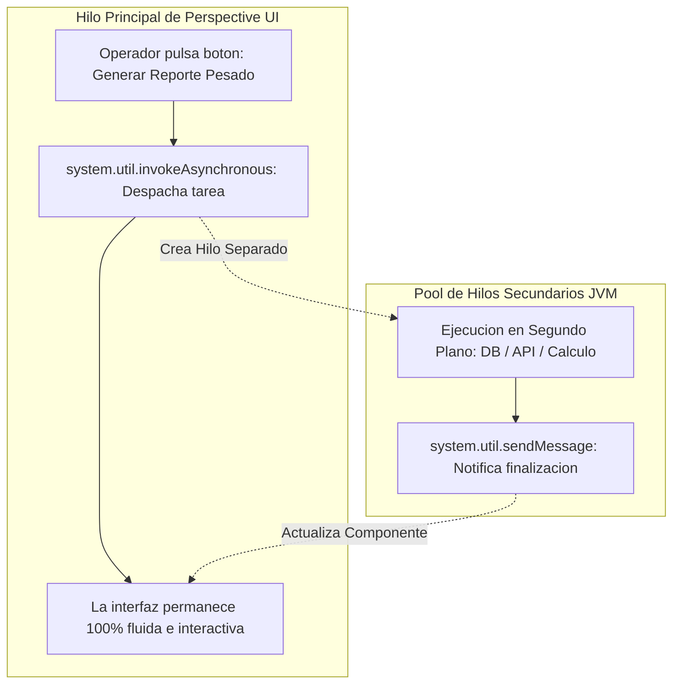
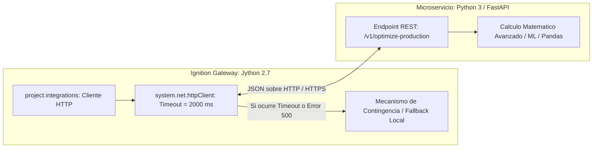

# Sesión 9

### 1. Repaso Inicial y Resolución de Dudas de la Sesión 8

#### Objetivos

* Consolidar los conceptos de optimización de consultas SQL sargables e indexación B-Tree en tablas de telemetría industrial.
* Revisar la implementación del gestor de caché en memoria de Gateway con control de tiempo de vida (TTL).

#### Contenidos

* Repaso de las consultas sobre la reescritura de filtros temporales sin aplicar funciones sobre columnas indexadas.
* Revisión de los resultados de benchmarking y reducción de tiempos de CPU en la JVM.
* Comprobación del uso de la _Checklist de Rendimiento_ en los módulos de `Project Library`.

#### Resultado esperado

* Fijación de las directrices de alto rendimiento en base de datos y memoria, base técnica requerida para abordar tareas asíncronas e integraciones con servicios externos.

***

### 2. Tema 20: Procesamiento Asíncrono, Tareas Programadas e Idempotencia

#### Objetivos

* Comprender la diferencia entre la ejecución síncrona en hilos de interfaz de usuario y la ejecución en segundo plano (_Background Threads_).
* Dominar el uso de `system.util.invokeAsynchronous` para evitar el congelamiento de pantallas (_UI Freezing_) durante operaciones de larga duración.
* Diseñar tareas automáticas programadas en el Gateway bajo el principio de **idempotencia** y control de fallos desatendidos.

#### Contenidos

**1. Desacoplamiento de Hilos y Prevención del Bloqueo de Interfaz (*UI Freezing*)**

* **La arquitectura de hilos en Perspective y Vision:**
  * En interfaces SCADA, los eventos de usuario (pulsación de botón, cambio de selector, edición en tabla) se procesan en hilos vinculados directamente a la sesión web del operador (*UI Event Dispatch Thread / Session Thread*).
  * *El peligro del bloqueo síncrono (*UI Freezing*):* Si un script invocado en `onActionPerformed` ejecuta una operación con latencia de red o cómputo (consulta SQL pesada de 4 segundos, llamada HTTP externa a un ERP, o cálculo analítico intensivo), el hilo de la interfaz queda secuestrado esperando la respuesta.
  * Para el operador, la pantalla deja de responder, los botones no reaccionan y el navegador web muestra indicadores de congelamiento (*spinning loader* o advertencia de "Página no responde"), lo cual es inadmisible en supervisión crítica de planta.
* **Despacho asíncrono con `system.util.invokeAsynchronous`:**
  * Delegación a segundo plano: `system.util.invokeAsynchronous(worker_function, [args], [kwargs])`.
  * La JVM extrae un hilo del pool de ejecución en segundo plano (*Background Worker Thread Pool*) del Gateway, liberando inmediatamente el hilo de la interfaz en < 1 milisegundo. La vista permanece 100% fluida e interactiva.
* **Patrón de notificación y retorno hacia la interfaz:**
  * *La trampa del acceso cruzado entre hilos:* Un hilo en segundo plano **jamás debe acceder ni modificar directamente componentes de la vista** (ej. `self.getSibling("label").props.text = "OK"` fallará o generará condiciones de carrera).
  * *El estándar desacoplado:* El hilo secundario ejecuta la tarea pesada y, al finalizar, emite un mensaje en el bus de eventos mediante `system.util.sendMessage` o `system.perspective.sendMessage(messageHandler, payload, scope="page")`.
  * El componente visual receptor (`Message Handler`) captura el evento en el hilo seguro de la UI y actualiza su estado o ejecuta `self.refreshBinding()`.

**2. Automatizaciones Desatendidas en Gateway y Planificación Temporal Robusta**

* **El motor Quartz Scheduler en el Gateway de Ignition:**
  * Procesos en segundo plano 24/7 sin interacción humana: Gateway Scheduled Scripts y Gateway Timer Scripts.
  * *Timer Scripts (Intervalos Fijos):* Ejecución cíclica (ej. cada 5.000 ms). Selección crítica entre hilos compartidos (*Shared Pool* para tareas ultraligeras de < 10 ms) e hilos dedicados (*Dedicated Thread* para tareas con riesgo de demora por I/O).
  * *Scheduled Scripts (Expresiones CRON):* Planificación determinista en instantes exactos de calendario industrial (ej. fin de turno a las 06:00, 14:00 y 22:00 con `0 0 6,14,22 * * ?` o balances mensuales de OEE).
* **Supervisión, trazabilidad y contención de fallos desatendidos:**
  * Al no haber un operador frente a la pantalla, los errores en scripts de Gateway pueden pasar desapercibidos durante días si no se gestionan adecuadamente.
  * *Logging estructurado obligatorio:* Uso de `system.util.getLogger("SCADA.Gateway.Scheduler")` con registro explícito de marca de inicio, tiempo total transcurrido en milisegundos (`System.currentTimeMillis()`) y recuento de registros procesados.
  * *Aislamiento contra excepciones:* Los scripts programados deben envolverse en bloques `try / except Exception as ex:` para evitar que una excepción no controlada aborte el planificador o deje recursos abiertos en memoria.

**3. El Principio de Idempotencia en Procesos de Planta**

* **Definición y relevancia industrial:**
  * Una operación es **idempotente** si su ejecución repetida $f(f(x)) = f(x)$ produce exactamente el mismo resultado en el sistema que una única ejecución, sin efectos secundarios acumulativos indeseados.
  * *Escenarios de riesgo en planta:* Reintentos automáticos tras microcortes de red, dobles clics accidentales de operarios en botones de mando o re-ejecución manual de una tarea de cierre de turno fallida.
  * *Consecuencias del código no idempotente:* Descuento duplicado de inventario de reactivos, duplicación de órdenes de producción en la base de datos o envío múltiple de consignas a un PLC.
* **Patrones técnicos para garantizar la idempotencia:**
  * *1. Identificadores únicos de transacción (*Idempotency Keys* / Business Keys):* Empleo de claves unívocas basadas en el contexto del negocio (ej. código de lote `LOT-2026-EDAR-01-SH1`), evitando identificadores autoincrementales opacos que permitan duplicados.
  * *2. Sentencias SQL `UPSERT` / `MERGE` o `INSERT ... ON CONFLICT`:*
    - En PostgreSQL: `INSERT INTO shift_production (shift_id, units) VALUES (?, ?) ON CONFLICT (shift_id) DO UPDATE SET units = EXCLUDED.units;`.
    - Garantiza que re-ejecutar el script actualice el registro existente sin lanzar excepciones de clave primaria duplicada ni crear registros parásitos.
  * *3. Comprobación de estado previo (*Guard Clauses*):* Verificar el estado de la máquina o del lote antes de actuar:
    ```python
    if batch_status == "CLOSED":
        logger.warn("El lote ya fue cerrado previamente; operación omitida.")
        return (True, "Lote ya cerrado (idempotente)")
    ```




#### Resultado esperado

* Capacidad para ejecutar procesos pesados en segundo plano sin congelar la pantalla del operador y diseñar tareas programadas de Gateway que se ejecuten de forma segura e idempotente.

***

### 3. Tema 21: Seguridad en Scripting, Validación RBAC en Servidor y Protección de Secretos

#### Objetivos

* Comprender el principio de defensa en profundidad aplicado al scripting SCADA, distinguiendo la seguridad en interfaz de la seguridad en servidor.
* Implementar control de acceso basado en roles (_Role-Based Access Control - RBAC_) directamente en la capa de lógica de negocio en Gateway.
* Aplicar directrices para la protección de credenciales y la sanitización de trazas de error hacia el usuario final.

#### Contenidos

**1. Defensa en Profundidad: Seguridad en Servidor (Backend) vs. Seguridad en Interfaz (Frontend)**

* **La trampa de la falsa seguridad en la interfaz gráfica (*Client-Side Security Illusion*):**
  * En aplicaciones SCADA modernas (especialmente en arquitecturas web como Perspective), es habitual deshabilitar u ocultar controles visuales mediante bindings a permisos del usuario (`props.enabled = hasRole`).
  * *La vulnerabilidad crítica:* Ocultar un botón (`props.visible = False`) o deshabilitarlo (`props.enabled = False`) es una directiva meramente cosmética para el navegador del cliente. Un usuario malintencionado o un operador puede inspeccionar el DOM, reactivar el botón mediante herramientas de desarrollo o emitir el evento WebSocket directamente al Gateway.
  * Si el script asociado al botón asume que quien disparó el evento ya está autorizado y no valida los permisos en el servidor, la planta queda completamente expuesta a maniobras no autorizadas.
* **Validación imperativa en el servidor (Gateway RBAC Validation):**
  * Toda función que ejecute una maniobra crítica (arranque/paro de bombas, modificación de consignas, confirmación de alarmas, volcado de recetas) debe implementar una aduana de seguridad en el código de backend en `Project Library`.
  * Inspección de la identidad y roles en la sesión activa: `session.props.auth.user.roles`.
  * Verificación formal contra el conjunto de roles requeridos (`roles_usuario ∩ roles_requeridos ≠ ∅`) antes de emitir cualquier instrucción a PLC o base de datos. Si la intersección es vacía, la ejecución se aborta de inmediato con rechazo formal.

**2. Prevención de Fuga de Credenciales y Gestión Segura de Secretos**

* **El grave peligro de credenciales hardcodeadas (*Hardcoded Secrets*):**
  * Práctica nefasta en proyectos SCADA antiguos: almacenar contraseñas de bases de datos, tokens de APIs externas (ERP, MES), claves privadas o certificados directamente en el código fuente de los scripts:
    ```python
    # VULNERABILIDAD GRAVE: Secreto expuesto en texto plano
    api_token = "eyJhbGciOiJIUzI1NiIsInR5cCI6IkpXVCJ9..."
    db_pass = "Admin_Scada_2026!"
    ```
  * *Riesgos:* El código fuente de `Project Library` se exporta en backups del proyecto (`.zip`, `.gwbk`), se sube a repositorios de control de versiones Git o queda accesible para cualquier integrador con acceso al Designer.
* **Estándar de gestión segura de secretos:**
  * *Conexiones administradas de Gateway:* El acceso a bases de datos relacionales debe realizarse siempre a través de las conexiones JDBC gestionadas en el Gateway (`database="SANDBOX_DB"`), donde las credenciales residen cifradas en la base de datos interna de Ignition.
  * *Variables de entorno del sistema operativo:* Para tokens de API o secretos de servicios externos, extraer los valores del entorno de ejecución del Gateway mediante `os.environ.get("SCADA_API_KEY")`.
  * *Almacenes de secretos (*Secret Managers*) y perfiles de seguridad:* Integración con servicios de gestión de claves o archivos de configuración protegidos fuera del árbol de directorios del proyecto SCADA con permisos estrictos a nivel de sistema operativo (`chmod 600`).

**3. Auditoría de Seguridad y Sanitización de Mensajes de Error**

* **Registro forense obligatorio de intentos no autorizados:**
  * Todo intento de ejecución que sea rechazado por falta de privilegios debe ser registrado con nivel `WARN` en el logger de seguridad del Gateway (`system.util.getLogger("SCADA.Security.RBAC")`).
  * Inserción obligatoria de una traza de auditoría en la base de datos relacional (`ins_Registre_Actuacions` o `security_audit_log`): registrando usuario autenticado, roles simulados, equipo objetivo, maniobra solicitada y marca temporal del servidor.
* **Sanitización de excepciones hacia el usuario (*Information Disclosure Prevention*):**
  * *Principio de divulgación mínima:* El operador o cliente web jamás debe ver la traza técnica completa de una excepción (*Stack Trace*), nombres de tablas internas, esquemas relacionales, IPs de servidores ni consultas SQL fallidas.
  * *Patrón de respuesta sanitizada:*
    ```python
    try:
        # Ejecución protegida
        ...
    except Exception as ex:
        # 1. Traza técnica completa en log interno del servidor
        logger.error("Error crítico en maniobra de {}: {}".format(equip, str(ex)))
        # 2. Mensaje funcional y seguro hacia el operador
        return (False, u"Error interno en la maniobra. Contacte con mantenimiento con código ERR-502.")
    ```


#### Resultado esperado

* Dominio del diseño de funciones protegidas mediante validación de roles en servidor y eliminación de credenciales expuestas en el código fuente.

***

### 4. Tema 22: Integración con APIs REST Externas y Microservicios

#### Objetivos

* Dominar la comunicación HTTP/REST desde Ignition utilizando la utilidad nativa `system.net.httpClient`.
* Comprender la arquitectura híbrida SCADA + Microservicios para desacoplar cálculos analíticos complejos (Python 3 / FastAPI) de la JVM de Ignition.
* Diseñar clientes REST industriales resilientes con timeouts estrictos, gestión de cabeceras de autenticación y mecanismos de respuesta de contingencia (_Fallback_).

#### Contenidos

**1. El Cliente HTTP Moderno de Ignition: `system.net.httpClient`**

* **Evolución y superación de funciones heredadas:**
  * En versiones antiguas de Ignition se utilizaba `system.net.httpGet` y `httpPost`. Estas funciones históricas son rígidas, carecen de soporte nativo para métodos HTTP modernos (PUT, DELETE, PATCH), no manejan conexiones persistentes y su control de timeouts y cabeceras es muy limitado.
  * El estándar moderno es `client = system.net.httpClient(timeout=2000)`:
    * Basado en el cliente HTTP asíncrono de Java, soporta HTTP/1.1 y HTTP/2, gestión automática de cookies y autenticación básica o Bearer tokens.
    * Decodificación automática de JSON: la propiedad `response.json` parsea directamente la respuesta a estructuras de datos nativas de Python (diccionarios y listas) sin necesidad de importar librerías externas.
* **Control estricto de tiempos de espera (*Timeouts*):**
  * En una arquitectura industrial, una llamada HTTP a un servicio externo (ERP SAP, sistema MES corporativo, API de precios de energía o meteorología) está sujeta a caídas de red, problemas de DNS o sobrecarga en servidores remotos.
  * **La regla de oro:** El timeout de `system.net.httpClient` debe acotarse estrictamente (ej. `timeout=2000` o `3000` ms). Un timeout por defecto o ilimitado causará que el hilo de ejecución quede retenido indefinidamente, colapsando el Gateway.

**2. Arquitectura Híbrida: Desacoplamiento con Microservicios en Python 3 (FastAPI)**

* **Las limitaciones intrínsecas de Jython 2.7:**
  * Jython 2.7 está anclado en la sintaxis de Python 2 y no soporta extensiones compiladas en C (C-Extensions).
  * Imposibilidad técnica de utilizar las librerías modernas del ecosistema de ciencia de datos e inteligencia artificial: **NumPy, Pandas, Scikit-Learn, PyTorch, TensorFlow, OpenCV**.
* **El patrón arquitectónico híbrido SCADA + Microservicios:**
  * En lugar de forzar cálculos matemáticos pesados en scripts de Gateway o intentar portar librerías incompatibles, se implementa una arquitectura desacoplada:
    1. **Ignition SCADA (Planta):** Se encarga de lo que mejor hace: adquisición de tags en tiempo real, alarmas, control HMI/Perspective y persistencia transaccional.
    2. **Microservicio Externo (Python 3 / FastAPI):** Corre de forma independiente (ej. en un contenedor Docker en el servidor o en la nube), exponiendo endpoints REST optimizados (`/v1/optimize-production`, `/v1/predict-maintenance`).
    3. **Canal de Intercambio:** Ignition emite telemetría mediante `system.net.httpClient.post()` en formato JSON y recibe consignas optimizadas en pocos milisegundos.
  * Beneficios: Aislamiento total de recursos (un cálculo intensivo en Python 3 no consume memoria de la JVM de Ignition) y capacidad de escalar horizontalmente.

**3. Resiliencia, Códigos de Estado HTTP y Mecanismos de Fallback**

* **Inspección semántica de códigos de respuesta HTTP:**
  * Una petición HTTP puede conectarse con éxito pero devolver un código de error de aplicación:
    * `2xx (200 OK, 201 Created)`: Respuesta exitosa; procesar datos.
    * `4xx (400 Bad Request, 401 Unauthorized, 403 Forbidden, 404 Not Found)`: Errores del cliente o credenciales caducadas.
    * `5xx (500 Internal Server Error, 503 Service Unavailable)`: Fallo en el servidor externo.
  * Es imperativo validar `response.statusCode == 200` antes de intentar acceder a los campos del payload JSON.
* **El patrón de contingencia segura (*Fallback Pattern*):**
  * Principio de continuidad operativa: **Una planta de producción jamás debe detenerse porque un servicio web externo deje de responder**.
  * Si la API REST externa falla, se agota el timeout o devuelve un error 5xx, el script debe capturar la anomalía y activar un *Fallback* predeterminado:
    * Retorno de una tarifa eléctrica media de referencia o consignas operativas conservadoras previamente configuradas en el SCADA.
    * Marcado explícito de la bandera `is_fallback: True` para que la pantalla de supervisión alerte visualmente al operador de que los datos proceden del modo de contingencia.




#### Resultado esperado

* Capacidad para integrar Ignition con servicios web y APIs REST empresariales de forma robusta, aplicando timeouts defensivos y arquitecturas híbridas con microservicios externos.

***

### 5. Laboratorio 9.1: Cliente REST Asíncrono con Timeout, Fallback Resiliente y Monitor en Perspective

#### Objetivos

* Construir un módulo en `Project Library` (`project.integrations.energy`) que consuma una API REST externa de tarificación eléctrica mediante `system.net.httpClient`.
* Parametrizar cabeceras seguras, timeouts estrictos (2.000 ms) y un mecanismo de respuesta de fallback que devuelva una tarifa predeterminada si la API externa no responde o arroja errores de conexión.
* Diseñar una vista operativa en Perspective (`Views/Laboratorios/Lab9_1_EnergyPricing`) con scripts ultra-ligeros de 1-2 líneas.

#### Resultado esperado

* Servicio probado en la Script Console ante respuestas nominales simuladas y ante escenarios de caída de red / timeout.
* Vista funcional en Perspective que visualiza el precio en EUR/MWh y distingue de forma inmediata si procede de la API en vivo o del fallback de contingencia sin congelar la interfaz.

#### Paso a Paso para la Realización

**Paso 1: Módulo en Project Library (`project.integrations.energy`)**
Crear el script `integrations.energy` con cliente HTTP, timeout estricto y funciones para UI:
```python
def get_current_energy_price(area_code="ES_PENINSULA", force_failure=False):
    logger = system.util.getLogger("SCADA.Integrations.Energy")
    FALLBACK_TARIFF = {
        "price_eur_mwh": 85.50,
        "is_fallback": True,
        "source": "DEFAULT_CONFIG_FALLBACK",
        "timestamp": system.date.format(system.date.now(), "dd/MM/yyyy HH:mm:ss")
    }
    client = system.net.httpClient(timeout=2000)
    headers = {"Accept": "application/json", "User-Agent": "Ignition-SCADA-Gateway/8.1", "X-Plant-ID": "EDAR_CENTRAL_01"}
    target_url = "https://api.energypricing.internal/v1/tariffs/current" if not force_failure else "https://10.255.255.1/timeout_test"
    try:
        response = client.get(target_url, params={"area": area_code}, headers=headers)
        if response.statusCode == 200:
            price_val = float(response.json.get("price", 85.50))
            return {"price_eur_mwh": round(price_val, 2), "is_fallback": False, "source": "LIVE_REST_API", "timestamp": system.date.format(system.date.now(), "dd/MM/yyyy HH:mm:ss")}
        logger.warn("API de energía devolvió HTTP {}. Aplicando fallback.".format(response.statusCode))
        return FALLBACK_TARIFF
    except Exception as ex:
        logger.error("Error de conexión API energía: {}. Aplicando fallback.".format(str(ex)))
        return FALLBACK_TARIFF

def fetch_energy_price_for_ui(area_code="ES_PENINSULA", force_failure=False):
    return get_current_energy_price(area_code=area_code, force_failure=force_failure)

def get_energy_status_badge(is_fallback):
    if is_fallback:
        return {"text": "TARIFA DE CONTINGENCIA (FALLBACK ACTIVO)", "backgroundColor": "#e67e22", "color": "#ffffff"}
    return {"text": "API REST EN VIVO (CONEXIÓN NOMINAL)", "backgroundColor": "#27ae60", "color": "#ffffff"}
```

**Paso 2: Validación en Script Console**
```python
res_fail = project.integrations.energy.fetch_energy_price_for_ui("ES_PENINSULA", force_failure=True)
print "Precio:", res_fail["price_eur_mwh"], "EUR/MWh | Fallback:", res_fail["is_fallback"]
badge = project.integrations.energy.get_energy_status_badge(res_fail["is_fallback"])
print "Badge UI:", badge["text"], "(Color:", badge["backgroundColor"], ")"
```

**Paso 3: Monitor en Perspective (`Views/Laboratorios/Lab9_1_EnergyPricing`)**
1. Crear la vista `Lab9_1_EnergyPricing` (`Flex Container`, `column`) con propiedad `custom`:
   * `custom.energyData`: `{}`
2. **Controles de Consulta:**
   * Dropdown (`drop_Zona`): Opciones `ES_PENINSULA`, `ES_BALEARES`, `ES_CANARIAS`.
   * Toggle Switch (`toggle_Timeout`): `props.label.text = "Simular Caída de Red / Timeout (2s)"`.
   * Botón Consultar (`btn_ConsultarTarifa -> onActionPerformed` - 2 líneas):
     ```python
     res = project.integrations.energy.fetch_energy_price_for_ui(self.getSibling("drop_Zona").props.value, self.getSibling("toggle_Timeout").props.selected)
     self.view.custom.energyData = res
     ```
3. **Tarjetas de Visualización:**
   * Precio (`kpi_Precio`): Binding a `view.custom.energyData.price_eur_mwh` con sufijo `" EUR / MWh"`.
   * Badge Estado (`kpi_Badge`): Binding a `view.custom.energyData.is_fallback`.
     * Transform en `props.text` (1 línea):
       ```python
       return project.integrations.energy.get_energy_status_badge(value)["text"]
       ```
     * Transform en `props.style.backgroundColor` (1 línea):
       ```python
       return project.integrations.energy.get_energy_status_badge(value)["backgroundColor"]
       ```
     * `props.style.color`: `"#ffffff"`.

**Paso 4: Verificación Interactiva**
Lanzar en Preview (`Ctrl+P`). Activar el conmutador de simulación y pulsar el botón: tras 2 segundos de timeout estricto, la pantalla se desbloquea mostrando el precio de contingencia (85.50 EUR/MWh) y el badge en naranja sin haber bloqueado el hilo de ejecución web.

***

### 6. Laboratorio 9.2: Control de Acceso Basado en Roles (RBAC), Auditoría en Servidor y Panel en Perspective

#### Objetivos

* Crear un servicio centralizado en `Project Library` (`project.security.core`) que valide si los roles del usuario autenticado cumplen los privilegios necesarios antes de ejecutar cualquier acción operativa o cambio de consigna.
* Registrar en el log del Gateway y persistir en base de datos (`ins_Registre_Actuacions`) cualquier intento no autorizado y las operaciones exitosas.
* Construir un panel interactivo en Perspective (`Views/Laboratorios/Lab9_2_RBACMonitor`) con scripts de 1-2 líneas que evidencie la autorización para supervisores y la denegación para operadores.

#### Resultado esperado

* Función modular verificada en consola simulando llamadas con usuarios operadores (rol básico, denegado con advertencia de seguridad) y supervisores (rol autorizado, ejecución completada y auditada).
* Vista funcional en Perspective con feedback cromático inmediato (rojo para denegado, verde para autorizado) y refresco automático de la tabla de auditoría.

#### Paso a Paso para la Realización

**Paso 1: Módulo en Project Library (`project.security.core`)**
Crear el script `security.core` con validación de roles en servidor, auditoría y soporte UI:
```python
def execute_authorized_action(user_roles, required_roles, action_name, equip, username, action_func, *args, **kwargs):
    logger = system.util.getLogger("SCADA.Security.RBAC")
    user_str = str(username) if username else "ANONYMOUS"
    roles_user_set = set(user_roles) if user_roles else set()
    roles_req_set = set(required_roles) if required_roles else set()
    
    authorized = len(roles_user_set.intersection(roles_req_set)) > 0
    if not authorized:
        logger.warn("INTENTO NO AUTORIZADO: Usuario '{}' (Roles: {}) intentó ejecutar [{}] en '{}'".format(user_str, list(roles_user_set), action_name, equip))
        try:
            sql = "INSERT INTO ins_Registre_Actuacions (Equip, Descripcio, Usuari) VALUES (?, ?, ?)"
            system.db.runPrepUpdate(sql, [str(equip), u"SEGURIDAD: Intento no autorizado de ejecutar [{}]".format(unicode(action_name)), user_str], database="SANDBOX_DB")
        except Exception as db_ex:
            logger.error("Error al registrar auditoría de seguridad: {}".format(str(db_ex)))
        return (False, u"Acceso Denegado: El usuario no dispone de los roles requeridos ({})".format(", ".join(required_roles)))
        
    try:
        result = action_func(*args, **kwargs)
        sql = "INSERT INTO ins_Registre_Actuacions (Equip, Descripcio, Usuari) VALUES (?, ?, ?)"
        system.db.runPrepUpdate(sql, [str(equip), u"OPERACION: Maniobra autorizada [{}] ejecutada con exito".format(unicode(action_name)), user_str], database="SANDBOX_DB")
        return (True, result)
    except Exception as ex:
        logger.error("Error ejecutando acción autorizada [{}]: {}".format(action_name, str(ex)))
        return (False, u"Error interno durante la ejecución de la maniobra")

def _maniobra_ajuste_velocidad(equip, new_speed):
    return u"Velocidad de {} ajustada a {} m3/h con éxito".format(equip, new_speed)

def execute_critical_setpoint_ui(user_roles, username, equip, new_speed):
    ok, msg = execute_authorized_action(user_roles, ["Supervisor", "Administrator"], "AjusteCaudalCritico", equip, username, _maniobra_ajuste_velocidad, equip, new_speed)
    return {"success": ok, "message": msg, "color": "#27ae60" if ok else "#c0392b"}

def get_security_audit_table(equip="EDAR_BOMBA_01", db_conn="SANDBOX_DB"):
    sql = "SELECT id, Equip, Descripcio, Usuari, DataHora FROM ins_Registre_Actuacions WHERE Equip = ? ORDER BY DataHora DESC LIMIT 10"
    pyds = system.dataset.toPyDataSet(system.db.runPrepQuery(sql, [equip], database=db_conn))
    rows = []
    for r in pyds:
        desc = r["Descripcio"] or ""
        is_sec = "SEGURIDAD" in desc
        rows.append({
            "id": r["id"], "Equipo": r["Equip"], "Descripcion": desc, "Usuario": r["Usuari"],
            "Fecha": system.date.format(r["DataHora"], "dd/MM/yyyy HH:mm:ss") if r["DataHora"] else "---",
            "_style": {"backgroundColor": "#fdedec" if is_sec else "#ffffff", "color": "#c0392b" if is_sec else "#2c3e50", "fontWeight": "bold" if is_sec else "normal"}
        })
    return rows
```

**Paso 2: Validación en Script Console**
```python
res1 = project.security.core.execute_critical_setpoint_ui(["Operator"], "operador_noche", "EDAR_BOMBA_01", 80.0)
print "Operador Basico:", res1["success"], "| Mensaje:", res1["message"]
res2 = project.security.core.execute_critical_setpoint_ui(["Operator", "Supervisor"], "laura.vidal", "EDAR_BOMBA_01", 80.0)
print "Supervisor:     ", res2["success"], "| Mensaje:", res2["message"]
```

**Paso 3: Panel en Perspective (`Views/Laboratorios/Lab9_2_RBACMonitor`)**
1. Crear la vista `Lab9_2_RBACMonitor` (`Flex Container`, `column`) con propiedades `custom`:
   * `custom.simulatedRoles`: `["Operator"]`
   * `custom.securityFeedback`: `{}`
2. **Controles y Botón de Maniobra:**
   * Dropdown (`drop_Roles`): Opciones `Operator` y `Supervisor`.
   * Campo numérico (`num_Velocidad`): Valor inicial `85.0`.
   * Botón Ejecutar (`btn_EjecutarManiobra -> onActionPerformed` - 2 líneas):
     ```python
     roles = [self.getSibling("drop_Roles").props.value]
     self.view.custom.securityFeedback = project.security.core.execute_critical_setpoint_ui(roles, self.session.props.auth.user.userName, "EDAR_BOMBA_01", self.getSibling("num_Velocidad").props.value)
     ```
3. **Feedback y Tabla de Auditoría:**
   * Label Feedback (`lbl_Feedback`): Binding a `view.custom.securityFeedback.message` y color a `view.custom.securityFeedback.color`.
   * Tabla Auditoría (`table_Auditoria.props.data` Transform - 1 línea):
     ```python
     return project.security.core.get_security_audit_table("EDAR_BOMBA_01")
     ```

**Paso 4: Verificación Interactiva**
Lanzar en Preview (`Ctrl+P`). Al probar con perfil `Operador Básico`, el sistema rechaza la orden con feedback en rojo y registra el intento no autorizado en la tabla. Al cambiar a `Supervisor de Planta`, la orden se aprueba en verde y queda auditada.

***

### 7. Tema 23: Metodología de Refactorización de Scripts Heredados (Legacy)

#### Objetivos

* Identificar síntomas de código degradado (_Code Smells_) habituales en proyectos SCADA antiguos.
* Aplicar una metodología secuencial de refactorización para transformar scripts monolíticos e inseguros en código modular y mantenible.
* Diseñar pruebas de no-regresión para garantizar que los cambios estructurales conservan exactamente el comportamiento funcional requerido por la planta.

#### Contenidos

**1. Diagnóstico de Síntomas de Código Degradado (*Code Smells*) en Sistemas SCADA**

* **La deuda técnica acumulada en proyectos SCADA:**
  * Proyectos con 5 a 15 años de vida donde decenas de ingenieros e integradores han añadido parches de código sobre la marcha sin estándares de arquitectura.
* **Catálogo de *Code Smells* industriales habituales:**
  * *1. Monolitos incrustados en componentes de interfaz:* Scripts de 30 a 100 líneas escritos directamente en el evento `onActionPerformed` de un botón o en una propiedad personalizada, mezclando lógica de negocio, validaciones de interfaz, accesos a base de datos y comandos a PLCs.
  * *2. Anti-patrón de I/O en bucle:* Iteraciones `for` que ejecutan lecturas o escrituras individuales de tags (`system.tag.readBlocking([path])`), saturando la red industrial y congelando la interfaz.
  * *3. SQL dinámico concatenado en texto plano:* Cadenas SQL armadas con el operador `+` concatenando variables sin parametrizar, exponiendo el sistema a inyecciones SQL y roturas por comillas simples.
  * *4. Acoplamiento estructural rígido:* Rutas relativas frágiles entre componentes (`self.parent.parent.getChild(...)`), que se rompen al mover cualquier elemento de la pantalla.
  * *5. Ausencia total de validación y tratamiento defensivo:* Código que asume que los tags siempre devuelven calidad `Good`, que los datasets nunca están vacíos y que no captura excepciones de red.

**2. Metodología Secuencial de Refactorización en 5 Pasos**

* **El método disciplinado de modernización segura sin riesgo operativo:**
  * **Paso 1: Caracterización Funcional de la Caja Negra:**
    * Antes de modificar una sola línea de código, identificar exactamente el contrato: entradas (parámetros de interfaz, tags leídos), salidas (tags escritos, filas modificadas en SQL) y casos límite (consignas en cero, valores negativos, pérdida de comunicación con PLC).
  * **Paso 2: Construcción del Banco de Pruebas (*Harness*) en Script Console:**
    * Diseñar un script de prueba reproducible en la consola con datos representativos para verificar el comportamiento del código original y registrar los resultados esperados.
  * **Paso 3: Extracción de Lógica a Funciones Puras en `Project Library`:**
    * Separar la matemática, las reglas de negocio y los mapeos de nomenclatura en funciones puras (sin I/O de red ni acceso a componentes gráficos). Ejemplo: función pura `resolve_target_tag_name(source, is_esim)` testeable de forma aislada.
  * **Paso 4: Sustitución de I/O por Operaciones Masivas y Parametrizadas:**
    * Reemplazar las lecturas y escrituras unitarias en bucle por operaciones atómicas por lote (`readBlocking` y `writeBlocking` con listas de rutas).
    * Sustituir consultas dinámicas concatenadas por Named Queries o sentencias preparadas con parámetros tipados.
  * **Paso 5: Verificación de No-Regresión (*Regression Testing*):**
    * Ejecutar el banco de pruebas comparando los resultados de la nueva implementación contra el comportamiento registrado en el Paso 2, certificando que la funcionalidad permanece 100% idéntica.

**3. El Estándar de Vista Limpia en Perspective: Reducción a Scripts de 1-2 Líneas**

* **La separación de responsabilidades (SoC - Separation of Concerns):**
  * La vista de Perspective debe actuar exclusivamente como capa de presentación (*Presentation Layer*).
  * *La regla de oro de la ingeniería SCADA moderna:* Los botones y componentes visuales **no deben contener más de 1 o 2 líneas de script**.
  * Toda la complejidad de validación, orquestación por lotes, transacciones de base de datos y auditoría reside centralizada y versionada en `Project Library`.
* **Comparativa de mantenibilidad:**
  * *Código heredado original:* 20 líneas de código espagueti con bucles y comprobaciones manuales dentro del botón de Perspective.
  * *Código refactorizado profesional:*
    ```python
    # 2 líneas exactas, limpias y declarativas en el botón
    ok, summary = project.consignas.service.process_and_send_consignas_batch(
        self.getSibling("rep_Consignas").props.instances,
        self.view.custom.basePath,
        self.view.custom.equipName,
        self.session.props.auth.user.userName
    )
    self.view.custom.feedbackMessage = summary["msg"]
    ```
  * *Facilidad de mantenimiento:* Si cambian las reglas de consignas o se añade una columna de auditoría, se modifica únicamente el módulo en `Project Library`, sin necesidad de buscar, abrir y modificar decenas de vistas y botones repartidos por todo el proyecto.


#### Resultado esperado

* Dominio de la metodología de modernización de código heredado, transformando scripts frágiles en componentes modulares, testeables y seguros.

***

### 8. Laboratorio 9.3: Taller de Refactorización Integral de Código Heredado con Implementación en Perspective

#### Objetivos

* Analizar un script industrial monolítico real del cliente (páginas 9-10) que ejecutaba lecturas y escrituras de tags individuales en bucle dentro de un botón de Perspective.
* Refactorizar el código separando la lógica en una función pura en `Project Library` (`project.consignas.service`) y orquestando el lote con operaciones atómicas seguras.
* Rediseñar el script del botón en Perspective (`Views/Laboratorios/Lab9_3_ConsignasRefactored`), reduciendo las 20 líneas de anti-patrones originales a **2 líneas exactas** y seguras.

#### Resultado esperado

* Script heredado completamente transformado en un módulo limpio en `Project Library` (`project.consignas.service`), validado mediante la Script Console ante un vector de pruebas que certifica la equivalencia funcional.
* Vista en Perspective con Flex Repeater donde el botón de envío masivo se ejecuta de forma atómica en una sola trama de red con registro unificado de auditoría.

#### Paso a Paso para la Realización

**Paso 1: Módulo en Project Library (`project.consignas.service`)**
Crear el script `consignas.service` con función pura de mapeo, orquestador por lotes y generador de datos:
```python
def resolve_target_tag_name(source_tag_name, is_esim_active=False):
    if not source_tag_name:
        return ""
    tag_clean = source_tag_name.strip()
    if tag_clean == "SFOR" and is_esim_active:
        return "MFOS"
    if len(tag_clean) > 1 and tag_clean.startswith("S"):
        return "M" + tag_clean[1:]
    return "M_" + tag_clean

def process_and_send_consignas_batch(instances_data, base_path, equip_name, username):
    logger = system.util.getLogger("SCADA.Consignas.BatchService")
    if not instances_data or not isinstance(instances_data, list):
        return (False, {"msg": u"No se han recibido instancias para procesar", "count": 0})
    selected_items = [inst for inst in instances_data if inst.get("selected", False) is True]
    if len(selected_items) == 0:
        return (True, {"msg": u"No hay ninguna consigna seleccionada para enviar", "count": 0})
    try:
        # 1. Lectura por lote de prerrequisitos (ESIM y Tooltips en 1 llamada)
        root_path = (base_path or "").rstrip("/")
        all_read_paths = ["{}/ESIM".format(root_path)] + ["{}.Tooltip".format(item.get("tagPath", "")) for item in selected_items]
        read_qvs = system.tag.readBlocking(all_read_paths, 3000)
        esim_val = bool(read_qvs[0].value) if read_qvs[0].quality.isGood() else False
        
        # 2. Preparacion de listas masivas
        write_paths, write_values, audit_records = [], [], []
        for item, tt_qv in zip(selected_items, read_qvs[1:]):
            src_tagpath, val_new = item.get("tagPath", ""), item.get("value_new")
            if not src_tagpath or val_new is None:
                continue
            tag_name = src_tagpath.split("/")[-1]
            target_write_path = src_tagpath.rsplit("/", 1)[0] + "/" + resolve_target_tag_name(tag_name, esim_val)
            tooltip_desc = unicode(tt_qv.value) if tt_qv.quality.isGood() and tt_qv.value else tag_name
            write_paths.append(target_write_path)
            write_values.append(val_new)
            audit_records.append(u"Orden Enviar Consigna {}: {} -> Valor: {}".format(tag_name, tooltip_desc, val_new))
            
        # 3. Escritura atomica en lote y auditoria
        write_qcs = system.tag.writeBlocking(write_paths, write_values, 3000)
        project_name, user_str = system.util.getProjectName(), str(username) if username else "SYSTEM"
        for desc in audit_records:
            system.db.runNamedQuery(project=project_name, path="Actuacions/InsertRegistre", parameters={"equip": str(equip_name), "descripcio": desc, "usuari": user_str})
        return (True, {"msg": u"Consignas enviadas y auditadas con éxito ({} actualizadas)".format(len(write_paths)), "count": len(write_paths)})
    except Exception as ex:
        logger.error("Error en batch de consignas: {}".format(str(ex)))
        return (False, {"msg": u"Fallo operativo: {}".format(str(ex)), "count": 0})

def get_sample_consignas_instances(base_path="[default]EDAR/EDAR_BOMBA_01"):
    root = (base_path or "").rstrip("/")
    return [
        {"selected": True,  "tagPath": "{}/SCFL".format(root), "value_new": 65.5, "label": "Caudal Consigna"},
        {"selected": True,  "tagPath": "{}/SCMX".format(root), "value_new": 105.0, "label": "Caudal Máximo"},
        {"selected": False, "tagPath": "{}/SFOR".format(root), "value_new": 0.0, "label": "Modo Forzado"}
    ]
```

**Paso 2: Validación en Script Console**
```python
assert project.consignas.service.resolve_target_tag_name("SCFL", False) == "MCFL"
assert project.consignas.service.resolve_target_tag_name("SFOR", True) == "MFOS"
print "1. Mapeo de nombres:", "[ PASS ]"
instances = project.consignas.service.get_sample_consignas_instances()
ok, summary = project.consignas.service.process_and_send_consignas_batch(instances, "[default]EDAR/EDAR_BOMBA_01", "EDAR_BOMBA_01", "marti.sanchez")
print "2. Servicio Batch:", "Exito =", ok, "|", summary["msg"]
```

**Paso 3: Vista Refactorizada en Perspective (`Views/Laboratorios/Lab9_3_ConsignasRefactored`)**
1. Crear la vista `Lab9_3_ConsignasRefactored` (`Flex Container`, `column`) con propiedades `custom`:
   * `custom.basePath`: `"[default]EDAR/EDAR_BOMBA_01"`
   * `custom.equipName`: `"EDAR_BOMBA_01"`
   * `custom.feedbackMessage`: `"Listo para enviar"`
2. **Flex Repeater de Consignas (`rep_Consignas.props.instances` Transform - 1 línea):**
   ```python
   return project.consignas.service.get_sample_consignas_instances(self.view.custom.basePath)
   ```
3. **Botón Enviar Consignas (`btn_EnviarConsignas -> onActionPerformed` - 2 líneas):**
   ```python
   ok, summary = project.consignas.service.process_and_send_consignas_batch(self.getSibling("rep_Consignas").props.instances, self.view.custom.basePath, self.view.custom.equipName, self.session.props.auth.user.userName)
   self.view.custom.feedbackMessage = summary["msg"]
   ```
4. **Label de Estado (`lbl_Resultado`):**
   * Property Binding en `props.text` hacia `view.custom.feedbackMessage`.

**Paso 4: Verificación Interactiva**
Lanzar en Preview (`Ctrl+P`), marcar las consignas deseadas y pulsar el botón. Verificar la actualización inmediata en menos de 50 ms en un único bloque de ejecución seguro y auditado, habiendo reemplazado 20 líneas de código monolítico por 2 líneas limpias.

***

### 9. Test de Conceptos de la Sesión 9

#### Objetivos

* Evaluar la comprensión sobre el procesamiento asíncrono y el principio de idempotencia en tareas de Gateway.
* Validar el entendimiento de la seguridad RBAC en backend frente a frontend.
* Comprobar el dominio sobre el consumo de APIs REST con `system.net.httpClient` y la metodología de refactorización de código heredado.

#### Contenidos

* Cuestionario técnico individual de opción múltiple y resolución de casos de arquitectura asíncrona, seguridad y refactorización.
* [Cuestionario Sesión 9](https://docs.google.com/forms/d/e/1FAIpQLScU9yrROAxZ94hG9aecbwbSOYK1ztsRjbAFq4Pxnr67oNqnfw/viewform?usp=header)


#### Resultado esperado

* Fijación de los principios de diseño asíncrono, ciberseguridad industrial y modernización de código en Ignition SCADA.

***

### 10. Feedback Individual y Cierre de la Sesión

#### Objetivos

* Revisar las soluciones de refactorización implementadas por los alumnos en el Laboratorio 9.3.
* Verificar el correcto funcionamiento de los clientes REST y el control de roles RBAC.
* Presentar la planificación de la Sesión 10.

#### Contenidos

* Rondas de revisión individual del código refactorizado y validación de estándares de diseño.
* Resolución de dudas sobre integración con microservicios externos y gestión de timeouts.
* Avance de la Sesión 10: Testing funcional formal de scripts y consultas, estándares de estilo y documentación de equipo, y presentación del enunciado del Proyecto Final Integrador (Tema 26).

#### Resultado esperado

* Cada participante finaliza la sesión intensiva con sus laboratorios validados, su ejercicio de refactorización completado y la preparación técnica requerida para abordar las fases de testing formal y desarrollo del proyecto final.
