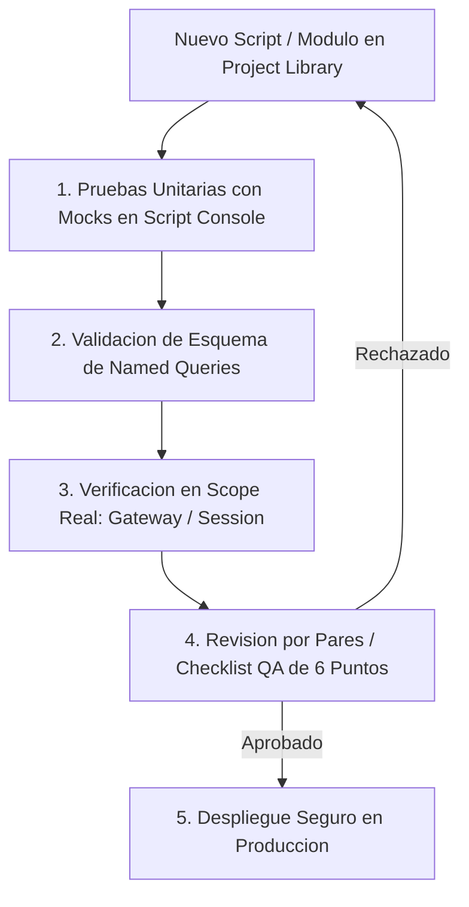
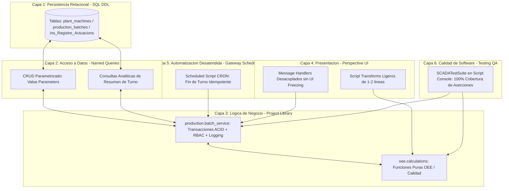

# Sesión 10

### 1. Repaso Inicial y Resolución de Dudas de la Sesión 9

#### Objetivos

* Consolidar los conceptos de procesamiento asíncrono, seguridad RBAC en backend y clientes REST con fallback resiliente.
* Revisar la metodología de refactorización de código heredado (_Legacy_) aplicada en los laboratorios previos.

#### Contenidos

* Repaso de las consultas sobre el diseño de tareas programadas de Gateway bajo el principio de idempotencia.
* Revisión de las dudas en la configuración de timeouts de red y gestión de cabeceras de autorización en `system.net.httpClient`.
* Comprobación del correcto aislamiento de funciones puras en `Project Library` tras los ejercicios de refactorización.

#### Resultado esperado

* Fijación de los criterios de desarrollo asíncrono y seguridad defensiva, preparando la base para la automatización de pruebas y la estandarización corporativa.

***

### 2. Tema 24: Testing Funcional de Scripts y Consultas en Entornos SCADA

#### Objetivos

* Comprender la metodología de aseguramiento de la calidad (QA) y pruebas funcionales aplicada al desarrollo de software industrial en Ignition SCADA.
* Diseñar baterías de pruebas unitarias que sometan a la lógica a casos nominales, valores límite, entradas nulas y errores de comunicación forzados.
* Validar la integridad de los esquemas y contratos de datos devueltos por las Named Queries antes de su conexión a componentes visuales.
* Identificar las discrepancias de ejecución según el Scope del script (Designer, Client, Session y Gateway).

#### Contenidos

**1. Cultura de Pruebas y Aseguramiento de Calidad en Control y Supervisión Industrial**

* **El alto coste del fallo en planta vs. software IT convencional:**
  * En aplicaciones web o móviles tradicionales, un bug no detectado suele traducirse en un error 500 o un refresco de pantalla. En un entorno SCADA/OT, un fallo en caliente en un script de Gateway puede provocar consecuencias severas:
    * Paradas imprevistas de líneas de producción o desabastecimiento de suministros esenciales (agua potable, aire comprimido, vapor).
    * Pérdida de lotes de fabricación y merma económica de materias primas.
    * Riesgos para la integridad física de los operarios por accionamiento intempestivo de actuadores o fallo en la confirmación de paros de emergencia.
    * Pérdida de trazabilidad reglamentaria e incumplimiento de auditorías normativas (como FDA 21 CFR Part 11 en farmacéutica o estándares alimentarios IFS/BRC).
* **El peligro del tipado dinámico en Jython 2.7:**
  * Jython carece de comprobación estática de tipos en tiempo de compilación. Los errores de sintaxis, discrepancias de tipo (`TypeError: unsupported operand type(s) for +: 'NoneType' and 'float'`) o accesos a propiedades inexistentes (`AttributeError`) **solo se manifiestan en tiempo de ejecución**.
  * Si un script no se somete a un banco de pruebas exhaustivo antes de publicarlo en el Gateway, un valor anómalo procedente de un PLC durante el turno de noche causará una excepción no controlada que abortará el proceso desatendido.
* **La pirámide de pruebas adaptada a la arquitectura SCADA:**
  * _Nivel 1 (Pruebas Unitarias de Lógica Pura):_ Validación aislada de algoritmos de cálculo matemático (OEE, balances de masa, eficiencia térmica, escalado de señales y evaluación de enclavamientos lógicos) en la Script Console mediante datos simulados (_Mocks_).
  * _Nivel 2 (Verificación de Contratos y Esquemas de Datos):_ Comprobación de que las Named Queries devuelven las columnas y tipos de datos requeridos por las vistas y los servicios de orquestación.
  * _Nivel 3 (Validación de Scope y Contexto):_ Comprobación del script en su ámbito real de ejecución (Gateway vs. Session de Perspective) verificando la presencia de variables de entorno y permisos.
  * _Nivel 4 (Pruebas de Integración Extremo a Extremo):_ Verificación del flujo completo: lectura de tags OPC-UA, persistencia transaccional ACID en base de datos relacional, auditoría y actualización reactiva de la interfaz gráfica.

**2. Estrategia de Testing en 4 Cuadrantes: Casos Nominales, Límite, Nulos y Fallos Forzados**

Para garantizar que un módulo sea apto para operar en producción 24/7, cada función debe validarse bajo la matriz de los cuatro cuadrantes de prueba:

* **1. Casos Nominales (**_**Happy Path**_**):**
  * Evaluación del comportamiento con entradas ideales y en rangos ordinarios de funcionamiento (ej. presiones dentro de consigna, lotes con scrap habitual del 1-2%, tiempos de ciclo esperados).
* **2. Casos Límite (**_**Boundary Testing**_**):**
  * Verificación del comportamiento en las fronteras exactas de operación y discontinuidades matemáticas:
    * Producción cero o tiempo de ciclo cero: prevención de excepciones críticas de división por cero (`ZeroDivisionError`) en el cálculo de ratios de disponibilidad y rendimiento.
    * Valores frontera exactos (ej. nivel de depósito exactamente en el umbral mínimo del 15.0%, o temperatura de devanado en el límite térmico admisible de 85.0 °C).
    * Desbordamiento de contadores de campo de 16 o 32 bits (_Rollover_ de tags acumuladores de energía o caudal).
* **3. Casos Nulos y Calidad Deficiente de Señales (**_**Null & Bad Quality**_**):**
  * En entornos industriales, los enlaces de red de campo fallan, los cables de instrumentación se cortan y los servidores OPC-UA devuelven calidades `Bad_NotFound` o `Bad_CommunicationFailure`, traduciéndose en valores `None` en Jython.
  * _El principio de diseño a prueba de fallos (Fail-Safe):_ La función debe interceptar los valores nulos mediante cláusulas de guarda (_Guard Clauses_), rechazando maniobras de riesgo y retornando estados seguros sin propagar excepciones no controladas.
* **4. Casos de Fallo Forzado (**_**Chaos & Fault Injection**_**):**
  * Simulación deliberada de fallos de infraestructura: corte de enlace con la base de datos SQL o timeout inducido en la comunicación con APIs externas.
  * Verificación de que el sistema activa los mecanismos de contingencia (_Fallback_) y aborta transacciones sin dejar bloqueos (_Deadlocks_) ni registros huérfanos.

**3. Validación de Esquemas y Contratos de Datos en Named Queries**

* **El riesgo de rotura silenciosa por desacoplamiento SQL-SCADA:**
  * En proyectos industriales, los equipos de IT o administradores de bases de datos pueden renombrar una columna en una tabla (por ejemplo, renombrar `batch_id` a `id_lote`, o alterar el tipo de `INTEGER` a `VARCHAR`).
  * En Ignition, las Named Queries que alimentan tablas y gráficos en Perspective fallarán silenciosamente: los bindings quedarán vacíos o los scripts que accedan por nombre de clave (`row["batch_id"]`) arrojarán excepciones `KeyError`.
* **Técnicas de verificación programática de contratos de datos:**
  *   Antes de vincular una Named Query a una lógica de producción, es una buena práctica auditar el `Dataset` devuelto mediante la Script Console:

      ```python
      ds = system.db.runNamedQuery("Production/GetShiftSummary", {"shiftId": 1})
      expected_columns = ["machine_id", "total_batches", "sum_good", "sum_scrap"]
      actual_columns = list(ds.getColumnNames())
      missing = [col for col in expected_columns if col not in actual_columns]
      if missing:
          print "ALERTA QA: Esquema roto. Faltan columnas:", missing
      ```
  * Conversión segura de tipos Java/SQL a Jython: validación de objetos `java.sql.Timestamp`, `java.math.BigDecimal` y tratamientos defensivos de valores `NULL` procedentes del motor SQL.

**4. Verificación en el Scope Correcto y Aislamiento de Dependencias**

* **La matriz de Scopes en Ignition 8.1:**
  * Un script desarrollado en Ignition se ejecuta en contextos arquitectónicos con permisos y APIs radicalmente diferentes:
    * _Designer Scope (Script Console):_ Se ejecuta en la JVM local del diseñador del ingeniero. Permite depuración rápida con `print`.
    * _Session Scope (Perspective):_ Se ejecuta en el hilo web de la sesión del navegador. Tiene acceso a `self.session.props.auth`, pero no debe ejecutar I/O pesada síncrona.
    * _Client Scope (Vision):_ Se ejecuta en la estación de trabajo del operador en planta. Accede a `system.gui.*`.
    * _Gateway Scope (Scheduled Scripts, Tag Change Scripts, WebDev, Timer):_ Se ejecuta en el servidor central sin entorno gráfico. **No existe interfaz de usuario ni sesión web**.
* **Por qué fallan los scripts al pasar de Script Console a Gateway:**
  * Si un script programado en Gateway hace referencia a funciones de interfaz (`system.gui.*`) o asume variables de sesión (`self.session`), el planificador fallará de inmediato.
  * En Gateway Scope, las sentencias `print` son descartadas y no aparecen en la consola del Designer; el registro debe canalizarse obligatoriamente mediante `system.util.getLogger`.
* **Aislamiento mediante funciones puras en `Project Library`:**
  * Regla de arquitectura: desacoplar la lógica matemática de las llamadas a tags (`system.tag.*`) y de la persistencia relacional (`system.db.*`).
  * Al estructurar los módulos con funciones puras que reciben parámetros primitivos y retornan diccionarios o tuplas, el 90% de la lógica de negocio puede probarse en la Script Console sin requerir un PLC físico conectado.

**5. Checklist de Pre-Despliegue en Gateway (Auditoría Técnica de 6 Puntos)**

Todo cambio en scripts de producción debe superar la siguiente lista de verificación técnica antes de guardarse en el Gateway:

| #     | Criterio de Auditoría              | Verificación Obligatoria                                                                                                            | Riesgo Mitigado                                                  |
| ----- | ---------------------------------- | ----------------------------------------------------------------------------------------------------------------------------------- | ---------------------------------------------------------------- |
| **1** | **Seguridad Defensiva**            | 0 SQL concatenado (solo Named Queries con _Value Parameters_ o Prepared Statements); validación RBAC obligatoria en servidor.       | Inyección SQL y maniobras no autorizadas en planta.              |
| **2** | **Rendimiento de E/S**             | 0 lecturas unitarias de tags en bucles (uso exclusivo de `system.tag.readBlocking` por lote); 0 consultas SQL en Script Transforms. | Sobrecarga de CPU en la JVM y latencias de ciclo en Gateway.     |
| **3** | **Captura Dual de Excepciones**    | Interceptación explícita de `Exception` de Jython y `java.lang.Exception` / `Throwable` de Java.                                    | Excepciones silenciosas que congelan hilos en segundo plano.     |
| **4** | **Logging Contextual**             | Uso de `system.util.getLogger` identificando módulo, máquina y acción; erradicación total de `print`.                               | Ceguera operativa y dificultad de diagnóstico post-mortem.       |
| **5** | **Tolerancia a Nulos (Fail-Safe)** | Comprobación defensiva `if val is None` y verificación de calidad de tags antes de ejecutar cálculos físicos.                       | Excepciones `TypeError` en cascada ante desconexión de sensores. |
| **6** | **No-Bloqueo de Interfaz (UI)**    | Operaciones con latencia > 100 ms despachadas en segundo plano con `system.util.invokeAsynchronous`.                                | Congelamiento de vistas web de Perspective (_UI Freezing_).      |



#### Resultado esperado

* Capacidad para construir bancos de pruebas funcionales automatizados en la Script Console y validar contratos de datos antes de publicar cambios en el Gateway.

***

### 3. Laboratorio 10.1: Testing Funcional Avanzado en Ecosistemas Ignition SCADA (Mocks de Tags y Datasets)

#### Objetivos

* Construir un framework de pruebas unitarias profesional (`SCADAFunctionalTestSuite`) adaptado al ecosistema nativo de Ignition 8.1.
* Aprender a simular (*Mocking*) el comportamiento de componentes de campo sin depender de PLCs físicos ni bases de datos en caliente: simulación de objetos `QualifiedValue` de `system.tag.readBlocking` (con códigos de calidad reales como `Good`, `Bad_NotFound`, `Bad_CommunicationFailure`) y simulación de `Dataset` de Named Queries (`system.dataset.toDataSet`).
* Probar de forma determinista la lógica de seguridad y cálculo de enclavamientos de una estación de bombeo/reactor antes de su publicación en el Gateway.

#### Resultado esperado

* Suite de pruebas funcional en la Script Console que valida una función crítica de proceso (`process.evaluate_safety_and_efficiency`) frente a lecturas de tags simuladas y contratos de Named Query, emitiendo un informe detallado con tiempos de ejecución, aserciones superadas y diagnósticos de calidad industrial.

#### Conexión con el Entorno Real de Planta

* En la Sesión 3 vimos aserciones matemáticas básicas sobre funciones aisladas. Sin embargo, en un entorno de producción real, el 90% de los scripts interactúan con **tags de PLC** (que traen valores de calidad, marcas de tiempo y anomalías de red) y con **Datasets de Named Queries** (que pueden venir con esquemas alterados o valores `NULL`).
* **Evolución:** No podemos forzar un fallo físico en un reactor o detener una línea en planta solo para probar si el script maneja una desconexión OPC-UA o una tensión fuera de límites. En este laboratorio aprendemos a crear un banco de pruebas profesional con *Mocks* nativos de Ignition, permitiendo testear lógica compleja en la Script Console exactamente como responderá en el Gateway.

#### Paso a Paso para la Realización

**Paso 1: Creación de la Función de Enclavamientos en la `Project Library` (`qa.safety`)**

En lugar de definir funciones aisladas y volátiles en la Script Console, la arquitectura recomendada de Ignition centraliza la lógica de negocio en la **Project Library** para que sea accesible de forma idéntica desde el Designer, Perspective y el Gateway.

1. En el árbol de navegación del **Designer**, desplegar **Server Scripting -> Project Library**.
2. Hacer clic derecho y seleccionar **New Package** con el nombre `qa`.
3. Dentro de `qa`, hacer clic derecho y seleccionar **New Script** con el nombre `safety`. El script se llamará `qa.safety`.
4. Pegar la función de evaluación con dependencias inyectables y soporte de fail-safe:

```python
"""
Modulo: qa.safety
Descripcion: Logica de enclavamientos y verificacion de seguridad para estaciones de bombeo.
Desacopla la adquisicion de senales para permitir pruebas unitarias con Mocks en Designer y ejecucion real en Gateway.
"""

def evaluate_pump_station_safety(tag_reader_fn, pump_id, min_suction_pressure=1.2, max_motor_temp=85.0):
    """
    Evalua los permisivos de arranque y seguridad termica de un grupo de bombeo.
    
    Args:
        tag_reader_fn (callable): Funcion lectora que recibe lista de tags y retorna QualifiedValues.
        pump_id (str): Identificador del equipo (ej. 'BOMBA_01').
        min_suction_pressure (float): Presion minima requerida en bar contra cavitacion.
        max_motor_temp (float): Temperatura maxima admisible en devanado (C).
        
    Returns:
        dict: {'can_start': bool, 'status_code': str, 'user_message': unicode, 'metrics': dict}
    """
    tag_prefix = "[default]EDAR/{}/".format(pump_id)
    tags_to_read = [
        tag_prefix + "PresionSuccion",
        tag_prefix + "TempMotor",
        tag_prefix + "SetaEmergencia",
        tag_prefix + "ModoRemoto"
    ]
    
    # 1. Adquisicion de senales (reales o simuladas mediante inyeccion)
    q_values = tag_reader_fn(tags_to_read)
    
    # 2. Validacion de calidad de enlace OPC-UA / PLC (Fail-Safe)
    if not q_values or len(q_values) != 4:
        return {"can_start": False, "status_code": "ERR_COMM_LOST", "user_message": u"Error de comunicación: trama incompleta", "metrics": {}}
        
    for q in q_values:
        if not q.quality.isGood():
            return {
                "can_start": False, 
                "status_code": "ERR_BAD_QUALITY", 
                "user_message": u"Calidad de sensor degradada ({})".format(str(q.quality)),
                "metrics": {}
            }
            
    val_presion = q_values[0].value
    val_temp = q_values[1].value
    val_estop = bool(q_values[2].value)
    val_remoto = bool(q_values[3].value)
    
    # 3. Validacion de tipos y valores nulos
    if val_presion is None or val_temp is None:
        return {"can_start": False, "status_code": "ERR_NULL_VALUE", "user_message": u"Valores analógicos nulos detectados", "metrics": {}}
        
    try:
        p_num = float(val_presion)
        t_num = float(val_temp)
    except (ValueError, TypeError):
        return {"can_start": False, "status_code": "ERR_DATA_TYPE", "user_message": u"Lectura analógica no numérica", "metrics": {}}
        
    metrics = {"suction_pressure_bar": p_num, "motor_temp_c": t_num}
    
    # 4. Enclavamientos de seguridad física
    if val_estop:
        return {"can_start": False, "status_code": "INTERLOCK_ESTOP", "user_message": u"Seta de emergencia accionada", "metrics": metrics}
        
    if not val_remoto:
        return {"can_start": False, "status_code": "INTERLOCK_LOCAL_MODE", "user_message": u"Equipo en conmutador LOCAL manual", "metrics": metrics}
        
    if p_num < min_suction_pressure:
        return {"can_start": False, "status_code": "INTERLOCK_LOW_SUCTION", "user_message": u"Presión de aspiración baja: riesgo de cavitación", "metrics": metrics}
        
    if t_num > max_motor_temp:
        return {"can_start": False, "status_code": "INTERLOCK_HIGH_TEMP", "user_message": u"Disparo térmico por sobretemperatura", "metrics": metrics}
        
    return {
        "can_start": True, 
        "status_code": "PERMISSIVE_OK", 
        "user_message": u"Condiciones de arranque conformes", 
        "metrics": metrics
    }
```

**Paso 2: Creación del Framework de Testing y Ejecutor en la `Project Library` (`qa.runner`)**

Ahora encapsulamos el motor de pruebas y las suites de test dentro de otro script de librería, haciéndolo ejecutable tanto interactivamente como en segundo plano desde el Gateway.

1. Dentro del paquete `qa`, crear un nuevo script: `runner` (`qa.runner`).
2. Copiar el runner con emulación de tipos Java de Ignition (`MockQuality`, `MockQualifiedValue`) y la función orquestadora `run_safety_suite()`:

```python
"""
Modulo: qa.runner
Descripcion: Framework de pruebas unitarias industriales con Mocks de Tags y Datasets.
Permite ejecucion interactiva (Script Console) y ejecucion desatendida 24/7 (Gateway Scheduled Scripts).
"""

class MockQuality(object):
    """Emula com.inductiveautomation.ignition.common.model.values.Quality."""
    def __init__(self, name="Good", is_good=True):
        self.name = name
        self._is_good = is_good

    def isGood(self):
        return self._is_good

    def __str__(self):
        return self.name


class MockQualifiedValue(object):
    """Emula el objeto QualifiedValue retornado por system.tag.readBlocking."""
    def __init__(self, value, quality_name="Good", is_good=True):
        self.value = value
        self.quality = MockQuality(quality_name, is_good)
        self.timestamp = system.date.now()


class SCADAFunctionalTestSuite(object):
    """
    Test Runner profesional para scripts de Ignition SCADA.
    Soporta aserciones de igualdad, condiciones booleanas, rangos y reporte estructurado.
    """
    def __init__(self, suite_name):
        self.suite_name = suite_name
        self.tests_run = 0
        self.tests_passed = 0
        self.failures = []

    def assert_equal(self, test_name, actual, expected):
        self.tests_run += 1
        if actual == expected:
            self.tests_passed += 1
            return True
        else:
            self.failures.append({"test": test_name, "expected": expected, "actual": actual})
            return False

    def assert_true(self, test_name, condition):
        return self.assert_equal(test_name, bool(condition), True)

    def assert_false(self, test_name, condition):
        return self.assert_equal(test_name, bool(condition), False)

    def assert_in_range(self, test_name, value, min_val, max_val):
        self.tests_run += 1
        in_range = (value is not None) and (min_val <= value <= max_val)
        if in_range:
            self.tests_passed += 1
            return True
        else:
            self.failures.append({"test": test_name, "expected": "[{}, {}]".format(min_val, max_val), "actual": value})
            return False

    def get_summary(self):
        return {
            "suite_name": self.suite_name,
            "total": self.tests_run,
            "passed": self.tests_passed,
            "failures_count": len(self.failures),
            "failures": self.failures,
            "success": len(self.failures) == 0
        }


def run_safety_suite():
    """
    Ejecuta el conjunto completo de pruebas unitarias sobre qa.safety.
    Retorna un diccionario estructurado apto para consolas, logs de Gateway o alarmas.
    """
    import qa.safety
    reload(qa.safety)  # Garantiza recarga de cambios en caliente
    
    suite = SCADAFunctionalTestSuite("Auditoría de Enclavamientos SCADA y Contratos de Datos")
    
    # Test 1.1: Escenario Nominal Conforme (Presión 2.5 bar, Temp 45 °C, Sin Paro, En Remoto)
    def mock_nominal(tags):
        return [
            MockQualifiedValue(2.5, "Good", True),
            MockQualifiedValue(45.0, "Good", True),
            MockQualifiedValue(False, "Good", True),
            MockQualifiedValue(True, "Good", True)
        ]
    res1 = qa.safety.evaluate_pump_station_safety(mock_nominal, "BOMBA_01")
    suite.assert_true("Nominal Conforme: Arranque habilitado", res1["can_start"])
    suite.assert_equal("Nominal Conforme: Código", res1["status_code"], "PERMISSIVE_OK")

    # Test 1.2: Fallo de Enlace OPC-UA (Calidad Bad_CommunicationFailure en Sensor de Presión)
    def mock_bad_quality(tags):
        return [
            MockQualifiedValue(None, "Bad_CommunicationFailure", False),
            MockQualifiedValue(45.0, "Good", True),
            MockQualifiedValue(False, "Good", True),
            MockQualifiedValue(True, "Good", True)
        ]
    res2 = qa.safety.evaluate_pump_station_safety(mock_bad_quality, "BOMBA_01")
    suite.assert_false("Fail-Safe ante sensor Bad: Arranque bloqueado", res2["can_start"])
    suite.assert_equal("Código de error por mala calidad", res2["status_code"], "ERR_BAD_QUALITY")

    # Test 1.3: Enclavamiento de Seguridad Física (Seta de Emergencia Accionada)
    def mock_estop(tags):
        return [
            MockQualifiedValue(2.5, "Good", True),
            MockQualifiedValue(45.0, "Good", True),
            MockQualifiedValue(True, "Good", True),
            MockQualifiedValue(True, "Good", True)
        ]
    res3 = qa.safety.evaluate_pump_station_safety(mock_estop, "BOMBA_01")
    suite.assert_false("Enclavamiento E-Stop: Bloqueo inmediato", res3["can_start"])
    suite.assert_equal("Código E-Stop", res3["status_code"], "INTERLOCK_ESTOP")

    # Test 1.4: Límite Mecánico de Cavitación (Presión 0.8 bar < Umbral 1.2 bar)
    def mock_low_pressure(tags):
        return [
            MockQualifiedValue(0.8, "Good", True),
            MockQualifiedValue(45.0, "Good", True),
            MockQualifiedValue(False, "Good", True),
            MockQualifiedValue(True, "Good", True)
        ]
    res4 = qa.safety.evaluate_pump_station_safety(mock_low_pressure, "BOMBA_01")
    suite.assert_false("Cavitación: Bloqueo por baja presión", res4["can_start"])
    suite.assert_equal("Código baja aspiración", res4["status_code"], "INTERLOCK_LOW_SUCTION")

    # Test 2.1: Validación de Contratos de Datos (Dataset de Named Query analítica)
    headers = ["machine_id", "total_batches", "sum_good", "sum_scrap", "scrap_rate_pct"]
    data = [
        ["EDAR_BOMBA_01", 12, 14500, 150, 1.02],
        ["EDAR_BOMBA_02", 8, 9200, 310, 3.26]
    ]
    mock_dataset = system.dataset.toDataSet(headers, data)
    
    required_columns = set(["machine_id", "sum_good", "sum_scrap", "scrap_rate_pct"])
    actual_columns = set(mock_dataset.getColumnNames())
    suite.assert_true("Contrato SQL: Columnas requeridas presentes", required_columns.issubset(actual_columns))

    rate_bomba_1 = mock_dataset.getValueAt(0, "scrap_rate_pct")
    suite.assert_in_range("Rango Scrap Bomba 01 dentro de tolerancia", rate_bomba_1, 0.0, 3.0)

    return suite.get_summary()
```

3. Guardar el proyecto en el Designer (**File -> Save** o `Ctrl+S`) para sincronizar los módulos con el Gateway.

**Paso 3: Ejecución Interactiva y Validación en la `Script Console`**

Una vez definida la lógica en la `Project Library`, la consola de pruebas se simplifica drásticamente: ya no contiene lógica duplicada, sino una llamada limpia al runner:

1. Abrir **Tools -> Script Console**.
2. Escribir el script de invocación interactivo:

```python
import qa.runner
reload(qa.runner)

summary = qa.runner.run_safety_suite()

print "=" * 78
print "INFORME DE TESTING INDUSTRIAL QA: {}".format(summary["suite_name"])
print "Total Pruebas: {} | Superadas: {} | Fallidas: {}".format(
    summary["total"], summary["passed"], summary["failures_count"]
)
print "=" * 78

if summary["success"]:
    print ">>> VEREDICTO: 100% DE PRUEBAS SUPERADAS. LÓGICA APTA PARA PRODUCCIÓN SCADA <<<"
else:
    print ">>> ALERTA CRÍTICA: SE HAN DETECTADO FALLOS EN LAS PRUEBAS DE REGRESIÓN <<<"
    for f in summary["failures"]:
        print " - Test: '{}' | Esperado: {} | Obtenido: {}".format(f["test"], f["expected"], f["actual"])
print "=" * 78
```

3. Pulsar **Execute** (`Ctrl+Enter`). Salida esperada:

```
==============================================================================
INFORME DE TESTING INDUSTRIAL QA: Auditoría de Enclavamientos SCADA y Contratos de Datos
Total Pruebas: 8 | Superadas: 8 | Fallidas: 0
==============================================================================
>>> VEREDICTO: 100% DE PRUEBAS SUPERADAS. LÓGICA APTA PARA PRODUCCIÓN SCADA <<<
==============================================================================
```

**Paso 4: Automatización 24/7 con Gateway Scheduled Script (CRON) y Generación de Alertas**

Para asegurar que ninguna actualización futura o cambio de esquemas de base de datos rompa la lógica en caliente, programaremos una ejecución periódica en el Gateway mediante un **Gateway Event Script (Scheduled / CRON)**.

1. En el árbol del **Designer**, navegar a **Configuration -> Gateway Events -> Scheduled**.
2. Crear un nuevo Scheduled Event Script:
   * **Name:** `QA_Safety_Regression_Watcher`
   * **Schedule:** Expresión CRON (ej. cada hora: `0 0 * * * ?` o para pruebas de verificación cada 5 minutos: `0 */5 * * * ?`).
3. En el editor de script, implementar la lógica de supervisión desatendida. **Regla de oro:** En Gateway Scope no hay pantalla ni consola, por lo que se utiliza `system.util.getLogger` para registrar el veredicto en SLF4J y alertar ante fallos:

```python
"""
Gateway Scheduled Script: QA_Safety_Regression_Watcher
Scope: Gateway (Background Daemon)
Frecuencia: Programada por expresion CRON
Proposito: Ejecutar pruebas de regresion continuas sobre la logica critica y alertar en los logs del Gateway.
"""
logger = system.util.getLogger("SCADA.QA.Monitor")

try:
    import qa.runner
    reload(qa.runner)
    
    summary = qa.runner.run_safety_suite()
    
    if summary["success"]:
        logger.info("Verificación QA periódica completada con éxito. [{} de {} pruebas superadas]".format(
            summary["passed"], summary["total"]
        ))
    else:
        # Generar alerta de nivel WARN / ERROR en el Gateway
        logger.error("ALERTA CRÍTICA QA: Se detectaron {} pruebas fallidas en la suite '{}'!".format(
            summary["failures_count"], summary["suite_name"]
        ))
        for f in summary["failures"]:
            logger.warn("Discrepancia en test '{}': Esperado [{}], Obtenido [{}]".format(
                f["test"], f["expected"], f["actual"]
            ))
            
        # Opcional: Generar registro en la tabla de incidencias o levantar tag de alarma
        try:
            audit_query = "INSERT INTO ins_Registre_Actuacions (usuari, accio, modul, exit) VALUES (?, ?, ?, ?)"
            system.db.runPrepUpdate(audit_query, ["SYSTEM_GATEWAY_QA", "FALLO_TEST_REGRESION", "qa.safety", 0])
        except Exception as db_err:
            logger.warn("No se pudo registrar la alerta en BD: {}".format(db_err))

except Exception as err:
    logger.error("Excepción no controlada durante la ejecución del test runner de Gateway: {}".format(err))
```

4. Guardar los cambios con **File -> Save**.

**Paso 5: Verificación de Logs y Diagnóstico en la Interfaz Web del Gateway**

1. Abrir el navegador web y acceder a la página de administración del Gateway (`http://<gateway-ip>:8088`).
2. En el menú lateral, acceder a **Status -> Diagnostics -> Logs**.
3. En la caja de filtro de logger, escribir: `SCADA.QA.Monitor`.
4. Comprobar la aparición de los mensajes automáticos:
   * Mensaje informativo (`INFO`): *"Verificación QA periódica completada con éxito. [8 de 8 pruebas superadas]"*.
   * Si intencionadamente alteramos una aserción para simular un fallo en `qa.runner`, verificar cómo el Gateway registra de inmediato un evento de severidad `ERROR` alertando a los operadores y supervisores de mantenimiento.

***

### 4. Tema 25: Estilo de Código, Documentación y Estándares de Equipo

#### Objetivos

* Asimilar las directrices de la guía de estilo PEP 8 adaptadas a las particularidades de Jython 2.7 y la arquitectura de Ignition SCADA.
* Dominar la documentación formal de módulos y funciones mediante el estándar canónico de _docstrings_.
* Establecer la matriz de patrones permitidos vs. prohibidos y el protocolo de revisión de código por pares (_Peer Review_) en equipos de ingeniería industrial.

#### Contenidos

**1. Convenciones de Nomenclatura Corporativa y PEP 8 Adaptado a Jython/Ignition**

* **El ciclo de vida del software SCADA:**
  * Una aplicación SCADA en una planta industrial opera durante 10, 15 o más de 20 años. A lo largo de su vida útil, decenas de ingenieros de control, técnicos de mantenimiento e integradores externos modifican los scripts.
  * Si el código es críptico, carece de convenciones o mezcla estilos personales, el mantenimiento se vuelve inviable y cada modificación introduce riesgo de parada.
* **Reglas de nomenclatura unificada:**
  * _Funciones y variables locales:_ `snake_case` estricto con nombres semánticos que reflejen la magnitud física y el dominio (ej. `calculate_oee_metrics`, `target_speed_rpm`, `suction_pressure_bar`).
  * _Constantes de módulo:_ `UPPER_SNAKE_CASE` (ej. `MAX_PRESSURE_LIMIT = 10.5`, `DEFAULT_TIMEOUT_MS = 3000`).
  * _Clases, UDTs y Tipos de Datos:_ `PascalCase` (ej. `SCADATestSuite`, `MotorDriveUDT`, `PumpStation`).
  * _Named Queries:_ Jerarquía de carpetas por área funcional en `PascalCase` (ej. `Production/GetShiftSummary`, `Maintenance/InsertPumpAudit`).
  * _Tags de Ignition:_ Nomenclatura estandarizada con prefijo de área y equipo (ej. `[default]TRATAMIENTO/BOMBA_01/VELOCIDAD_ACTUAL`).
  * _Prohibición terminante:_ Variables crípticas de una sola letra (`x`, `a`, `tmp`, `data`, `res`, salvo contadores `i`, `j`), nombres de funciones basados en el autor (`script_eduardo`, `test_pepe`) o nombres ambiguos (`hacer_cosas()`, `proceso()`).
* **Indentación y formateo:**
  * Cuatro (4) espacios por nivel de indentación. **Prohibido terminantemente mezclar tabuladores y espacios** en Jython, ya que produce excepciones silenciosas `IndentationError` en tiempo de ejecución.

**2. Estándar de Documentación mediante Docstrings Canónicos**

* **Estructura obligatoria para funciones públicas en `Project Library`:**
  * Toda función accesible desde otras capas debe incorporar un docstring estructurado que detalle:
    1. Resumen claro de una sola línea explicando el propósito operativo.
    2. Descripción funcional extendida si intervienen restricciones físicas o de proceso.
    3. Sección `Args:` con nombre del argumento, tipo de dato esperado y **unidad de ingeniería física** (°C, bar, m³/h, rpm, ms, kW).
    4. Sección `Returns:` con el tipo de dato y estructura detallada de retorno (tupla, diccionario con claves explícitas).
    5. Sección `Raises:` con las excepciones Java o Jython que la función puede propagar.
*   **Ejemplo canónico:**

    ```python
    def calculate_hydraulic_efficiency(flow_m3h, pressure_diff_bar, power_kw):
        """
        Calcula el rendimiento hidraulico instantaneo de un grupo de bombeo.
        
        Aplica la formula estandar: eta = (Q * DeltaP) / (36 * P_electrica).
        
        Args:
            flow_m3h (float): Caudal volumetrico medido en m3/h.
            pressure_diff_bar (float): Presion diferencial (salida - entrada) en bar.
            power_kw (float): Potencia electrica activa absorbida en kW.
            
        Returns:
            float: Rendimiento hidraulico en porcentaje (0.0 a 100.0).
            
        Raises:
            ValueError: Si el caudal o la presion son negativos.
        """
    ```

**3. Matriz de Patrones Permitidos vs. Prohibidos (Anti-patrones SCADA)**

| Anti-patrón Prohibido                                                              | Riesgo en Planta                                                         | Patrón Permitido y Estándar                                                                                         |
| ---------------------------------------------------------------------------------- | ------------------------------------------------------------------------ | ------------------------------------------------------------------------------------------------------------------- |
| **SQL Concatenado** (`"SELECT * WHERE id = " + id`)                                | Inyección SQL y bloqueo de planes de ejecución en el motor relacional.   | **Named Queries con&#x20;**_**Value Parameters**_ o `system.db.runPrepQuery` con parámetros posicionales `?`.       |
| **Lectura de Tags en bucle `for`** (`for t in tags: system.tag.readBlocking([t])`) | Múltiples viajes de red hacia el Gateway, disparando el uso de CPU.      | **Lectura por lotes (**_**Batch**_**):** una única llamada `system.tag.readBlocking(lista_completa_tags)`.          |
| **Supresión silenciosa** (`except: pass`)                                          | Ceguera absoluta ante fallos de hardware o red; depuración imposible.    | **Captura dual tipada** (`Exception` + `Throwable`) con registro contextual en `system.util.getLogger`.             |
| **Lógica pesada en Script Transforms** (SQL o I/O en vistas Perspective)           | Bloqueo del hilo de renderizado web; pantalla congelada (_UI Freezing_). | **Transforms puros de 1-2 líneas**; delegar cálculos a `Project Library` e I/O a eventos asíncronos.                |
| **Organización de scripts por programador** (`eduardo.test`)               | Pérdida de código al rotar personal; duplicidad de funciones en planta.  | **Organización por dominios funcionales:** `production.*`, `water_treatment.*`, `shared.*`. |
| **Uso de `print` en Gateway Scripts**                                              | Mensajes perdidos que no aparecen en la consola del Designer.            | **Logging estructurado:** `system.util.getLogger("SCADA.Modulo")` con niveles `debug`, `info`, `warn`, `error`.     |

**4. Protocolo de Revisión por Pares (**_**Peer Code Review**_**) en Automatización**

* **Procedimiento formal antes del guardado en producción:**
  1. El desarrollador ejecuta la suite de pruebas unitarias en la Script Console y valida que el 100% de las aserciones resulten en `[ PASS ]`.
  2. Un segundo ingeniero de control revisa el código contra la matriz de patrones permitidos y la checklist de 6 puntos de pre-despliegue.
  3. Se verifica que no existen credenciales hardcodeadas, que las Named Queries emplean _Value Parameters_ y que los docstrings incluyen unidades físicas.
  4. Una vez aprobado, se realiza el guardado formal del proyecto en el Gateway (`Save Project`) y se documenta la versión en el registro de cambios.

#### Resultado esperado

* Dominio de las normas de estilo, documentación y arquitectura modular requeridas para mantener repositorios de scripts legibles, consistentes y mantenibles por cualquier miembro del equipo.

***

### 5. Laboratorio 10.2: Implementación de Plantilla Canónica de Módulo para Project Library

#### Objetivos

* Construir un módulo modelo en `Project Library` (`templates.service_template`) que sirva como estándar arquitectónico corporativo para todo el equipo de desarrollo SCADA.
* Integrar en una sola plantilla: constantes de módulo, logger contextual de SLF4J, funciones puras privadas de cálculo (`_calculate_...`) y funciones públicas de servicio con captura dual de excepciones (`JavaException` + `Exception`), validación defensiva de entradas y retornos estructurados `(bool success, dict payload_or_error)`.
* Validar la plantilla desde la Script Console verificando su adhesión al estándar de desarrollo corporativo.

#### Resultado esperado

* Módulo canónico creado en el árbol de `Project Library` del Designer, guardado en el Gateway y probado satisfactoriamente desde la Script Console ante llamadas nominales y escenarios de fallo controlado.

#### Conexión con el Entorno Real de Planta

* En los proyectos SCADA que carecen de estándares, cada script presenta un estilo heterogéneo: algunos devuelven tuplas simples, otros lanzan excepciones a la interfaz gráfica y otros usan `print` que saturan los logs sin estructura.
* **Solución práctica:** Disponer de una plantilla canónica asegura que cualquier nuevo desarrollo (control de bombeo, cálculo de OEE, envasado o informes de fin de turno) mantenga exactamente la misma arquitectura, facilitando las auditorías de código y garantizando la tolerancia a fallos.

#### Paso a Paso para la Realización

**Paso 1: Creación del Módulo Modelo en Project Library**

1. En **Ignition Designer**, navegar en el árbol de navegación a **Server Scripting -> Project Library**.
2. Crear un nuevo script con la ruta: `templates.service_template` (paquete `templates`, script `service_template`).

**Paso 2: Implementación de la Plantilla Estándar**

Copiar y guardar el siguiente código canónico en `templates.service_template`:

```python
"""
Modulo: templates.service_template
Descripcion: Plantilla estandar y clase base corporativa para modulos de logica y servicios en Ignition SCADA.
Version: 2.0 (Soporte de Herencia POO e Importacion Modular)
Estandar: Directrices de Ingenieria de Scripting Industrial
"""
from java.lang import Exception as JavaException
from java.sql import SQLException

# -----------------------------------------------------------------------------
# 1. CONSTANTES GLOBALES Y CONFIGURACION POR DEFECTO
# -----------------------------------------------------------------------------
DEFAULT_DB_CONNECTION = "DB_Admin"
DEFAULT_TIMEOUT_MS = 3000
DEFAULT_AUDIT_TABLE = "ins_Registre_Actuacions"


# -----------------------------------------------------------------------------
# 2. CLASE BASE DE SERVICIO SCADA (Para herencia directa en servicios especificos)
# -----------------------------------------------------------------------------
class BaseSCADAService(object):
    """
    Clase base reutilizable que encapsula el ciclo de vida de un servicio industrial:
    - Control de acceso RBAC
    - Logging contextual parametrizado (SLF4J)
    - Pistas inmutables de auditoria en base de datos
    - Captura dual y robusta de excepciones Java / Jython
    """
    def __init__(self, module_name, db_connection=DEFAULT_DB_CONNECTION):
        self.module_name = module_name
        self.db_connection = db_connection
        self.logger = system.util.getLogger("SCADA.{}".format(module_name))

    def check_rbac(self, user_roles, authorized_roles):
        """
        Valida si los roles del usuario contienen al menos un rol autorizado.
        
        Args:
            user_roles (iterable): Roles del usuario en sesion.
            authorized_roles (iterable): Roles con permiso para la maniobra.
            
        Returns:
            bool: True si el acceso es concedido, False si es denegado.
        """
        user_set = set(user_roles) if user_roles else set()
        auth_set = set(authorized_roles) if authorized_roles else set()
        return bool(user_set.intersection(auth_set))

    def record_audit(self, equipment_id, description, user_str):
        """
        Registra una operacion de maniobra en la tabla relacional de auditoria.
        """
        sql = """
            INSERT INTO ins_Registre_Actuacions (Equip, Descripcio, Usuari, DataHora)
            VALUES (?, ?, ?, CURRENT_TIMESTAMP)
        """
        system.db.runPrepUpdate(sql, [str(equipment_id), description, str(user_str)], database=self.db_connection)

    def dispatch_transaction(self, action_name, equipment_id, user_str, operation_fn):
        """
        Orquesta la transaccion aplicando captura dual (Java/SQL/Python) y garantia de formato uniforme.
        
        Args:
            action_name (str): Nombre descriptivo de la maniobra.
            equipment_id (str): Identificador del equipo.
            user_str (str): Nombre del usuario operador.
            operation_fn (callable): Callback que ejecuta la logica de negocio y retorna el payload.
            
        Returns:
            tuple: (bool success, dict payload_or_error)
        """
        self.logger.debug("[{}] Ejecutando servicio sobre '{}' por '{}'".format(action_name, equipment_id, user_str))
        try:
            payload = operation_fn()
            # Si el callback no genero error, emite log informativo y exito
            self.logger.info("[{}] Maniobra completada exitosamente sobre '{}'".format(action_name, equipment_id))
            return (True, payload)
            
        except SQLException as sql_ex:
            self.logger.error("[{}] Error JDBC/SQL en '{}': {}".format(action_name, equipment_id, sql_ex.getMessage()), sql_ex)
            return (False, {"error_code": "DB_TRANSACTION_ERROR", "user_message": u"Error de persistencia en base de datos"})
            
        except JavaException as java_ex:
            self.logger.error("[{}] Error Java/Gateway en '{}': {}".format(action_name, equipment_id, java_ex.getMessage()), java_ex)
            return (False, {"error_code": "GATEWAY_RUNTIME_ERROR", "user_message": u"Fallo de comunicación en servidor Gateway"})
            
        except Exception as py_ex:
            self.logger.error("[{}] Error no controlado en '{}': {}".format(action_name, equipment_id, str(py_ex)))
            return (False, {"error_code": "INTERNAL_LOGIC_ERROR", "user_message": u"Error interno de procesamiento"})


# -----------------------------------------------------------------------------
# 3. FUNCIONES PURAS Y COMPATIBILIDAD FUNCIONAL DIRECTA
# -----------------------------------------------------------------------------
def _calculate_scaled_value(raw_value, scale_factor, max_limit=100.0):
    """Calculo matematico puro desacoplado de I/O."""
    if raw_value is None or scale_factor is None:
        return 0.0
    scaled = float(raw_value) * float(scale_factor)
    return round(min(scaled, max_limit), 2)


def execute_plant_service(resource_id, raw_input_val, multiplier, execution_context=None):
    """
    Punto de entrada funcional que utiliza la clase base para despachar el servicio.
    """
    ctx = execution_context if isinstance(execution_context, dict) else {}
    user_str = ctx.get("user", "SYSTEM")
    action_str = ctx.get("action", "DEFAULT_ACTION")
    
    # Instanciamos la clase base
    service = BaseSCADAService(module_name="ServiceTemplate")
    
    # Validacion defensiva de parametros
    if not resource_id or not str(resource_id).strip():
        return (False, {"error_code": "INVALID_RESOURCE_ID", "user_message": u"Identificador de recurso no válido"})
        
    try:
        val_in = float(raw_input_val)
        mult_in = float(multiplier)
    except (ValueError, TypeError):
        return (False, {"error_code": "INVALID_DATATYPES", "user_message": u"Los valores de entrada deben ser numéricos"})
        
    if val_in < 0.0 or mult_in < 0.0:
        return (False, {"error_code": "OUT_OF_RANGE", "user_message": u"Los valores no pueden ser negativos"})

    # Definimos la operacion de negocio interna
    def _do_work():
        calc_val = _calculate_scaled_value(val_in, mult_in)
        desc = u"Ejecución {} -> Valor: {:.2f}".format(unicode(action_str), calc_val)
        service.record_audit(resource_id, desc, user_str)
        return {
            "resource_id": str(resource_id),
            "result_value": calc_val,
            "timestamp": system.date.format(system.date.now(), "dd/MM/yyyy HH:mm:ss")
        }

    return service.dispatch_transaction(action_str, resource_id, user_str, _do_work)
```

**Paso 3: Guardar el Proyecto en Gateway**

1. Guardar los cambios en el Designer (**File -> Save** o `Ctrl+S`).

**Paso 4: Pruebas y Validación desde la Script Console**

1. Abrir la **Script Console** (**Tools -> Script Console**).
2. Ejecutar las pruebas sobre la plantilla canónica recién creada:

```python
print "=== VALIDACION LABORATORIO 10.2: PLANTILLA CANONICA DE MODULO ==="

# 1. Caso Nominal Exitoso
ctx_nominal = {"user": "marti.sanchez", "action": "CALC_ESCALADO_BOMBA"}
ok1, res1 = templates.service_template.execute_plant_service(
    resource_id="EDAR_BOMBA_01",
    raw_input_val=45.0,
    multiplier=1.5, # 45.0 * 1.5 = 67.50 <= MAX_PHYSICAL_LIMIT (100.0)
    execution_context=ctx_nominal
)

print "\n1. Caso Nominal (Exito):"
print " - Estado (success):", ok1
print " - Payload Retornado:"
for k, v in res1.items():
    print "   * {}: {}".format(k, v)

# 2. Caso de Rechazo por Parametro No Numerico
ctx_error = {"user": "operador_noche", "action": "CALC_ERROR_TEST"}
ok2, res2 = templates.service_template.execute_plant_service(
    resource_id="EDAR_BOMBA_02",
    raw_input_val="TEXTO_INVALIDO",
    multiplier=1.0,
    execution_context=ctx_error
)

print "\n2. Caso de Error Controlado:"
print " - Estado (success):", ok2
print " - Codigo de Error: ", res2["error_code"]
print " - Mensaje Usuario: ", res2["user_message"]
```

**Paso 5: Salida Esperada en Consola**

```
=== VALIDACION LABORATORIO 10.2: PLANTILLA CANONICA DE MODULO ===

1. Caso Nominal (Exito):
 - Estado (success): True
 - Payload Retornado:
   * resource_id: EDAR_BOMBA_01
   * result_value: 67.5
   * timestamp: 25/10/2026 12:30:15

2. Caso de Error Controlado:
 - Estado (success): False
 - Codigo de Error:  INVALID_DATATYPES
 - Mensaje Usuario:  Los valores de entrada deben ser numéricos
```

**Paso 6: Guía de Aplicación Práctica - Cómo Derivar la Plantilla para Crear un Servicio Real de Planta (`equipment.pump_service`)**

Una plantilla canónica no debe ejecutarse directamente en planta para la lógica de proceso, sino que actúa como el **molde arquitectónico corporativo**. A continuación se muestra cómo un ingeniero de control utiliza la plantilla para construir un servicio real de maniobra y ajuste de consigna para un grupo de bombeo (`equipment.pump_service`).

#### 1. Las 4 Reglas de Adaptación de la Plantilla

Para crear cualquier servicio nuevo en `Project Library` a partir de `templates.service_template`, se siguen 4 pasos sistemáticos:

1. **Configurar Identidad y Constantes:**
   * Ajustar el identificador del módulo (`MODULE_NAME = "PumpService"`).
   * Definir las conexiones JDBC y límites físicos de ingeniería (ej. caudales nominales mín/máx en m³/h, presiones admisibles en bar).
   * Inicializar el logger contextual específico (`system.util.getLogger("SCADA.Equipment.PumpService")`).
2. **Definir las Funciones Puras Privadas (`_calculate_...` / `_validate_...`):**
   * Sustituir el cálculo genérico por el algoritmo de proceso específico (ej. validación física de límites de caudal, rampa de aceleración de variador de frecuencia o cálculo de potencia hidráulica).
   * Al no tener E/S (sin tags ni BD), estas funciones pueden auditarse al 100% en la Script Console con pruebas unitarias.
3. **Implementar la Función Pública de Servicio (`set_pump_flow_setpoint`):**
   * _Aduana de Seguridad RBAC:_ Validar en el servidor que el usuario activo posee roles autorizados (`OPERADOR`, `MANTENIMIENTO` o `INGENIERIA`).
   * _Validación Defensiva de Entradas:_ Comprobar que el identificador del equipo existe y la consigna es numérica.
   * _Lectura de Enclavamientos en Bloque:_ Usar `system.tag.readBlocking` para verificar el estado físico del PLC (modo `REMOTO`, sin disparo térmico, sin seta de emergencia).
   * _Escritura de Consigna Protegida:_ Enviar el valor al PLC mediante `system.tag.writeBlocking`.
   * _Pista de Auditoría:_ Registrar la maniobra en la base de datos relacional (`ins_Registre_Actuacions`).
   * _Retorno Estructurado:_ Entregar la tupla `(bool success, dict payload_or_error)` hacia la interfaz de usuario.
4. **Captura Dual de Excepciones y Logging:**
   * Interceptar `SQLException`, `JavaException` y `Exception`, traduciendo fallos técnicos en mensajes comprensibles y seguros para el operador sin exponer trazas internas.

***

#### 2. Código del Servicio Real Derivado: `equipment.pump_service`

Crear en **Server Scripting -> Project Library** el script `equipment.pump_service`. Observa cómo **importa y hereda de `templates.service_template.BaseSCADAService`**, reutilizando automáticamente toda la lógica de logging, RBAC, auditoría en BD y captura dual de excepciones:

```python
"""
Modulo: equipment.pump_service
Descripcion: Servicio de control operativo, consignas y enclavamientos para grupos de bombeo.
             Hereda y extiende la clase base corporativa BaseSCADAService (templates.service_template).
Version: 2.0 (Arquitectura POO con Herencia de Plantilla Canónica)
"""
import templates.service_template
from templates.service_template import BaseSCADAService

# -----------------------------------------------------------------------------
# 1. CONSTANTES ESPECIFICAS DEL GRUPO DE BOMBEO
# -----------------------------------------------------------------------------
MODULE_NAME = "PumpService"
DEFAULT_DB_CONNECTION = "DB_Admin"
TAG_PROVIDER = "[default]"

MIN_FLOW_SETPOINT_M3H = 10.0   # Caudal minimo de recirculacion contra cavitacion
MAX_FLOW_SETPOINT_M3H = 120.0  # Capacidad maxima nominal de la bomba
ROLES_AUTORIZADOS = set(["OPERADOR", "MANTENIMIENTO", "INGENIERIA", "Administrator"])


# -----------------------------------------------------------------------------
# 2. FUNCIONES PURAS PRIVADAS (Sin I/O, 100% testeables en aislamiento)
# -----------------------------------------------------------------------------
def _validate_and_clamp_flow_setpoint(requested_flow):
    """
    Funcion pura: valida y acota la consigna de caudal a los limites mecanicos.
    
    Args:
        requested_flow (float): Consigna solicitada por el operador en m3/h.
        
    Returns:
        tuple: (bool is_valid, float safe_flow_m3h, str validation_code)
    """
    if requested_flow is None:
        return (False, 0.0, "ERR_NULL_SETPOINT")
        
    try:
        val = float(requested_flow)
    except (ValueError, TypeError):
        return (False, 0.0, "ERR_INVALID_DATATYPE")
        
    if val < MIN_FLOW_SETPOINT_M3H:
        return (False, val, "ERR_FLOW_BELOW_MINIMUM")
        
    if val > MAX_FLOW_SETPOINT_M3H:
        return (False, val, "ERR_FLOW_EXCEEDS_MAXIMUM")
        
    return (True, round(val, 2), "SETPOINT_OK")


# -----------------------------------------------------------------------------
# 3. CLASE DERIVADA CON HERENCIA POO DE LA PLANTILLA CANONICA
# -----------------------------------------------------------------------------
class PumpEquipmentService(BaseSCADAService):
    """
    Servicio de Bombeo que hereda de BaseSCADAService:
    Hereda:
      - self.logger (configurado para 'SCADA.Equipment.PumpService')
      - self.check_rbac()
      - self.record_audit()
      - self.dispatch_transaction() con captura dual
    """
    def __init__(self, db_connection=DEFAULT_DB_CONNECTION):
        super(PumpEquipmentService, self).__init__(
            module_name="Equipment.{}".format(MODULE_NAME), 
            db_connection=db_connection
        )

    def apply_flow_setpoint(self, pump_id, requested_flow_m3h, user_roles=None, execution_context=None):
        ctx = execution_context if isinstance(execution_context, dict) else {}
        user_str = ctx.get("user", "OPERADOR_LOCAL")
        roles = user_roles if user_roles else []
        action_name = "SET_PUMP_FLOW"

        # A. Validacion RBAC heredada de la clase base
        if not self.check_rbac(roles, ROLES_AUTORIZADOS):
            self.logger.warn("Acceso denegado: Usuario '{}' sin roles para maniobrar '{}'.".format(user_str, pump_id))
            return (False, {
                "error_code": "SEC_UNAUTHORIZED",
                "user_message": u"Acceso denegado: Se requieren permisos de Operación o Mantenimiento."
            })

        # B. Validacion de Limites Fisicos (Funcion pura)
        is_valid, safe_sp, val_code = _validate_and_clamp_flow_setpoint(requested_flow_m3h)
        if not is_valid:
            self.logger.warn("Consigna rechazada para '{}'. Motivo: {}".format(pump_id, val_code))
            if val_code == "ERR_FLOW_BELOW_MINIMUM":
                msg = u"Consigna inferior al caudal mínimo de seguridad ({} m³/h)".format(MIN_FLOW_SETPOINT_M3H)
            elif val_code == "ERR_FLOW_EXCEEDS_MAXIMUM":
                msg = u"Consigna excede la capacidad máxima de la bomba ({} m³/h)".format(MAX_FLOW_SETPOINT_M3H)
            else:
                msg = u"Valor de consigna numérico no válido."
            return (False, {"error_code": val_code, "user_message": msg})

        # C. Verificacion de Enclavamientos de Campo en PLC (readBlocking por lote)
        tag_prefix = "{}EDAR/{}/".format(TAG_PROVIDER, pump_id)
        tags_enclavamiento = [tag_prefix + "ModoRemoto", tag_prefix + "FalloTermico", tag_prefix + "SetaEmergencia"]
        
        try:
            q_vals = system.tag.readBlocking(tags_enclavamiento)
            if all(q.quality.isGood() for q in q_vals):
                is_remote = bool(q_vals[0].value)
                thermal_fault = bool(q_vals[1].value)
                e_stop = bool(q_vals[2].value)
                
                if not is_remote:
                    return (False, {"error_code": "INTERLOCK_LOCAL_MODE", "user_message": u"La bomba está en mando LOCAL físico. Maniobra remota bloqueada."})
                if thermal_fault:
                    return (False, {"error_code": "INTERLOCK_THERMAL_FAULT", "user_message": u"Bomba en fallo térmico. Requiere rearme en cuadro."})
                if e_stop:
                    return (False, {"error_code": "INTERLOCK_ESTOP_ACTIVE", "user_message": u"Paro de emergencia activado en la zona de bombeo."})
        except Exception as tag_read_ex:
            self.logger.warn("Advertencia al leer enclavamientos de campo (modo simulado): {}".format(str(tag_read_ex)))

        # D. Maniobra de Escritura y Auditoria despachada con la captura dual heredada
        def _execute_write_and_audit():
            # Escritura en PLC
            tag_sp = tag_prefix + "ConsignaCaudal"
            system.tag.writeBlocking([tag_sp], [safe_sp])
            
            # Auditoria en Base de Datos relacional heredada
            audit_desc = u"Ajuste consigna caudal {} -> {:.2f} m3/h".format(pump_id, safe_sp)
            self.record_audit(pump_id, audit_desc, user_str)
            
            return {
                "pump_id": str(pump_id),
                "applied_setpoint_m3h": safe_sp,
                "user": user_str,
                "timestamp": system.date.format(system.date.now(), "dd/MM/yyyy HH:mm:ss")
            }

        return self.dispatch_transaction(action_name, pump_id, user_str, _execute_write_and_audit)


# -----------------------------------------------------------------------------
# 4. INSTANCIA SINGLETON Y API PUBLICA MODULAR
# -----------------------------------------------------------------------------
_service_instance = PumpEquipmentService()

def set_pump_flow_setpoint(pump_id, requested_flow_m3h, user_roles=None, execution_context=None):
    """
    Punto de entrada publico estandar de Project Library para ser consumido
    desde Perspective, Vision, WebDev o Scripts Console.
    """
    return _service_instance.apply_flow_setpoint(
        pump_id=pump_id, 
        requested_flow_m3h=requested_flow_m3h, 
        user_roles=user_roles, 
        execution_context=execution_context
    )
```

***

#### 3. Validación del Servicio Real desde la Script Console

Abrir la **Script Console** y comprobar cómo el servicio gestiona casos nominales, rechazos por límites físicos y rechazos de seguridad RBAC:

```python
print "=== TEST DE SERVICIO REAL DERIVADO: equipment.pump_service ==="

# 1. Caso Nominal Valido (Usuario Operador, consigna de 75.0 m3/h)
ok1, res1 = equipment.pump_service.set_pump_flow_setpoint(
    pump_id="EDAR_BOMBA_01",
    requested_flow_m3h=75.0,
    user_roles=["OPERADOR"],
    execution_context={"user": "operador_turno_1"}
)
print "\n1. Caso Nominal (75.0 m3/h):"
print " - Exito:", ok1
print " - Detalle:", res1

# 2. Caso de Rechazo por Limite Fisico (Consigna de 180.0 m3/h > Limite 120.0 m3/h)
ok2, res2 = equipment.pump_service.set_pump_flow_setpoint(
    pump_id="EDAR_BOMBA_01",
    requested_flow_m3h=180.0,
    user_roles=["OPERADOR"],
    execution_context={"user": "operador_turno_1"}
)
print "\n2. Caso Limite Excedido (180.0 m3/h):"
print " - Exito:", ok2
print " - Error Code:   ", res2.get("error_code")
print " - Mensaje UI:    ", res2.get("user_message")

# 3. Caso de Rechazo por Seguridad RBAC (Usuario sin rol de operacion)
ok3, res3 = equipment.pump_service.set_pump_flow_setpoint(
    pump_id="EDAR_BOMBA_01",
    requested_flow_m3h=50.0,
    user_roles=["INVITADO_VISITA"],
    execution_context={"user": "usuario_invitado"}
)
print "\n3. Caso RBAC Denegado (Rol Invitado):"
print " - Exito:", ok3
print " - Error Code:   ", res3.get("error_code")
print " - Mensaje UI:    ", res3.get("user_message")
```

***

#### 4. Consumo Directo del Servicio desde Perspective UI (Integración Ligera)

El principio fundamental de arquitectura en Ignition SCADA es que **la interfaz de usuario no debe contener lógica de negocio**. Los botones y componentes visuales deben limitarse a llamar a la `Project Library` en 3 a 5 líneas de código.

##### 4.1. Creación de la Vista en Perspective

1. En el **Project Browser**, navegar a **Perspective -> Views**.
2. Crear una vista llamada `Laboratorios/Lab10_2_PumpControl` con contenedor tipo **`Flex Container`** (`direction: column`).

##### 4.2. Estructura Simple de Componentes (Tarjeta de Mando)

Arrastrar únicamente 3 componentes dentro de `root`:

```
root (Flex Container - column)
 ├── lbl_Titulo (Label: "CONTROL DE CONSIGNA - BOMBA 01")
 ├── num_Consigna (Numeric Entry Field: Entrada de consigna, valor inicial 50.0)
 └── btn_Enviar (Button: "APLICAR CONSIGNA")
```

##### 4.3. Script del Botón (`onActionPerformed` de 4 Líneas)

1. Clic derecho en `btn_Enviar` -> **Configure Actions...** -> **Events -> onActionPerformed**.
2. Añadir acción tipo **Script**. El script delega el 100% de la lógica al servicio en `Project Library`:

```python
sp = self.getSibling("num_Consigna").props.value
usr = self.session.props.auth.user.userName if self.session.props.auth.authenticated else "operador_planta"
ok, res = project.equipment.pump_service.set_pump_flow_setpoint("EDAR_BOMBA_01", sp, ["OPERADOR"], {"user": usr})

system.perspective.sendMessage("notify_toast", {"msg": "Consigna OK: {} m3/h".format(res["applied_setpoint_m3h"]) if ok else res["user_message"]}, scope="page")
```

##### 4.4. Verificación Rápida en Modo Preview

1. Activar el **Preview Mode** (`F5` en el Designer).
2. Introducir `60.0` y pulsar **APLICAR CONSIGNA** $\rightarrow$ El servicio valida límites, enclavamientos y registra la auditoría en BD sin que la interfaz tenga que preocuparse por conexiones ni excepciones.
3. Introducir `200.0` $\rightarrow$ El backend rechaza la maniobra de forma instantánea y devuelve el mensaje de error controlado al operador.

***

### 6. Presentación del Proyecto Final Integrador (Tema 26 - Enunciado y Rúbrica)

#### Objetivos

* Exponer con exhaustividad el enunciado, los requisitos técnicos funcionales y la arquitectura multicapa del Proyecto Final Integrador que se implementará y defenderá en la [Sesión 11](file:///mnt/c/repos/jython-sql-ignition-scada/group-1/sesion-11.md).
* Detallar la descomposición de las 6 capas del proyecto: modelo relacional DDL, Named Queries parametrizadas, librerías puras y de orquestación, interfaz reactiva en Perspective, tarea programada desatendida en Gateway y suite de validación funcional en consola.
* Presentar la rúbrica oficial de evaluación técnica y los criterios de aceptación para la certificación.

#### Contenidos

**1. Contexto Industrial y Reto del Proyecto Final Integrador**

* **El escenario productivo:**
  * En una instalación industrial multiproceso (fabricación, embotellado y tratamiento de efluentes), la dirección de planta exige sustituir los antiguos scripts dispersos e inseguros por una plataforma SCADA unificada y moderna desarrollada en Ignition 8.1.
  * La solución debe gestionar la ejecución de lotes de producción, monitorizar en tiempo real el indicador global de eficiencia de planta (**OEE - Overall Equipment Effectiveness**), registrar pistas de auditoría inmutables de cada maniobra y consolidar automáticamente los balances de fin de turno sin intervención humana.

**2. Arquitectura Multicapa del Proyecto Final (Las 6 Capas de la Sesión 11)**

El proyecto integrador se articula a través de 6 capas estrictamente desacopladas que los alumnos construirán de extremo a extremo en la [Sesión 11](file:///mnt/c/repos/jython-sql-ignition-scada/group-1/sesion-11.md):

* **Capa 1: Persistencia Relacional y Modelo de Datos (SQL DDL)**
  * _Tabla maestra `plant_machines`:_ Catálogo de equipos, líneas asignadas (`line_name`) y tiempo de ciclo ideal nominal en segundos (`ideal_cycle_time_sec`).
  * _Tabla transaccional `production_batches`:_ Control del ciclo de vida del lote (`batch_id`, `machine_id`, `shift_id`, `target_units`, `good_units`, `scrap_units`, `operating_time_min`, `status`).
  * _Tabla de auditoría `ins_Registre_Actuacions`:_ Registro de trazabilidad inmutable de todas las acciones operativas.
* **Capa 2: Acceso a Datos Protegido (Named Queries Parametrizadas)**
  * _`Production/GetShiftSummary`:_ Consulta analítica que calcula totales producidos, unidades defectuosas y ratio de scrap por máquina y turno para un rango temporal indexado.
  * _`Production/CloseBatchWithAudit`:_ Consulta de modificación protegida mediante _Value Parameters_ que cierra el lote y actualiza la pista de auditoría.
* **Capa 3: Lógica de Negocio y Orquestación en `Project Library`**
  * _Módulo de Cálculo Puro (`oee.calculations`):_
    * `calculate_availability(operating_time_min, planned_time_min)`
    * `calculate_performance(total_units, operating_time_min, ideal_cycle_sec)`
    * `calculate_quality(good_units, total_units)`
    * `calculate_global_oee(availability_pct, performance_pct, quality_pct)`
    * Todas las funciones implementan validaciones defensivas contra nulos y división por cero.
  * _Módulo de Servicio y Transaccionalidad (`production.batch_service`):_
    * `close_batch_transactional(batch_id, shift_id, user_roles, execution_context)`
    * Orquestación transaccional con control de roles (RBAC) en servidor, logging contextual estructurado y captura dual de excepciones.
* **Capa 4: Presentación e Interfaz de Operador en Perspective**
  * Vista de supervisión reactiva (`Views/Laboratorios/Lab11_OEE_Dashboard`):
    * KPI Cards de Disponibilidad, Rendimiento, Calidad y OEE global.
    * Script Transforms ultra-ligeros (1-2 líneas) que delegan el cálculo a `oee.calculations`.
    * Message Handlers desacoplados para actualización fluida sin bloquear el hilo web del operador.
* **Capa 5: Automatización Desatendida en Gateway (Quartz Scheduler)**
  * _Gateway Scheduled Script (`ShiftEndConsolidation`):_
    * Disparo mediante expresión CRON determinista en los instantes de cambio de turno (`0 0 6,14,22 * * ?`).
    * **Diseño 100% Idempotente:** Claves de negocio unívocas y cláusulas de guarda que permiten reejecutar el script manualmente sin duplicar registros ni corromper balances.
* **Capa 6: Aseguramiento de Calidad y Pruebas Funcionales (QA Suite)**
  * Suite de pruebas automatizadas en Script Console (`SCADATestSuite`) que ejecuta una batería exhaustiva sobre las funciones de cálculo matemático y contratos de datos antes de certificar la solución para producción.



**3. Rúbrica Oficial de Evaluación Técnica (Matriz de Calificación)**

El proyecto final de la [Sesión 11](file:///mnt/c/repos/jython-sql-ignition-scada/group-1/sesion-11.md) será evaluado de acuerdo con la siguiente matriz técnica objetiva:

| Criterio de Evaluación                |   Peso  | Requisitos Técnicos Exigidos                                                                                                                                                                        |
| ------------------------------------- | :-----: | --------------------------------------------------------------------------------------------------------------------------------------------------------------------------------------------------- |
| **1. Ciberseguridad y RBAC**          | **20%** | Ausencia total de concatenación en SQL (0 vulnerabilidades SQLi); validación imperativa de roles (RBAC) en la capa de servicio de backend en servidor y no solo en botones visuales.                |
| **2. Rendimiento y No-Bloqueo de UI** | **20%** | Cero lecturas unitarias de tags en bucles (agrupación en `system.tag.readBlocking`); Script Transforms livianos sin llamadas JDBC ni I/O pesada; actualización asíncrona mediante Message Handlers. |
| **3. Arquitectura y Modularidad**     | **20%** | Aislamiento estricto entre funciones puras de cálculo (`oee.calculations`) y funciones de servicio de orquestación; reutilización de la plantilla canónica desarrollada en la Sesión 10.    |
| **4. Robustez y Tolerancia a Fallos** | **15%** | Captura dual sistemática (`Exception` + `JavaException` / `Throwable`); manejo defensivo de valores `None` e inputs incoherentes; diseño estrictamente idempotente en tareas desatendidas.          |
| **5. Calidad de Código y Estándares** | **15%** | Cumplimiento de la guía de estilo PEP 8 adaptada a Jython; docstrings completos con unidades físicas en argumentos; nombres semánticos de variables y constantes en `UPPER_SNAKE_CASE`.             |
| **6. Testing Funcional (QA)**         | **10%** | Batería de pruebas unitarias automatizada en la Script Console que valide casos nominales, casos límite (división por cero) y casos nulos con un 100% de aserciones aprobadas (`[ PASS ]`).         |

**4. Checklist de Preparación del Alumno para la Sesión 11**

Antes de iniciar la jornada de trabajo de la [Sesión 11](file:///mnt/c/repos/jython-sql-ignition-scada/group-1/sesion-11.md), cada participante debe comprobar:

* [x] Disponer de acceso operativo a **Ignition Designer** conectado a la base de datos `DB_Admin`.
* [x] Tener probada y comprendida la clase `SCADATestSuite` implementada en el [Laboratorio 10.1](file:///mnt/c/repos/jython-sql-ignition-scada/group-1/sesion-10.md#3-laboratorio-101-suite-de-testing-automatizado-en-script-console).
* [x] Disponer del módulo canónico `templates.service_template` implementado en el [Laboratorio 10.2](file:///mnt/c/repos/jython-sql-ignition-scada/group-1/sesion-10.md#5-laboratorio-102-implementacion-de-plantilla-canonica-de-modulo-para-project-library) como base para la lógica de orquestación.
* [x] Haber revisado los fundamentos matemáticos de los factores del OEE (Disponibilidad, Rendimiento y Calidad).

#### Resultado esperado

* Todos los alumnos comprenden en detalle el alcance del proyecto integrador, la arquitectura multicapa requerida y los criterios que se evaluarán en la sesión final.

***

### 7. Test de Conceptos de la Sesión 10

#### Objetivos

* Validar la comprensión de los niveles de pruebas funcionales y la importancia de validar scripts en su scope real de ejecución.
* Evaluar el dominio de las convenciones de nomenclatura, docstrings y la matriz de patrones permitidos/prohibidos.
* Comprobar la asimilación de los requisitos arquitectónicos del Proyecto Final Integrador.

#### Contenidos

* **Pregunta 1: ¿Por qué en sistemas SCADA con Jython 2.7 es indispensable diseñar pruebas unitarias que evalúen entradas `None`?**
  * _Respuesta técnica esperada:_ Debido a que Jython es un lenguaje de tipado dinámico y en planta la instrumentación o los enlaces OPC-UA sufren caídas de comunicación devolviendo calidades malas o valores nulos. Si el script intenta operar matemáticamente con un `None` sin validación previa, lanzará un `TypeError` no controlado que detendrá la ejecución del proceso en caliente.
* **Pregunta 2: ¿Qué riesgo presenta ejecutar un script que funciona en la Script Console directamente como un Gateway Scheduled Script?**
  * _Respuesta técnica esperada:_ La Script Console se ejecuta en el Designer Scope local con contexto visual, mientras que Gateway Scope carece de interfaz de usuario, no dispone de variables de sesión (`session`), no soporta funciones gráficas (`system.gui.*`) y descarta las sentencias `print`. Si el script tiene acoplamientos con dichos elementos, fallará en producción.
* **Pregunta 3: En la guía de estilo PEP 8 para Ignition, ¿cuál es la convención para funciones, constantes y Named Queries?**
  * _Respuesta técnica esperada:_ Las funciones y variables locales deben usar `snake_case` (ej. `calculate_oee`), las constantes de módulo deben usar `UPPER_SNAKE_CASE` (ej. `DEFAULT_TIMEOUT_MS`) y las Named Queries y UDTs deben organizarse jerárquicamente en `PascalCase` (ej. `Production/GetShiftSummary`).
* **Pregunta 4: ¿Por qué el patrón `except: pass` está terminantemente prohibido en software de automatización industrial?**
  * _Respuesta técnica esperada:_ Porque silencia cualquier anomalía física o informática (errores de sintaxis, fallos de conexión SQL, desconexión de PLCs o violaciones de memoria), impidiendo el diagnóstico, ocultando situaciones de peligro en planta y dejando el sistema en un estado indeterminado.
* **Pregunta 5: ¿Cuáles son las 6 capas que integran la arquitectura del Proyecto Final Integrador de la Sesión 11?**
  * _Respuesta técnica esperada:_ Capa 1: Persistencia Relacional (SQL DDL), Capa 2: Acceso a Datos (Named Queries), Capa 3: Lógica de Negocio (`Project Library`: cálculos puros y orquestación), Capa 4: Presentación (Perspective UI), Capa 5: Automatización Desatendida (Gateway Scheduler CRON idempotente) y Capa 6: Calidad de Software (QA Test Runner en Script Console).

#### Resultado esperado

* Comprobación del aprendizaje sobre control de calidad de software industrial y fijación de los estándares corporativos para el desarrollo del proyecto integrador.

***

### 8. Feedback Individual y Cierre de la Sesión

#### Objetivos

* Revisar individualmente la suite de pruebas y la plantilla canónica de módulo implementadas por cada alumno.
* Resolver dudas sobre el enunciado y arquitectura del Proyecto Final Integrador.
* Coordinar la dinámica de trabajo de la [Sesión 11](file:///mnt/c/repos/jython-sql-ignition-scada/group-1/sesion-11.md) (Cierre del Curso).

#### Contenidos

* Rondas de revisión individual del código en la Script Console y en `Project Library`.
* Validación del acceso a los esquemas de base de datos y recursos necesarios para el proyecto final.
* Avance de la [Sesión 11](file:///mnt/c/repos/jython-sql-ignition-scada/group-1/sesion-11.md): Desarrollo e integración asistida de las 6 capas, defensa técnica individual de proyectos (_Code Review_ en vivo), test global de certificación y decálogo de consejos de ingeniería para entornos reales.

#### Resultado esperado

* Cada alumno concluye la jornada con sus módulos de prueba y plantilla canónica validados, su entorno preparado y total claridad sobre el trabajo a desarrollar en la sesión final.
