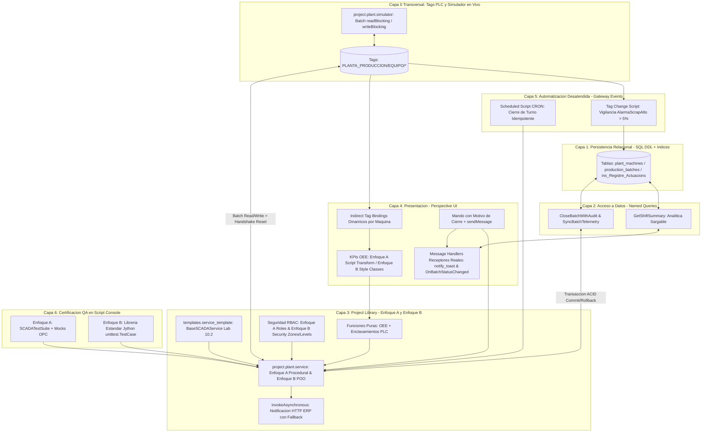

# Sesión 11

### 1. Apertura y Encuadre de la Sesión Final

#### Objetivos

* Revisar el estado de partida de los entornos individuales y verificar los recursos base del Proyecto Final Integrador.
* Establecer la dinámica de construcción autónoma guiada por contratos de ingeniería (implementando **Enfoque A** y **Enfoque B** en cada capa), presentación técnica y evaluación global del curso.

#### Contenidos

* Repaso de las dudas finales sobre testing funcional (`SCADATestSuite` y `unittest`), plantillas canónicas de módulo (`templates.service_template`) y directrices de estilo PEP 8.
* Verificación de la disponibilidad del esquema de base de datos en `SANDBOX_DB`, del proveedor de tags `[default]` y de los usuarios de prueba en el Gateway.
* Presentación del cronograma de la sesión de cierre:
  * **Bloque 1:** Aprovisionamiento de recursos base compartidos (Tags de campo, Script SQL multi-turno y Plantilla `BaseSCADAService`) y desarrollo autónomo de las capas del proyecto.
  * **Bloque 2:** Batería de validación multi-usuario RBAC y certificación QA en Script Console (Enfoque A y Enfoque B con `unittest`).
  * **Bloque 3:** Sesión de defensa técnica y revisión de código por pares (*Live Peer Code Review*).
  * **Bloque 4:** Evaluación teórica final de certificación y clausura formal del curso.

#### Resultado esperado

* Alineación de todos los participantes sobre los entregables, los contratos técnicos y la comparativa entre ambos enfoques arquitectónicos.

***

### 2. Tema 26: Arquitectura e Integración del Proyecto Final Integrador (Grado Industrial)

#### Objetivos

* Comprender la interacción desacoplada entre las **6 capas arquitectónicas + Capa 0 transversal de instrumentación de campo (Tags PLC)** abordadas durante las 35 horas de formación.
* Justificar técnicamente el flujo de extremo a extremo en un SCADA real: desde la lectura y simulación masiva de tags en tiempo real (`readBlocking` / `writeBlocking`), modelo relacional indexado, Named Queries parametrizadas, servicios transaccionales ACID con doble enfoque (Procedural vs. Herencia POO de Plantilla), seguridad en profundidad RBAC (Validación Jython vs. Security Zones & Security Levels), Perspective reactivo con Message Handlers reales, automatizaciones en Gateway y suite QA con `unittest`.
* Consolidar el proyecto como un estándar corporativo de referencia para desarrollos en planta.

#### Contenidos

**1. De una Prueba de Concepto (PoC) a un SCADA Industrial Real en 6+1 Capas**

* **El peligro de las arquitecturas monolíticas y de las PoCs desconectadas del campo:**
  * En sistemas heredados es frecuente encontrar scripts monolíticos incrustados en botones que ejecutan lecturas de tags en bucle, concatenan SQL dinámico y bloquean el hilo gráfico (*UI Freezing*). Por otro lado, muchas pruebas de concepto se limitan a hacer un `UPDATE` en base de datos ignorando el estado real del PLC.
  * **La arquitectura industrial completa de este Proyecto Final integra:**
    * **Capa 0 (Transversal — Instrumentación de Campo y Simulador de Tags PLC):** Jerarquía de tags en `[default]PLANTA_PRODUCCION/<EQUIPO>/` con lecturas vivas cambiantes (unidades buenas, rechazo, tiempo operativo, velocidad/caudal, temperatura), consignas y enclavamientos físicos (`ModoRemoto`, `SetaEmergencia`, `FalloTermico`, `OrdenCierrePLC`).
    * **Capa 1 (Persistencia Relacional e Índices B-Tree):** Catálogo maestro de equipos (`plant_machines`), lotes transaccionales multi-turno (`production_batches`) y pista de auditoría inmutable (`ins_Registre_Actuacions`).
    * **Capa 2 (Acceso a Datos Parametrizado):** Named Queries con *Value Parameters* para analítica sargable de turno (`GetShiftSummary`), sincronización de telemetría (`SyncBatchTelemetry`) y cierre protegido (`CloseBatchWithAudit`).
    * **Capa 3 (Lógica de Negocio en `Project Library` — Doble Enfoque):**
      * *Funciones Puras:* Cálculo determinista de Disponibilidad, Rendimiento, Calidad y OEE (`calculate_batch_kpis`) y evaluación pura de permisivos PLC (`evaluate_plc_interlocks_pure`).
      * *Orquestación Transaccional:* Implementada bajo **Enfoque A (Procedural)** y **Enfoque B (Heredando de la plantilla `templates.service_template.BaseSCADAService` del Lab 10.2)**, integrando **Transacciones ACID explícitas** (`beginNamedQueryTransaction`, `commit`, `rollback`, `close`), **Handshake bidireccional con el PLC** (acknowledge + carga de siguiente lote + puesta a cero de contadores) y **Notificación asíncrona a ERP/MES** (`invokeAsynchronous` + `httpClient` con fallback Store & Forward).
    * **Seguridad Industrial RBAC (Transversal Capas 3 y 4 — Doble Enfoque):**
      * *Enfoque A:* Validación imperativa de lista de roles en el backend Jython (`user_roles`).
      * *Enfoque B:* Delegación en **Security Zones** (`Zona_Planta_Control`) y **Security Levels** (`Authenticated/Roles/Supervisor`), permisos de escritura en Tags y función `isAuthorized()` en Perspective, verificada con 4 perfiles de usuario.
    * **Capa 4 (Presentación Reactiva en Perspective — Doble Enfoque y Bus de Mensajes Real):**
      * Vinculación polimórfica mediante **Indirect Tag Bindings**, KPIs calculados con **Enfoque A (Script Transform ligero)** y **Enfoque B (Perspective Style Classes + Map Transform)**, confirmación de cierre con motivo/firma operativa y **Message Handlers receptores reales (`notify_toast` y `OnBatchStatusChanged`)** configurados en la vista.
    * **Capa 5 (Automatización Desatendida en Gateway):**
      * **Scheduled Script CRON (`0 0 6,14,22 * * ?`)** 100% idempotente que sincroniza contadores del PLC y consolida los lotes abiertos al cambio de turno.
      * **Gateway Tag Change Script** reactivo que vigila `AlarmaScrapAlto` (`> 5%` de merma) y audita el incidente en tiempo real.
    * **Capa 6 (Aseguramiento de Calidad QA — Doble Enfoque):**
      * **Enfoque A:** Suite de aserciones directas / `SCADATestSuite` con Mocks de `QualifiedValue`.
      * **Enfoque B:** Batería automatizada construida con la librería estándar especializada **`unittest` (PyUnit)** de Jython (`unittest.TestCase`, `TextTestRunner`).



> [!IMPORTANT]
> **Topología Real del Entorno (Designer en Equipo Cliente vs. Gateway Desplegado en Servidor en la Nube):**
> En este proyecto final trabajamos sobre una topología industrial distribuida real: el **Ignition Gateway** y la base de datos **PostgreSQL (`SANDBOX_DB`)** se ejecutan en un **servidor remoto en la nube** (`http://35.204.54.113:8088/`), mientras que el **Ignition Designer** y el navegador se ejecutan en tu equipo cliente. Ten en cuenta estas 4 reglas de oro:
> 1. **Frontera de Ejecución (JVM Cloud Gateway vs. JVM Designer Local):** Los **Gateway Scheduled Scripts**, **Gateway Tag Change Scripts**, sesiones de **Perspective** e hilos de `invokeAsynchronous` corren en la **JVM del servidor en la nube**. La **Script Console** (`Tools -> Script Console`) corre en la JVM local de tu Designer y se comunica con el servidor en la nube por red.
> 2. **Transacciones ACID Multi-Scope (`system.db.beginTransaction`):** Usa `system.db.beginTransaction(database=DB_CONN, timeout=5000)` para abrir transacciones ACID explícitas; su firma es idéntica tanto al ejecutarse en **Perspective (Gateway Cloud Scope)** como al validarse desde la **Script Console del Designer (Client/Designer Scope)**.
> 3. **Security Zones en Servidor Cloud (`Zona_Planta_Control`):** El servidor en la nube no ve `127.0.0.1` (`localhost`) como IP de tu sesión, sino la IP remota de tu equipo cliente. Comprueba qué IP detecta el servidor en **Status -> Connections -> Perspective Sessions** (o en `session.props.address`) al configurar `Zona_Planta_Control`.
> 4. **Ubicación de los Logs (`system.util.getLogger`):** Las pruebas lanzadas en la **Script Console** vuelcan sus logs en la consola del Designer (**Help -> Diagnostics -> Console**), mientras que las acciones desde **Perspective** y los **Gateway Event Scripts** registran sus trazas en el servidor en la nube (**Status -> Diagnostics -> Logs** en `http://35.204.54.113:8088/`).

**2. Matriz de Responsabilidades, Enfoques y Fronteras de Confianza**

| Capa | Enfoque A | Enfoque B (Avanzado / Corporativo) | Qué Tiene Estrictamente Prohibido |
| :--- | :--- | :--- | :--- |
| **Capa 0 (Tags y Simulador)** | Lectura/escritura por lote desde Script Console. | Simulador modular (`plant.simulator`) con oscilación y alarmas. | Leer o escribir tags dentro de bucles `for` (1 viaje de red por tag). |
| **Capa 1 y 2 (SQL y Named Queries)** | Tablas relacionales y Named Queries con `:param`. | Índices B-Tree sargables y sincronización previa PLC $\rightarrow$ BD. | Concatenar cadenas SQL (`+`) o usar QueryString `{...}` para valores. |
| **Capa 3 (`plant.service`)** | Funciones modulares procedurales con `try/except` dual. | Clase `PlantProductionService` heredada de `BaseSCADAService` (Lab 10.2) con transacción ACID explícita. | Llamar a `system.tag.*` o `system.db.*` dentro de las funciones puras de cálculo. |
| **Seguridad RBAC** | Validación de lista `user_roles` en Jython backend. | Delegación en **Security Zones** + **Security Levels** + `isAuthorized()` + permisos de Tag. | Confiar únicamente en ocultar o deshabilitar el botón en el navegador. |
| **Capa 4 (Perspective UI)** | Script Transform de 1-3 líneas invocando a la función pura. | **Style Classes** (`OEE/*`) + **Map Transform** numérico + **Indirect Tag Bindings** y **Message Handlers** receptores activos. | Ejecutar consultas SQL, `readBlocking` o llamadas HTTP síncronas en transforms. |
| **Capa 5 (Gateway Events)** | Scheduled Script CRON idempotente de cierre de turno. | Sincronización previa de tags PLC + **Gateway Tag Change Script** de merma crítica (`> 5%`). | Usar `print` o hacer referencia a propiedades de sesión web (`self.session`). |
| **Capa 6 (Testing QA)** | Runner propio `SCADATestSuite` con aserciones en consola. | Librería estándar **`unittest` (PyUnit)** de Jython (`unittest.TestCase` + `TextTestRunner`). | Dejar datos corruptos o lotes bloqueados que impidan re-ejecutar el test. |

***

### 3. Laboratorio 11.1: Enunciado del Reto — Desarrollo e Integración Multicapa del Proyecto Final

#### Objetivos del Reto

* Construir e integrar de forma autónoma todas las capas del proyecto final en el entorno sandbox partiendo de **4 recursos base entregados** (el script de aprovisionamiento de Tags, el simulador de telemetría viva `project.plant.simulator`, el script SQL de `INSERT INTO` para poblar la Capa 1 y la plantilla `templates.service_template` del Lab 10.2) y siguiendo las especificaciones técnicas de cada capa.
* Implementar **ambos enfoques (Enfoque A y Enfoque B)** en el servicio de planta, en el control de acceso RBAC, en la capa visual de Perspective y en la suite de certificación QA.
* Incorporar los **5 mecanismos de grado industrial** que distinguen un SCADA real de planta de una simple PoC.

---

#### 📦 Fase 0: Recursos Base Entregados al Alumno (Instalar antes de comenzar el reto)

Para simular el campo industrial (PLCs y telemetría viva) y garantizar que todos los participantes trabajen sobre un catálogo de máquinas, lotes multi-turno y plantilla corporativa idénticos, instala estos **4 recursos base** en tu proyecto:

##### Recurso Entregado 1: Script de Creación de Tags de Planta en `[default]PLANTA_PRODUCCION`
Ejecutar una vez en **Tools -> Script Console** para crear las 4 máquinas con sus 15 tags de estado, contadores vivos, consignas y enclavamientos:

```python
# ==============================================================================
# RECURSO ENTREGADO 1: APROVISIONAMIENTO DE TAGS DE CAMPO (system.tag.configure)
# Ejecutar una vez en: Tools -> Script Console
# ==============================================================================
tag_provider = "[default]"
root_folder = "PLANTA_PRODUCCION"

equipos_config = [
    {"id": "EDAR_BOMBA_01",     "lote_inicial": "LOT-2026-FINAL-01", "target": 5000,  "good": 4850,  "scrap": 65,  "op_min": 420.0, "vel_actual": 68.5, "vel_consigna": 70.0, "ciclo_ideal": 2.5,  "unidad": "m3/h"},
    {"id": "EDAR_BOMBA_02",     "lote_inicial": "LOT-2026-HIST-04",  "target": 4500,  "good": 4410,  "scrap": 40,  "op_min": 390.0, "vel_actual": 62.0, "vel_consigna": 65.0, "ciclo_ideal": 2.5,  "unidad": "m3/h"},
    {"id": "EDAR_COMPRESOR_01", "lote_inicial": "LOT-2026-FINAL-03", "target": 1200,  "good": 980,   "scrap": 15,  "op_min": 310.0, "vel_actual": 6.8,  "vel_consigna": 7.0,  "ciclo_ideal": 12.0, "unidad": "bar"},
    {"id": "LINEA_ENVASADO_01", "lote_inicial": "LOT-2026-FINAL-02", "target": 15000, "good": 11200, "scrap": 180, "op_min": 280.0, "vel_actual": 49.2, "vel_consigna": 50.0, "ciclo_ideal": 1.2,  "unidad": "bot/s"}
]

equipment_folders = []
for eq in equipos_config:
    equipment_folders.append({
        "name": eq["id"],
        "tagType": "Folder",
        "tags": [
            {"name": "EstadoMarcha",       "tagType": "AtomicTag", "valueSource": "memory", "dataType": "Boolean", "value": True},
            {"name": "ModoRemoto",         "tagType": "AtomicTag", "valueSource": "memory", "dataType": "Boolean", "value": True},
            {"name": "SetaEmergencia",     "tagType": "AtomicTag", "valueSource": "memory", "dataType": "Boolean", "value": False},
            {"name": "FalloTermico",       "tagType": "AtomicTag", "valueSource": "memory", "dataType": "Boolean", "value": False},
            {"name": "AlarmaScrapAlto",    "tagType": "AtomicTag", "valueSource": "memory", "dataType": "Boolean", "value": False},
            {"name": "LoteActivoID",       "tagType": "AtomicTag", "valueSource": "memory", "dataType": "String",  "value": eq["lote_inicial"]},
            {"name": "UnidadesObjetivo",   "tagType": "AtomicTag", "valueSource": "memory", "dataType": "Int4",    "value": eq["target"]},
            {"name": "UnidadesBuenas",     "tagType": "AtomicTag", "valueSource": "memory", "dataType": "Int4",    "value": eq["good"]},
            {"name": "UnidadesScrap",      "tagType": "AtomicTag", "valueSource": "memory", "dataType": "Int4",    "value": eq["scrap"]},
            {"name": "TiempoOperativoMin", "tagType": "AtomicTag", "valueSource": "memory", "dataType": "Float8",  "value": eq["op_min"]},
            {"name": "TiempoCicloIdealSeg","tagType": "AtomicTag", "valueSource": "memory", "dataType": "Float8",  "value": eq["ciclo_ideal"]},
            {"name": "VelocidadActual",    "tagType": "AtomicTag", "valueSource": "memory", "dataType": "Float8",  "value": eq["vel_actual"]},
            {"name": "ConsignaVelocidad",  "tagType": "AtomicTag", "valueSource": "memory", "dataType": "Float8",  "value": eq["vel_consigna"]},
            {"name": "TemperaturaMotorC",  "tagType": "AtomicTag", "valueSource": "memory", "dataType": "Float8",  "value": 54.2},
            {"name": "OrdenCierrePLC",     "tagType": "AtomicTag", "valueSource": "memory", "dataType": "Boolean", "value": False}
        ]
    })

full_root_path = "{}{}".format(tag_provider, root_folder)
if system.tag.exists(full_root_path):
    system.tag.deleteTags([full_root_path])

system.tag.configure(tag_provider, [{"name": root_folder, "tagType": "Folder", "tags": equipment_folders}], "o")
print "Tags aprovisionados correctamente en [default]PLANTA_PRODUCCION/"
```

##### Recurso Entregado 2: Simulador de Telemetría Viva de Planta (`project.plant.simulator`)
Crear en **Server Scripting -> Project Library** el paquete `plant` y dentro el módulo `simulator` (`project.plant.simulator`). Pegar y guardar (`Ctrl+S`) el siguiente código que simula los PLCs de campo mediante lectura/escritura masiva sin bucles (`readBlocking` / `writeBlocking`).
*(Opcional: Puedes invocar `plant.simulator.step_simulation_tick()` desde un **Gateway Timer Script** cada `5000 ms`, desde la **Script Console** o desde el botón de pulso del dashboard en Perspective)*:

```python
"""
Modulo: project.plant.simulator
Descripcion: Recurso base entregado - Generador de telemetria industrial en tiempo real.
             Ejecuta lectura y escritura masiva por lotes (Batch I/O) para simular
             contadores de PLC, oscilacion de caudal/velocidad, temperatura y alarmas de merma.
"""
import math
import random

LOGGER = system.util.getLogger("SCADA.PlantSimulator")
TAG_ROOT = "[default]PLANTA_PRODUCCION"
MACHINES = ["EDAR_BOMBA_01", "EDAR_BOMBA_02", "EDAR_COMPRESOR_01", "LINEA_ENVASADO_01"]


def step_simulation_tick(tick_index=1, increment_counters=True):
    """
    Ejecuta un ciclo de simulacion leyendo y escribiendo en bloque todos los equipos activos.
    """
    read_paths = []
    for m in MACHINES:
        base = "{}/{}".format(TAG_ROOT, m)
        read_paths.extend([
            base + "/EstadoMarcha",
            base + "/SetaEmergencia",
            base + "/ConsignaVelocidad",
            base + "/UnidadesBuenas",
            base + "/UnidadesScrap",
            base + "/TiempoOperativoMin"
        ])

    # 1. Lectura masiva en 1 sola trama de red (24 tags en 1 llamada)
    qvs = system.tag.readBlocking(read_paths, 3000)

    write_paths = []
    write_values = []
    summary = {}

    for idx, m in enumerate(MACHINES):
        offset = idx * 6
        is_running = bool(qvs[offset].value) if qvs[offset].quality.isGood() else False
        is_estop = bool(qvs[offset + 1].value) if qvs[offset + 1].quality.isGood() else False
        setpoint = float(qvs[offset + 2].value or 50.0)
        good_cur = int(qvs[offset + 3].value or 0)
        scrap_cur = int(qvs[offset + 4].value or 0)
        op_min_cur = float(qvs[offset + 5].value or 0.0)

        base = "{}/{}".format(TAG_ROOT, m)

        if is_running and not is_estop:
            wave = math.sin((tick_index + idx) * 0.65) * (setpoint * 0.025)
            noise = random.uniform(-setpoint * 0.01, setpoint * 0.01)
            vel_live = round(max(0.0, setpoint + wave + noise), 2)
            temp_live = round(52.0 + (vel_live / max(setpoint, 1.0)) * 11.5 + random.uniform(-0.8, 0.8), 1)

            new_good = good_cur + (random.randint(3, 12) if increment_counters else 0)
            new_scrap = scrap_cur + (1 if (increment_counters and random.random() < 0.20) else 0)
            new_op_min = round(op_min_cur + (0.1 if increment_counters else 0.0), 2)
        else:
            vel_live = 0.0
            temp_live = 28.5
            new_good = good_cur
            new_scrap = scrap_cur
            new_op_min = op_min_cur

        total_u = new_good + new_scrap
        scrap_high = ((float(new_scrap) / total_u) * 100.0 > 5.0) if total_u > 0 else False

        write_paths.extend([
            base + "/VelocidadActual",
            base + "/TemperaturaMotorC",
            base + "/UnidadesBuenas",
            base + "/UnidadesScrap",
            base + "/TiempoOperativoMin",
            base + "/AlarmaScrapAlto"
        ])
        write_values.extend([vel_live, temp_live, new_good, new_scrap, new_op_min, scrap_high])

        summary[m] = {
            "vel": vel_live, "temp": temp_live,
            "good": new_good, "scrap": new_scrap, "op_min": new_op_min
        }

    # 2. Escritura masiva atomica en 1 sola trama
    system.tag.writeBlocking(write_paths, write_values, 3000)
    return summary


def reset_seed_counters_for_qa():
    """
    Restaura los valores exactos de semilla en EDAR_BOMBA_01 (4850 buenas, 65 scrap, 420.0 min)
    para que las pruebas deterministas de QA coincidan al 100% tras haber ejecutado el simulador.
    """
    base = "{}/EDAR_BOMBA_01".format(TAG_ROOT)
    paths = [
        base + "/EstadoMarcha", base + "/ModoRemoto", base + "/SetaEmergencia", base + "/FalloTermico",
        base + "/LoteActivoID", base + "/UnidadesObjetivo", base + "/UnidadesBuenas",
        base + "/UnidadesScrap", base + "/TiempoOperativoMin", base + "/TiempoCicloIdealSeg",
        base + "/OrdenCierrePLC"
    ]
    vals = [True, True, False, False, "LOT-2026-FINAL-01", 5000, 4850, 65, 420.0, 2.5, False]
    system.tag.writeBlocking(paths, vals, 3000)
    return True
```

##### Recurso Entregado 3: Script SQL de Poblado Inicial (`INSERT INTO`) para la Capa 1 (`SANDBOX_DB`)

> [!WARNING]
> **¡Atención! Las sentencias `CREATE TABLE` y `CREATE INDEX` NO se entregan hechas:**
> Antes de poder ejecutar este script de inserción de datos en **Tools -> Database Query Browser** (conexión `SANDBOX_DB`), **deberás escribir y ejecutar tú mismo las sentencias DDL (`CREATE TABLE IF NOT EXISTS` y `CREATE INDEX IF NOT EXISTS`)** siguiendo las especificaciones del **Reto 1** más abajo. Puedes apoyarte en las columnas y tipos de datos que observas en estos `INSERT INTO` para verificar que los nombres de tus columnas coinciden exactamente:

```sql
-- =============================================================================
-- RECURSO ENTREGADO 3: SCRIPT COMPARTIBLE DE POBLADO (SOLO SENTENCIAS INSERT INTO)
-- Requiere haber creado previamente las tablas:
--   1. plant_machines
--   2. production_batches
--   3. ins_Registre_Actuacions
-- =============================================================================

-- 1. Poblado del catálogo de equipos industriales (6 equipos en 4 áreas)
INSERT INTO plant_machines (machine_id, line_name, ideal_cycle_time_sec, nominal_setpoint, engineering_unit, is_active)
VALUES 
    ('EDAR_BOMBA_01',      'LINEA_TRACTAMENT_AIGUA',  2.5,  70.0,  'm3/h',  TRUE),
    ('EDAR_BOMBA_02',      'LINEA_TRACTAMENT_AIGUA',  2.5,  65.0,  'm3/h',  TRUE),
    ('EDAR_COMPRESOR_01',  'LINEA_GENERACIO_AIRE',   12.0,   7.0,  'bar',   TRUE),
    ('DECANTADOR_01',      'LINEA_DECANTACIO_FANGS', 15.0,  25.0,  'm3/h',  TRUE),
    ('LINEA_ENVASADO_01',  'LINEA_ENVASAT_PET',       1.2,  50.0,  'bot/s', TRUE),
    ('LINEA_ENVASADO_02',  'LINEA_ENVASAT_VIDRE',     1.5,  40.0,  'bot/s', FALSE)
ON CONFLICT (machine_id) DO UPDATE SET
    line_name = EXCLUDED.line_name,
    ideal_cycle_time_sec = EXCLUDED.ideal_cycle_time_sec,
    nominal_setpoint = EXCLUDED.nominal_setpoint,
    engineering_unit = EXCLUDED.engineering_unit,
    is_active = EXCLUDED.is_active;

-- 2. Poblado de lotes de producción (9 lotes históricos cerrados + 3 lotes 'IN_PROGRESS')
INSERT INTO production_batches (batch_id, machine_id, shift_id, target_units, good_units, scrap_units, operating_time_min, status, created_at, closed_at, closed_by)
VALUES
    ('LOT-2026-HIST-01',  'EDAR_BOMBA_01',     1, 5000,  4910,  45, 435.0, 'CLOSED',      CURRENT_TIMESTAMP - INTERVAL '6 hours',  CURRENT_TIMESTAMP - INTERVAL '2 hours',    'laura.vidal'),
    ('LOT-2026-HIST-02',  'EDAR_BOMBA_02',     1, 4500,  4380,  95, 410.0, 'CLOSED',      CURRENT_TIMESTAMP - INTERVAL '5 hours',  CURRENT_TIMESTAMP - INTERVAL '1 hour',     'laura.vidal'),
    ('LOT-2026-HIST-03',  'LINEA_ENVASADO_01', 1, 15000, 14650, 210, 395.0, 'CLOSED',     CURRENT_TIMESTAMP - INTERVAL '5 hours',  CURRENT_TIMESTAMP - INTERVAL '1 hour',     'marti.sanchez'),
    ('LOT-2026-HIST-04',  'EDAR_COMPRESOR_01', 1, 1200,  1150,  18, 380.0, 'CLOSED',      CURRENT_TIMESTAMP - INTERVAL '4 hours',  CURRENT_TIMESTAMP - INTERVAL '30 minutes', 'laura.vidal'),
    ('LOT-2026-HIST-05',  'EDAR_BOMBA_01',     2, 5000,  4720, 130, 405.0, 'CLOSED',      CURRENT_TIMESTAMP - INTERVAL '14 hours', CURRENT_TIMESTAMP - INTERVAL '8 hours',    'marti.sanchez'),
    ('LOT-2026-HIST-06',  'LINEA_ENVASADO_01', 2, 15000, 14100, 340, 385.0, 'CLOSED',     CURRENT_TIMESTAMP - INTERVAL '14 hours', CURRENT_TIMESTAMP - INTERVAL '8 hours',    'GATEWAY_CRON_AUTO'),
    ('LOT-2026-HIST-07',  'DECANTADOR_01',     2, 900,    860,  12, 360.0, 'CLOSED',      CURRENT_TIMESTAMP - INTERVAL '13 hours', CURRENT_TIMESTAMP - INTERVAL '8 hours',    'laura.vidal'),
    ('LOT-2026-HIST-08',  'EDAR_BOMBA_02',     3, 4500,  4290, 110, 400.0, 'CLOSED',      CURRENT_TIMESTAMP - INTERVAL '20 hours', CURRENT_TIMESTAMP - INTERVAL '15 hours',   'GATEWAY_CRON_AUTO'),
    ('LOT-2026-HIST-09',  'EDAR_COMPRESOR_01', 3, 1200,  1110,  25, 370.0, 'CLOSED',      CURRENT_TIMESTAMP - INTERVAL '20 hours', CURRENT_TIMESTAMP - INTERVAL '15 hours',   'GATEWAY_CRON_AUTO'),
    ('LOT-2026-FINAL-01', 'EDAR_BOMBA_01',     1, 5000,  4850,  65, 420.0, 'IN_PROGRESS', CURRENT_TIMESTAMP - INTERVAL '30 minutes', NULL, NULL),
    ('LOT-2026-FINAL-02', 'LINEA_ENVASADO_01', 1, 15000, 11200, 180, 280.0, 'IN_PROGRESS', CURRENT_TIMESTAMP - INTERVAL '25 minutes', NULL, NULL),
    ('LOT-2026-FINAL-03', 'EDAR_COMPRESOR_01', 1, 1200,   980,  15, 310.0, 'IN_PROGRESS', CURRENT_TIMESTAMP - INTERVAL '20 minutes', NULL, NULL)
ON CONFLICT (batch_id) DO UPDATE SET
    good_units = EXCLUDED.good_units,
    scrap_units = EXCLUDED.scrap_units,
    operating_time_min = EXCLUDED.operating_time_min,
    status = EXCLUDED.status,
    created_at = EXCLUDED.created_at,
    closed_at = EXCLUDED.closed_at,
    closed_by = EXCLUDED.closed_by;

-- 3. Poblado inicial de la tabla de auditoría ins_Registre_Actuacions
INSERT INTO ins_Registre_Actuacions (Equip, Descripcio, Usuari, DataHora)
SELECT 'EDAR_BOMBA_01', 'OPERACION: Inicio de lote LOT-2026-FINAL-01 en modo REMOTO (Consigna: 70.0 m3/h)', 'laura.vidal', CURRENT_TIMESTAMP - INTERVAL '30 minutes'
WHERE NOT EXISTS (SELECT 1 FROM ins_Registre_Actuacions WHERE Descripcio LIKE '%LOT-2026-FINAL-01%');

INSERT INTO ins_Registre_Actuacions (Equip, Descripcio, Usuari, DataHora)
SELECT 'EDAR_BOMBA_01', 'SEGURIDAD: Intento no autorizado de cierre de lote por usuario sin rol Supervisor', 'operador_noche', CURRENT_TIMESTAMP - INTERVAL '15 minutes'
WHERE NOT EXISTS (SELECT 1 FROM ins_Registre_Actuacions WHERE Usuari = 'operador_noche' AND Equip = 'EDAR_BOMBA_01');

INSERT INTO ins_Registre_Actuacions (Equip, Descripcio, Usuari, DataHora)
SELECT 'LINEA_ENVASADO_01', 'OPERACION: Ajuste de consigna de velocidad a 50.0 bot/s validado con enclavamientos OK', 'marti.sanchez', CURRENT_TIMESTAMP - INTERVAL '10 minutes'
WHERE NOT EXISTS (SELECT 1 FROM ins_Registre_Actuacions WHERE Equip = 'LINEA_ENVASADO_01');
```

##### Recurso Entregado 4: Plantilla Canónica `templates.service_template` (Sesión 10 - Lab 10.2)
Guardar en **Server Scripting -> Project Library** bajo la ruta `templates.service_template`. Tu implementación del **Enfoque B** de la Capa 3 deberá importar y heredar de esta clase `BaseSCADAService`:

```python
"""
Modulo: templates.service_template
Descripcion: Plantilla canonica corporativa (Sesion 10 - Lab 10.2) entregada para el Proyecto Final.
"""
from java.lang import Exception as JavaException
from java.sql import SQLException

DEFAULT_DB_CONNECTION = "SANDBOX_DB"


class BaseSCADAService(object):
    """Clase base corporativa para herencia POO en servicios de planta (Enfoque B)."""

    def __init__(self, module_name, db_connection=DEFAULT_DB_CONNECTION):
        self.module_name = module_name
        self.db_connection = db_connection
        self.logger = system.util.getLogger("SCADA.{}".format(module_name))

    def check_rbac_roles(self, user_roles, authorized_roles):
        """RBAC Enfoque A: Interseccion de roles clasicos."""
        user_set = set(user_roles) if user_roles else set()
        auth_set = set(authorized_roles) if authorized_roles else set()
        return bool(user_set.intersection(auth_set))

    def check_rbac_security_levels(self, security_levels, required_levels, security_zones=None, allowed_zones=None):
        """RBAC Enfoque B: Validacion de Security Levels jerarquicos y Security Zones de Ignition."""
        lvl_set = set(security_levels) if security_levels else set()
        req_set = set(required_levels) if required_levels else set()
        if not bool(lvl_set.intersection(req_set)):
            return False
        if allowed_zones:
            zone_set = set(security_zones) if security_zones else set()
            return bool(zone_set.intersection(set(allowed_zones)))
        return True

    def record_audit(self, equipment_id, description, user_str, tx=None):
        """Registra pista inmutable en ins_Registre_Actuacions (con soporte de transaccion ACID `tx`)."""
        sql = "INSERT INTO ins_Registre_Actuacions (Equip, Descripcio, Usuari, DataHora) VALUES (?, ?, ?, CURRENT_TIMESTAMP)"
        if tx is not None:
            system.db.runPrepUpdate(sql, [str(equipment_id), unicode(description), str(user_str)], tx=tx)
        else:
            system.db.runPrepUpdate(sql, [str(equipment_id), unicode(description), str(user_str)], database=self.db_connection)

    def dispatch_acid_transaction(self, action_name, equipment_id, user_str, tx_operation_fn):
        """Ejecuta `tx_operation_fn(tx_id)` dentro de una transaccion ACID con Commit, Rollback y Close en finally."""
        tx_id = None
        try:
            tx_id = system.db.beginTransaction(database=self.db_connection, timeout=5000)
            payload = tx_operation_fn(tx_id)
            system.db.commitTransaction(tx_id)
            self.logger.info("[ACID:{}] Commit exitoso en '{}' por '{}'".format(action_name, equipment_id, user_str))
            return (True, payload)
        except (SQLException, JavaException, Exception) as ex:
            if tx_id is not None:
                system.db.rollbackTransaction(tx_id)
            self.logger.error("[ACID:{}] Rollback ejecutado en '{}': {}".format(action_name, equipment_id, str(ex)))
            return (False, {"error_code": "TX_ROLLBACK", "user_message": unicode(str(ex))})
        finally:
            if tx_id is not None:
                try:
                    system.db.closeTransaction(tx_id)
                except Exception:
                    pass
```

---

#### 🛠️ Especificaciones del Reto por Capas (Lo que debe desarrollar e integrar el alumno)

> [!IMPORTANT]
> A partir de los **4 recursos base entregados** arriba (los tags de campo, el simulador de telemetría `project.plant.simulator`, los `INSERT INTO` de semilla y la plantilla `templates.service_template`), debes implementar las siguientes capas cumpliendo los contratos de nombres, firmas y parámetros para que la batería de certificación QA valide tu proyecto al 100%.

---

#### Reto 1: Capa 1 — Escritura del Esquema Relacional SQL DDL (`CREATE TABLE` + `CREATE INDEX`) e Hidratación
* **Objetivo:** Redactar y ejecutar por ti mismo en **Tools -> Database Query Browser** (`SANDBOX_DB`) las sentencias DDL idempotentes para crear las 3 tablas del proyecto y sus índices de rendimiento antes de lanzar los `INSERT INTO` del **Recurso Entregado 3**:
  1. **Tabla `plant_machines` (`CREATE TABLE IF NOT EXISTS`):**
     * `machine_id` (`VARCHAR(50)`, clave primaria `PRIMARY KEY`), `line_name` (`VARCHAR(60) NOT NULL`), `ideal_cycle_time_sec` (`DOUBLE PRECISION NOT NULL`), `nominal_setpoint` (`DOUBLE PRECISION NOT NULL DEFAULT 50.0`), `engineering_unit` (`VARCHAR(20) NOT NULL DEFAULT 'u/h'`), `is_active` (`BOOLEAN NOT NULL DEFAULT TRUE`).
     * *(Tip: Si la tabla ya existía de laboratorios previos sin las columnas `nominal_setpoint` o `engineering_unit`, añade `ALTER TABLE plant_machines ADD COLUMN IF NOT EXISTS ...`)*
  2. **Tabla `production_batches` (`CREATE TABLE IF NOT EXISTS`):**
     * `batch_id` (`VARCHAR(50)`, clave primaria `PRIMARY KEY`), `machine_id` (`VARCHAR(50) NOT NULL`, clave foránea `REFERENCES plant_machines(machine_id)`), `shift_id` (`INT NOT NULL` con restricción `CHECK (shift_id IN (1, 2, 3))`), `target_units` (`INT NOT NULL`), `good_units` (`INT NOT NULL DEFAULT 0`), `scrap_units` (`INT NOT NULL DEFAULT 0`), `operating_time_min` (`DOUBLE PRECISION NOT NULL DEFAULT 0.0`), `status` (`VARCHAR(20) NOT NULL DEFAULT 'IN_PROGRESS'`), `created_at` (`TIMESTAMP NOT NULL DEFAULT CURRENT_TIMESTAMP`), `closed_at` (`TIMESTAMP NULL`), `closed_by` (`VARCHAR(100) NULL`).
  3. **Tabla `ins_Registre_Actuacions` (`CREATE TABLE IF NOT EXISTS`):**
     * `id` (`SERIAL PRIMARY KEY`), `Equip` (`VARCHAR(60) NOT NULL`), `Descripcio` (`TEXT NOT NULL`), `Usuari` (`VARCHAR(80) NOT NULL`), `DataHora` (`TIMESTAMP NOT NULL DEFAULT CURRENT_TIMESTAMP`).
  4. **Índices Compuestos B-Tree Sargables (`CREATE INDEX IF NOT EXISTS`):**
     * `idx_batches_shift_created` sobre `production_batches (shift_id, created_at)`.
     * `idx_batches_status_created` sobre `production_batches (status, created_at)`.
     * `idx_audit_equip_datahora` sobre `ins_Registre_Actuacions (Equip, DataHora DESC)`.
  5. **Ejecución del Poblado:** Una vez creadas tus tablas e índices, ejecuta el bloque de sentencias `INSERT INTO` del **Recurso Entregado 3** y verifica que tienes 6 máquinas, 12 lotes (9 `'CLOSED'` y 3 `'IN_PROGRESS'`) y las trazas iniciales de auditoría.

---

#### Reto 2: Capa 2 — Named Queries Parametrizadas (`Production/*`)
* **Objetivo:** Crear en **Named Queries** (carpeta `Production`, conexión `SANDBOX_DB`) 3 consultas con *Value Parameters*:
  1. **`Production/GetShiftSummary` (`Query`):**
     * *Parámetros:* `shiftId` (`Integer`), `startDate` (`DateTime`), `endDate` (`DateTime`).
     * *Contrato de columnas:* `machine_id`, `line_name`, `engineering_unit`, `total_batches`, `active_batches`, `sum_good`, `sum_scrap`, `scrap_rate_pct` (protegido contra división por cero mediante `NULLIF`). Filtrado sargable sobre `shift_id` y `created_at`.
  2. **`Production/CloseBatchWithAudit` (`Update Query`):**
     * *Parámetros:* `batchId` (`String`), `goodUnits` (`Integer`), `scrapUnits` (`Integer`), `user` (`String`).
     * *Regla de Idempotencia:* Actualizar a `status = 'CLOSED'`, `closed_at = CURRENT_TIMESTAMP` y `closed_by = :user` filtrando obligatoriamente por `WHERE batch_id = :batchId AND status = 'IN_PROGRESS'`.
  3. **`Production/SyncBatchTelemetry` (`Update Query`):**
     * *Parámetros:* `batchId` (`String`), `goodUnits` (`Integer`), `scrapUnits` (`Integer`), `operatingMin` (`Float8`).
     * *Lógica:* Sincroniza en `production_batches` las unidades y minutos leídos de los tags del PLC mientras el lote sigue `'IN_PROGRESS'`.

---

#### Reto 3: Configuración de Seguridad RBAC (Enfoque A y Enfoque B) y Usuarios de Prueba en el Gateway Cloud
* **Objetivo:** Configurar la seguridad en el **Gateway desplegado en el servidor en la nube** (`http://<IP-GATEWAY-CLOUD>:8088/`, ej. `http://35.204.54.113:8088/`) para validar el sistema con **4 perfiles de usuario distintos** y **2 enfoques de autorización**:
  1. **Usuarios en el Gateway Cloud (`Config -> Security -> Users, Roles`):**
     * `visita_auditor` (Rol: `PlantViewer` — Solo lectura)
     * `operador_noche` (Rol: `Operator` — Operación básica, sin permiso de cierre de lote)
     * `laura.vidal` (Roles: `Operator`, `Supervisor` — Autorizada)
     * `marti.sanchez` (Roles: `Administrator`, `Supervisor` — Autorizado)
  2. **Security Zone y Security Levels en Entorno Cloud (Para el Enfoque B):**
     * **Importante (Designer Local/Guacamole vs. Gateway en la Nube):** Al no estar el Gateway en `localhost`, la IP de origen que recibe el servidor en la nube es la IP pública/NAT o la IP de la red VPC/contenedor de tu sesión cliente. Consulta primero qué IP detecta el Gateway entrando en **Status -> Connections -> Designer Sessions / Perspective Sessions** (o leyendo `self.session.props.address` en Perspective).
     * Crear en **Config -> Security -> Security Zones** la zona `Zona_Planta_Control` incluyendo en **IP Addresses** la IP detectada de tu puesto cliente y los rangos de la red de prácticas (`<TU_IP_CLIENTE>, 10.0.0.0/8, 172.16.0.0/12, 192.168.0.0/16`).
     * Verificar en **Config -> Security -> Security Levels** los niveles jerárquicos `Authenticated/Roles/Supervisor`, `Authenticated/Roles/Administrator` y `SecurityZones/Zona_Planta_Control`.

---

#### Reto 4: Capa 3 — Servicio de Planta (`project.plant.service`) con Enfoque A, Enfoque B y los 5 Puntos de SCADA Real
* **Objetivo:** Implementar el módulo `plant.service` cumpliendo los siguientes bloques:
  1. **Funciones Puras (0% I/O):**
     * `calculate_batch_kpis(target_units, good_units, scrap_units, operating_min, ideal_cycle_sec)`:
       * Guarda contra `None`, tipos inválidos o tiempos `<= 0` retornando `0.0` en todas las claves.
       * `quality`: `(good / (good + scrap)) * 100.0` (`100.0` si total es `0`).
       * `performance`: `min(((good + scrap) / ((operating_min * 60.0) / ideal_cycle_sec)) * 100.0, 100.0)`.
       * `oee`: `round((quality * performance) / 100.0, 2)`.
       * Retorna `{'availability': 100.0, 'performance': ..., 'quality': ..., 'oee': ..., 'scrap_rate': ...}`.
     * `evaluate_plc_interlocks_pure(is_remote, is_estop, is_thermal_fault, all_qualities_good=True)`:
       * Retorna `(bool can_operate, str code, unicode msg)` bloqueando si la calidad OPC es `Bad`, si `SetaEmergencia` o `FalloTermico` están activos, o si no está en `ModoRemoto`.
  2. **Integración de Lectura/Escritura Masiva de Tags y Handshake PLC (Punto 2 de SCADA Real):**
     * `read_machine_live_telemetry(equip="EDAR_BOMBA_01", tag_reader_fn=None)`: Lee los 14 tags del equipo en 1 sola llamada `readBlocking` (permitiendo inyectar `tag_reader_fn` para Mocks), evalúa enclavamientos y calcula el OEE instantáneo.
     * `_execute_plc_closure_handshake_and_reset(equip, closed_batch_id, next_batch_id=None)`: En 1 sola llamada `writeBlocking`, escribe en el PLC `OrdenCierrePLC = True`, actualiza `LoteActivoID` al código del siguiente lote (`"<batch_id>-NEXT"`) y **resetea a `0` los contadores `UnidadesBuenas`, `UnidadesScrap` y `TiempoOperativoMin` del PLC**.
  3. **Notificación Asíncrona al ERP/MES con Timeout y Fallback (Punto 5 de SCADA Real):**
     * `notify_erp_batch_closure_sync(batch_id, equip, good_units, scrap_units, username, force_offline=True)` y `dispatch_erp_notification_async(...)`: Usa `system.util.invokeAsynchronous` + `system.net.httpClient(timeout=2000)`. Si el ERP externo no responde, registra en `ins_Registre_Actuacions` la entrada de contingencia `CONTINGENCIA ERP [Fallback]` y retorna `{'synced': False, 'is_fallback': True, 'mode': 'STORE_AND_FORWARD_FALLBACK'}`.
  4. **Orquestación de Cierre de Lote — Implementar AMBOS Enfoques:**
     * **Enfoque A (`finalize_batch_service` — Procedural Directo):**
       * Soporta `rbac_mode="A"` (valida `user_roles`) y `rbac_mode="B"` (valida `security_levels` y `security_zones`). Si es rechazado, registra `WARN` en logger e inserta traza `SEGURIDAD [RBAC-...]` en `ins_Registre_Actuacions`.
       * **Punto 1 de SCADA Real:** Abre transacción ACID explícita (`system.db.beginTransaction(database=DB_CONN, timeout=5000)`), ejecuta `Production/CloseBatchWithAudit` e inserta en `ins_Registre_Actuacions` incluyendo el motivo de cierre (`close_reason`), ejecuta `commitTransaction` (o `rollbackTransaction` en `except` + `closeTransaction` en `finally`), y dispara el handshake PLC y la notificación asíncrona ERP.
     * **Enfoque B (`class PlantProductionService(BaseSCADAService)` + wrapper `finalize_batch_service_enfoque_b`):**
       * Hereda de `templates.service_template.BaseSCADAService` (**Recurso Entregado 4**), delegando en `self.check_rbac_roles()`, `self.check_rbac_security_levels()`, `self.record_audit(..., tx=tx_id)` y `self.dispatch_acid_transaction(...)`.

---

#### Reto 5: Capa 4 — Dashboard en Perspective con Tags Vivos, Enfoque A/B y Message Handlers Reales (`Views/Laboratorios/Lab11_OEE_Dashboard`)
* **Objetivo:** Construir el panel de supervisión y mando conectado en tiempo real a los tags del PLC y al bus de mensajería de Perspective:
  1. **Indirect Tag Bindings Polimórficos:** Configurar `view.custom.selectedEquip` y vincular en `root.custom` los tags de la máquina seleccionada (`[default]PLANTA_PRODUCCION/{1}/UnidadesBuenas`, `UnidadesScrap`, `VelocidadActual`, `ConsignaVelocidad`, `TemperaturaMotorC`, `EstadoMarcha`, `ModoRemoto`, `SetaEmergencia`, `LoteActivoID`).
  2. **Cálculo y Estilo de KPIs OEE (Implementar Ambos Enfoques):**
     * *Enfoque A:* **Script Transform** de 3 líneas que invoca a `project.plant.service.calculate_batch_kpis(...)`.
     * *Enfoque B:* **Perspective Style Classes** (`OEE/Optimal` verde `>= 85%`, `OEE/Warning` naranja `>= 65%`, `OEE/Critical` rojo `< 65%`) vinculadas mediante un **Map Transform** numérico.
  3. **Selectores de Prueba y Firma Operativa con Motivo de Cierre (Punto 3 de SCADA Real):**
     * Añadir selectores para elegir equipo (`drop_Equipo`), usuario simulado (`drop_UsuarioPrueba`: `visita_auditor`, `operador_noche`, `laura.vidal`, `marti.sanchez`), modo RBAC (`"A"` o `"B"`), modo de servicio (`"A"` o `"B"`) y **motivo de cierre / firma operativa (`drop_MotivoCierre` o Popup Modal de confirmación en 2 pasos)**.
     * Añadir el botón `"SIMULAR PULSO DE TELEMETRÍA PLC"` que invoque al simulador entregado (`project.plant.simulator.step_simulation_tick()`) y publique un mensaje en `notify_toast`.
  4. **Configuración OBLIGATORIA de los 2 Message Handlers Receptores en `root` (`Configure Scripts... -> Message Handlers`):**
     * **`notify_toast` (Scopes: `Page`, `Session`):** Debe recoger el `payload` enviado por los botones (`msg`, `type`, `user`), formatear la marca de hora actual y cambiar dinámicamente el texto y el color de fondo del banner `lbl_BannerNotificacion` (verde en éxito, rojo en rechazo RBAC/error, azul en información).
     * **`OnBatchStatusChanged` (Scopes: `Page`, `Session`):** Debe recoger el evento tras cada intento de cierre y ejecutar `refreshBinding("props.data")` tanto sobre la tabla `tbl_ResumenTurno` (vinculada a `Production/GetShiftSummary`) como sobre la tabla `tbl_Auditoria` (vinculada a `ins_Registre_Actuacions`).

---

#### Reto 6: Capa 5 — Automatización Desatendida en Gateway (CRON Idempotente + Vigilancia de Merma por Tag Change)
* **Objetivo:** Configurar dos eventos automáticos en **Server Scripting -> Gateway Event Scripts**:
  1. **Scheduled Script (`ConsolidacionFinTurno` — CRON `0 0 6,14,22 * * ?`):**
     * Comprobar primero con `system.db.runScalarPrepQuery` cuántos lotes están en `'IN_PROGRESS'`. Si es `0`, registrar mensaje de idempotencia en el logger y terminar sin hacer escrituras.
     * Si existen lotes abiertos, volcar primero los contadores vivos del PLC (`sync_live_tags_to_db`), cerrar los lotes con `closed_by = 'GATEWAY_CRON_AUTO'` y auditar el cierre masivo en `ins_Registre_Actuacions`.
  2. **Tag Change Script (`VigilanciaMermaCriticaPLC` — Punto 4 de SCADA Real):**
     * Suscribirse a `[default]PLANTA_PRODUCCION/*/AlarmaScrapAlto`.
     * Cuando `not initialChange` y el valor pase a `True` (merma `> 5%`), insertar automáticamente una alerta en `ins_Registre_Actuacions` con usuario `'PLC_WATCHDOG'`.

---

#### Reto 7: Capa 6 — Suite de Certificación QA en `Project Library` y `Script Console` (Enfoque A + Enfoque B con `unittest`)
* **Objetivo:** Auditar y certificar automáticamente todas las capas implementando **ambos enfoques de testing**:
  1. **Enfoque A (Suite Directa / `SCADATestSuite` en Consola):**
     * Validar los resultados exactos del motor OEE con los datos semilla (`quality == 98.68`, `performance == 48.76`, `oee == 48.12`), la lectura en bloque de tags reales, el rechazo RBAC a `operador_noche` y el cierre autorizado + idempotencia con `marti.sanchez`.
  2. **Enfoque B (Librería Especializada Estándar `unittest` de Jython en `qa.test_plant_unittest`):**
     * Crear subclases de `unittest.TestCase` ejecutadas con `unittest.TextTestRunner(verbosity=2)` que verifiquen los **6 tests obligatorios**:
       * `test_01_calculo_oee_nominal`: Verificación con `self.assertAlmostEqual(..., places=2)`.
       * `test_02_calculo_oee_casos_limite_y_nulos`: División por cero (`0, 0, 0.0`) y entradas `None` retornando `0.0` sin lanzar excepciones.
       * `test_03_enclavamientos_plc_y_calidad_tags_mock`: Bloqueo ante `SetaEmergencia = True` e inyección de `MockQualifiedValue` con calidad `Bad_CommunicationFailure`.
       * `test_04_rbac_rechazo_multiples_usuarios_no_autorizados`: Rechazo verificado para `visita_auditor` (RBAC A), `operador_noche` (RBAC B) y para `laura.vidal` cuando intenta operar desde una `SecurityZone` externa no confiable (`Zona_WiFi_Externa_No_Confiable`).
       * `test_05_cierre_autorizado_e_idempotencia_enfoque_a_y_b`: Cierre exitoso en Enfoque A (`LOT-2026-FINAL-01` con `marti.sanchez`) y en Enfoque B (`LOT-2026-FINAL-02` con `laura.vidal`), comprobando que el segundo intento inmediato sobre ambos devuelve `False`.
       * `test_06_handshake_plc_reset_y_notificacion_erp_fallback`: Verificación de que el PLC queda con `OrdenCierrePLC == True`, `UnidadesBuenas == 0` y `LoteActivoID == 'LOT-2026-FINAL-01-NEXT'`, y que el cliente ERP activa `STORE_AND_FORWARD_FALLBACK` ante caída del servidor externo.
     * Incluir una función `reset_test_batches_in_db()` (apoyada en `plant.simulator.reset_seed_counters_for_qa()` entregado en el **Recurso Entregado 2**) en `setUpClass` y al finalizar el runner para que la batería sea **100% repetible en cualquier momento**.

#### Resultado esperado

* Solución SCADA de grado industrial completamente operativa en el entorno de cada alumno, validada en vivo en Perspective con múltiples usuarios y certificada al 100% (`OK` en los 6 tests de `unittest`) en la Script Console.

***

### 4. Test Final de Conceptos Global

#### Objetivos

* Evaluar el grado de asimilación global de los contenidos teóricos y prácticos impartidos a lo largo de las 11 sesiones (35 horas).
* Certificar la adquisición de competencias en Scopes de ejecución, interoperabilidad Jython/Java, transacciones ACID, optimización SQL, seguridad RBAC, diseño modular con plantillas y testing con `unittest`.

#### Cuestionario Técnico Integrador

* [Cuestionario Sesión 10](https://docs.google.com/forms/d/e/1FAIpQLSca5RJfunwZEwJs1myBwAPwzB85mQ5nx7OXkQZW4K2jRmy1Rg/viewform?usp=header)

#### Resultado esperado

* Certificación individual del aprovechamiento técnico del curso y acreditación de los conocimientos exigidos para el desarrollo profesional en Ignition SCADA.

***

### 5. Decálogo de Buenas Prácticas y Consejos Finales para Producción Real

#### Objetivos

* Sintetizar las 10 reglas de oro de la ingeniería de scripting en Ignition para su aplicación directa en proyectos de planta en producción.
* Proveer pautas de mantenimiento, gobernanza y evolución de sistemas SCADA a largo plazo.

#### Las 10 Reglas de Oro de Scripting en Ignition SCADA

1. **Cero SQL Concatenado:** Utilizar exclusivamente Named Queries con *Value Parameters* (`:param`) o Prepared Statements con parámetros posicionales (`?`). Toda concatenación es una vulnerabilidad de inyección SQL.
2. **Cero E/S en Bucles:** Agrupar lecturas y escrituras de tags en llamadas masivas por lote (`system.tag.readBlocking` y `system.tag.writeBlocking`). Prohibido llamar a tags dentro de bucles `for`.
3. **Transforms Livianos y Estilos Nativos:** Los Script Transforms de Perspective deben limitarse a llamadas de 1-3 líneas a funciones puras, priorizando siempre **Expression Bindings**, **Map Transforms** y **Perspective Style Classes**. Cero llamadas a base de datos o lecturas de tags en transforms.
4. **Transaccionalidad ACID y Captura Dual de Excepciones:** Agrupar escrituras críticas y sus pistas de auditoría bajo transacciones explícitas (`system.db.beginTransaction`, `commit`, `rollback`, `close` en `finally`) e interceptar tanto errores de Jython como `SQLException` y `JavaException`.
5. **Logging Contextual Estructurado:** Erradicar por completo las sentencias `print` en Gateway y utilizar `system.util.getLogger` identificando módulo, máquina, acción y usuario.
6. **Defensa en Profundidad (Security Zones + Levels + Backend RBAC):** Combinar la restricción por zonas de red y niveles de seguridad nativos de Ignition con la validación imperativa de roles en `Project Library`, auditando todo intento rechazado.
7. **Idempotencia y Handshake Físico PLC ↔ SCADA:** Diseñar tareas CRON de forma que su reejecución no duplique cierres, y verificar siempre los enclavamientos físicos (`ModoRemoto`, `SetaEmergencia`, calidad `Good`) antes de transaccionar.
8. **Consultas SQL Sargables e Indexadas:** Filtrar rangos temporales directamente sobre columnas con índices B-Tree (`created_at >= :start AND created_at <= :end`) sin aplicar funciones sobre la columna en el `WHERE`.
9. **Arquitectura Basada en Plantillas Corporativas:** Construir los servicios de planta heredando de una clase base estandarizada (`BaseSCADAService`) y desacoplar la interfaz gráfica mediante **Message Handlers** reales y ejecución asíncrona (`invokeAsynchronous`).
10. **Testing Automatizado Reproducible (`unittest` + Mocks):** Certificar algoritmos, enclavamientos y contratos de datos en la Script Console utilizando `unittest.TestCase` y Mocks de `QualifiedValue` antes de publicar cambios en el Gateway de producción.

#### Resultado esperado

* Asimilación de un marco metodológico y técnico consolidado que guíe el desarrollo de futuros proyectos industriales en entornos reales.

***

### 6. Feedback Individual, Balance y Cierre del Curso

#### Objetivos

* Resolver dudas avanzadas sobre casos particulares de las plantas de los asistentes.
* Clausurar formalmente el curso de 35 horas y hacer entrega de las acreditaciones técnicas.

#### Contenidos

* [Feedback Sesión 11](https://imagina-formacion.typeform.com/to/LQzhO2AR)

#### Resultado esperado

* Finalización formal del curso con todos los alumnos evaluados, proyectos validados y un conjunto de herramientas y estándares listos para su aplicación inmediata en planta.
