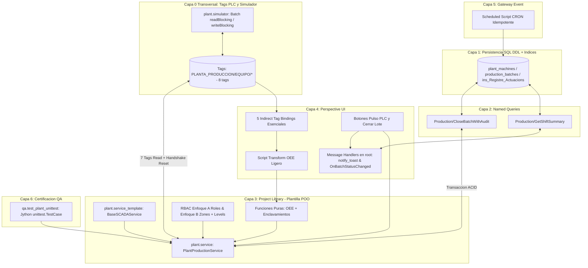

# Sesión 11

### 1. Apertura y Encuadre de la Sesión Final

#### Objetivos

* Revisar el estado de partida de los entornos individuales y verificar los recursos base del Proyecto Final Integrador.
* Establecer la dinámica de construcción autónoma guiada por contratos de ingeniería, presentación técnica y evaluación global del curso.

#### Contenidos

* Repaso de dudas finales sobre testing automatizado (`unittest`), plantillas canónicas de módulo (`plant.service_template`) y directrices PEP 8.
* Verificación de `SANDBOX_DB`, proveedor de tags `[default]` y acceso al Gateway en la nube (`http://35.204.54.113:8088/`).
* Cronograma de la sesión:
  * **Bloque 1:** Instalación rápida de recursos base y desarrollo autónomo de las capas del proyecto.
  * **Bloque 2:** Pruebas multi-usuario RBAC (Enfoque A y Enfoque B) en Perspective y certificación QA con `unittest`.
  * **Bloque 3:** Defensa técnica y revisión de código por pares (*Live Peer Code Review*).
  * **Bloque 4:** Test teórico final y cierre del curso.

#### Resultado esperado

* Alineación de todos los participantes sobre los entregables y contratos técnicos del proyecto final.

***

### 2. Tema 26: Arquitectura e Integración del Proyecto Final Integrador (Grado Industrial)

#### Objetivos

* Comprender e integrar de forma ágil las **6 capas arquitectónicas + Capa 0 transversal de campo (Tags PLC)** abordadas durante las 35 horas de formación.
* Justificar técnicamente el flujo completo de un SCADA real: lectura/escritura en bloque de tags (`readBlocking` / `writeBlocking`), modelo SQL indexado, Named Queries parametrizadas, servicio transaccional ACID construido sobre la plantilla `plant.service_template`, seguridad RBAC con doble enfoque (Roles Jython vs. Security Zones & Security Levels), Perspective reactivo con Message Handlers reales, tarea CRON idempotente en Gateway y suite QA con `unittest`.

#### Contenidos

**1. Arquitectura Industrial Ágil en 6+1 Capas**

* **Capa 0 (Transversal — Tags PLC y Simulador):** Jerarquía `[default]PLANTA_PRODUCCION/<EQUIPO>/` con 8 tags esenciales por máquina (contadores vivos, enclavamientos `ModoRemoto` y `SetaEmergencia`, y pulso `OrdenCierrePLC`) actualizados en bloque por `plant.simulator`.
* **Capa 1 (Persistencia Relacional e Índices B-Tree):** Catálogo maestro (`plant_machines`), lotes por turno (`production_batches`) y auditoría inmutable (`ins_Registre_Actuacions`).
* **Capa 2 (Named Queries Parametrizadas):** 2 consultas con *Value Parameters*: analítica sargable de turno (`Production/GetShiftSummary`) y cierre idempotente (`Production/CloseBatchWithAudit`).
* **Capa 3 (Lógica de Negocio en `Project Library` — Basada en Plantilla):** Funciones puras (`calculate_batch_kpis`, `evaluate_plc_interlocks_pure`), lectura en bloque de 7 tags y clase `PlantProductionService` heredada de `plant.service_template.BaseSCADAService` (Lab 10.2) con transacciones ACID explícitas y handshake al PLC.
* **Seguridad Industrial RBAC (Transversal Capas 3 y 4 — Doble Enfoque):**
  * *Enfoque A:* Validación imperativa de lista de roles en Jython (`user_roles`).
  * *Enfoque B:* Delegación en **Security Zones** (`Zona_Planta_Control`) y **Security Levels** (`Authenticated/Roles/Supervisor`), probada con 4 perfiles de usuario.
* **Capa 4 (Presentación Reactiva en Perspective):** Vista polimórfica con **5 Indirect Tag Bindings esenciales**, cálculo de OEE con **Script Transform ligero** y **2 Message Handlers receptores reales (`notify_toast` y `OnBatchStatusChanged`)**.
* **Capa 5 (Automatización en Gateway):** **Scheduled Script CRON (`0 0 6,14,22 * * ?`)** 100% idempotente para cierre de fin de turno.
* **Capa 6 (Certificación QA con `unittest`):** Batería reproducible de 5 tests con `unittest.TestCase` y Mocks de `QualifiedValue`.



> [!IMPORTANT]
> **Topología del Entorno (Designer Local vs. Gateway en Servidor Cloud):**
> El **Ignition Gateway** y **PostgreSQL (`SANDBOX_DB`)** se ejecutan en un **servidor en la nube** (`http://35.204.54.113:8088/`), mientras que el **Designer** y tu navegador corren en tu puesto cliente:
> 1. **Transacciones ACID Multi-Scope:** Usa `system.db.beginTransaction(database=DB_CONN, timeout=5000)`, cuya firma es idéntica tanto en **Perspective (Gateway Cloud)** como en **Script Console (Designer Local)**.
> 2. **Security Zones en Cloud (`Zona_Planta_Control`):** El servidor cloud no ve `127.0.0.1` como IP de tu sesión, sino la IP remota de tu equipo cliente. Consúltala en **Status -> Connections -> Perspective Sessions** al configurar `Zona_Planta_Control`.

**2. Matriz de Responsabilidades y Fronteras de Confianza**

| Capa | Responsabilidad Principal | Qué Tiene Estrictamente Prohibido |
| :--- | :--- | :--- |
| **Capa 0 (Tags y Simulador)** | 8 tags por equipo y lectura/escritura masiva en `plant.simulator`. | Leer o escribir tags dentro de bucles `for`. |
| **Capa 1 y 2 (SQL y Named Queries)** | Tablas indexadas y 2 Named Queries con *Value Parameters* (`:param`). | Concatenar SQL (`+`) o usar QueryString `{...}` para valores. |
| **Capa 3 (`plant.service`)** | Funciones puras (`0% I/O`) + `PlantProductionService(BaseSCADAService)` con transacción ACID. | Llamar a `system.tag.*` o `system.db.*` dentro de las funciones puras. |
| **Seguridad RBAC (A y B)** | **Enfoque A:** lista `user_roles` en Jython. **Enfoque B:** `Security Zones` + `Security Levels`. | Confiar únicamente en ocultar el botón en el navegador. |
| **Capa 4 (Perspective UI)** | 5 Indirect Tag Bindings, Script Transform OEE de 3 líneas y 2 Message Handlers reales en `root`. | Ejecutar SQL o `readBlocking` dentro de transforms visuales. |
| **Capa 5 (Gateway CRON)** | Scheduled Script CRON idempotente (`ConsolidacionFinTurno`). | Usar `print` o propiedades de sesión web (`self.session`). |
| **Capa 6 (QA `unittest`)** | 5 tests automatizados con `unittest.TestCase` y restauración de semilla. | Dejar lotes bloqueados que impidan repetir la suite. |

***

### 3. Laboratorio 11.1: Enunciado del Reto — Desarrollo e Integración Multicapa del Proyecto Final

#### Objetivos del Reto

* Construir e integrar todas las capas del proyecto final a partir de los **recursos base entregados** (tags esenciales, simulador `plant.simulator`, `INSERT INTO` de semilla, plantilla `plant.service_template` y JSON base opcional de la vista Perspective).
* Implementar `plant.service` heredando de `plant.service_template`, validar **ambos enfoques (Enfoque A y Enfoque B) en seguridad RBAC** con 4 usuarios distintos y certificar la solución al 100% con **`unittest`**.

---

#### 📦 Fase 0: Recursos Base Entregados al Alumno (Instalar antes de comenzar)

##### Recurso Entregado 1: Creación de los 8 Tags Esenciales por Equipo (`[default]PLANTA_PRODUCCION`)
Ejecutar una vez en **Tools -> Script Console**:

```python
# ==============================================================================
# RECURSO ENTREGADO 1: APROVISIONAMIENTO DE 8 TAGS ESENCIALES POR EQUIPO
# Ejecutar una vez en: Tools -> Script Console
# ==============================================================================
tag_provider = "[default]"
root_folder = "PLANTA_PRODUCCION"

equipos_config = [
    {"id": "EDAR_BOMBA_01",     "lote": "LOT-2026-FINAL-01", "target": 5000,  "good": 4850,  "scrap": 65,  "op_min": 420.0},
    {"id": "EDAR_BOMBA_02",     "lote": "LOT-2026-HIST-02",  "target": 4500,  "good": 4380,  "scrap": 95,  "op_min": 410.0},
    {"id": "EDAR_COMPRESOR_01", "lote": "LOT-2026-FINAL-03", "target": 1200,  "good": 980,   "scrap": 15,  "op_min": 310.0},
    {"id": "LINEA_ENVASADO_01", "lote": "LOT-2026-FINAL-02", "target": 15000, "good": 11200, "scrap": 180, "op_min": 280.0}
]

equipment_folders = []
for eq in equipos_config:
    equipment_folders.append({
        "name": eq["id"],
        "tagType": "Folder",
        "tags": [
            {"name": "ModoRemoto",         "tagType": "AtomicTag", "valueSource": "memory", "dataType": "Boolean", "value": True},
            {"name": "SetaEmergencia",     "tagType": "AtomicTag", "valueSource": "memory", "dataType": "Boolean", "value": False},
            {"name": "OrdenCierrePLC",     "tagType": "AtomicTag", "valueSource": "memory", "dataType": "Boolean", "value": False},
            {"name": "LoteActivoID",       "tagType": "AtomicTag", "valueSource": "memory", "dataType": "String",  "value": eq["lote"]},
            {"name": "UnidadesObjetivo",   "tagType": "AtomicTag", "valueSource": "memory", "dataType": "Int4",    "value": eq["target"]},
            {"name": "UnidadesBuenas",     "tagType": "AtomicTag", "valueSource": "memory", "dataType": "Int4",    "value": eq["good"]},
            {"name": "UnidadesScrap",      "tagType": "AtomicTag", "valueSource": "memory", "dataType": "Int4",    "value": eq["scrap"]},
            {"name": "TiempoOperativoMin", "tagType": "AtomicTag", "valueSource": "memory", "dataType": "Float8",  "value": eq["op_min"]}
        ]
    })

full_root_path = "{}{}".format(tag_provider, root_folder)
if system.tag.exists(full_root_path):
    system.tag.deleteTags([full_root_path])

system.tag.configure(tag_provider, [{"name": root_folder, "tagType": "Folder", "tags": equipment_folders}], "o")
print "Tags aprovisionados correctamente en [default]PLANTA_PRODUCCION/"
```

##### Recurso Entregado 2: Simulador de Telemetría Viva (`plant.simulator`)
Crear en **Server Scripting -> Project Library** el paquete `plant` y dentro el módulo `simulator` (`plant.simulator`):

```python
"""
Modulo: plant.simulator
Descripcion: Simulador ligero de contadores PLC mediante lectura/escritura en bloque.
"""
import random

TAG_ROOT = "[default]PLANTA_PRODUCCION"
MACHINES = ["EDAR_BOMBA_01", "EDAR_BOMBA_02", "EDAR_COMPRESOR_01", "LINEA_ENVASADO_01"]


def step_simulation_tick(increment_counters=True):
    read_paths = []
    for m in MACHINES:
        base = "{}/{}".format(TAG_ROOT, m)
        read_paths.extend([
            base + "/ModoRemoto", base + "/SetaEmergencia",
            base + "/UnidadesBuenas", base + "/UnidadesScrap", base + "/TiempoOperativoMin"
        ])

    qvs = system.tag.readBlocking(read_paths, 3000)
    write_paths, write_values, summary = [], [], {}

    for idx, m in enumerate(MACHINES):
        off = idx * 5
        is_remote = bool(qvs[off].value) if qvs[off].quality.isGood() else False
        is_estop = bool(qvs[off + 1].value) if qvs[off + 1].quality.isGood() else False
        good = int(qvs[off + 2].value or 0)
        scrap = int(qvs[off + 3].value or 0)
        op_min = float(qvs[off + 4].value or 0.0)

        if is_remote and not is_estop and increment_counters:
            good += random.randint(5, 15)
            scrap += (1 if random.random() < 0.25 else 0)
            op_min = round(op_min + 0.2, 2)

        base = "{}/{}".format(TAG_ROOT, m)
        write_paths.extend([base + "/UnidadesBuenas", base + "/UnidadesScrap", base + "/TiempoOperativoMin"])
        write_values.extend([good, scrap, op_min])
        summary[m] = {"good": good, "scrap": scrap, "op_min": op_min}

    system.tag.writeBlocking(write_paths, write_values, 3000)
    return summary


def reset_seed_counters_for_qa():
    base = "{}/EDAR_BOMBA_01".format(TAG_ROOT)
    paths = [
        base + "/ModoRemoto", base + "/SetaEmergencia", base + "/OrdenCierrePLC",
        base + "/LoteActivoID", base + "/UnidadesObjetivo", base + "/UnidadesBuenas",
        base + "/UnidadesScrap", base + "/TiempoOperativoMin"
    ]
    vals = [True, False, False, "LOT-2026-FINAL-01", 5000, 4850, 65, 420.0]
    system.tag.writeBlocking(paths, vals, 3000)
    return True
```

##### Recurso Entregado 3: Sentencias `INSERT INTO` para Poblar la Capa 1 (`SANDBOX_DB`)
> [!WARNING]
> **Importante:** Este script contiene **únicamente las sentencias `INSERT INTO`**. Antes de ejecutarlo en **Tools -> Database Query Browser** (`SANDBOX_DB`), debes escribir y ejecutar por ti mismo los `CREATE TABLE` y `CREATE INDEX` del **Reto 1**.

```sql
-- =============================================================================
-- RECURSO ENTREGADO 3: POBLADO COMPARTIBLE (EJECUTAR TRAS TUS CREATE TABLE)
-- =============================================================================
INSERT INTO plant_machines (machine_id, line_name, ideal_cycle_time_sec, is_active)
VALUES
    ('EDAR_BOMBA_01',     'LINEA_TRACTAMENT_AIGUA', 2.5,  TRUE),
    ('EDAR_BOMBA_02',     'LINEA_TRACTAMENT_AIGUA', 2.5,  TRUE),
    ('EDAR_COMPRESOR_01', 'LINEA_GENERACIO_AIRE',  12.0,  TRUE),
    ('LINEA_ENVASADO_01', 'LINEA_ENVASAT_PET',      1.2,  TRUE)
ON CONFLICT (machine_id) DO UPDATE SET
    line_name = EXCLUDED.line_name,
    ideal_cycle_time_sec = EXCLUDED.ideal_cycle_time_sec,
    is_active = EXCLUDED.is_active;

INSERT INTO production_batches (batch_id, machine_id, shift_id, target_units, good_units, scrap_units, operating_time_min, status, created_at, closed_at, closed_by)
VALUES
    ('LOT-2026-HIST-01',  'EDAR_BOMBA_01',     1, 5000,  4910,  45, 435.0, 'CLOSED',      CURRENT_TIMESTAMP - INTERVAL '6 hours',  CURRENT_TIMESTAMP - INTERVAL '2 hours', 'laura.vidal'),
    ('LOT-2026-HIST-02',  'EDAR_BOMBA_02',     1, 4500,  4380,  95, 410.0, 'CLOSED',      CURRENT_TIMESTAMP - INTERVAL '5 hours',  CURRENT_TIMESTAMP - INTERVAL '1 hour',  'laura.vidal'),
    ('LOT-2026-HIST-03',  'LINEA_ENVASADO_01', 1, 15000, 14650, 210, 395.0, 'CLOSED',     CURRENT_TIMESTAMP - INTERVAL '5 hours',  CURRENT_TIMESTAMP - INTERVAL '1 hour',  'marti.sanchez'),
    ('LOT-2026-HIST-04',  'EDAR_BOMBA_01',     2, 5000,  4720, 130, 405.0, 'CLOSED',      CURRENT_TIMESTAMP - INTERVAL '14 hours', CURRENT_TIMESTAMP - INTERVAL '8 hours', 'GATEWAY_CRON_AUTO'),
    ('LOT-2026-HIST-05',  'EDAR_COMPRESOR_01', 2, 1200,  1150,  18, 380.0, 'CLOSED',      CURRENT_TIMESTAMP - INTERVAL '13 hours', CURRENT_TIMESTAMP - INTERVAL '8 hours', 'GATEWAY_CRON_AUTO'),
    ('LOT-2026-FINAL-01', 'EDAR_BOMBA_01',     1, 5000,  4850,  65, 420.0, 'IN_PROGRESS', CURRENT_TIMESTAMP - INTERVAL '30 minutes', NULL, NULL),
    ('LOT-2026-FINAL-02', 'LINEA_ENVASADO_01', 1, 15000, 11200, 180, 280.0, 'IN_PROGRESS', CURRENT_TIMESTAMP - INTERVAL '25 minutes', NULL, NULL),
    ('LOT-2026-FINAL-03', 'EDAR_COMPRESOR_01', 1, 1200,   980,  15, 310.0, 'IN_PROGRESS', CURRENT_TIMESTAMP - INTERVAL '20 minutes', NULL, NULL)
ON CONFLICT (batch_id) DO UPDATE SET
    good_units = EXCLUDED.good_units,
    scrap_units = EXCLUDED.scrap_units,
    operating_time_min = EXCLUDED.operating_time_min,
    status = EXCLUDED.status,
    created_at = EXCLUDED.created_at,
    closed_at = EXCLUDED.closed_at,
    closed_by = EXCLUDED.closed_by;

INSERT INTO ins_Registre_Actuacions (Equip, Descripcio, Usuari, DataHora)
SELECT 'EDAR_BOMBA_01', 'OPERACION: Inicio de lote LOT-2026-FINAL-01 en modo REMOTO', 'laura.vidal', CURRENT_TIMESTAMP - INTERVAL '30 minutes'
WHERE NOT EXISTS (SELECT 1 FROM ins_Registre_Actuacions WHERE Descripcio LIKE '%LOT-2026-FINAL-01%');

INSERT INTO ins_Registre_Actuacions (Equip, Descripcio, Usuari, DataHora)
SELECT 'EDAR_BOMBA_01', 'SEGURIDAD: Intento no autorizado de cierre de lote sin rol Supervisor', 'operador_noche', CURRENT_TIMESTAMP - INTERVAL '15 minutes'
WHERE NOT EXISTS (SELECT 1 FROM ins_Registre_Actuacions WHERE Usuari = 'operador_noche' AND Equip = 'EDAR_BOMBA_01');
```

##### Recurso Entregado 4: Plantilla Canónica `plant.service_template` (Sesión 10 - Lab 10.2)
Guardar en **Server Scripting -> Project Library** bajo `plant.service_template`:

```python
"""
Modulo: plant.service_template
Descripcion: Plantilla canonica corporativa (Lab 10.2) para herencia POO en Capa 3.
"""
from java.lang import Exception as JavaException
from java.sql import SQLException

DEFAULT_DB_CONNECTION = "SANDBOX_DB"


class BaseSCADAService(object):
    def __init__(self, module_name, db_connection=DEFAULT_DB_CONNECTION):
        self.module_name = module_name
        self.db_connection = db_connection
        self.logger = system.util.getLogger("SCADA.{}".format(module_name))

    def check_rbac_roles(self, user_roles, authorized_roles):
        user_set = set(user_roles) if user_roles else set()
        auth_set = set(authorized_roles) if authorized_roles else set()
        return bool(user_set.intersection(auth_set))

    def check_rbac_security_levels(self, security_levels, required_levels, security_zones=None, allowed_zones=None):
        lvl_set = set(security_levels) if security_levels else set()
        req_set = set(required_levels) if required_levels else set()
        if not bool(lvl_set.intersection(req_set)):
            return False
        if allowed_zones:
            zone_set = set(security_zones) if security_zones else set()
            return bool(zone_set.intersection(set(allowed_zones)))
        return True

    def record_audit(self, equipment_id, description, user_str, tx=None):
        sql = "INSERT INTO ins_Registre_Actuacions (Equip, Descripcio, Usuari, DataHora) VALUES (?, ?, ?, CURRENT_TIMESTAMP)"
        params = [str(equipment_id), unicode(description), str(user_str)]
        if tx is not None:
            system.db.runPrepUpdate(sql, params, tx=tx)
        else:
            system.db.runPrepUpdate(sql, params, database=self.db_connection)

    def dispatch_acid_transaction(self, action_name, equipment_id, user_str, tx_operation_fn):
        tx_id = None
        try:
            tx_id = system.db.beginTransaction(database=self.db_connection, timeout=5000)
            payload = tx_operation_fn(tx_id)
            system.db.commitTransaction(tx_id)
            self.logger.info("[ACID:{}] Commit exitoso en '{}' por '{}'".format(action_name, equipment_id, user_str))
            return (True, payload)
        except SQLException as sql_ex:
            if tx_id is not None:
                system.db.rollbackTransaction(tx_id)
            self.logger.error("[ACID:{}] Rollback SQL en '{}': {}".format(action_name, equipment_id, sql_ex.getMessage()), sql_ex)
            return (False, {"error_code": "DB_SQL_ROLLBACK", "user_message": u"Error SQL: Transacción revertida"})
        except JavaException as java_ex:
            if tx_id is not None:
                system.db.rollbackTransaction(tx_id)
            self.logger.error("[ACID:{}] Rollback Java en '{}': {}".format(action_name, equipment_id, java_ex.getMessage()), java_ex)
            return (False, {"error_code": "GATEWAY_RUNTIME_ROLLBACK", "user_message": u"Error Gateway: Transacción revertida"})
        except Exception as py_ex:
            if tx_id is not None:
                system.db.rollbackTransaction(tx_id)
            self.logger.error("[ACID:{}] Rollback en '{}': {}".format(action_name, equipment_id, str(py_ex)))
            return (False, {"error_code": "INTERNAL_LOGIC_ROLLBACK", "user_message": unicode(str(py_ex))})
        finally:
            if tx_id is not None:
                try:
                    system.db.closeTransaction(tx_id)
                except Exception:
                    pass
```

##### Recurso Entregado 5 (Opcional para Ahorrar Tiempo en UI): JSON Base del Layout Perspective (`Lab11_OEE_Dashboard`)
Para no perder tiempo arrastrando controles ni creando propiedades una por una en el **Reto 5**, puedes crear la vista Flex `Laboratorios/Lab11_OEE_Dashboard`, hacer **`Shift` + Clic Derecho** sobre ella en el Project Browser y pulsar **`Paste JSON`** con el siguiente esqueleto (ya incluye las 4 propiedades de `view.custom`, los **5 Indirect Tag Bindings** de `root.custom` y los componentes vacíos listos para que tú programes el Transform, los botones, los bindings de tablas y los 2 Message Handlers):

<details>
<summary>Haz clic aquí para desplegar y copiar el JSON base de la vista <code>Lab11_OEE_Dashboard</code></summary>

```json
{
  "custom": {
    "lastNotification": "Sistema SCADA listo y conectado a PLC",
    "rbacMode": "A",
    "selectedEquip": "EDAR_BOMBA_01",
    "simulatedUser": "laura.vidal"
  },
  "params": {},
  "propConfig": {
    "custom.lastNotification": { "persistent": true },
    "custom.rbacMode": { "persistent": true },
    "custom.selectedEquip": { "persistent": true },
    "custom.simulatedUser": { "persistent": true }
  },
  "props": {
    "defaultSize": { "height": 740, "width": 1080 }
  },
  "root": {
    "children": [
      {
        "meta": { "name": "lbl_BannerNotificacion" },
        "propConfig": {
          "props.text": {
            "binding": {
              "config": { "path": "view.custom.lastNotification" },
              "type": "property"
            }
          }
        },
        "props": {
          "style": {
            "backgroundColor": "#2980b9",
            "borderRadius": "6px",
            "color": "#ffffff",
            "fontWeight": "bold",
            "padding": "10px 14px"
          }
        },
        "type": "ia.display.label",
        "version": 0
      },
      {
        "children": [
          {
            "meta": { "name": "drop_Equipo" },
            "propConfig": {
              "props.value": {
                "binding": {
                  "config": { "bidirectional": true, "path": "view.custom.selectedEquip" },
                  "type": "property"
                }
              }
            },
            "props": {
              "options": [
                { "label": "EDAR_BOMBA_01", "value": "EDAR_BOMBA_01" },
                { "label": "EDAR_BOMBA_02", "value": "EDAR_BOMBA_02" },
                { "label": "EDAR_COMPRESOR_01", "value": "EDAR_COMPRESOR_01" },
                { "label": "LINEA_ENVASADO_01", "value": "LINEA_ENVASADO_01" }
              ],
              "style": { "flexBasis": "200px" }
            },
            "type": "ia.input.dropdown",
            "version": 0
          },
          {
            "meta": { "name": "drop_UsuarioPrueba" },
            "propConfig": {
              "props.value": {
                "binding": {
                  "config": { "bidirectional": true, "path": "view.custom.simulatedUser" },
                  "type": "property"
                }
              }
            },
            "props": {
              "options": [
                { "label": "visita_auditor (Viewer)", "value": "visita_auditor" },
                { "label": "operador_noche (Operator)", "value": "operador_noche" },
                { "label": "laura.vidal (Supervisor)", "value": "laura.vidal" },
                { "label": "marti.sanchez (Admin)", "value": "marti.sanchez" }
              ],
              "style": { "flexBasis": "220px" }
            },
            "type": "ia.input.dropdown",
            "version": 0
          },
          {
            "meta": { "name": "drop_ModoRBAC" },
            "propConfig": {
              "props.value": {
                "binding": {
                  "config": { "bidirectional": true, "path": "view.custom.rbacMode" },
                  "type": "property"
                }
              }
            },
            "props": {
              "options": [
                { "label": "RBAC A (Roles Jython)", "value": "A" },
                { "label": "RBAC B (Zones + Levels)", "value": "B" }
              ],
              "style": { "flexBasis": "190px" }
            },
            "type": "ia.input.dropdown",
            "version": 0
          },
          {
            "meta": { "name": "btn_SimularPulsoPLC" },
            "props": {
              "style": { "backgroundColor": "#34495e", "color": "#ffffff", "fontWeight": "bold" },
              "text": "SIMULAR PULSO PLC"
            },
            "type": "ia.input.button",
            "version": 0
          },
          {
            "meta": { "name": "btn_CerrarLote" },
            "props": {
              "style": { "backgroundColor": "#27ae60", "color": "#ffffff", "fontWeight": "bold" },
              "text": "CERRAR Y AUDITAR LOTE"
            },
            "type": "ia.input.button",
            "version": 0
          }
        ],
        "meta": { "name": "barra_Controles" },
        "props": {
          "direction": "row",
          "style": { "alignItems": "center", "gap": "10px" },
          "wrap": "wrap"
        },
        "type": "ia.container.flex",
        "version": 0
      },
      {
        "meta": { "name": "lbl_OEE" },
        "props": {
          "style": {
            "backgroundColor": "#ecf0f1",
            "borderRadius": "6px",
            "fontSize": "18px",
            "fontWeight": "bold",
            "padding": "12px"
          },
          "text": "Configurar Binding OEE"
        },
        "type": "ia.display.label",
        "version": 0
      },
      {
        "meta": { "name": "tbl_ResumenTurno" },
        "props": { "style": { "flexBasis": "210px" } },
        "type": "ia.display.table",
        "version": 0
      },
      {
        "meta": { "name": "tbl_Auditoria" },
        "props": { "style": { "flexBasis": "240px" } },
        "type": "ia.display.table",
        "version": 0
      }
    ],
    "custom": {
      "batchId": "LOT-2026-FINAL-01",
      "good": 4850,
      "operating_min": 420.0,
      "scrap": 65,
      "target": 5000
    },
    "meta": { "name": "root" },
    "propConfig": {
      "custom.batchId": {
        "binding": {
          "config": {
            "bidirectional": false,
            "fallbackDelay": 2.5,
            "mode": "indirect",
            "references": { "1": "{view.custom.selectedEquip}" },
            "tagPath": "[default]PLANTA_PRODUCCION/{1}/LoteActivoID"
          },
          "type": "tag"
        }
      },
      "custom.good": {
        "binding": {
          "config": {
            "bidirectional": false,
            "fallbackDelay": 2.5,
            "mode": "indirect",
            "references": { "1": "{view.custom.selectedEquip}" },
            "tagPath": "[default]PLANTA_PRODUCCION/{1}/UnidadesBuenas"
          },
          "type": "tag"
        }
      },
      "custom.operating_min": {
        "binding": {
          "config": {
            "bidirectional": false,
            "fallbackDelay": 2.5,
            "mode": "indirect",
            "references": { "1": "{view.custom.selectedEquip}" },
            "tagPath": "[default]PLANTA_PRODUCCION/{1}/TiempoOperativoMin"
          },
          "type": "tag"
        }
      },
      "custom.scrap": {
        "binding": {
          "config": {
            "bidirectional": false,
            "fallbackDelay": 2.5,
            "mode": "indirect",
            "references": { "1": "{view.custom.selectedEquip}" },
            "tagPath": "[default]PLANTA_PRODUCCION/{1}/UnidadesScrap"
          },
          "type": "tag"
        }
      },
      "custom.target": {
        "binding": {
          "config": {
            "bidirectional": false,
            "fallbackDelay": 2.5,
            "mode": "indirect",
            "references": { "1": "{view.custom.selectedEquip}" },
            "tagPath": "[default]PLANTA_PRODUCCION/{1}/UnidadesObjetivo"
          },
          "type": "tag"
        }
      }
    },
    "props": {
      "direction": "column",
      "style": { "gap": "12px", "padding": "16px" }
    },
    "type": "ia.container.flex",
    "version": 0
  }
}
```

</details>

---

#### 🛠️ Especificaciones del Reto por Capas (Lo que debe desarrollar el alumno)

#### Reto 1: Capa 1 — Esquema Relacional SQL DDL (`CREATE TABLE` + `CREATE INDEX`) y Poblado
* Redactar y ejecutar en **Tools -> Database Query Browser** (`SANDBOX_DB`):
  1. **`plant_machines` (`CREATE TABLE IF NOT EXISTS`):** `machine_id` (`VARCHAR(50) PRIMARY KEY`), `line_name` (`VARCHAR(60) NOT NULL`), `ideal_cycle_time_sec` (`DOUBLE PRECISION NOT NULL`), `is_active` (`BOOLEAN NOT NULL DEFAULT TRUE`).
  2. **`production_batches` (`CREATE TABLE IF NOT EXISTS`):** `batch_id` (`VARCHAR(50) PRIMARY KEY`), `machine_id` (`VARCHAR(50) NOT NULL REFERENCES plant_machines(machine_id)`), `shift_id` (`INT NOT NULL CHECK (shift_id IN (1, 2, 3))`), `target_units` (`INT NOT NULL`), `good_units` (`INT NOT NULL DEFAULT 0`), `scrap_units` (`INT NOT NULL DEFAULT 0`), `operating_time_min` (`DOUBLE PRECISION NOT NULL DEFAULT 0.0`), `status` (`VARCHAR(20) NOT NULL DEFAULT 'IN_PROGRESS'`), `created_at` (`TIMESTAMP NOT NULL DEFAULT CURRENT_TIMESTAMP`), `closed_at` (`TIMESTAMP NULL`), `closed_by` (`VARCHAR(100) NULL`).
  3. **`ins_Registre_Actuacions` (`CREATE TABLE IF NOT EXISTS`):** `id` (`SERIAL PRIMARY KEY`), `Equip` (`VARCHAR(60) NOT NULL`), `Descripcio` (`TEXT NOT NULL`), `Usuari` (`VARCHAR(80) NOT NULL`), `DataHora` (`TIMESTAMP NOT NULL DEFAULT CURRENT_TIMESTAMP`).
  4. **Índices B-Tree:** `idx_batches_shift_created` en `(shift_id, created_at)`, `idx_batches_status_created` en `(status, created_at)` e `idx_audit_equip_datahora` en `(Equip, DataHora DESC)`.
  5. Ejecutar a continuación los `INSERT INTO` del **Recurso Entregado 3** (verificando 4 máquinas y 8 lotes: 5 `'CLOSED'` y 3 `'IN_PROGRESS'`).

---

#### Reto 2: Capa 2 — Las 2 Named Queries Parametrizadas (`Production/*`)
* Crear en **Named Queries** (carpeta `Production`, conexión `SANDBOX_DB`):
  1. **`Production/GetShiftSummary` (`Query`):**
     * *Parámetros:* `shiftId` (`Integer`), `startDate` (`DateTime`), `endDate` (`DateTime`).
     * *Columnas:* `machine_id`, `line_name`, `total_batches`, `active_batches`, `sum_good`, `sum_scrap`, `scrap_rate_pct` (protegido con `NULLIF`).
  2. **`Production/CloseBatchWithAudit` (`Update Query`):**
     * *Parámetros:* `batchId` (`String`), `goodUnits` (`Integer`), `scrapUnits` (`Integer`), `user` (`String`).
     * *Idempotencia:* Actualizar a `status = 'CLOSED'`, `closed_at = CURRENT_TIMESTAMP`, `closed_by = :user` filtrando por `WHERE batch_id = :batchId AND status = 'IN_PROGRESS'`.

---

#### Reto 3: Seguridad RBAC (Enfoque A y Enfoque B) en el Gateway Cloud
* En `http://35.204.54.113:8088/`:
  1. **Usuarios (`Config -> Security -> Users, Roles`):** Verificar/crear `visita_auditor` (`PlantViewer`), `operador_noche` (`Operator`), `laura.vidal` (`Operator`, `Supervisor`) y `marti.sanchez` (`Administrator`, `Supervisor`).
  2. **Security Zone y Security Levels (Para Enfoque B):** Consultar tu IP cliente en **Status -> Connections**, crear `Zona_Planta_Control` en **Security Zones** incluyendo dicha IP y verificar los niveles `Authenticated/Roles/Supervisor` y `Authenticated/Roles/Administrator`.

---

#### Reto 4: Capa 3 — Servicio de Planta (`plant.service`) Basado en `plant.service_template`
* Implementar `plant.service` con estos 3 bloques concisos:
  1. **Funciones Puras (`0% I/O`):**
     * `calculate_batch_kpis(target_units, good_units, scrap_units, operating_min, ideal_cycle_sec=2.5)`: Guarda contra `None` y valores `<= 0` retornando `0.0`. Retorna `{'availability': 100.0, 'performance': ..., 'quality': ..., 'oee': ..., 'scrap_rate': ...}` redondeados a 2 decimales.
     * `evaluate_plc_interlocks_pure(is_remote, is_estop, all_qualities_good=True)`: Retorna `(bool, str_code, unicode_msg)` bloqueando ante calidad `Bad`, `SetaEmergencia = True` o `ModoRemoto = False`.
  2. **Lectura en Bloque de los 7 Tags Esenciales y Handshake PLC:**
     * `read_machine_live_telemetry(equip="EDAR_BOMBA_01", tag_reader_fn=None)`: Lee en 1 sola llamada `readBlocking` los **7 tags esenciales** (`ModoRemoto`, `SetaEmergencia`, `LoteActivoID`, `UnidadesObjetivo`, `UnidadesBuenas`, `UnidadesScrap`, `TiempoOperativoMin`), evalúa enclavamientos y calcula el OEE.
     * `_execute_plc_closure_handshake(equip, closed_batch_id)`: En 1 sola llamada `writeBlocking`, escribe `OrdenCierrePLC = True`, `LoteActivoID = "<batch_id>-NEXT"` y resetea a `0` `UnidadesBuenas`, `UnidadesScrap` y `TiempoOperativoMin`.
  3. **Servicio POO (`class PlantProductionService(BaseSCADAService)` + wrapper `finalize_batch_service(...)`):**
     * Hereda de `plant.service_template.BaseSCADAService` (**Recurso Entregado 4**).
     * Soporta **RBAC Enfoque A** (`rbac_mode="A"` $\rightarrow$ `self.check_rbac_roles`) y **RBAC Enfoque B** (`rbac_mode="B"` $\rightarrow$ `self.check_rbac_security_levels`). Si deniega el acceso, registra `WARN` e inserta alerta `SEGURIDAD [RBAC-...]` con `self.record_audit(...)`.
     * Verifica enclavamientos PLC y ejecuta en una transacción ACID (`self.dispatch_acid_transaction`) la Named Query `Production/CloseBatchWithAudit` junto con `self.record_audit(..., tx=tx_id)`. Tras el commit, lanza `_execute_plc_closure_handshake`.

---

#### Reto 5: Capa 4 — Vista Ágil en Perspective (`Views/Laboratorios/Lab11_OEE_Dashboard`)
* Construir la vista (manualmente o pegando el **Recurso Entregado 5** con `Shift + Clic Derecho -> Paste JSON`):
  1. **5 Indirect Tag Bindings Esenciales en `root.custom`** (`{1}` = `view.custom.selectedEquip`): `batchId` (`LoteActivoID`), `target` (`UnidadesObjetivo`), `good` (`UnidadesBuenas`), `scrap` (`UnidadesScrap`) y `operating_min` (`TiempoOperativoMin`).
  2. **Cálculo Reactivo de OEE en `lbl_OEE`:** Configurar un **Expression Structure Binding** con esas 5 propiedades y un **Script Transform** de 3 líneas que invoque a `plant.service.calculate_batch_kpis(...)`.
  3. **Acciones y Tablas:**
     * `btn_SimularPulsoPLC`: Invoca `plant.simulator.step_simulation_tick()` y envía mensaje a `notify_toast`.
     * `btn_CerrarLote`: Resuelve el usuario activo (o el seleccionado en `drop_UsuarioPrueba` + `drop_ModoRBAC`), llama a `plant.service.finalize_batch_service(...)` y emite `notify_toast` y `OnBatchStatusChanged` (`scope="page"`).
     * `tbl_ResumenTurno` vinculada a `Production/GetShiftSummary` y `tbl_Auditoria` mostrando las últimas entradas de `ins_Registre_Actuacions`.
  4. **Los 2 Message Handlers Receptores en `root` (`Configure Scripts... -> Message Handlers`):**
     * **`notify_toast` (`Page`, `Session`):** Actualiza `view.custom.lastNotification` y colorea `lbl_BannerNotificacion` (verde en éxito, rojo en rechazo/error, azul en pulso PLC).
     * **`OnBatchStatusChanged` (`Page`, `Session`):** Ejecuta `refreshBinding("props.data")` sobre `tbl_ResumenTurno` y `tbl_Auditoria`.

---

#### Reto 6: Capa 5 — Automatización en Gateway (`ConsolidacionFinTurno`)
* Configurar un único **Gateway Scheduled Script** (`0 0 6,14,22 * * ?`):
  * Comprobar con `system.db.runScalarPrepQuery` cuántos lotes siguen en `'IN_PROGRESS'`. Si es `0`, registrar traza de idempotencia en el logger y salir sin escribir.
  * Si hay lotes abiertos, actualizarlos a `'CLOSED'` con `closed_by = 'GATEWAY_CRON_AUTO'` y registrar el cierre en `ins_Registre_Actuacions`.

---

#### Reto 7: Capa 6 — Suite de Certificación QA con `unittest` (`qa.test_plant_unittest`)
* Crear en `Project Library` el módulo `qa.test_plant_unittest` usando la librería estándar **`unittest`** de Jython (`unittest.TestCase` + `unittest.TextTestRunner(verbosity=2)`) con una función `reset_test_batches_in_db()` para que sea 100% repetible y verifique estos **5 tests obligatorios**:
  1. `test_01_calculo_oee_nominal`: Con `(5000, 4850, 65, 420.0, 2.5)` valida `quality == 98.68`, `performance == 48.76` y `oee == 48.12`.
  2. `test_02_calculo_oee_casos_limite_y_nulos`: Entradas `0` y `None` retornan `0.0` sin lanzar excepciones.
  3. `test_03_enclavamientos_plc_y_mock_bad_quality`: Bloqueo ante `SetaEmergencia = True` e inyección de `MockQualifiedValue` con calidad `Bad`.
  4. `test_04_rbac_rechazo_usuarios_no_autorizados_a_y_b`: Rechazo en `finalize_batch_service` para `visita_auditor` (`rbac_mode="A"`), `operador_noche` (`rbac_mode="B"`) y `laura.vidal` fuera de zona (`Zona_WiFi_Externa`).
  5. `test_05_cierre_acido_idempotencia_y_handshake_plc_a_y_b`: Cierre autorizado e idempotencia en Modo A (`LOT-2026-FINAL-01` con `marti.sanchez`, comprobando que el PLC queda con `OrdenCierrePLC == True`, `UnidadesBuenas == 0` y `LoteActivoID == 'LOT-2026-FINAL-01-NEXT'`) y en Modo B (`LOT-2026-FINAL-02` con `laura.vidal`).

#### Resultado esperado

* Proyecto SCADA completo, ágil de construir en clase, probado en vivo en Perspective con múltiples usuarios en RBAC A/B y certificado al 100% (`Ran 5 tests ... OK`) con `unittest`.

***

### 4. Test Final de Conceptos Global

#### Objetivos

* Evaluar el grado de asimilación global de los contenidos teóricos y prácticos impartidos a lo largo de las 11 sesiones (35 horas).
* Certificar la adquisición de competencias en Scopes de ejecución, interoperabilidad Jython/Java, transacciones ACID, optimización SQL, seguridad RBAC, diseño modular con plantillas y testing con `unittest`.

#### Cuestionario Técnico Integrador

* [Cuestionario Sesión 10](https://docs.google.com/forms/d/e/1FAIpQLSca5RJfunwZEwJs1myBwAPwzB85mQ5nx7OXkQZW4K2jRmy1Rg/viewform?usp=header)

#### Resultado esperado

* Certificación individual del aprovechamiento técnico del curso y acreditación de los conocimientos exigidos para el desarrollo profesional en Ignition SCADA.

***

### 5. Decálogo de Buenas Prácticas y Consejos Finales para Producción Real

#### Objetivos

* Sintetizar las 10 reglas de oro de la ingeniería de scripting en Ignition para su aplicación directa en proyectos de planta en producción.
* Proveer pautas de mantenimiento, gobernanza y evolución de sistemas SCADA a largo plazo.

#### Las 10 Reglas de Oro de Scripting en Ignition SCADA

1. **Cero SQL Concatenado:** Utilizar exclusivamente Named Queries con *Value Parameters* (`:param`) o Prepared Statements con parámetros posicionales (`?`). Toda concatenación es una vulnerabilidad de inyección SQL.
2. **Cero E/S en Bucles:** Agrupar lecturas y escrituras de tags en llamadas masivas por lote (`system.tag.readBlocking` y `system.tag.writeBlocking`). Prohibido llamar a tags dentro de bucles `for`.
3. **Transforms Livianos:** Los Script Transforms de Perspective deben limitarse a llamadas de 1-3 líneas a funciones puras. Cero llamadas a base de datos o lecturas de tags en transforms.
4. **Transaccionalidad ACID y Captura Dual de Excepciones:** Agrupar escrituras críticas y sus pistas de auditoría bajo transacciones explícitas (`system.db.beginTransaction`, `commit`, `rollback`, `close` en `finally`) e interceptar tanto errores de Jython como `SQLException` y `JavaException`.
5. **Logging Contextual Estructurado:** Erradicar por completo las sentencias `print` en Gateway y utilizar `system.util.getLogger` identificando módulo, máquina, acción y usuario.
6. **Defensa en Profundidad (Security Zones + Levels + Backend RBAC):** Combinar la restricción por zonas de red y niveles de seguridad nativos de Ignition con la validación imperativa de roles en `Project Library`, auditando todo intento rechazado.
7. **Idempotencia y Handshake Físico PLC ↔ SCADA:** Diseñar tareas CRON de forma que su reejecución no duplique cierres, y verificar siempre los enclavamientos físicos (`ModoRemoto`, `SetaEmergencia`, calidad `Good`) antes de transaccionar.
8. **Consultas SQL Sargables e Indexadas:** Filtrar rangos temporales directamente sobre columnas con índices B-Tree (`created_at >= :start AND created_at <= :end`) sin aplicar funciones sobre la columna en el `WHERE`.
9. **Arquitectura Basada en Plantillas Corporativas:** Construir los servicios de planta heredando de una clase base estandarizada (`BaseSCADAService`) y desacoplar la interfaz gráfica mediante **Message Handlers** reales.
10. **Testing Automatizado Reproducible (`unittest` + Mocks):** Certificar algoritmos, enclavamientos y contratos de datos en la Script Console utilizando `unittest.TestCase` y Mocks de `QualifiedValue` antes de publicar cambios en el Gateway de producción.

#### Resultado esperado

* Asimilación de un marco metodológico y técnico consolidado que guíe el desarrollo de futuros proyectos industriales en entornos reales.

***

### 6. Feedback Individual, Balance y Cierre del Curso

#### Objetivos

* Resolver dudas avanzadas sobre casos particulares de las plantas de los asistentes.
* Clausurar formalmente el curso de 35 horas y hacer entrega de las acreditaciones técnicas.

#### Contenidos

* [Feedback Sesión 11](https://imagina-formacion.typeform.com/to/LQzhO2AR)

#### Resultado esperado

* Finalización formal del curso con todos los alumnos evaluados, proyectos validados y un conjunto de herramientas y estándares listos para su aplicación inmediata en planta.
