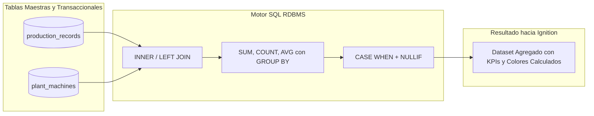

# Sesión 4

### 1. Repaso Inicial y Resolución de Dudas de la Sesión 3

#### Objetivos

* Consolidar la metodología de depuración sistemática en 6 fases y el uso de la Script Console como entorno de aislamiento.
* Revisar el diseño de bancos de pruebas sintéticos (_Mocks_) para validar funciones de `Project Library`.

#### Contenidos

* Repaso de las técnicas de introspección de objetos (`type`, `dir`, `len`) en la JVM.
* Revisión de dudas sobre la interpretación de trazas de error (_Tracebacks_) en la consola.
* Comprobación de la correcta eliminación de sentencias `print` temporales antes del pase a entornos de Gateway.

#### Resultado esperado

* Fijación del flujo de aislamiento y pruebas en consola, base necesaria para implementar captura formal de excepciones y logging en esta sesión.

***

### 2. Tema 8: Logging y Tratamiento Profesional de Errores en Ignition

#### Objetivos

* Dominar la captura jerárquica de excepciones duales (Jython nativo y clases Java de la JVM).
* Comprender la arquitectura de registro de trazas en el Gateway mediante `system.util.getLogger` y sus niveles de severidad.
* Diseñar mensajes contextuales para diagnóstico técnico y respuestas estructuradas amigables para el operador de planta.

#### Contenidos

**1. Arquitectura de Excepciones Duales: Jython vs. Java Runtime**

* **La discrepancia de tipos de excepción:**
  * En Jython 2.7, las excepciones del lenguaje heredan de la clase base de Python `exceptions.Exception`.
  * Las excepciones lanzadas por el motor interno de Ignition, los drivers de PLC y los conectores de base de datos son objetos nativos de Java que heredan de `java.lang.Throwable` y `java.lang.Exception`.
* **El fallo del bloque `except Exception` estándar:**
  * Un bloque `except Exception:` en Jython **no siempre intercepta ciertas excepciones nativas de Java** (como errores de timeout de sockets de red, violaciones de constraints JDBC complejas o punteros nulos de la JVM).
*   **Estructura de captura profesional recomendada:**

    ```python
    from java.lang import Exception as JavaException
    from java.sql import SQLException

    try:
        # Operacion critica de I/O, base de datos o tags
        pass
    except (TypeError, ValueError, KeyError, IndexError) as py_err:
        # 1. Errores especificos de la logica y tipos de Jython
        pass
    except SQLException as sql_err:
        # 2. Errores especificos del motor de base de datos
        pass
    except JavaException as java_err:
        # 3. Errores genericos del runtime de Java / Ignition Gateway
        pass
    except Exception as general_err:
        # 4. Fallback final de Python
        pass
    else:
        # Se ejecuta UNICAMENTE si no ocurrio ninguna excepcion
        pass
    finally:
        # Se ejecuta SIEMPRE (limpieza de conexiones, liberacion de locks)
        pass
    ```

**2. Logging Centralizado con `system.util.getLogger`**

* **Espacios de nombres jerárquicos (**_**Logger Namespaces**_**):**
  * La nomenclatura debe seguir el árbol funcional del sistema SCADA mediante puntos:
    * `system.util.getLogger("SCADA.Packaging.Line1.Conveyor")`
    * `system.util.getLogger("SCADA.Database.Transactions")`
  * Permite al administrador del Gateway filtrar y ajustar los niveles de log de un área completa sin alterar el resto del sistema.
* **Semántica de los Niveles de Severidad:**
  * `TRACE / DEBUG`: Trazas de depuración técnica (payloads de tags, dumps de arrays). Solo activos durante desarrollo o análisis puntual de averías.
  * `INFO`: Eventos nominales significativos en el ciclo de producción (arranque de turno, carga de receta completada, cambio de orden de trabajo).
  * `WARN`: Anomalías recuperables que requieren atención pero no detienen el proceso (reintento de comunicación tras timeout, corrección automática de un valor fuera de rango).
  * `ERROR`: Fallos críticos que impiden completar una operación (caída de base de datos, tag no encontrado, fallo de inserción de lote).
* **El Principio del Contexto Completo:**
  * Una traza de log debe permitir a un ingeniero de mantenimiento diagnosticar la avería sin necesidad de abrir el código fuente.
  * Formato obligatorio de mensaje: `[Subdominio] [Usuario] [Recurso/ID] [Detalle de entrada] -> [Error exacto]`.

**3. Patrón Wrapper para Operaciones Críticas**

* **Encapsulación de efectos secundarios:** Centralizar la ejecución protegida de consultas SQL o escrituras de tags en funciones de librería genéricas (`safe_db_call`, `safe_tag_write`).
* Evita la duplicación masiva de bloques `try/except` a lo largo de cientos de componentes visuales en el Designer.

#### Resultado esperado

* Capacidad para proteger scripts críticos mediante captura dual de errores, registrando trazas contextualizadas en el Gateway y evitando que excepciones no controladas afecten a la interfaz de usuario.

***

### 3. Laboratorio 4.1: Módulo de Logging Contextual y Wrapper Defensivo

#### Objetivos

* Construir una función de ejecución protegida (_Wrapper_) en `Project Library` (`project.util.logging`) que capture excepciones híbridas de Jython y Java.
* Registrar automáticamente los fallos en el sistema de logs del Gateway con metadatos contextuales (usuario, máquina, acción) y retornar una tupla estandarizada `(success, result_or_user_message)`.

#### Resultado esperado

* Módulo creado y verificado desde la Script Console que procesa llamadas nominales y llamadas con fallos forzados (tags inválidos, errores de tipo), comprobando la emisión de trazas formateadas en el visor de logs del Gateway y la entrega de respuestas limpias hacia la consola.


**Paso 1: Creación del Módulo en Project Library**

1. En el panel izquierdo de **Ignition Designer** (_Project Browser_), desplegar **Server Scripting -> Project Library**.
2. Hacer clic derecho sobre **Project Library**, seleccionar **New Script** y nombrarlo: `util.logging` (carpeta `util`, script `logging`).

**Paso 2: Implementación de la Función `safe_execution`**

En el editor del script `project.util.logging`, copiar y guardar el siguiente código:

```python
"""
Modulo: project.util.logging
Descripcion: Wrapper defensivo de ejecucion con captura dual de excepciones
             (Jython + Java) y registro contextual en el Gateway.
Autor: Equipo SCADA
"""
from java.lang import Exception as JavaException
from java.sql import SQLException

# Logger centralizado del proyecto SCADA
LOGGER = system.util.getLogger("SCADA.Core")

def safe_execution(func_name, context_info, callable_func, *args, **kwargs):
    """
    Ejecuta una funcion de forma protegida, capturando excepciones de Jython y Java
    y emitiendo logs estructurados en el Gateway.
    
    Args:
        func_name (str): Nombre identificativo de la operacion (ej. 'TagWrite_Speed').
        context_info (dict): Diccionario con contexto (user, equip, action, etc.).
        callable_func (callable): Puntero a la funcion a ejecutar.
        *args, **kwargs: Argumentos posicionales y nombrados para callable_func.
        
    Returns:
        tuple: (bool success, any result_or_error_message)
    """
    # 1. Construccion del encabezado contextual
    ctx_items = []
    if isinstance(context_info, dict):
        for k, v in sorted(context_info.items()):
            ctx_items.append("{}={}".format(k, v))
        ctx_str = " | ".join(ctx_items)
    else:
        ctx_str = str(context_info)
        
    try:
        LOGGER.debug("[{}] Iniciando ejecucion. Contexto: [{}]".format(func_name, ctx_str))
        
        # 2. Invocacion de la funcion objetivo
        result = callable_func(*args, **kwargs)
        
        LOGGER.debug("[{}] Ejecucion completada con exito. Contexto: [{}]".format(func_name, ctx_str))
        return (True, result)
        
    except (TypeError, ValueError, KeyError, IndexError) as py_err:
        # Errores propios de la sintaxis y tipos de Jython
        err_detail = "Error de tipos/datos en [{}]: {}".format(func_name, str(py_err))
        LOGGER.error("{} | Contexto: [{}]".format(err_detail, ctx_str))
        return (False, u"Error en los parámetros o datos de procesamiento")
        
    except SQLException as sql_err:
        # Errores especificos del motor de base de datos (JDBC)
        err_detail = "Error SQL/JDBC en [{}]: {}".format(func_name, sql_err.getMessage())
        LOGGER.error("{} | Contexto: [{}]".format(err_detail, ctx_str), sql_err)
        return (False, u"Error de comunicación o transacción con la base de datos")
        
    except JavaException as java_err:
        # Errores genericos de la JVM / drivers de Ignition
        err_detail = "Error Java/Gateway en [{}]: {}".format(func_name, java_err.getMessage())
        LOGGER.error("{} | Contexto: [{}]".format(err_detail, ctx_str), java_err)
        return (False, u"Fallo de comunicación con el sistema industrial")
        
    except Exception as general_err:
        # Fallback general de Python
        err_detail = "Error no controlado en [{}]: {}".format(func_name, str(general_err))
        LOGGER.error("{} | Contexto: [{}]".format(err_detail, ctx_str))
        return (False, u"Error interno no controlado")
```

**Paso 3: Guardar el Proyecto**

1. En el menú superior, hacer clic en **File -> Save** (o `Ctrl+S` / `Cmd+S`).

**Paso 4: Pruebas y Validación desde la Script Console**

1. Abrir la **Script Console** (**Tools -> Script Console**).
2. Probar la función simulando operaciones nominales y fallos reales de planta:

```python
print "=== VALIDACION LABORATORIO 4.1: LOGGING CONTEXTUAL ==="

# 1. Definir funciones auxiliares de prueba
def simular_escritura_consigna(tag_path, valor):
    if "INVALID" in tag_path:
        raise ValueError("Ruta de tag inexistente en el provider")
    return u"Consigna {:.2f} escrita correctamente en {}".format(float(valor), tag_path)

def simular_calculo_con_error(x, y):
    # Forzar error de tipo
    return x + y

# 2. Caso Nominal (Exito)
ctx_1 = {"user": "marti.sanchez", "equip": "EDAR_BOMBA_01", "action": "SET_SPEED"}
ok1, res1 = project.util.logging.safe_execution(
    "SetSpeed_Action", ctx_1, simular_escritura_consigna, "[default]EDAR/EDAR_BOMBA_01/SCFL", 45.5
)
print "\nCaso 1 (Nominal) -> Exito: {} | Retorno: {}".format(ok1, res1)

# 2. Caso Error de Validacion (Captura Jython + Log en Gateway)
ctx_2 = {"user": "operador_noche", "equip": "EDAR_COMPRESOR_02", "action": "SET_PRESSURE"}
ok2, res2 = project.util.logging.safe_execution(
    "SetPressure_Action", ctx_2, simular_escritura_consigna, "[default]EDAR/INVALID_PATH/SCMX", 8.2
)
print "Caso 2 (Tag Invalido) -> Exito: {} | Mensaje Usuario: {}".format(ok2, res2)

# 3. Caso Error de Tipos (Captura TypeError)
ctx_3 = {"user": "admin", "equip": "DECANTADOR_01", "action": "CALC_INDEX"}
ok3, res3 = project.util.logging.safe_execution(
    "CalcIndex_Action", ctx_3, simular_calculo_con_error, "Texto", 100
)
print "Caso 3 (Error Tipos)  -> Exito: {} | Mensaje Usuario: {}".format(ok3, res3)
```

**Paso 5: Inspección en el Gateway**

1. Abrir el navegador web y acceder a la página de administración del Gateway (`http://localhost:8088`).
2. Navegar a **Status -> Diagnostics -> Logs**.
3. Filtrar por el nombre del logger: `SCADA.Core`.
4. **Verificación:** Comprobar que aparecen los registros de error con el contexto formateado `user=... | equip=... | action=...` y el detalle técnico del error.

***

### 4. Tema 9: SQL Esencial para Scripting Industrial y Cálculo de KPIs

#### Objetivos

* Dominar la sintaxis de consultas SQL estructuradas (`SELECT`, `WHERE`, `ORDER BY`, `GROUP BY`, `HAVING`) aplicadas a datos de telemetría y eventos de planta.
* Relacionar tablas transaccionales de eventos con tablas maestras de planta mediante operaciones `JOIN`.
* Delegar el cálculo de indicadores de rendimiento (OEE, porcentajes de scrap, medias de ciclo) directamente en el motor de base de datos utilizando lógica condicional `CASE WHEN`.

#### Contenidos

**1. Estructura de Consultas Industriales Eficientes**

* **Proyección explícita de columnas:**
  * Prohibición terminante de `SELECT *` en tablas de planta. Arrastra columnas de metadatos, satura el pool JDBC y ralentiza la serialización.
  * Seleccionar exclusivamente las columnas requeridas para el cálculo o la visualización.
* **Filtrado temporal y particiones (`WHERE`):**
  * La telemetría industrial exige siempre límites temporales explícitos (`recorded_at >= :start AND recorded_at < :end`).
  * Consultar tablas históricas sin filtro de fechas provoca escaneos completos de millones de registros, saturando el motor SQL.
* **Agregaciones masivas en servidor (`GROUP BY` y `HAVING`):**
  * Uso de `SUM()`, `AVG()`, `COUNT()`, `MIN()`, `MAX()` para condensar miles de lecturas de sensores en un único registro por turno, máquina o lote.
  * Uso de `HAVING` para filtrar sobre resultados calculados (ej. `HAVING COUNT(alarm_id) > 10` para identificar equipos con alta recurrencia de paradas).

**2. Combinación de Tablas de Planta (`JOIN`)**

* **`INNER JOIN`:**
  * Uso: Combinar registros transaccionales que obligatoriamente deben coincidir con un maestro (ej. cada registro de lote debe pertenecer a una máquina existente en `plant_machines`).
* **`LEFT JOIN`:**
  * Uso: Conservar todos los registros de la tabla principal aunque la tabla secundaria no contenga coincidencias (ej. listar todas las máquinas de la planta y cruzar sus paradas del turno; las máquinas que no tuvieron paradas aparecerán con valores `NULL`, permitiendo verificar que operaron al 100%).

**3. Lógica Condicional y Cálculo de Indicadores en SQL (`CASE WHEN`)**

* **Eliminación de bucles condicionales en el SCADA:**
  *   Traducir códigos numéricos de PLC (ej. Estado = 1, 2, 3) a cadenas funcionales y colores directamente en la consulta:

      ```sql
      SELECT 
          machine_id,
          produced_units,
          CASE 
              WHEN status_code = 1 THEN 'PRODUCIENDO'
              WHEN status_code = 2 THEN 'PARADA NO PLANIFICADA'
              WHEN status_code = 3 THEN 'MANTENIMIENTO'
              ELSE 'ESTADO INDEFINIDO'
          END AS status_text,
          CASE 
              WHEN scrap_rate > 5.0 THEN '#e74c3c' -- Rojo alerta
              WHEN scrap_rate > 2.0 THEN '#f39c12' -- Ambar aviso
              ELSE '#2ecc71'                       -- Verde optimo
          END AS status_color
      FROM machine_shift_summary;
      ```
* **Protección contra División por Cero con `NULLIF`:**
  * El cálculo de tasas porcentuales (ej. `(scrap * 100.0) / total`) falla fatalmente en el motor SQL si `total = 0`.
  *   _Patrón industrial estándar:_

      ```sql
      -- Si el divisor es 0, NULLIF retorna NULL y la division resulta en NULL sin arrojar excepcion
      ROUND((SUM(scrap_units) * 100.0) / NULLIF(SUM(good_units + scrap_units), 0), 2) AS scrap_percentage
      ```



#### Resultado esperado

* Capacidad para diseñar consultas SQL analíticas de alto rendimiento que entreguen datos agregados y KPIs precalculados listos para su consumo en Ignition.

***

### 5. Laboratorio 4.2: Consultas Analíticas Industriales y Cálculo de KPIs en Base de Datos

#### Objetivos

* Diseñar una consulta SQL industrial que cruce tablas de máquinas y registros de producción, calculando unidades conformes, scrap, porcentaje de rechazo, tiempo medio de ciclo y estado de calidad condicional.
* Ejecutar la consulta desde la Script Console simulando el consumo del `Dataset` resultante y formateando el reporte consolidado de líneas.

#### Resultado esperado

* Consulta SQL validada en el sandbox de base de datos que agrupa por línea, máquina y turno, y script de prueba en consola que recorre el `Dataset` resultante mostrando un informe formateado de producción y calidad por equipo.

**Paso 1: Verificación de la Consulta en el Database Query Browser**

1. En **Ignition Designer**, ir a **Tools -> Database Query Browser**.
2. Seleccionar la conexión de base de datos sandbox (por defecto `SANDBOX_DB` o la conexión configurada en el curso).
3. Pegar y ejecutar la siguiente consulta SQL analítica:

```sql
SELECT 
    te.tagpath,
    COUNT(d.t_stamp) AS total_muestras,
    ROUND(AVG(d.floatvalue)::numeric, 2) AS valor_medio,
    ROUND(MIN(d.floatvalue)::numeric, 2) AS valor_minimo,
    ROUND(MAX(d.floatvalue)::numeric, 2) AS valor_maximo,
    CASE 
        WHEN AVG(d.floatvalue) > 75.0 THEN 'ALTA_CARGA'
        WHEN AVG(d.floatvalue) < 25.0 THEN 'BAJA_CARGA'
        ELSE 'NOMINAL'
    END AS estado_operativo,
    CASE 
        WHEN AVG(d.floatvalue) > 75.0 THEN '#e74c3c' -- Rojo alerta
        WHEN AVG(d.floatvalue) < 25.0 THEN '#f39c12' -- Ambar aviso
        ELSE '#2ecc71'                               -- Verde optimo
    END AS color_hex
FROM sqlt_data_1_2026_10 d
INNER JOIN sqlth_te te ON d.tagid = te.id
WHERE d.floatvalue IS NOT NULL
GROUP BY te.tagpath
ORDER BY valor_medio DESC;
```

**Paso 2: Implementación del Consumo en la Script Console**

1. Abrir la **Script Console**.
2. Limpiar el editor y pegar el script que ejecuta la consulta y formatea el reporte de planta:

```python
"""
Script de Consumo Analitico de Telemetria Historica.
Ejecuta la consulta agregada en BD y procesa el reporte en Jython.
"""

sql_query = """
SELECT 
    te.tagpath,
    COUNT(d.t_stamp) AS total_muestras,
    ROUND(AVG(d.floatvalue)::numeric, 2) AS valor_medio,
    ROUND(MIN(d.floatvalue)::numeric, 2) AS valor_minimo,
    ROUND(MAX(d.floatvalue)::numeric, 2) AS valor_maximo,
    CASE 
        WHEN AVG(d.floatvalue) > 75.0 THEN 'ALTA_CARGA'
        WHEN AVG(d.floatvalue) < 25.0 THEN 'BAJA_CARGA'
        ELSE 'NOMINAL'
    END AS estado_operativo,
    CASE 
        WHEN AVG(d.floatvalue) > 75.0 THEN '#e74c3c'
        WHEN AVG(d.floatvalue) < 25.0 THEN '#f39c12'
        ELSE '#2ecc71'
    END AS color_hex
FROM sqlt_data_1_2026_10 d
INNER JOIN sqlth_te te ON d.tagid = te.id
WHERE d.floatvalue IS NOT NULL
GROUP BY te.tagpath
ORDER BY valor_medio DESC
"""

try:
    # 1. Ejecucion de la consulta (ajustar database si el nombre de conexion difiere)
    db_conn = "SANDBOX_DB"
    dataset = system.db.runQuery(sql_query, database=db_conn)
    
    # 2. Conversion a PyDataSet para iteracion segura
    pyds = system.dataset.toPyDataSet(dataset)
    
    print "=== REPORTE ANALITICO DE TELEMETRIA (OCTUBRE 2026) ==="
    print "Total variables analizadas: {}".format(len(pyds))
    print "-" * 95
    print "{:<32} | {:<8} | {:<7} | {:<7} | {:<7} | {:<12} | {:<8}".format(
        "TAG PATH", "MUESTRAS", "MEDIA", "MIN", "MAX", "ESTADO", "COLOR"
    )
    print "-" * 95
    
    for row in pyds:
        tag_short = row["tagpath"].replace("[default]EDAR/", "")
        print "{:<32} | {:<8} | {:<7} | {:<7} | {:<7} | {:<12} | {:<8}".format(
            tag_short,
            row["total_muestras"],
            row["valor_medio"],
            row["valor_minimo"],
            row["valor_maximo"],
            row["estado_operativo"],
            row["color_hex"]
        )
    print "-" * 95

except Exception as e:
    print "Error al ejecutar la consulta analitica:", str(e)
```

**Paso 3: Ejecución y Validación**

1. Pulsar **Execute**.
2. **Salida esperada:**

```
=== REPORTE ANALITICO DE TELEMETRIA (OCTUBRE 2026) ===
Total variables analizadas: 10
-----------------------------------------------------------------------------------------------
TAG PATH                         | MUESTRAS | MEDIA   | MIN     | MAX     | ESTADO       | COLOR   
-----------------------------------------------------------------------------------------------
EDAR_BOMBA_01/SCFL               | 300      | 52.84   | 10.15   | 94.88   | NOMINAL      | #2ecc71 
EDAR_COMPRESOR_02/SCMX           | 300      | 51.90   | 10.50   | 94.20   | NOMINAL      | #2ecc71 
EDAR_BOMBA_02/SCFL               | 300      | 50.45   | 11.20   | 93.10   | NOMINAL      | #2ecc71 
DECANTADOR_01/SCFL               | 300      | 49.80   | 10.05   | 94.90   | NOMINAL      | #2ecc71 
EDAR_COMPRESOR_01/SCFL           | 300      | 48.60   | 10.80   | 92.40   | NOMINAL      | #2ecc71 
VALVULA_RECIRC_01/SCFL           | 300      | 47.10   | 12.00   | 91.50   | NOMINAL      | #2ecc71 
EDAR_BOMBA_01/SCMX               | 300      | 46.75   | 10.30   | 93.80   | NOMINAL      | #2ecc71 
EDAR_BOMBA_02/SCMX               | 300      | 45.90   | 11.40   | 90.70   | NOMINAL      | #2ecc71 
EDAR_BOMBA_01/SFOR               | 300      | 44.30   | 10.90   | 89.60   | NOMINAL      | #2ecc71 
EDAR_BOMBA_01/ESIM               | 300      | 43.15   | 10.10   | 88.50   | NOMINAL      | #2ecc71 
-----------------------------------------------------------------------------------------------
```

***

### 6. Test de Conceptos de la Sesión 4

#### Objetivos

* Validar la comprensión sobre la captura de excepciones Java frente a excepciones Jython.
* Evaluar el criterio de asignación de niveles de severidad en el sistema de logging.
* Comprobar el dominio sobre el uso de `NULLIF`, `GROUP BY` y `CASE WHEN` para el cálculo de indicadores en SQL.

#### Contenidos

* Cuestionario técnico de opción múltiple y resolución de casos prácticos de logging y optimización de consultas.
* [Cuestionario Sesión 4](https://docs.google.com/forms/d/e/1FAIpQLSdBbpYiVp2Yg-XWBw-d0eKqBwOLVNOd7A5tjJojzzOqPv9Feg/viewform?usp=publish-editor)

#### Resultado esperado

* Comprobación del nivel de asimilación de los mecanismos de logging industrial y de las técnicas de agregación analítica en base de datos.

***

### 7. Feedback Individual y Cierre de la Sesión

#### Objetivos

* Verificar en el Gateway de cada alumno la correcta visualización de los logs generados en el laboratorio.
* Revisar las consultas SQL construidas para asegurar la no utilización de `SELECT *` y el uso adecuado de alias y filtros.
* Introducir los contenidos de la Sesión 5.

#### Contenidos

* Inspección individual de las trazas de registro en _Status -> Diagnostics -> Logs_.
* Resolución de incidencias en la sintaxis de consultas SQL y manejo de excepciones.
* Avance de la Sesión 5: Modificaciones seguras de datos (`INSERT`, `UPDATE`, `DELETE`), borrado lógico, diseño de tablas de auditoría e implementación de _Named Queries_ parametrizadas.

#### Resultado esperado

* Cada alumno finaliza la jornada con su módulo de logging operativo, trazabilidad confirmada en el Gateway y consultas analíticas de KPI validadas en el sandbox de base de datos.
