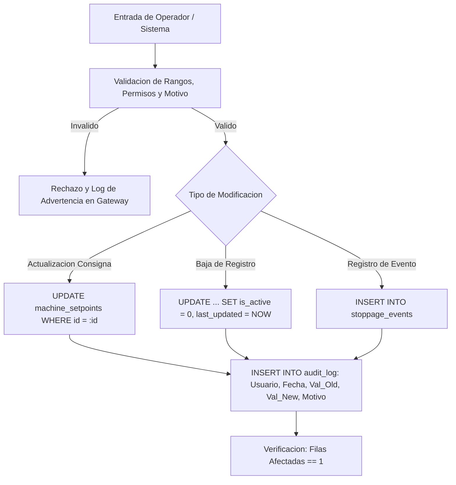
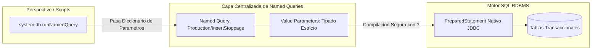
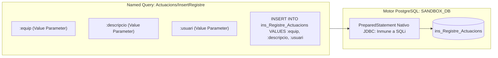

# Sesión 5

### 1. Repaso Inicial y Resolución de Dudas de la Sesión 4

#### Objetivos

* Consolidar la gestión de excepciones duales en la JVM (Jython + Java) y el uso de `system.util.getLogger` para registro contextual.
* Revisar las consultas SQL analíticas industriales construidas con `GROUP BY`, `JOIN` y lógica condicional `CASE WHEN`.

#### Contenidos

* Repaso de las consultas sobre la captura de `java.lang.Exception` frente a errores propios de Python.
* Revisión de las buenas prácticas de proyección de columnas explícitas y uso de `NULLIF` para evitar divisiones por cero.
* Comprobación del estado de la base de datos de pruebas para abordar operaciones de escritura.

#### Resultado esperado

* Fijación de las directrices de logging y analítica en base de datos, asegurando la base técnica para implementar modificaciones seguras y auditoría.

***

### 2. Tema 10: Inserciones, Actualizaciones y Borrados Seguros en Entornos Industriales

#### Objetivos

* Comprender los riesgos de integridad y seguridad derivados de escrituras directas o concatenadas en bases de datos SCADA.
* Aplicar técnicas de validación previa de rangos, estados de máquina y permisos antes de ejecutar sentencias `INSERT`, `UPDATE` o `DELETE`.
* Diferenciar entre borrado físico y borrado lógico, implementando esquemas de auditoría estandarizados para trazabilidad de planta.

#### Contenidos

**1. Prevención de Fallos Críticos y Riesgos de Inyección SQL en SCADA**

* **Peligros de la concatenación de texto:**
  * Unir cadenas con el operador `+` (`"WHERE equip = '" + equip + "'"`) es una de las mayores vulnerabilidades en sistemas industriales.
  * _Inyección accidental:_ Caracteres especiales introducidos por operarios (ej. comillas simples en observaciones como `"Válvula 2" no cierra'`) rompen la gramática SQL y abortan la ejecución.
  * _Inconsistencia de fechas:_ Formatos regionales de fecha (`DD/MM/YYYY` vs `YYYY-MM-DD`) provocan desajustes temporales o rechazos en el motor.
  * _Riesgo en dispositivos externos:_ Entradas procedentes de lectores de códigos de barras, escáneres RFID o APIs externas pueden inyectar fragmentos destructivos (`BOMBA_01' OR '1'='1`).
* **Obligatoriedad de parámetros tipados (`PreparedStatement`):**
  * El estándar industrial exige el uso estricto de `system.db.runPrepUpdate` o Named Queries parametrizadas.
  * La consulta se envía con marcadores de posición (`?`), congelando la estructura sintáctica en el motor de base de datos.
  * El driver JDBC transmite los parámetros en un canal binario desacoplado con casteo estricto de tipos (`Timestamp`, `Double`, `Varchar`), neutralizando físicamente cualquier intento de inyección.

**2. Patrones de Modificación Defensiva y Borrado Seguro**

* **Cláusulas `WHERE` defensivas y el Seguro de Filas Afectadas (`rows_affected == 1`):**
  * Toda sentencia de modificación unitaria debe incluir claves primarias unívocas en el `WHERE`.
  * La función de base de datos devuelve el número entero de filas modificadas. Ignorar este retorno asumiendo éxito es un grave error de diseño:
    * `rows_affected == 0`: El equipo no existe o está inactivo. Fallo silencioso; la máquina física sigue con la consigna antigua.
    * `rows_affected == 1`: **Único resultado admisible** en operaciones sobre un activo unitario.
    * `rows_affected > 1`: Violación crítica de unicidad; el `WHERE` afectó a múltiples máquinas por error.
  *   _Patrón defensivo:_

      ```python
      rows_affected = system.db.runPrepUpdate(update_sql, [new_sp, equip_id], database="SANDBOX_DB")
      if rows_affected != 1:
          logger.warn("Inconsistencia en actualización: {} filas afectadas para equipo {}".format(rows_affected, equip_id))
          return (False, u"Error: no se modificó la consigna esperada")
      ```
* **Borrado Físico (`DELETE FROM`) vs. Borrado Lógico (**_**Soft Delete**_**):**
  * _La regla de planta:_ **En un SCADA nunca se borra nada**. El borrado físico destruye la integridad referencial histórica y deja huérfanos millones de registros de telemetría y alarmas en el Historian (regulaciones ISA-95, GAMP5, FDA 21 CFR Part 11).
  * _Implementación de baja lógica:_ Inclusión de columnas de control `is_active` (`BOOLEAN`), `updated_by` (`VARCHAR`) y `last_updated` (`TIMESTAMP`).
  * Desactivación mediante actualización: `UPDATE machine_setpoints SET is_active = FALSE, updated_by = ?, last_updated = CURRENT_TIMESTAMP WHERE equip = ? AND is_active = TRUE;`.
  * Los selectores visuales y consultas operativas filtran siempre por activos: `WHERE is_active = TRUE`.

**3. Trazabilidad y Auditoría Canónica de Operaciones Sensibles**

* **Registro sistemático de cambios de consigna (**_**setpoints**_**), fórmulas de recetas y anulaciones manuales.**
* **Las 5 preguntas obligatorias de la pista de auditoría (**_**Audit Trail**_**):**
  * _Quién:_ Usuario autenticado en la sesión de Ignition (`username`).
  * _Cuándo:_ Marca temporal oficial del servidor de base de datos (`CURRENT_TIMESTAMP`), evitando desincronizaciones entre relojes de clientes o husos horarios.
  * _Dónde:_ Identificador físico del equipo o señal (`equip`).
  * _Qué:_ Parámetro alterado, valor anterior y valor nuevo con sus unidades de ingeniería.
  * _Por qué:_ Justificación operativa obligatoria (validación mínima de longitud, ej. `len(reason.strip()) >= 5`).
*   **Estructura canónica de la tabla de auditoría (`ins_Registre_Actuacions`):**

    ```sql
    INSERT INTO ins_Registre_Actuacions (Equip, Descripcio, Usuari, DataHora)
    VALUES (?, ?, ?, CURRENT_TIMESTAMP);
    ```



#### Resultado esperado

* Capacidad para diseñar e implementar operaciones de escritura protegidas que validen condiciones operativas antes de persistir y mantengan trazabilidad mediante tablas de auditoría y borrado lógico.

***

### 3. Laboratorio 5.1: Auditoría de Setpoints y Modificación Segura con Borrado Lógico

#### Objetivos

* Construir una función en `Project Library` que valide límites de ingeniería antes de modificar la consigna de temperatura o presión de una máquina.
* Registrar automáticamente una traza completa en la tabla `audit_log` con usuario, valor anterior, valor nuevo y justificación del cambio, verificando el número exacto de filas afectadas.

#### Resultado esperado

* Función verificada en la Script Console que procesa modificaciones nominales de consignas, rechaza valores fuera de rango físico o solicitudes sin motivo justificado, e inserta la correspondiente traza de auditoría en la base de datos sandbox.

#### 4. Paso a Paso para la Realización

**Paso 1: Creación de la Tabla de Consignas en el Sandbox (SQL)**

1. En **Ignition Designer**, abrir **Tools -> Database Query Browser**.
2. Seleccionar la conexión `SANDBOX_DB`.
3. Ejecutar la siguiente sentencia DDL para crear la tabla de consignas operativas con soporte de borrado lógico:

```sql
CREATE TABLE IF NOT EXISTS machine_setpoints (
    id SERIAL PRIMARY KEY,
    equip VARCHAR(100) UNIQUE NOT NULL,
    flow_sp DOUBLE PRECISION NOT NULL DEFAULT 0.0,
    pressure_sp DOUBLE PRECISION NOT NULL DEFAULT 0.0,
    is_active BOOLEAN NOT NULL DEFAULT TRUE,
    last_updated TIMESTAMP NOT NULL DEFAULT CURRENT_TIMESTAMP,
    updated_by VARCHAR(100) NOT NULL DEFAULT 'SYSTEM'
);

-- Insertar consignas base para los equipos del sandbox
INSERT INTO machine_setpoints (equip, flow_sp, pressure_sp, is_active, updated_by)
VALUES 
    ('EDAR_BOMBA_01', 45.0, 3.5, TRUE, 'admin'),
    ('EDAR_BOMBA_02', 50.0, 4.0, TRUE, 'admin'),
    ('EDAR_COMPRESOR_01', 80.0, 6.5, TRUE, 'admin'),
    ('VALVULA_RECIRC_01', 25.0, 2.0, TRUE, 'admin')
ON CONFLICT (equip) DO NOTHING;
```

**Paso 2: Creación del Módulo en Project Library**

1. En el _Project Browser_, desplegar **Server Scripting -> Project Library**.
2. Crear el script: `setpoints.service` (carpeta `setpoints`, script `service`).

**Paso 3: Implementación de la Lógica de Modificación y Auditoría**

Copiar y guardar el siguiente código en `project.setpoints.service`:

```python
"""
Modulo: project.setpoints.service
Descripcion: Gestion segura de consignas con validacion de limites de ingenieria,
             verificacion de filas afectadas, auditoria y borrado logico.
Autor: Equipo SCADA
"""

# Limites de ingenieria admisibles en planta
LIMITS = {
    "flow_sp": {"min": 0.0, "max": 150.0, "unit": "m3/h"},
    "pressure_sp": {"min": 0.0, "max": 10.0, "unit": "bar"}
}

def update_setpoint_with_audit(equip, param_name, new_value, username, reason, db_conn="SANDBOX_DB"):
    """
    Valida limites, actualiza la consigna de un equipo y registra auditoria en ins_Registre_Actuacions.
    
    Args:
        equip (str): Identificador del equipo (ej. 'EDAR_BOMBA_01').
        param_name (str): 'flow_sp' o 'pressure_sp'.
        new_value (float|int): Nuevo valor de la consigna.
        username (str): Nombre del usuario que autoriza el cambio.
        reason (str): Justificacion operativa obligatoria (min. 5 caracteres).
        db_conn (str): Nombre de la conexion de base de datos en Ignition.
        
    Returns:
        tuple: (bool success, unicode message)
    """
    logger = system.util.getLogger("SCADA.Setpoints")
    
    # 1. Validaciones defensivas de entrada
    if not equip or not param_name or username is None:
        return (False, u"Parámetros de identificación incompletos")
        
    if param_name not in LIMITS:
        return (False, u"Parámetro desconocido: {}".format(param_name))
        
    if not reason or len(reason.strip()) < 5:
        return (False, u"Es obligatorio introducir un motivo justificativo (mínimo 5 caracteres)")
        
    try:
        val_num = float(new_value)
    except (ValueError, TypeError):
        return (False, u"El valor de la consigna debe ser numérico")
        
    # 2. Validacion de limites fisicos
    p_lim = LIMITS[param_name]
    if val_num < p_lim["min"] or val_num > p_lim["max"]:
        return (False, u"Valor {:.2f} fuera de rango [{:.1f} - {:.1f} {}]".format(
            val_num, p_lim["min"], p_lim["max"], p_lim["unit"]
        ))
        
    try:
        # 3. Obtener el valor anterior para la pista de auditoria
        select_sql = "SELECT " + param_name + ", is_active FROM machine_setpoints WHERE equip = ?"
        current_data = system.db.runPrepQuery(select_sql, [equip], database=db_conn)
        
        if len(current_data) == 0:
            return (False, u"El equipo '{}' no existe en la tabla de consignas".format(equip))
            
        old_val = current_data[0][param_name]
        is_active = current_data[0]["is_active"]
        
        if not is_active:
            return (False, u"El equipo '{}' se encuentra desactivado (Baja Lógica)".format(equip))
            
        # 4. Actualizacion segura con Prepared Statement
        update_sql = """
            UPDATE machine_setpoints 
            SET """ + param_name + """ = ?, updated_by = ?, last_updated = CURRENT_TIMESTAMP 
            WHERE equip = ? AND is_active = TRUE
        """
        rows_affected = system.db.runPrepUpdate(update_sql, [val_num, username, equip], database=db_conn)
        
        if rows_affected != 1:
            logger.warn("Inconsistencia en update_setpoint: {} filas afectadas".format(rows_affected))
            return (False, u"No se ha podido actualizar la consigna (Filas afectadas: {})".format(rows_affected))
            
        # 5. Registro de auditoria en la tabla ins_Registre_Actuacions (PDF Pag. 10 y 14)
        audit_desc = u"Cambio Consigna {} [{} -> {:.2f} {}]. Motivo: {}".format(
            unicode(param_name), old_val, val_num, unicode(p_lim["unit"]), unicode(reason.strip())
        )
        audit_sql = """
            INSERT INTO ins_Registre_Actuacions (Equip, Descripcio, Usuari, DataHora)
            VALUES (?, ?, ?, CURRENT_TIMESTAMP)
        """
        system.db.runPrepUpdate(audit_sql, [equip, audit_desc, username], database=db_conn)
        
        logger.info("Consigna actualizada: {} | {} | Usuario: {}".format(equip, audit_desc, username))
        return (True, u"Consigna actualizada y auditada correctamente")
        
    except Exception as ex:
        logger.error("Error al actualizar consigna de {}: {}".format(equip, str(ex)))
        return (False, u"Error interno de base de datos")


def soft_delete_setpoint(equip, username, reason, db_conn="SANDBOX_DB"):
    """
    Aplica borrado logico a una consigna (is_active = FALSE) registrando auditoria.
    """
    logger = system.util.getLogger("SCADA.Setpoints")
    
    if not reason or len(reason.strip()) < 5:
        return (False, u"Motivo de baja obligatorio (mínimo 5 caracteres)")
        
    try:
        update_sql = """
            UPDATE machine_setpoints 
            SET is_active = FALSE, updated_by = ?, last_updated = CURRENT_TIMESTAMP 
            WHERE equip = ? AND is_active = TRUE
        """
        rows = system.db.runPrepUpdate(update_sql, [username, equip], database=db_conn)
        
        if rows == 1:
            audit_desc = u"Baja Lógica de Consigna. Motivo: {}".format(unicode(reason.strip()))
            audit_sql = "INSERT INTO ins_Registre_Actuacions (Equip, Descripcio, Usuari) VALUES (?, ?, ?)"
            system.db.runPrepUpdate(audit_sql, [equip, audit_desc, username], database=db_conn)
            return (True, u"Equipo desactivado correctamente (Baja Lógica)")
        else:
            return (False, u"El equipo no existe o ya estaba desactivado")
            
    except Exception as ex:
        logger.error("Error en baja lógica de {}: {}".format(equip, str(ex)))
        return (False, u"Error interno al procesar la baja lógica")
```

**Paso 4: Guardar el Proyecto**

1. Guardar en el Designer (**File -> Save** o `Ctrl+S`).

**Paso 5: Pruebas y Validación desde la Script Console**

1. Abrir la **Script Console**.
2. Ejecutar la batería de pruebas:

```python
print "=== VALIDACION LABORATORIO 5.1: ESCRITURAS DEFENSIVAS Y AUDITORIA ==="

# Caso 1: Modificacion nominal de caudal en EDAR_BOMBA_01 (45 -> 62.5 m3/h)
ok1, msg1 = setpoints.service.update_setpoint_with_audit(
    equip="EDAR_BOMBA_01",
    param_name="flow_sp",
    new_value=62.5,
    username="marti.sanchez",
    reason="Ajuste por aumento de caudal de entrada a planta"
)
print "\nCaso 1 (Nominal)     -> Exito: {} | Mensaje: {}".format(ok1, msg1)

# Caso 2: Rechazo por valor fuera de rango fisico (250 m3/h > max 150 m3/h)
ok2, msg2 = setpoints.service.update_setpoint_with_audit(
    equip="EDAR_BOMBA_01",
    param_name="flow_sp",
    new_value=250.0,
    username="operador_noche",
    reason="Pruebas de sobrepresión"
)
print "Caso 2 (Fuera Rango) -> Exito: {} | Mensaje: {}".format(ok2, msg2)

# Caso 3: Rechazo por falta de justificacion (motivo vacio)
ok3, msg3 = setpoints.service.update_setpoint_with_audit(
    equip="EDAR_COMPRESOR_01",
    param_name="pressure_sp",
    new_value=7.0,
    username="carlos.gomez",
    reason=" "
)
print "Caso 3 (Sin Motivo)  -> Exito: {} | Mensaje: {}".format(ok3, msg3)

# Caso 4: Borrado logico de VALVULA_RECIRC_01
ok4, msg4 = setpoints.service.soft_delete_setpoint(
    equip="VALVULA_RECIRC_01",
    username="mantenimiento_01",
    reason="Mantenimiento preventivo anual - Válvula fuera de servicio"
)
print "Caso 4 (Soft Delete) -> Exito: {} | Mensaje: {}".format(ok4, msg4)
```

**Paso 6: Verificación en Base de Datos**

1.  En el **Database Query Browser**, ejecutar:

    ```sql
    SELECT equip, flow_sp, pressure_sp, is_active, updated_by, last_updated FROM machine_setpoints;
    SELECT * FROM ins_Registre_Actuacions ORDER BY id DESC LIMIT 5;
    ```
2. **Verificación:** Comprobar que `EDAR_BOMBA_01` tiene el nuevo caudal `62.5`, `VALVULA_RECIRC_01` tiene `is_active = false` y en `ins_Registre_Actuacions` aparecen los registros de auditoría detallados.

***

### 4. Tema 11: Named Queries como Capa de Abstracción y Acceso Seguro a Datos

#### Objetivos

* Comprender la arquitectura, ciclo de vida y ventajas de centralización de las _Named Queries_ en Ignition Designer.
* Distinguir los tipos de consulta (_Query_, _Scalar Query_, _Update Query_) y los mecanismos internos de paso de parámetros (_Value Parameters_ vs. _Query Strings_).
* Dominar la invocación programática de Named Queries desde scripts mediante `system.db.runNamedQuery`.

#### Contenidos

**1. Arquitectura y Organización Centralizada de Named Queries**

* **Centralización del código SQL en el árbol del proyecto (`Project Browser -> Named Queries`):**
  * Desacoplamiento total del SQL frente a componentes visuales y scripts (patrón Repository / DAO). Evita el antipatrón del "SQL disperso" en botones y bindings.
  * _Entorno de pruebas integrado (Testing Tab):_ Permite ejecutar la consulta dentro del Designer con parámetros reales antes de enlazarla a pantallas o scripts.
  * _Caché en memoria RAM del Gateway:_ TTL configurable para reducir drásticamente la carga sobre el motor SQL en consultas de alta concurrencia (ej. catálogo de recetas).
  * _Control de acceso por roles (Role-Based Permissions):_ Restricción de consultas sensibles a perfiles autorizados (`Supervisor`, `DirectorPlanta`).
* **Estructuración jerárquica por dominios funcionales:**
  * Organización modular en carpetas por área de planta (`Production/`, `Maintenance/`, `Quality/`, `Audit/`, `Actuacions/`).

**2. Tipología de Named Queries y Contratos de Retorno**

* **`Query` (Consulta Tabular):**
  * Ejecución de consultas `SELECT` con retorno de un objeto `Dataset` (`com.inductiveautomation.ignition.common.BasicDataset`).
  * Uso: Tablas en Perspective/Vision, listas desplegables (_Dropdowns_) o procesamiento con `system.dataset.toPyDataSet()`.
* **`Scalar Query` (Consulta Escalar Atómica):**
  * Retorno directo de la primera celda de la primera fila como valor atómico (`int`, `float`, `unicode`, `java.util.Date`), o `None` si la consulta no devuelve filas.
  * Ventaja clave: Evita el código intermedio de desenvolvimiento de un Dataset (`ds.getValueAt(0, 0)`) para indicadores numéricos, contadores o KPIs individuales.
* **`Update Query` (Sentencia de Modificación):**
  * Ejecución de sentencias `INSERT`, `UPDATE` o `DELETE` con retorno del número entero de filas afectadas (`rows_affected`).
  * Uso: Modificación de consignas, bajas lógicas y registros de auditoría con validación inmediata de filas afectadas (`rows == 1`).

**3. Gestión de Parámetros:&#x20;**_**Value Parameters**_**&#x20;vs.&#x20;**_**Query String Parameters**_

* **Value Parameters (`:nombreParam`):**
  * Vinculación nativa como `PreparedStatement` de Java (marcadores `?` en el driver JDBC).
  * _Seguridad:_ Inmunidad total contra inyección SQL y casteo estricto automático de tipos (`Integer`, `Float`, `String`, `DateTime`).
  * _Rendimiento:_ Máximo aprovechamiento de la precompilación y planes de ejecución en el motor SQL.
  * _Ámbito de uso:_ Estándar obligatorio para el 99% de las consultas (`WHERE col = :val`, `SET col = :val`, `VALUES (:val)`).
* **Query String Parameters (`{nombreParam}`):**
  * Sustitución textual en crudo antes de compilar la sentencia.
  * _Seguridad:_ Vulnerable a inyección SQL si no se valida exhaustivamente mediante listas blancas en Python.
  * _Ámbito de uso restringido:_ Exclusivamente cuando el nombre de la tabla o columna es dinámico (ej. particiones temporales del Historian: `FROM sqlt_data_1_{mes}`).

**4. Invocación Programática desde Scripts con `system.db.runNamedQuery`**

* **Sintaxis de invocación:** `system.db.runNamedQuery([project], path, parameters)`.
* **El contexto de Scopes y el parámetro `project`:**
  * En **Perspective Scope** o **Vision Client Scope**, el nombre del proyecto es implícito.
  * En **Gateway Scope**, **Script Console** o tareas programadas (_Timer Scripts_), el argumento `project` es obligatorio o se lanza `IllegalArgumentException: Project name not specified`.
*   **El patrón universal agnóstico de Scope con `system.util.getProjectName()`:**

    ```python
    # Resuelve dinámicamente el proyecto para ejecución válida en cualquier Scope
    project_name = system.util.getProjectName()
    rows = system.db.runNamedQuery(project=project_name, path="Actuacions/InsertRegistre", parameters=params)
    ```
* **Sensibilidad estricta a mayúsculas y minúsculas (**_**Case-Sensitivity**_**):** Las claves del diccionario `parameters` deben coincidir de forma idéntica con los nombres declarados en la Named Query del Designer.



#### Resultado esperado

* Dominio de la creación, tipado y ejecución programática de Named Queries parametrizadas, utilizándolas como el estándar principal de acceso a datos del proyecto SCADA.

***

### 5. Laboratorio 5.2: Configuración y Consumo de Named Queries Parametrizadas desde Project Library

#### Objetivos

* Configurar en el Designer una Named Query de tipo `Update Query` parametrizada mediante _Value Parameters_ para el registro de eventos de parada de línea.
* Construir una función de servicio en `Project Library` (`project.stoppage.events`) que valide las entradas, arme el diccionario de parámetros e invoque la Named Query controlando el retorno de filas afectadas.

#### Resultado esperado

* Named Query creada en el árbol del Designer y consumida desde una función modular en `Project Library`, verificada mediante la Script Console ante llamadas nominales y llamadas con parámetros incorrectos, comprobando la persistencia en la tabla `stoppage_events`.

#### 4. Paso a Paso para la Realización

**Paso 1: Configuración de la Named Query en Ignition Designer**

1. En el panel **Project Browser**, navegar a **Named Queries**.
2. Hacer clic derecho, seleccionar **New Folder** y nombrarla: `Actuacions`.
3. Hacer clic derecho sobre la carpeta `Actuacions`, seleccionar **New Query** y nombrarla: `InsertRegistre`.
4. En el panel de configuración de la Named Query:
   * **Database Connection:** Seleccionar la conexión por defecto (`SANDBOX_DB`).
   * **Query Type:** Seleccionar **Update Query**.
5. En la sección **Parameters** (panel superior derecho), añadir 3 parámetros de tipo **Value** (haciendo clic en el botón `+`):
   * Parameter 1: Name = `equip`, Type = `String`
   * Parameter 2: Name = `descripcio`, Type = `String`
   * Parameter 3: Name = `usuari`, Type = `String`
6.  En el editor SQL inferior, pegar la siguiente consulta parametrizada:

    ```sql
    INSERT INTO ins_Registre_Actuacions (Equip, Descripcio, Usuari, DataHora)
    VALUES (:equip, :descripcio, :usuari, CURRENT_TIMESTAMP)
    ```
7. En la pestaña **Testing** (superior), introducir valores de prueba (`equip` = `EDAR_BOMBA_01`, `descripcio` = `Test Named Query`, `usuari` = `admin`) y pulsar **Execute**. Verificar que devuelve `1 row affected`.



**Paso 2: Implementación del Módulo Consumidor en Project Library**

1. En **Project Library**, crear el script: `actuacions.service` (carpeta `actuacions`, script `service`).
2. Copiar y guardar el siguiente código:

```python
"""
Modulo: project.actuacions.service
Descripcion: Servicio de registro de actuaciones operativas mediante Named Queries.
Autor: Equipo SCADA
"""

def log_operator_action(equip, description, username):
    """
    Registra una actuacion u orden operativa consumiendo la Named Query parametrizada.
    
    Args:
        equip (str): Identificador del equipo (ej. 'EDAR_BOMBA_02').
        description (str|unicode): Detalle funcional de la orden o alarma.
        username (str): Usuario autenticado que realiza la accion.
        
    Returns:
        tuple: (bool success, unicode message)
    """
    logger = system.util.getLogger("SCADA.Actuacions")
    
    # 1. Validaciones defensivas de entrada
    if not equip or not str(equip).strip():
        return (False, u"El identificador de equipo es obligatorio")
        
    if not description or not str(description).strip():
        return (False, u"La descripción de la actuación no puede estar vacía")
        
    user_str = str(username).strip() if username else "SYSTEM"
    
    # 2. Armado del diccionario de parametros (debe coincidir exactamente con la Named Query)
    params = {
        "equip": str(equip).strip(),
        "descripcio": unicode(description).strip(),
        "usuari": user_str
    }
    
    try:
        # Obtener el nombre del proyecto actual para ejecucion en cualquier scope
        project_name = system.util.getProjectName()
        
        # 3. Invocacion de la Named Query
        rows_affected = system.db.runNamedQuery(
            project=project_name,
            path="Actuacions/InsertRegistre",
            parameters=params
        )
        
        if rows_affected == 1:
            logger.info("Actuación registrada por Named Query: {} | Equipo: {}".format(user_str, equip))
            return (True, u"Actuación registrada correctamente")
        else:
            logger.warn("Named Query no insertó filas para {}".format(equip))
            return (False, u"No se ha podido registrar la actuación en la base de datos")
            
    except Exception as ex:
        logger.error("Error al ejecutar Named Query Actuacions/InsertRegistre: {}".format(str(ex)))
        return (False, u"Error interno de comunicación con la base de datos")
```

**Paso 3: Guardar el Proyecto**

1. Guardar en el Designer (**File -> Save** o `Ctrl+S`).

**Paso 4: Pruebas y Validación desde la Script Console**

1. Abrir la **Script Console**.
2. Ejecutar las pruebas:

```python
print "=== VALIDACION LABORATORIO 5.2: CONSUMO DE NAMED QUERIES ==="

# Caso 1: Registro nominal de maniobra de envio de consigna
ok1, msg1 = project.actuacions.service.log_operator_action(
    equip="EDAR_COMPRESOR_02",
    description=u"Orden Enviar Consigna SCMX: 8.5 bar por supervisor",
    username="laura.vidal"
)
print "\nCaso 1 (Nominal)       -> Exito: {} | Mensaje: {}".format(ok1, msg1)

# Caso 2: Registro de alarma de proceso
ok2, msg2 = project.actuacions.service.log_operator_action(
    equip="LINEA_ENVASADO_01",
    description=u"Reconocimiento manual de alarma: Parada de emergencia pulsada",
    username="carlos.gomez"
)
print "Caso 2 (Alarma)        -> Exito: {} | Mensaje: {}".format(ok2, msg2)

# Caso 3: Error por descripcion vacia
ok3, msg3 = project.actuacions.service.log_operator_action(
    equip="EDAR_BOMBA_01",
    description=" ",
    username="admin"
)
print "Caso 3 (Error Valida)  -> Exito: {} | Mensaje: {}".format(ok3, msg3)
```

**Paso 5: Salida Esperada en Consola**

```
=== VALIDACION LABORATORIO 5.2: CONSUMO DE NAMED QUERIES ===

Caso 1 (Nominal)       -> Exito: True | Mensaje: Actuación registrada correctamente
Caso 2 (Alarma)        -> Exito: True | Mensaje: Actuación registrada correctamente
Caso 3 (Error Valida)  -> Exito: False | Mensaje: La descripción de la actuación no puede estar vacía
```

***

### 6. Test de Conceptos de la Sesión 5

#### Objetivos

* Evaluar la asimilación conceptual sobre prevención de inyecciones SQL y borrado lógico en bases de datos industriales.
* Comprobar la correcta diferenciación entre _Value Parameters_ y _Query Strings_ en Named Queries.
* Validar el entendimiento sobre el retorno entero de filas afectadas en operaciones de tipo `Update Query`.

#### Contenidos

* Cuestionario técnico individual de opción múltiple y resolución de casos de diseño seguro de consultas y auditoría.
* [Cuestionario Sesión 5](https://docs.google.com/forms/d/e/1FAIpQLSdENIk0hUBa_KXuzF0ycJa3vv02xlAvEzA1ZsgAkQSFlzW8oA/viewform?usp=publish-editor)

#### Resultado esperado

* Comprobación del dominio de los patrones de modificación segura y de la arquitectura de Named Queries en Ignition.

***

### 7. Feedback Individual y Cierre de la Sesión

#### Objetivos

* Verificar que cada alumno ha creado correctamente sus Named Queries con los tipos de parámetros adecuados en el Designer.
* Comprobar en el _Database Query Browser_ que las inserciones y trazas de auditoría generadas en los laboratorios están correctamente registradas.
* Presentar la planificación de la Sesión 6 (sesión intensiva de 5 horas).

#### Contenidos

* Rondas de revisión individual de las Named Queries y módulos de servicio en `Project Library`.
* Corrección de errores comunes en la coincidencia de nombres de parámetros entre el script y la Named Query.
* Avance de la Sesión 6: Ecosistema avanzado de `system.db.*`, transacciones atómicas ACID (`commit`/`rollback`), buenas prácticas en Script Transforms y arquitectura de eventos en Perspective, Vision y Gateway.

#### Resultado esperado

* Cada participante finaliza la sesión con su capa de Named Queries funcional, auditoría verificada en base de datos y claridad sobre los conceptos transaccionales que se abordarán en la siguiente jornada intensiva.
