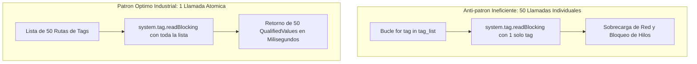
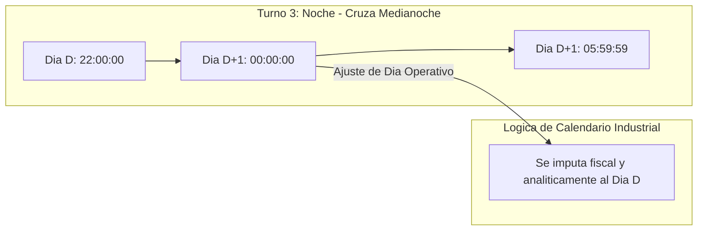

# Sesión 7

### 1. Repaso Inicial y Resolución de Dudas de la Sesión 6

#### Objetivos

* Consolidar el diseño de transacciones ACID compuestas y la prevención de fugas de conexiones JDBC mediante bloques `finally`.
* Revisar el desacoplamiento de componentes mediante Message Handlers y las buenas prácticas en Script Transforms de Perspective.

#### Contenidos

* Repaso de consultas sobre el ciclo de vida de transacciones (`beginTransaction`, `commit`, `rollback`, `closeTransaction`).
* Revisión de dudas sobre la invocación de `system.util.sendMessage` entre vistas y popups.
* Comprobación del estado del proveedor de tags de pruebas en el Designer.

#### Resultado esperado

* Fijación de los estándares transaccionales y de eventos, asegurando la base técnica para interactuar directamente con el motor de tags y variables de proceso.

***

### 2. Tema 16: Tags, Lectura/Escritura Masiva y Scripting Operativo en Planta

#### Objetivos

* Comprender la anatomía del dato industrial a través del objeto `QualifiedValue` (valor, calidad y marca temporal).
* Dominar las operaciones de lectura y escritura por lotes (_Batch Operations_) con `system.tag.readBlocking` y `writeBlocking`.
* Aplicar el principio de programación defensiva mediante la validación obligatoria del código de calidad (`QualityCode`) antes de procesar lógica de control.

#### Contenidos

**1. Anatomía y Ciclo de Vida del Dato Industrial: El Objeto `QualifiedValue`**

* **La naturaleza del Tag en la arquitectura de Ignition:**
  * Un tag en Ignition no es una posición pasiva de memoria, sino una entidad administrada por el Tag Engine del Gateway en un proveedor específico (`[default]`, `[System]` o proveedores remotos vía Gateway Network).
  * El motor mantiene suscripciones activas contra autómatas y dispositivos mediante drivers OPC-UA (Siemens S7, Rockwell EtherNet/IP, Modbus TCP, etc.) agrupadas en *Tag Groups* (scan classes) que determinan su frecuencia de actualización cíclica (*Direct*) o basada en eventos (*Leased / Driven*).
* **Estructura tridimensional atómica del `QualifiedValue`:**
  * Toda lectura de tag en Ignition retorna una instancia de `com.inductiveautomation.ignition.common.model.values.QualifiedValue`, integrada obligatoriamente por tres dimensiones:
    * **`.value`:** El valor bruto o escalado del dato en la memoria RAM del servidor, tipado de forma estricta en la JVM (`Boolean`, `Integer`, `Double`, `String`, `Dataset`, etc.). *Advertencia crítica:* Cuando la comunicación con el PLC se interrumpe o la calidad se degrada, `.value` puede retener el último valor congelado (*stale value*) o ser `None`, por lo que nunca debe procesarse sin validar previamente su calidad.
    * **`.quality`:** Estado de comunicación e integridad semántica a través de la clase `QualityCode`. Expone métodos y propiedades esenciales:
      * `quality.isGood()`: Único indicador admisible para ejecutar lógica de control, recetas o cálculos analíticos.
      * `quality.isBad()` y `quality.isUncertain()`: Detección de anomalías en la telemetría.
      * *Códigos de calidad industriales frecuentes:* `Bad_NotFound` (la ruta del tag no existe o está mal escrita en el proveedor), `Bad_Stale` (el driver OPC perdió conexión con el autómata o expiró el periodo de refresco), `Bad_Disabled` (el tag está deshabilitado en configuración), `Bad_Unauthorized` (el contexto de ejecución carece de permisos de seguridad) y `Uncertain_InitialValue` (el Gateway está inicializando y aún no ha recibido el primer frame de datos).
    * **`.timestamp`:** Objeto `java.util.Date` que registra el instante cronológico de adquisición del dato. Distingue entre el *Source Timestamp* (asignado por el reloj del PLC en origen al cambiar la variable) y el *Server Timestamp* (asignado por el reloj del Gateway de Ignition al procesar el paquete en red).
* **Taxonomía de Tags en Sistemas SCADA de Producción:**
  * *Tags OPC (Variables de Proceso):* Vinculadas a memorias físicas del PLC (entradas/salidas, bloques de datos DB, registros de mantenimiento). Sujetas a tiempos de ciclo de bus y latencias de red.
  * *Tags de Memoria:* Variables residentes exclusivamente en la memoria heap del Gateway. Ideales para consignas de sesión de usuario, selectores operativos locales, banderas de simulación y variables de estado interno.
  * *Tags de Expresión (Calculados):* Evaluadas de forma reactiva por el motor de expresiones del Gateway en memoria, ahorrando ciclos de comunicación en la red de control.
  * *Tags Derivados (*Derived Tags*):* Capas de abstracción sobre un tag de origen que aplican fórmulas de escalado bidireccionales o transformaciones lógicas transparentes.
  * *Tags del Sistema (`[System]`):* Telemetría interna de rendimiento del Gateway (uso de CPU, memoria heap disponible, conexiones JDBC activas, estado de redundancia y licencias).

**2. Erradicación del Anti-Patrón de I/O en Bucles y Optimización de Batch Operations**

* **El colapso por lecturas iterativas unitarias (Anti-patrón de I/O en bucle):**
  * *Análisis del fallo común:* Iterar una lista de variables ejecutando lecturas individuales:
    ```python
    # ANTI-PATRÓN: 50 llamadas individuales bloqueantes
    for path in tag_paths:
        val = system.tag.readBlocking([path])[0].value
    ```
  * *Degradación en el Gateway:* Cada llamada a `system.tag.readBlocking` adquiere bloqueos de sincronización en el Tag Manager, serializa una solicitud independiente, atraviesa la pila de comunicación y espera de forma síncrona.
  * *Multiplicación de latencia:* Si consultar un tag toma 15 ms de ida y vuelta (RTT), consultar 50 tags en un bucle demora entre 750 y 1.200 ms. Si este script corre en un evento de Perspective o un Gateway Timer Script de alta frecuencia, retiene hilos del servidor provocando bloqueos de pantalla (*Spinning Wheels*), desbordamiento de colas y saturación del pool de ejecución (*Thread Starvation*).
* **El estándar de alto rendimiento: Operaciones Atómicas por Lote (*Batch Operations*):**
  * *Patrón industrial canónico:*
    ```python
    # PATRÓN ÓPTIMO: 1 sola llamada atómica en lote
    q_values = system.tag.readBlocking(tag_paths, timeout=3000)
    ```
  * *Resolución interna:* El Tag Engine empaqueta todas las rutas en una única transacción optimizada en memoria y red, resolviendo las 50 lecturas de forma paralela en apenas 2 a 5 ms (una aceleración superior al 95%).
* **Control defensivo de tiempos de espera con el parámetro `timeout`:**
  * Por defecto, las funciones de tag aplican un tiempo de espera interno de 45.000 ms (45 segundos).
  * Si un switch industrial falla o un PLC es desconectado por mantenimiento, una llamada sin timeout retendrá el hilo durante tres cuartos de minuto, degradando por completo la experiencia de usuario.
  * *Obligatoriedad en producción:* Configurar siempre un timeout explícito y restrictivo (ej. `timeout_ms=3000`), garantizando que la aplicación recupere el control de inmediato si un dispositivo no responde.
* **Escrituras Masivas Atómicas y Verificación de Retorno en `writeBlocking`:**
  * Firma: `quality_codes = system.tag.writeBlocking(tag_paths, value_list, timeout=3000)`.
  * *Atomicidad operativa:* Al aplicar consignas vinculadas a una misma máquina (ej. consigna de caudal `SCFL`, consigna máxima `SCMX` y modo simulación `ESIM`), la escritura debe enviarse en bloque para evitar que el PLC opere con configuraciones mixtas o parciales.
  * *Ausencia de excepciones en fallo individual:* `system.tag.writeBlocking` **no arroja excepciones de Python** si un tag específico falla (por ejemplo, si el tag no existe o es de sólo lectura); en su lugar, devuelve una lista de objetos `QualityCode` en estricta correspondencia posicional con las rutas enviadas.
  * *Inspección obligatoria de la respuesta:* Es imperativo iterar la lista de `QualityCode` devuelta verificando `qc.isGood()`. Si algún código es anómalo (`Bad_NotFound`, `Bad_AccessDenied`, `Bad_NotWritable`), el script debe capturar el fallo y notificarlo de inmediato al operador.

**3. Programación Defensiva, Calidades y Sincronización con Bases de Datos**

* **Principio de salvaguarda industrial:**
  * Nunca utilizar el `.value` de una variable de proceso en cálculos de balances, control de actuadores o persistencia relacional sin haber verificado formalmente `qv.quality.isGood()`.
  * *Riesgo de omisión:* Incorporar lecturas con calidad `Bad` en un algoritmo puede introducir ceros falsos en cálculos acumulativos, provocar paradas intempestivas o registrar datos corruptos en el histórico de planta.
  * *Patrón de normalización defensiva:*
    ```python
    good = qv.quality.isGood()
    clean_value = qv.value if good else None
    ```
* **Patrones de sincronización e ingesta Tag-to-Database:**
  * *Disparo por evento (*Tag Change Script*):* Detección de flancos en variables de fin de ciclo o fin de lote mediante la condición `if not initialChange and currentValue.value and not previousValue.value:`.
  * *Lectura atómica previa al registro relacional:* Antes de ejecutar la inserción en base de datos (`system.db.runPrepUpdate` o `system.db.runNamedQuery`), el script debe leer por lote todas las variables del proceso (`readBlocking`), validar su calidad y estampar la fotografía operativa de la máquina con total coherencia temporal.




#### Resultado esperado

* Capacidad para interactuar con el motor de tags de Ignition de forma masiva y eficiente, validando sistemáticamente la calidad de los datos antes de ejecutar cálculos o acciones operativas.

***

### 3. Laboratorio 7.1: Servicio de Lectura y Escritura de Tags por Lote y Monitor en Perspective

#### Objetivos

* Construir un servicio en `Project Library` (`project.tags.service`) que lea un conjunto de tags de una máquina en una sola llamada atómica, filtre variables con calidad no confiable y devuelva un diccionario normalizado.
* Implementar una función de escritura masiva segura que verifique que todos los valores fueron aceptados por el PLC, alertando si alguno fue rechazado por permisos o desconexión.
* Diseñar una vista operativa en Perspective (`Views/Laboratorios/Lab7_1_TagBatchView`) con scripts de 1 o 2 líneas para monitorizar telemetría y aplicar consignas por lote.

#### Resultado esperado

* Módulo creado en `Project Library` probado en consola y pantalla operativa en Perspective con distintivos de calidad (`Good` vs `Bad_NotFound`) y mando masivo atómico sin bloqueos de interfaz.

#### Paso a Paso para la Realización

**Paso 1: Módulo en Project Library (`project.tags.service`)**
En **Server Scripting -> Project Library**, crear `tags.service` con la lógica de red y formateadores para UI:

```python
"""Modulo: project.tags.service"""

def read_equipment_telemetry(base_path, tag_names, timeout_ms=3000):
    root = (base_path or "").rstrip("/")
    full_paths = ["{}/{}".format(root, name.strip()) for name in tag_names]
    try:
        q_values = system.tag.readBlocking(full_paths, timeout_ms)
        results = {}
        all_good = True
        for name, path, qv in zip(tag_names, full_paths, q_values):
            good = qv.quality.isGood()
            if not good:
                all_good = False
            results[name] = {
                "value": qv.value if good else None,
                "quality": str(qv.quality),
                "timestamp": qv.timestamp,
                "is_good": good
            }
        return (all_good, results)
    except Exception as ex:
        system.util.getLogger("SCADA.Tags").error("Error en batch read: " + str(ex))
        return (False, {})

def write_equipment_batch(tag_value_map, timeout_ms=3000):
    if not tag_value_map:
        return (True, [])
    paths, values = list(tag_value_map.keys()), list(tag_value_map.values())
    qcs = system.tag.writeBlocking(paths, values, timeout_ms)
    fails = ["{} -> {}".format(p, str(qc)) for p, qc in zip(paths, qcs) if not qc.isGood()]
    return (len(fails) == 0, fails)

# --- Funciones auxiliares para scripts de 1-2 líneas en Perspective ---
def refresh_telemetry_ui(base_path, tag_names):
    all_ok, data = read_equipment_telemetry(base_path, tag_names)
    msg = "Telemetría OK (100% Good)" if all_ok else "Atención: tags con mala calidad (Bad/NotFound)"
    color = "#27ae60" if all_ok else "#e67e22"
    return {"data": data, "message": msg, "color": color}

def format_telemetry_table(telemetry_data):
    if not telemetry_data:
        return []
    rows = []
    for tag_name in telemetry_data:
        info = telemetry_data[tag_name]
        is_good = bool(info["is_good"]) if ("is_good" in info and info["is_good"]) else False
        quality_str = str(info["quality"]) if "quality" in info else "Unknown"
        raw_val = info["value"] if "value" in info else None
        ts = info["timestamp"] if "timestamp" in info else None
        if ts:
            try:
                ts_str = system.date.format(ts, "yyyy-MM-dd HH:mm:ss")
            except Exception:
                ts_str = str(ts)
        else:
            ts_str = "---"
        rows.append({
            "tag": str(tag_name),
            "valor": str(raw_val) if is_good and raw_val is not None else "---",
            "calidad": quality_str,
            "estado": "CONFIABLE" if is_good else "ERROR",
            "timestamp": ts_str,
            "_style": {"backgroundColor": "#ffffff" if is_good else "#fdedec", "color": "#2c3e50" if is_good else "#c0392b"}
        })
    return rows

def apply_equipment_setpoints(base_path, scfl_val, scmx_val, esim_val):
    root = (base_path or "").rstrip("/")
    try:
        payload = {"{}/SCFL".format(root): float(scfl_val), "{}/SCMX".format(root): float(scmx_val), "{}/ESIM".format(root): bool(esim_val)}
    except Exception as ex:
        return {"success": False, "message": "Datos inválidos: " + str(ex), "color": "#e74c3c"}
    ok, fails = write_equipment_batch(payload)
    if ok:
        return {"success": True, "message": "¡Éxito! 3 consignas escritas de forma atómica en el PLC.", "color": "#27ae60"}
    return {"success": False, "message": "Escritura rechazada: " + "; ".join(fails), "color": "#c0392b"}
```

**Paso 2: Validación en Script Console y Creación de Tags de Memoria**
Guardar (`Ctrl+S`) y ejecutar en la Script Console para aprovisionar las variables y comprobar los servicios:
```python
# 1. Configuracion de tags de prueba en el provider [default]
tag_config = [
    {
        "name": "EDAR",
        "tagType": "Folder",
        "tags": [
            {
                "name": "EDAR_BOMBA_01",
                "tagType": "Folder",
                "tags": [
                    {"name": "SCFL", "tagType": "AtomicTag", "valueSource": "memory", "dataType": "Float4", "value": 45.0},
                    {"name": "SCMX", "tagType": "AtomicTag", "valueSource": "memory", "dataType": "Float4", "value": 85.0},
                    {"name": "ESIM", "tagType": "AtomicTag", "valueSource": "memory", "dataType": "Boolean", "value": False},
                    {"name": "SFOR", "tagType": "AtomicTag", "valueSource": "memory", "dataType": "Boolean", "value": False}
                ]
            }
        ]
    }
]
results = system.tag.configure("[default]", tag_config, "o")
print "Resultado configuracion de tags:", results

# 2. Verificacion de lectura masiva y formateo
base = "[default]EDAR/EDAR_BOMBA_01"
ui_data = tags.service.refresh_telemetry_ui(base, ["SCFL", "SCMX", "ESIM", "SFOR", "TAG_INEXISTENTE_TEST"])
print "Telemetria:", ui_data["message"]
print "Filas Table:", len(tags.service.format_telemetry_table(ui_data["data"]))
write_res = tags.service.apply_equipment_setpoints(base, 55.0, 100.0, False)
print "Escritura Batch:", write_res["message"]
```

**Paso 3: Vista Operativa en Perspective (`Views/Laboratorios/Lab7_1_TagBatchView`)**
1. Crear la vista `Lab7_1_TagBatchView` (`Flex Container`, `column`) con propiedades `custom`:
   * `custom.basePath`: `"[default]EDAR/EDAR_BOMBA_01"`
   * `custom.tagList`: `["SCFL", "SCMX", "ESIM", "SFOR", "TAG_INEXISTENTE_TEST"]`
   * `custom.telemetryData`: `{}`
   * `custom.statusMessage`: `""`
   * `custom.statusColor`: `"#27ae60"`
2. **Botón Refrescar (`btn_Refrescar` -> `onActionPerformed` - 2 líneas):**
   ```python
   res = tags.service.refresh_telemetry_ui(self.view.custom.basePath, self.view.custom.tagList)
   self.view.custom.telemetryData, self.view.custom.statusMessage, self.view.custom.statusColor = res["data"], res["message"], res["color"]
   ```
   * En Message Handlers de `btn_Refrescar` (`onMessageReceived` con tipo de mensaje `refrescar_tabla`):
   ```python
   res = tags.service.refresh_telemetry_ui(self.view.custom.basePath, self.view.custom.tagList)
   self.view.custom.telemetryData, self.view.custom.statusMessage, self.view.custom.statusColor = res["data"], res["message"], res["color"]
   ```
3. **Tabla de Telemetría (`table_Telemetria.props.data` Transform - 1 línea):**
   ```python
   return tags.service.format_telemetry_table(value)
   ```
4. **Botón Aplicar Consignas (`btn_EnviarLote` -> `onActionPerformed`):**
   ```python
   res = tags.service.apply_equipment_setpoints(self.view.custom.basePath, self.getSibling("NumericEntryField").props.value, self.getSibling("NumericEntryField_0").props.value, self.getSibling("ToggleSwitch").props.selected)
   self.view.custom.statusMessage, self.view.custom.statusColor = res["message"], res["color"]
   if res["success"]:
       system.perspective.sendMessage("refrescar_tabla", scope="view")
   ```

**Paso 4: Verificación Interactiva**
Lanzar en Preview (`Ctrl+P`). Comprobar que `TAG_INEXISTENTE_TEST` se destaca en rojo sin congelar la pantalla y que al aplicar consignas se actualizan en un solo envío atómico.

***

### 4. Tema 17: Gestión de Fechas, Turnos Industriales y Ventanas Temporales

#### Objetivos

* Dominar la manipulación de objetos `java.util.Date`, timestamps Epoch (milisegundos) y formatos SQL en Jython.
* Resolver la problemática analítica del "Día Operativo" frente al "Día Natural" en turnos nocturnos que cruzan la medianoche.
* Diseñar consultas SQL filtradas por rangos temporales que aprovechen índices de base de datos sin degradar el rendimiento.

#### Contenidos

**1. Coexistencia de Tipos Temporales en Ignition: JVM Native, Epoch Millis y Formatos de Presentación**

* **Los tres planos temporales en sistemas SCADA basados en Java/Jython:**
  * **1. Plano de Objeto de Negocio e Intercambio (`java.util.Date` y `java.util.Calendar`):**
    * Es el tipo nativo subyacente que maneja el motor de Ignition (Jython 2.7 sobre JVM). Todas las propiedades de componentes (DateTime Pickers), bindings y funciones de Ignition entregan y reciben objetos `java.util.Date`.
    * *Diferenciación con Python estándar:* Debe evitarse el módulo `datetime` de CPython en scripts de planta, ya que carece de compatibilidad binaria directa con el driver JDBC (`java.sql.Timestamp`) y las funciones del subsistema `system.date.*`.
  * **2. Plano Matemático de Duraciones (Epoch Milliseconds - `long`):**
    * Marca numérica entera de 64 bits que representa los milisegundos transcurridos desde el 1 de enero de 1970 00:00:00 UTC.
    * Obtenido mediante `system.date.toMillis(d)` o mediante el método Java `d.getTime()`.
    * **El único estándar válido para cálculos matemáticos:** Medición de duraciones de parada, microparadas, tiempos de ciclo (*Takt Time*), tiempo medio entre fallos (MTBF) y cálculo de disponibilidad en OEE:
      $$\text{Duración (s)} = \frac{t_{\text{fin}} - t_{\text{inicio}}}{1000.0}$$
    * Inmune a problemas de formato regional, husos horarios o cambios de hora estacionales (DST).
  * **3. Plano Visual de Presentación (Text Strings):**
    * Conversión de objetos de fecha a cadenas de texto legibles mediante `system.date.format(date, "yyyy-MM-dd HH:mm:ss")`.
    * **Regla de oro de ingeniería SCADA:** Los textos formateados están destinados **exclusivamente a la visualización gráfica para los ojos del operador**. Jamás deben emplearse cadenas de texto para comparar cronologías (`fecha1 > fecha2`), calcular intervalos de tiempo o filtrar en cláusulas `WHERE` de bases de datos.
* **El ecosistema `system.date.*` y la manipulación precisa con `java.util.Calendar`:**
  * Funciones de utilidad en scripting: `system.date.now()`, `system.date.addDays()`, `system.date.addHours()`, `system.date.addMinutes()`, `system.date.midnight()`, `system.date.daysBetween()`, `system.date.parse()`.
  * Control quirúrgico con `Calendar`: Fijación exacta de campos horarios (`set(Calendar.HOUR_OF_DAY, ...)`, `set(Calendar.MINUTE, 0)`, `set(Calendar.SECOND, 0)`, `set(Calendar.MILLISECOND, 0)`) para delimitar ventanas de turno con precisión de milisegundo sin arrastrar residuos temporales.

**2. La Problemática del Día Operativo y la Discontinuidad de la Medianoche en Turnos Industriales**

* **Día Natural (*Calendar Day*) frente a Día Operativo (*Production / Operational Day*):**
  * El día natural es una convención civil rígida que inicia a las 00:00:00 y concluye a las 23:59:59.
  * La industria de proceso continuo opera habitualmente en 3 turnos rotativos de 8 horas:
    * *Turno 1 (Mañana):* 06:00:00 a 13:59:59.
    * *Turno 2 (Tarde):* 14:00:00 a 21:59:59.
    * *Turno 3 (Noche):* 22:00:00 a 05:59:59 del día siguiente.
* **La trampa analítica del Turno Nocturno (*Cross-Midnight Shift*):**
  * El turno de noche comienza a las 22:00 del Día D y finaliza a las 06:00 del Día D+1.
  * A las 00:00:00 se produce la ruptura de la medianoche: las horas comprendidas entre las 00:00:00 y las 05:59:59 pertenecen cronológicamente al día civil D+1, pero operativa, contable y laboralmente pertenecen al **Día Operativo D** (el turno del equipo de noche iniciado a las 22:00 del día anterior).
  * **El error clásico de agregación SQL:** Si las consultas agrupan la producción por fecha civil (`GROUP BY CAST(DataHora AS DATE)`), la producción del turno nocturno queda partida en dos partes incoherentes: 2 horas computadas al Día D y 6 horas al Día D+1. Esto inutiliza los reportes diarios de producción, corrompe el cálculo de OEE por cuadrilla y falsea la imputación de materias primas.
* **Algoritmo determinista para la resolución del Día Operativo:**
  * Análisis de la hora de la marca temporal (`hour = cal.get(Calendar.HOUR_OF_DAY)`):
    * Si `6 <= hour < 14`: Turno Mañana (`day_offset = 0`, Día Operativo coincide con el día natural).
    * Si `14 <= hour < 22`: Turno Tarde (`day_offset = 0`, Día Operativo coincide con el día natural).
    * Si `hour >= 22`: Turno Noche antes de medianoche (`day_offset = 0`, Día Operativo es el día actual; la ventana temporal se proyecta hacia el día siguiente).
    * Si `hour < 6`: Turno Noche en horas de madrugada. El evento ocurrió físicamente en el día civil D+1, pero **su Día Operativo es D** (`day_offset = -1`, restando 1 día al calendario de imputación).
  * Fijación de los límites cerrados de la ventana de consulta:
    * `start_date`: 22:00:00.000 del Día Operativo D.
    * `end_date`: 05:59:59.999 del Día D+1.

**3. Consultas Temporales de Alto Rendimiento: SARGability e Índices B-Tree en Base de Datos**

* **El anti-patrón de ruptura de SARGability (*Search Argument Able*):**
  * Práctica común perjudicial en consultas industriales: aplicar funciones de conversión o extracción sobre la columna temporal en el filtro `WHERE`:
    ```sql
    -- ANTI-PATRÓN: Destruye el uso de índices temporales
    WHERE CONVERT(varchar, DataHora, 103) = '21/10/2026'
    WHERE DATE(DataHora) = '2026-10-21'
    WHERE EXTRACT(HOUR FROM DataHora) >= 6 AND EXTRACT(HOUR FROM DataHora) < 14
    ```
  * *Por qué colapsa el motor de base de datos:* Al envolver la columna indexada en una función de cálculo o conversión de texto, el optimizador de la base de datos no puede predecir el resultado y queda inhabilitado para utilizar el índice de árbol B (*B-Tree Index*) de la tabla.
  * *Consecuencia en planta:* El motor ejecuta un escaneo completo de tabla (*Full Table Scan*). En tablas históricas con cientos de miles o millones de registros (como `ins_Registre_Actuacions` o tablas de telemetría de historiador), la consulta tarda varios segundos o minutos, dispara el uso de CPU de la base de datos al 100% y bloquea la interfaz de usuario en Perspective.
* **El estándar de alto rendimiento: Rangos Temporales Directos con Tipos Nativos:**
  * Estructura de consulta SARGable:
    ```sql
    -- PATRÓN ÓPTIMO: Búsqueda quirúrgica por rango de índice (Index Range Scan)
    WHERE DataHora >= ? AND DataHora <= ?
    ```
  * *Paso directo de objetos `java.util.Date`:*
    * En `system.db.runPrepQuery`: pasar las instancias directas de `java.util.Date` en la lista de argumentos `args=[shift_window["start_date"], shift_window["end_date"]]`.
    * En Named Queries: configurar los parámetros como tipo `DateTime` / `Date` (*Value Parameters*).
  * *Mecánica del optimizador:* El motor SQL realiza una búsqueda directa por rango de índice (*Index Range Scan*), accediendo únicamente a las páginas de disco que contienen los registros del turno en milisegundos con un coste de E/S mínimo.
* **Consideraciones sobre husos horarios y cambio de hora estacional (DST):**
  * Uso de columnas `TIMESTAMP WITH TIME ZONE` o almacenamiento estandarizado en UTC a nivel de motor de base de datos.
  * Prevención de duplicidades o solapamientos de registros en la transición horaria otoño/primavera (DST), garantizando que las 8 horas netas de producción de cada turno queden perfectamente acotadas sin desajustes cronológicos.




#### Resultado esperado

* Dominio del manejo de marcas temporales y calendarios industriales, resolviendo cálculos de turnos continuos y consultas analíticas por rangos de fechas sin errores de zona horaria ni conversiones textuales frágiles.

***

### 5. Laboratorio 7.2: Motor de Turnos Industriales, Fechas SQL y Dashboard en Perspective (Evaluación Crítica Script vs Nativo)

#### Objetivos

* Construir un módulo en `Project Library` (`project.util.shifts`) capaz de determinar el identificador del turno actual, su nombre funcional y el día operativo correspondiente a partir de cualquier marca temporal.
* Resolver la discontinuidad de la medianoche en turnos nocturnos e integrar consultas SQL sargables pasando objetos `Date` nativos.
* Diseñar un dashboard en Perspective (`Views/Laboratorios/Lab7_2_ShiftDashboard`) contrastando el uso de scripts frente a las funcionalidades nativas de Ignition (*Style Classes*, *Map Transforms* y *Expression Bindings*).

#### Resultado esperado

* Módulo de turnos validado ante marcas temporales diurnas y de madrugada.
* Dashboard en Perspective con tarjetas KPI comparando la implementación por Script Transform frente a la solución óptima nativa con Map Transforms y Style Classes (reduciendo carga en el Gateway).

#### Paso a Paso para la Realización

**Paso 1: Módulo en Project Library (`project.util.shifts`)**
En **Server Scripting -> Project Library**, crear `util.shifts`:

```python
"""
Modulo: project.util.shifts
Descripcion: Motor de calculo de turnos industriales y fechas operativas.

NOTA DE ARQUITECTURA INDUSTRIAL:
La logica de turnos complejos y rangos temporales en Project Library es el lugar
ideal para Python. Sin embargo, para la presentacion en Perspective (colores y etiquetas),
se debe priorizar Map Transforms + Style Classes y Expression Bindings en produccion.
"""
from java.util import Calendar

def get_shift_window(target_date=None):
    if target_date is None:
        target_date = system.date.now()
    cal = Calendar.getInstance()
    cal.setTime(target_date)
    hour = cal.get(Calendar.HOUR_OF_DAY)
    
    if 6 <= hour < 14:
        s_id, s_name, s_hour, e_hour, day_offset = 1, "TURNO_MANANA", 6, 13, 0
    elif 14 <= hour < 22:
        s_id, s_name, s_hour, e_hour, day_offset = 2, "TURNO_TARDE", 14, 21, 0
    else:
        s_id, s_name, s_hour, e_hour = 3, "TURNO_NOCHE", 22, 5
        day_offset = -1 if hour < 6 else 0
        
    cal_start = Calendar.getInstance()
    cal_start.setTime(target_date)
    if day_offset != 0:
        cal_start.add(Calendar.DAY_OF_MONTH, day_offset)
    cal_start.set(Calendar.HOUR_OF_DAY, s_hour); cal_start.set(Calendar.MINUTE, 0); cal_start.set(Calendar.SECOND, 0); cal_start.set(Calendar.MILLISECOND, 0)
    
    cal_end = Calendar.getInstance()
    cal_end.setTime(cal_start.getTime())
    if s_id == 3:
        cal_end.add(Calendar.DAY_OF_MONTH, 1)
    cal_end.set(Calendar.HOUR_OF_DAY, e_hour); cal_end.set(Calendar.MINUTE, 59); cal_end.set(Calendar.SECOND, 59); cal_end.set(Calendar.MILLISECOND, 999)
    
    return {
        "shift_id": s_id, "shift_name": s_name,
        "operational_date": system.date.format(cal_start.getTime(), "yyyy-MM-dd"),
        "start_date": cal_start.getTime(), "end_date": cal_end.getTime()
    }

def query_shift_actions(shift_window, equip=None, db_conn="DB_Admin"):
    sql = "SELECT id, Equip, Descripcio, Usuari, DataHora FROM ins_Registre_Actuacions WHERE DataHora >= ? AND DataHora <= ?"
    args = [shift_window["start_date"], shift_window["end_date"]]
    if equip:
        sql += " AND Equip = ?"
        args.append(equip)
    sql += " ORDER BY DataHora DESC"
    return system.db.runPrepQuery(sql, args, database=db_conn)

# --- Funciones auxiliares de presentacion (Comparativa Script vs Nativo) ---
def get_shift_badge_style(shift_id):
    """Ilustra diccionarios en Python. En produccion usar Map Transform + Style Classes."""
    colors = {1: "#2980b9", 2: "#d35400", 3: "#4a148c"}
    return colors.get(shift_id, "#7f8c8d")

def format_shift_window_label(shift_window):
    """En produccion SCADA se puede resolver con Expression Binding dateFormat()."""
    if not shift_window:
        return "---"
    start = shift_window.get("start_date")
    end = shift_window.get("end_date")
    if start and end:
        try:
            return "Horario: {}h - {}h".format(system.date.format(start, "HH:mm"), system.date.format(end, "HH:mm"))
        except Exception:
            return "---"
    return "---"

def get_shift_operational_note(shift_window):
    if not shift_window:
        return ""
    shift_id = shift_window.get("shift_id")
    if shift_id == 3:
        return "Turno Noche: Horas de madrugada imputadas a la fecha de inicio"
    elif shift_id in (1, 2):
        return "Día operativo coincide con el día natural"
    return ""

def format_shift_actions_table(shift_window, equip=None, db_conn="DB_Admin"):
    if not shift_window or "start_date" not in shift_window:
        return []
    equip_filter = None if equip in (None, "TODOS") else equip
    raw_ds = query_shift_actions(shift_window, equip=equip_filter, db_conn=db_conn)
    return [{"id": r["id"], "Equipo": r["Equip"], "Descripcion": r["Descripcio"], "Usuario": r["Usuari"], "FechaHora": system.date.format(r["DataHora"], "dd/MM/yyyy HH:mm:ss") if r["DataHora"] else "---"} for r in system.dataset.toPyDataSet(raw_ds)]
```

**Paso 2: Validación en Script Console**
```python
from java.util import Date

# 1. Simulación de marcas temporales de prueba
timestamps_test = [
    {"name": "Mañana Nominal (10:30h)",        "ts": "2026-10-20 10:30:00"},
    {"name": "Tarde Nominal (16:45h)",         "ts": "2026-10-20 16:45:00"},
    {"name": "Noche - Madrugada (03:30h)",      "ts": "2026-10-21 03:30:00"} # Caso Critico
]

for t in timestamps_test:
    d = system.date.parse(t["ts"], "yyyy-MM-dd HH:mm:ss")
    info = util.shifts.get_shift_window(d)
    print "\nCaso: {}".format(t["name"])
    print " - Turno:          {} (ID: {})".format(info["shift_name"], info["shift_id"])
    print " - Color Badge UI: {}".format(util.shifts.get_shift_badge_style(info["shift_id"]))
    print " - Etiqueta UI:    {}".format(util.shifts.format_shift_window_label(info))
    print " - Nota Imputacion:{}".format(util.shifts.get_shift_operational_note(info))

# 2. Prueba de la funcion de datos para Table de Perspective
shift_actual = util.shifts.get_shift_window(target_date=Date(126, 7, 25, 8, 0, 0))
table_data = util.shifts.format_shift_actions_table(shift_actual, equip="EDAR_BOMBA_01")
print "\n2. Filas obtenidas para Table.props.data:", len(table_data)
```

**Paso 3: Dashboard de Turnos en Perspective (`Views/Laboratorios/Lab7_2_ShiftDashboard`)**
1. Crear la vista `Lab7_2_ShiftDashboard` (`Flex Container`, `column`) con propiedades `custom`:
   * `custom.selectedEquip`: `"EDAR_BOMBA_01"`
   * `custom.shiftMeta`: `{}`
2. **Evento de Inicio (`view -> onStartup` - 1 línea):**
   ```python
   self.view.custom.shiftMeta = util.shifts.get_shift_window(None)
   ```
3. **Banner KPI (Comparativa Scripting vs Funcionalidades Nativas):**
   * **Tarjeta Turno (Color/Estilo):**
     * *Opción A (Script):* En `props.style.backgroundColor`: `return util.shifts.get_shift_badge_style(value)`
     * *Opción B (Nativo Recomendado):* En `props.style.classes`, usar un **Map Transform** nativo vinculado a Style Classes (`Shifts/Morning`, `Shifts/Afternoon`, `Shifts/Night`). Evita ciclos de CPU de Jython en el Gateway.
   * **Tarjeta Horario (Etiqueta de Fechas):**
     * *Opción A (Script):* `return util.shifts.format_shift_window_label(value)`
     * *Opción B (Nativo Recomendado):* **Expression Binding** nativo:
       `concat("Horario: ", dateFormat({view.custom.shiftMeta.start_date}, "HH:mm"), "h - ", dateFormat({view.custom.shiftMeta.end_date}, "HH:mm"), "h")`
   * **Tarjeta Día Operativo:** En `props.text`: `return util.shifts.get_shift_operational_note(value)`
4. **Controles y Tabla:**
   * **Dropdown** (`drop_Equipo`): Binding bidireccional a `view.custom.selectedEquip`.
   * Botón Evaluar Simulación (`btn_Evaluar -> onActionPerformed` - 2 líneas):
     ```python
     target = self.getSibling("dt_Simulador").props.value
     self.view.custom.shiftMeta = util.shifts.get_shift_window(target)
     ```
   * Botón Ahora (`btn_Ahora -> onActionPerformed` - 1 línea):
     ```python
     self.view.custom.shiftMeta = util.shifts.get_shift_window(None)
     ```
   * Tabla Actuaciones (`table_Actuaciones.props.data` Transform - 1 línea):
     ```python
     return util.shifts.format_shift_actions_table(value, equip=self.view.custom.selectedEquip)
     ```
     *(Nota: En producción, para tablas masivas sin enriquecimiento de negocio, priorizar un Query Binding nativo a una Named Query).*

**Paso 4: Verificación Interactiva**
En el DateTime Picker, seleccionar las 03:30h: comprobar que el turno cambia a púrpura (`TURNO_NOCHE`), el día operativo retrocede 1 día y la tabla carga las actuaciones de esa franja nocturna.

***

### 6. Test de Conceptos de la Sesión 7

#### Objetivos

* Evaluar la asimilación conceptual sobre la estructura del `QualifiedValue` y el impacto de lecturas individuales en bucles.
* Validar la comprensión de las reglas de cálculo de turnos nocturnos y la imputación del día operativo.
* Comprobar el entendimiento sobre el paso de objetos `Date` nativos a consultas SQL parametrizadas.

#### Contenidos

* Cuestionario técnico individual de opción múltiple y resolución de casos de gestión de tags y fechas.
* [Cuestionario Sesión 7](https://docs.google.com/forms/d/e/1FAIpQLSeE_ZPXWNzn5zLH8czdMwsWT7uGH9LGB8PkBXbmsCIF3NCSWA/viewform?usp=header)

#### Resultado esperado

* Fijación de los principios de optimización de I/O de tags y del tratamiento de calendarios industriales en sistemas SCADA.

***

### 7. Feedback Individual y Cierre de la Sesión

#### Objetivos

* Verificar en el entorno de cada alumno la correcta ejecución de los servicios de lectura/escritura de tags por lote.
* Comprobar los resultados del motor de turnos ante casos borde de cambio de día.
* Presentar la planificación de la Sesión 8.

#### Contenidos

* Rondas de revisión individual del código en `Project Library` y en la Script Console.
* Resolución de dudas sobre la gestión de códigos de calidad y formatos de fecha.
* Avance de la Sesión 8: Optimización avanzada de consultas SQL (índices compuestos, SARGability), optimización de scripts Jython, reducción de uso de CPU y patrones de caché en memoria de Gateway con TTL.

#### Resultado esperado

* Cada alumno finaliza la jornada con sus módulos de tags y turnos verificados, sin llamadas ineficientes en bucles y con la preparación técnica requerida para el módulo de optimización y rendimiento.
