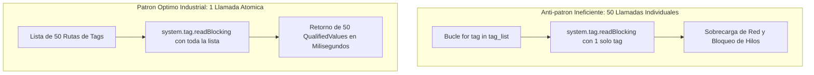
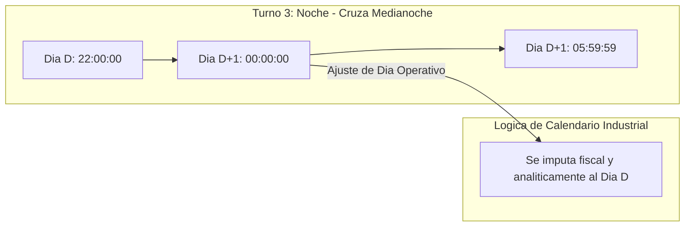

# Sesión 7

### 1. Repaso Inicial y Resolución de Dudas de la Sesión 6

#### Objetivos

* Consolidar el diseño de transacciones ACID compuestas y la prevención de fugas de conexiones JDBC mediante bloques `finally`.
* Revisar el desacoplamiento de componentes mediante Message Handlers y las buenas prácticas en Script Transforms de Perspective.

#### Contenidos

* Repaso de consultas sobre el ciclo de vida de transacciones (`beginTransaction`, `commit`, `rollback`, `closeTransaction`).
* Revisión de dudas sobre la invocación de `system.util.sendMessage` entre vistas y popups.
* Comprobación del estado del proveedor de tags de pruebas en el Designer.

#### Resultado esperado

* Fijación de los estándares transaccionales y de eventos, asegurando la base técnica para interactuar directamente con el motor de tags y variables de proceso.

***

### 2. Tema 16: Tags, Lectura/Escritura Masiva y Scripting Operativo en Planta

#### Objetivos

* Comprender la anatomía del dato industrial a través del objeto `QualifiedValue` (valor, calidad y marca temporal).
* Dominar las operaciones de lectura y escritura por lotes (_Batch Operations_) con `system.tag.readBlocking` y `writeBlocking`.
* Aplicar el principio de programación defensiva mediante la validación obligatoria del código de calidad (`QualityCode`) antes de procesar lógica de control.

#### Contenidos

* Estructura tridimensional del dato de tag:
  * `.value`: Valor de la variable en memoria.
  * `.quality`: Estado de comunicación e integridad (`quality.isGood()`, `Bad_NotFound`, `Bad_Stale`, `Uncertain`).
  * `.timestamp`: Marca temporal de adquisición del dato.
* Erradicación del anti-patrón de I/O en bucles:
  * Comparativa de rendimiento: Lecturas individuales dentro de bucles `for` (saturación de canales OPC-UA) frente a lectura atómica por lote con lista de rutas.
* Control y verificación de escrituras operativas:
  * Análisis de la lista de objetos `QualityCode` devuelta por `system.tag.writeBlocking`.
  * Diferenciación de tipos de tags: tags de proceso (OPC), memoria, calculados (Expression) y derivados.
* Sincronización entre tags y base de datos:
  * Patrones de disparo por evento para el volcado de valores de planta hacia tablas relacionales.



#### Resultado esperado

* Capacidad para interactuar con el motor de tags de Ignition de forma masiva y eficiente, validando sistemáticamente la calidad de los datos antes de ejecutar cálculos o acciones operativas.

***

### 3. Laboratorio 7.1: Servicio de Lectura y Escritura de Tags por Lote y Monitor en Perspective

#### Objetivos

* Construir un servicio en `Project Library` (`project.tags.service`) que lea un conjunto de tags de una máquina en una sola llamada atómica, filtre variables con calidad no confiable y devuelva un diccionario normalizado.
* Implementar una función de escritura masiva segura que verifique que todos los valores fueron aceptados por el PLC, alertando si alguno fue rechazado por permisos o desconexión.
* Diseñar una vista operativa en Perspective (`Views/Laboratorios/Lab7_1_TagBatchView`) con scripts de 1 o 2 líneas para monitorizar telemetría y aplicar consignas por lote.

#### Resultado esperado

* Módulo creado en `Project Library` probado en consola y pantalla operativa en Perspective con distintivos de calidad (`Good` vs `Bad_NotFound`) y mando masivo atómico sin bloqueos de interfaz.

#### Paso a Paso para la Realización

**Paso 1: Módulo en Project Library (`project.tags.service`)**
En **Server Scripting -> Project Library**, crear `tags.service` con la lógica de red y formateadores para UI:

```python
"""Modulo: project.tags.service"""

def read_equipment_telemetry(base_path, tag_names, timeout_ms=3000):
    root = (base_path or "").rstrip("/")
    full_paths = ["{}/{}".format(root, name.strip()) for name in tag_names]
    try:
        q_values = system.tag.readBlocking(full_paths, timeout_ms)
        results = {}
        all_good = True
        for name, path, qv in zip(tag_names, full_paths, q_values):
            good = qv.quality.isGood()
            if not good:
                all_good = False
            results[name] = {
                "value": qv.value if good else None,
                "quality": str(qv.quality),
                "timestamp": qv.timestamp,
                "is_good": good
            }
        return (all_good, results)
    except Exception as ex:
        system.util.getLogger("SCADA.Tags").error("Error en batch read: " + str(ex))
        return (False, {})

def write_equipment_batch(tag_value_map, timeout_ms=3000):
    if not tag_value_map:
        return (True, [])
    paths, values = list(tag_value_map.keys()), list(tag_value_map.values())
    qcs = system.tag.writeBlocking(paths, values, timeout_ms)
    fails = ["{} -> {}".format(p, str(qc)) for p, qc in zip(paths, qcs) if not qc.isGood()]
    return (len(fails) == 0, fails)

# --- Funciones auxiliares para scripts de 1-2 líneas en Perspective ---
def refresh_telemetry_ui(base_path, tag_names):
    all_ok, data = read_equipment_telemetry(base_path, tag_names)
    msg = "Telemetría OK (100% Good)" if all_ok else "Atención: tags con mala calidad (Bad/NotFound)"
    color = "#27ae60" if all_ok else "#e67e22"
    return {"data": data, "message": msg, "color": color}

def format_telemetry_table(telemetry_data):
    if not telemetry_data:
        return []
    rows = []
    for tag_name, info in telemetry_data.items():
        is_good = info.get("is_good", False)
        rows.append({
            "tag": tag_name,
            "valor": str(info.get("value")) if is_good else "---",
            "calidad": info.get("quality", "Unknown"),
            "estado": "CONFIABLE" if is_good else "ERROR",
            "timestamp": system.date.format(info.get("timestamp"), "yyyy-MM-dd HH:mm:ss") if info.get("timestamp") else "---",
            "_style": {"backgroundColor": "#ffffff" if is_good else "#fdedec", "color": "#2c3e50" if is_good else "#c0392b"}
        })
    return rows

def apply_equipment_setpoints(base_path, scfl_val, scmx_val, esim_val):
    root = (base_path or "").rstrip("/")
    try:
        payload = {"{}/SCFL".format(root): float(scfl_val), "{}/SCMX".format(root): float(scmx_val), "{}/ESIM".format(root): bool(esim_val)}
    except Exception as ex:
        return {"success": False, "message": "Datos inválidos: " + str(ex), "color": "#e74c3c"}
    ok, fails = write_equipment_batch(payload)
    if ok:
        return {"success": True, "message": "¡Éxito! 3 consignas escritas de forma atómica en el PLC.", "color": "#27ae60"}
    return {"success": False, "message": "Escritura rechazada: " + "; ".join(fails), "color": "#c0392b"}
```

**Paso 2: Validación en Script Console**
Guardar (`Ctrl+S`) y verificar en la Script Console:
```python
base = "[default]EDAR/EDAR_BOMBA_01"
ui_data = project.tags.service.refresh_telemetry_ui(base, ["SCFL", "SCMX", "ESIM", "TAG_INEXISTENTE_TEST"])
print "Telemetria:", ui_data["message"]
print "Filas Table:", len(project.tags.service.format_telemetry_table(ui_data["data"]))
write_res = project.tags.service.apply_equipment_setpoints(base, 55.0, 100.0, False)
print "Escritura Batch:", write_res["message"]
```

**Paso 3: Vista Operativa en Perspective (`Views/Laboratorios/Lab7_1_TagBatchView`)**
1. Crear la vista `Lab7_1_TagBatchView` (`Flex Container`, `column`) con propiedades `custom`:
   * `custom.basePath`: `"[default]EDAR/EDAR_BOMBA_01"`
   * `custom.tagList`: `["SCFL", "SCMX", "ESIM", "SFOR", "TAG_INEXISTENTE_TEST"]`
   * `custom.telemetryData`: `{}`
   * `custom.statusMessage`: `""`
   * `custom.statusColor`: `"#27ae60"`
2. **Botón Refrescar (`btn_Refrescar` -> `onActionPerformed` - 2 líneas):**
   ```python
   res = project.tags.service.refresh_telemetry_ui(self.view.custom.basePath, self.view.custom.tagList)
   self.view.custom.telemetryData, self.view.custom.statusMessage, self.view.custom.statusColor = res["data"], res["message"], res["color"]
   ```
3. **Tabla de Telemetría (`table_Telemetria.props.data` Transform - 1 línea):**
   ```python
   return project.tags.service.format_telemetry_table(value)
   ```
4. **Botón Aplicar Consignas (`btn_EnviarLote` -> `onActionPerformed` - 3 líneas):**
   ```python
   res = project.tags.service.apply_equipment_setpoints(self.view.custom.basePath, self.getSibling("num_SCFL").props.value, self.getSibling("num_SCMX").props.value, self.getSibling("toggle_ESIM").props.selected)
   self.view.custom.statusMessage, self.view.custom.statusColor = res["message"], res["color"]
   if res["success"]:
       self.getSibling("btn_Refrescar").fireEvent("onActionPerformed")
   ```

**Paso 4: Verificación Interactiva**
Lanzar en Preview (`Ctrl+P`). Comprobar que `TAG_INEXISTENTE_TEST` se destaca en rojo sin congelar la pantalla y que al aplicar consignas se actualizan en un solo envío atómico.

***

### 4. Tema 17: Gestión de Fechas, Turnos Industriales y Ventanas Temporales

#### Objetivos

* Dominar la manipulación de objetos `java.util.Date`, timestamps Epoch (milisegundos) y formatos SQL en Jython.
* Resolver la problemática analítica del "Día Operativo" frente al "Día Natural" en turnos nocturnos que cruzan la medianoche.
* Diseñar consultas SQL filtradas por rangos temporales que aprovechen índices de base de datos sin degradar el rendimiento.

#### Contenidos

* Coexistencia de tipos temporales en Ignition:
  * Objetos `java.util.Date` como tipo estándar de intercambio en el motor de scripting.
  * Milisegundos Epoch (`long`) para cálculo de duraciones, tiempos de ciclo y microparadas.
  * Formatos de presentación visual (`system.date.format`) restringidos exclusivamente a la interfaz de usuario.
* El cálculo del Día Operativo y turnos nocturnos:
  * Definición de turnos industriales estándar (Mañana: 06:00-14:00, Tarde: 14:00-22:00, Noche: 22:00-06:00).
  * Lógica de ajuste para imputar la producción de las primeras horas de la madrugada (00:00 a 05:59) al día calendario en que inició el turno nocturno.
* Consultas temporales eficientes en base de datos:
  * Paso de objetos `Date` como _Value Parameters_ en Named Queries (`WHERE fecha BETWEEN :inicio AND :fin`).
  * Eliminación de conversiones a texto en las cláusulas `WHERE` para permitir el uso de índices temporales B-Tree.



#### Resultado esperado

* Dominio del manejo de marcas temporales y calendarios industriales, resolviendo cálculos de turnos continuos y consultas analíticas por rangos de fechas sin errores de zona horaria ni conversiones textuales frágiles.

***

### 5. Laboratorio 7.2: Motor de Turnos Industriales, Fechas SQL y Dashboard en Perspective

#### Objetivos

* Construir un módulo en `Project Library` (`project.util.shifts`) capaz de determinar el identificador del turno actual, su nombre funcional y el día operativo correspondiente a partir de cualquier marca temporal.
* Resolver la discontinuidad de la medianoche en turnos nocturnos e integrar consultas SQL sargables pasando objetos `Date` nativos.
* Diseñar un dashboard en Perspective (`Views/Laboratorios/Lab7_2_ShiftDashboard`) con scripts de 1 línea para visualizar KPIs de turno y actuaciones filtradas.

#### Resultado esperado

* Módulo de turnos validado ante marcas temporales diurnas y de madrugada.
* Dashboard en Perspective con tarjetas que cambian de color según el turno (Azul/Naranja/Púrpura), alertan del día operativo y filtran la tabla de intervenciones sin desajustes horarios.

#### Paso a Paso para la Realización

**Paso 1: Módulo en Project Library (`project.util.shifts`)**
En **Server Scripting -> Project Library**, crear `util.shifts`:

```python
"""Modulo: project.util.shifts"""
from java.util import Calendar

def get_shift_window(target_date=None):
    if target_date is None:
        target_date = system.date.now()
    cal = Calendar.getInstance()
    cal.setTime(target_date)
    hour = cal.get(Calendar.HOUR_OF_DAY)
    
    if 6 <= hour < 14:
        s_id, s_name, s_hour, e_hour, day_offset = 1, "TURNO_MANANA", 6, 13, 0
    elif 14 <= hour < 22:
        s_id, s_name, s_hour, e_hour, day_offset = 2, "TURNO_TARDE", 14, 21, 0
    else:
        s_id, s_name, s_hour, e_hour = 3, "TURNO_NOCHE", 22, 5
        day_offset = -1 if hour < 6 else 0
        
    cal_start = Calendar.getInstance()
    cal_start.setTime(target_date)
    if day_offset != 0:
        cal_start.add(Calendar.DAY_OF_MONTH, day_offset)
    cal_start.set(Calendar.HOUR_OF_DAY, s_hour); cal_start.set(Calendar.MINUTE, 0); cal_start.set(Calendar.SECOND, 0); cal_start.set(Calendar.MILLISECOND, 0)
    
    cal_end = Calendar.getInstance()
    cal_end.setTime(cal_start.getTime())
    if s_id == 3:
        cal_end.add(Calendar.DAY_OF_MONTH, 1)
    cal_end.set(Calendar.HOUR_OF_DAY, e_hour); cal_end.set(Calendar.MINUTE, 59); cal_end.set(Calendar.SECOND, 59); cal_end.set(Calendar.MILLISECOND, 999)
    
    return {
        "shift_id": s_id, "shift_name": s_name,
        "operational_date": system.date.format(cal_start.getTime(), "yyyy-MM-dd"),
        "start_date": cal_start.getTime(), "end_date": cal_end.getTime()
    }

def query_shift_actions(shift_window, equip=None, db_conn="SANDBOX_DB"):
    sql = "SELECT id, Equip, Descripcio, Usuari, DataHora FROM ins_Registre_Actuacions WHERE DataHora >= ? AND DataHora <= ?"
    args = [shift_window["start_date"], shift_window["end_date"]]
    if equip:
        sql += " AND Equip = ?"
        args.append(equip)
    sql += " ORDER BY DataHora DESC"
    return system.db.runPrepQuery(sql, args, database=db_conn)

# --- Funciones auxiliares para scripts de 1 línea en Perspective ---
def get_shift_badge_style(shift_id):
    colors = {1: "#2980b9", 2: "#d35400", 3: "#4a148c"}
    return colors.get(shift_id, "#7f8c8d")

def format_shift_window_label(shift_window):
    if not shift_window or "start_date" not in shift_window: return "---"
    return "Horario: {}h - {}h".format(system.date.format(shift_window["start_date"], "HH:mm"), system.date.format(shift_window["end_date"], "HH:mm"))

def get_shift_operational_note(shift_window):
    return "Turno Noche: Horas de madrugada imputadas al día anterior" if shift_window.get("shift_id") == 3 else "Día operativo coincide con día natural"

def format_shift_actions_table(shift_window, equip=None, db_conn="SANDBOX_DB"):
    if not shift_window or "start_date" not in shift_window: return []
    equip_filter = None if equip in (None, "TODOS") else equip
    raw_ds = query_shift_actions(shift_window, equip=equip_filter, db_conn=db_conn)
    return [{"id": r["id"], "Equipo": r["Equip"], "Descripcion": r["Descripcio"], "Usuario": r["Usuari"], "FechaHora": system.date.format(r["DataHora"], "dd/MM/yyyy HH:mm:ss") if r["DataHora"] else "---"} for r in system.dataset.toPyDataSet(raw_ds)]
```

**Paso 2: Validación en Script Console**
```python
d_test = system.date.parse("2026-10-21 03:30:00", "yyyy-MM-dd HH:mm:ss") # Caso critico madrugada
info = project.util.shifts.get_shift_window(d_test)
print "Turno:", info["shift_name"], "| Dia Operativo:", info["operational_date"], "| Color:", project.util.shifts.get_shift_badge_style(info["shift_id"])
print "Actuaciones recuperadas:", len(project.util.shifts.format_shift_actions_table(info, "EDAR_BOMBA_01"))
```

**Paso 3: Dashboard de Turnos en Perspective (`Views/Laboratorios/Lab7_2_ShiftDashboard`)**
1. Crear la vista `Lab7_2_ShiftDashboard` (`Flex Container`, `column`) con propiedades `custom`:
   * `custom.selectedEquip`: `"EDAR_BOMBA_01"`
   * `custom.shiftMeta`: `{}`
2. **Evento de Inicio (`view -> onStartup` - 1 línea):**
   ```python
   self.custom.shiftMeta = project.util.shifts.get_shift_window(None)
   ```
3. **Banner KPI (Scripts de 1 línea en Transforms):**
   * Color de fondo Tarjeta Turno: `return project.util.shifts.get_shift_badge_style(value)`
   * Texto Tarjeta Día Operativo: `return project.util.shifts.get_shift_operational_note(value)`
   * Texto Tarjeta Horario: `return project.util.shifts.format_shift_window_label(value)`
4. **Controles y Tabla:**
   * Botón Evaluar Simulación (`btn_Evaluar -> onActionPerformed` - 2 líneas):
     ```python
     target = self.getSibling("dt_Simulador").props.value
     self.view.custom.shiftMeta = project.util.shifts.get_shift_window(target)
     ```
   * Tabla Actuaciones (`table_Actuaciones.props.data` Transform - 1 línea):
     ```python
     return project.util.shifts.format_shift_actions_table(value, equip=self.view.custom.selectedEquip)
     ```

**Paso 4: Verificación Interactiva**
En el DateTime Picker, seleccionar las 03:30h: comprobar que el turno cambia a púrpura (`TURNO_NOCHE`), el día operativo retrocede 1 día y la tabla carga las actuaciones de esa franja nocturna.

***

### 6. Test de Conceptos de la Sesión 7

#### Objetivos

* Evaluar la asimilación conceptual sobre la estructura del `QualifiedValue` y el impacto de lecturas individuales en bucles.
* Validar la comprensión de las reglas de cálculo de turnos nocturnos y la imputación del día operativo.
* Comprobar el entendimiento sobre el paso de objetos `Date` nativos a consultas SQL parametrizadas.

#### Contenidos

* Cuestionario técnico individual de opción múltiple y resolución de casos de gestión de tags y fechas.

#### Resultado esperado

* Fijación de los principios de optimización de I/O de tags y del tratamiento de calendarios industriales en sistemas SCADA.

***

### 7. Feedback Individual y Cierre de la Sesión

#### Objetivos

* Verificar en el entorno de cada alumno la correcta ejecución de los servicios de lectura/escritura de tags por lote.
* Comprobar los resultados del motor de turnos ante casos borde de cambio de día.
* Presentar la planificación de la Sesión 8.

#### Contenidos

* Rondas de revisión individual del código en `Project Library` y en la Script Console.
* Resolución de dudas sobre la gestión de códigos de calidad y formatos de fecha.
* Avance de la Sesión 8: Optimización avanzada de consultas SQL (índices compuestos, SARGability), optimización de scripts Jython, reducción de uso de CPU y patrones de caché en memoria de Gateway con TTL.

#### Resultado esperado

* Cada alumno finaliza la jornada con sus módulos de tags y turnos verificados, sin llamadas ineficientes en bucles y con la preparación técnica requerida para el módulo de optimización y rendimiento.
