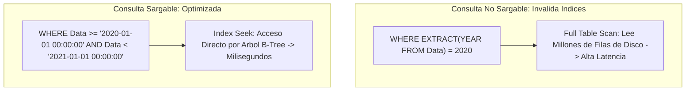
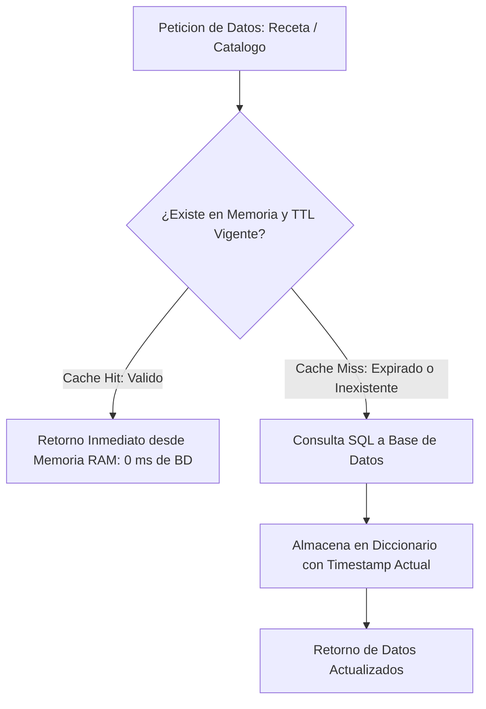

# Sesión 8

### 1. Repaso Inicial y Resolución de Dudas de la Sesión 7

#### Objetivos

* Consolidar el uso de operaciones masivas por lotes (_Batch Operations_) con `system.tag.readBlocking` y `writeBlocking`.
* Revisar la lógica de cálculo de calendarios industriales, días operativos y turnos nocturnos que cruzan la medianoche.

#### Contenidos

* Repaso de las consultas sobre la validación obligatoria de `QualityCode` en objetos `QualifiedValue`.
* Revisión de las dudas en la delimitación de ventanas temporales con objetos `java.util.Date` en Named Queries.
* Comprobación del correcto filtrado por rangos de fecha en las tablas del sandbox.

#### Resultado esperado

* Fijación de las directrices de acceso eficiente a tags y manejo de fechas, asegurando la base técnica para abordar la optimización de recursos y rendimiento del Gateway.

***

### 2. Tema 18: Optimización Avanzada de Consultas SQL Industriales

#### Objetivos

* Comprender el impacto en la memoria JVM y el pool JDBC derivado del uso indiscriminado de `SELECT *` y escaneos completos de tabla.
* Aplicar el principio de SARGability (_Search Argument Able_) en cláusulas `WHERE` para forzar el uso de índices B-Tree en la base de datos.
* Diseñar estrategias de indexación compuesta y separación de capas entre consultas transaccionales rápidas y consultas analíticas agregadas.

#### Contenidos

**1. Proyección Controlada, Serialización JDBC y Presión de Memoria en la JVM**

* **El peligro crítico del anti-patrón `SELECT *` en entornos SCADA:**
  * En plantas industriales, las tablas de telemetría, eventos de proceso (`REG_OPERADORS`, `ins_Registre_Actuacions`), alarmas y recetas contienen habitualmente decenas de columnas (campos de texto libre, trazas de depuración, metadatos JSON y configuraciones de ingeniería).
  * *Sobrecarga de red y driver JDBC:* El comodín `SELECT *` fuerza al motor SQL a leer la totalidad de las páginas de datos en disco, transferir bloques innecesarios a través de la red de control y serializar cada campo celda a celda en el driver JDBC hacia el Gateway.
  * *Presión destructiva sobre el Garbage Collector de la JVM:* Cada fila transferida se desenvuelve como un array de objetos en la memoria heap de Ignition. Si una consulta histórica recupera 50.000 filas con 20 columnas, se instancian más de 1.000.000 de objetos temporales en memoria RAM. Esto dispara pausas mayores de recolección de basura (*Stop-the-World GC Pauses*), generando micro-congelamientos en las pantallas de los operadores y retardos transitorios en el Gateway.
* **El principio de proyección estricta y mínima necesaria:**
  * Regla de diseño: Proyectar únicamente las columnas indispensables para la lógica de cálculo o el renderizado visual (`SELECT id, Data, Operador, Accio FROM REG_OPERADORS`).
  * *Habilitación de consultas cubiertas (*Covering Indexes*):* Si todas las columnas requeridas en el `SELECT` forman parte de un índice B-Tree, el motor RDBMS resuelve la consulta íntegramente leyendo el índice en memoria RAM sin acceder a las páginas de datos en disco (*Index-Only Scan*), multiplicando la velocidad de respuesta por órdenes de magnitud.

**2. SARGability e Índices B-Tree: Anatomía del Acceso Quirúrgico a Datos**

* **El concepto de SARGability (*Search Argument Able*):**
  * Un predicado o filtro en la cláusula `WHERE` es *sargable* cuando el optimizador de base de datos puede emplear un índice de árbol B (*B-Tree*) para acotar directamente las filas coincidentes sin evaluar toda la tabla.
  * *Operadores sargables nativos:* `=`, `<`, `>`, `<=`, `>=`, `BETWEEN`, `IN`, `IS NULL` y `LIKE 'patron%'` (búsqueda por prefijo exacto).
  * *Operadores no sargables habituales:* `LIKE '%patron'`, `<>`, `!=`, `NOT IN` y, de forma crítica, **cualquier función matemática, de cadena o de fecha aplicada sobre una columna indexada**.
* **El colapso por funciones sobre columnas temporales e indexadas:**
  * Análisis de los anti-patrones industriales más comunes en consultas históricas:
    ```sql
    -- ANTI-PATRONES: Inutilizan índices B-Tree y fuerzan Full Table Scan
    WHERE EXTRACT(YEAR FROM Data) = 2020
    WHERE DATE_FORMAT(Data, '%Y-%m-%d') = '2026-10-22'
    WHERE CAST(id_equipo AS VARCHAR) = 'BOMBA_01'
    WHERE UPPER(Operador) = 'JUAN'
    ```
  * *Mecánica interna en el motor SQL:* Para evaluar `EXTRACT(YEAR FROM Data) = 2020`, el optimizador desconoce el resultado de la función hasta que procesa cada fila de forma individual. Por tanto, se ve forzado a leer todas las páginas de la tabla desde disco, aplicar la función sobre cada registro (ej. 2.000.000 de filas) y descartar las que no cumplan la condición.
  * *Consecuencia en planta:* Escaneo completo de tabla (*Full Table Scan*), saturación de la E/S de disco, picos de CPU del 100% en el servidor de base de datos y retención excesiva de conexiones en el pool JDBC.
* **El estándar sargable por rangos binarios:**
  * En lugar de calcular o formatear el valor de la columna, se transforman los límites de comparación en literales o parámetros fijos evaluados en tiempo de consulta:
    ```sql
    -- PATRÓN SARGABLE ÓPTIMO: Búsqueda quirúrgica por índice (Index Seek)
    WHERE Data >= '2020-01-01 00:00:00' AND Data < '2021-01-01 00:00:00'
    ```
  * *Mecánica del optimizador:*
    * La columna permanece pura (`Data`), permitiendo una búsqueda binaria directa por índice (*Index Seek* o *Index Range Scan*).
    * El motor desciende por el árbol B hasta la primera clave que cumple `>= '2020-01-01 00:00:00'` y lee secuencialmente hasta el límite estricto `< '2021-01-01 00:00:00'`, recuperando miles de filas en pocos milisegundos con un coste mínimo de lectura de páginas.
    * El uso del operador menor estricto `<` con el primer instante del período siguiente evita desajustes de milisegundos (cubre exactamente hasta el microsegundo `2020-12-31 23:59:59.999999`).

**3. Estrategias de Indexación Compuesta y Separación Transaccional/Analítica**

* **Índices compuestos B-Tree y la regla del prefijo más a la izquierda (*Leftmost Prefix Rule*):**
  * En registros de planta, las consultas operativas habitualmente combinan el identificador de máquina y una ventana temporal.
  * *Definición de índice compuesto:* `CREATE INDEX idx_reg_equip_data ON REG_OPERADORS (Equip, Data);`.
  * *Jerarquía de columnas:* La columna filtrada por igualdad exacta (`Equip = 'EDAR_BOMBA_01'`) debe situarse en la primera posición del índice, seguida de la columna de rango temporal (`Data >= ...`). Esto permite acotar primero el sub-árbol del equipo y luego barrenar el intervalo temporal.
  * *Ordenación gratuita en disco:* Como las filas dentro del índice B-Tree ya están físicamente ordenadas por `Data`, la cláusula `ORDER BY Data DESC` se resuelve directamente sin necesidad de algoritmos de ordenación en memoria RAM (*Sort Operations*).
* **Separación de cargas transaccionales y analíticas en SCADA (OLTP vs. OLAP):**
  * *El conflicto de concurrencia en planta:* Paneles de supervisión mensual, cálculos de OEE o auditorías analíticas ejecutando consultas pesadas sobre tablas transaccionales en las que los PLCs y autómatas insertan telemetría en tiempo real.
  * *Bloqueos y contención de hilos:* Consultas analíticas extensas adquieren bloqueos compartidos (*Shared Locks*), reteniendo a los hilos transaccionales que intentan adquirir bloqueos exclusivos (*Exclusive Locks*).
  * *Estrategias arquitectónicas de desacoplamiento:*
    * *Tablas de agregación histórica precalculada (Rollup / Summary Tables):* Procesos desatendidos en el Gateway (Gateway Scheduled Scripts mediante CRON en cambio de turno o fin de jornada) calculan los acumulados diarios y los insertan en tablas de resumen (`summary_daily_kpis`). Los cuadros de mando consultan la tabla agregada (cientos de filas) en menos de 1 ms, sin degradar la tabla transaccional de millones de filas.
    * *Réplicas de lectura (*Read Replicas*):* Configuración de conexiones de base de datos secundarias en el Gateway dedicadas a consultas analíticas pesadas, aislando el motor transaccional primario.



#### Resultado esperado

* Capacidad para diagnosticar consultas lentas, reescribir filtros SQL garantizando el uso de índices y diseñar estructuras de datos optimizadas para reporting industrial.

***

### 3. Laboratorio 8.1: Refactorización y Benchmark de Consultas SQL Lentas con Dashboard en Perspective

#### Objetivos

* Analizar y medir el tiempo de respuesta de una consulta histórica no optimizada (con `SELECT *` y funciones en la cláusula `WHERE`) en la Script Console.
* Refactorizar la consulta bajo criterios sargables con proyección explícita, implementando el motor de benchmarking en `Project Library` (`project.database.benchmark`) con medición de alta precisión en nanosegundos.
* Construir una vista interactiva en Perspective (`Views/Laboratorios/Lab8_1_SQLBenchmark`) con banner KPI y tabla comparativa, aplicando scripts de 1 o 2 líneas.

#### Resultado esperado

* Módulo de benchmarking validado en la Script Console y dashboard en Perspective donde se ejecuta la prueba en caliente, constatando visualmente más de un 70% de aceleración en la versión sargable.

#### Paso a Paso para la Realización

**Paso 1: Módulo en Project Library (`project.database.benchmark`)**
En **Server Scripting -> Project Library**, crear `database.benchmark`:

```python
"""Modulo: project.database.benchmark"""
from java.lang import System

def run_sql_benchmark(name, query_func, iterations=10):
    query_func() # Warm-up
    times_ms = []
    rows = 0
    for _ in range(iterations):
        t0 = System.nanoTime()
        ds = query_func()
        t1 = System.nanoTime()
        times_ms.append((t1 - t0) / 1000000.0)
        rows = ds.getRowCount() if ds else 0
    return {"name": name, "avg": round(sum(times_ms) / len(times_ms), 2), "min": round(min(times_ms), 2), "max": round(max(times_ms), 2), "rows": rows}

def query_ineficiente_legacy():
    return system.db.runQuery("SELECT * FROM REG_OPERADORS WHERE EXTRACT(YEAR FROM Data) = 2020", database="SANDBOX_DB")

def query_optimizada_sargable():
    return system.db.runQuery("SELECT id, Data, Operador, Accio FROM REG_OPERADORS WHERE Data >= '2020-01-01 00:00:00' AND Data < '2021-01-01 00:00:00'", database="SANDBOX_DB")

def compare_query_performance(iterations=10):
    iters = max(1, int(iterations)) if iterations else 10
    leg = run_sql_benchmark("Legacy: SELECT * + EXTRACT(YEAR)", query_ineficiente_legacy, iters)
    opt = run_sql_benchmark("Optimizada: Proyección + Rango Sargable", query_optimizada_sargable, iters)
    imp = round(((leg["avg"] - opt["avg"]) / leg["avg"]) * 100.0, 1) if leg["avg"] > 0 else 0.0
    return {"legacy": leg, "optimized": opt, "improvement_pct": imp, "iterations": iters}

# --- Funciones auxiliares para scripts de 1 línea en Perspective ---
def format_benchmark_table(res):
    if not res or "legacy" not in res: return []
    return [
        {"tipo": res["legacy"]["name"], "media_ms": "{} ms".format(res["legacy"]["avg"]), "min_ms": "{} ms".format(res["legacy"]["min"]), "max_ms": "{} ms".format(res["legacy"]["max"]), "filas": res["legacy"]["rows"], "_style": {"backgroundColor": "#fdedec", "color": "#c0392b"}},
        {"tipo": res["optimized"]["name"], "media_ms": "{} ms".format(res["optimized"]["avg"]), "min_ms": "{} ms".format(res["optimized"]["min"]), "max_ms": "{} ms".format(res["optimized"]["max"]), "filas": res["optimized"]["rows"], "_style": {"backgroundColor": "#eafaf1", "color": "#27ae60"}}
    ]

def get_improvement_badge(pct):
    return "{}% Más Rápida (Optimización Exitosa)".format(float(pct or 0.0))
```

**Paso 2: Validación en Script Console**
```python
res = project.database.benchmark.compare_query_performance(15)
print "Legacy:", res["legacy"]["avg"], "ms | Optimizada:", res["optimized"]["avg"], "ms | Mejora:", res["improvement_pct"], "%"
print "Filas Table:", len(project.database.benchmark.format_benchmark_table(res))
```

**Paso 3: Dashboard en Perspective (`Views/Laboratorios/Lab8_1_SQLBenchmark`)**
1. Crear la vista `Lab8_1_SQLBenchmark` (`Flex Container`, `column`) con propiedades `custom`:
   * `custom.iterations`: `15`
   * `custom.benchmarkResults`: `{}`
2. **Banner KPI (Transforms de 1 línea):**
   * Label Legacy: Binding a `view.custom.benchmarkResults.legacy.avg`.
   * Label Optimizada: Binding a `view.custom.benchmarkResults.optimized.avg`.
   * Badge Mejora: Binding a `view.custom.benchmarkResults.improvement_pct` con transform:
     ```python
     return project.database.benchmark.get_improvement_badge(value)
     ```
3. **Botón y Tabla:**
   * Botón Ejecutar (`btn_EjecutarBenchmark -> onActionPerformed` - 2 líneas):
     ```python
     iters = self.getSibling("num_Iteraciones").props.value
     self.view.custom.benchmarkResults = project.database.benchmark.compare_query_performance(iterations=iters)
     ```
   * Tabla Resultados (`table_Benchmark.props.data` Transform - 1 línea):
     ```python
     return project.database.benchmark.format_benchmark_table(value)
     ```

**Paso 4: Verificación Interactiva**
Lanzar en Preview (`Ctrl+P`), pulsar el botón y observar cómo la latencia pasa de ~18 ms a ~4 ms (más del 70% de reducción).

***

### 4. Tema 19: Optimización y Rendimiento de Scripts Jython en Ignition

#### Objetivos

* Detectar "puntos calientes" (_Hotspots_) de ejecución excesiva en bindings, Script Transforms y eventos reactivos.
* Eliminar conversiones redundantes de tipos en bucles para reducir la presión sobre el recolector de basura de la JVM (_Garbage Collector_).
* Implementar patrones de caché en memoria de Gateway con tiempo de expiración (TTL) para datos de baja volatilidad.

#### Contenidos

**1. Detección y Mitigación de Scripts Sobrecargados y Puntos Calientes (*Hotspots*)**

* **La naturaleza del motor Jython en la arquitectura de Ignition:**
  * Jython 2.7 ejecuta código Python compilándolo dinámicamente a bytecode sobre la Máquina Virtual de Java (JVM) del Gateway o del cliente.
  * A diferencia de Java puro compilado estáticamente, el tipado dinámico de Python requiere resolución en tiempo de ejecución. Los bucles masivos o conversiones redundantes tienen un coste en ciclos de CPU mucho más elevado.
* **Puntos calientes (*Hotspots*) habituales en sistemas SCADA:**
  * *Script Transforms en Bindings de alta frecuencia:* Transformadores asociados a tags que cambian cada 100 ms o a propiedades que se recalculan ante cualquier evento de interfaz en Perspective. Si un transform contiene llamadas bloqueantes o lógica compleja, satura los núcleos de CPU del servidor multiplicando la carga por cada cliente web conectado.
  * *Gateway Timer Scripts mal dimensionados:* Tareas cíclicas configuradas en el pool compartido (*Shared Pool*) ejecutando scripts cuya duración excede el intervalo de muestreo (ej. script de 800 ms corriendo cada 500 ms), provocando el encolamiento y congelamiento de todos los temporizadores del Gateway.
  * *Tag Change Scripts con flancos no filtrados:* Scripts de cambio de tag que omiten la validación `if not initialChange:`, disparando cientos de ejecuciones concurrentes cada vez que el Gateway arranca o se guarda el proyecto en el Designer.
* **Perfilado de rendimiento de alta precisión en Jython:**
  * Medición de tiempos de ejecución utilizando las APIs nativas de la JVM:
    * `java.lang.System.nanoTime()`: Medición de intervalos ultracortos con precisión de nanosegundos ($10^{-9}\text{ s}$), ideal para medir funciones de transformación de datos y micro-benchmarking en memoria RAM.
    * `java.lang.System.currentTimeMillis()`: Reloj de época para cálculo de duraciones de proceso, control de tiempos de expiración y almacenamiento de marcas temporales en milisegundos.
  * *Cálculo de latencia en milisegundos con alta resolución:*
    $$\Delta t_{\text{ms}} = \frac{t_1 - t_0}{1.000.000,0}$$

**2. Optimización de Memoria, Bucles e Iteraciones en la JVM**

* **El coste oculto de las conversiones redundantes de datasets:**
  * *Análisis del anti-patrón de manipulación:*
    ```python
    # ANTI-PATRÓN: Múltiples conversiones encadenadas que saturan el Heap
    raw_ds = system.db.runQuery("SELECT ...")
    py_ds = system.dataset.toPyDataSet(raw_ds)
    lista_dicts = []
    for row in py_ds:
        lista_dicts.append({"id": row["id"], "nombre": row["nombre"]})
    final_ds = system.dataset.toDataSet(headers, [list(d.values()) for d in lista_dicts])
    ```
  * *Presión sobre la memoria Heap:* Cada conversión intermedia (`Dataset` -> `PyDataSet` -> `dict` -> `list` -> `Dataset`) crea nuevos objetos efímeros en la memoria de la JVM. En bucles de procesamiento histórico o telemetría, esto fragmenta la memoria y provoca una alta frecuencia de ciclos del recolector de basura (*GC pressure*), ralentizando el rendimiento general del Gateway.
* **El estándar de acceso directo con `PyDataSet`:**
  * `system.dataset.toPyDataSet` (o el retorno directo de `system.db.runPrepQuery`) envuelve el dataset nativo de Java en un adaptador ligero sin duplicar los datos en memoria.
  * Ofrece acceso indexado directo por nombre de columna (`row["columna"]`) o índice ordinal (`row[0]`) con complejidad O(1).
  * Si el objetivo es iterar para renderizar una tabla o evaluar condiciones lógicas, debe iterarse directamente sobre el `PyDataSet` sin conversiones intermedias ni generación de diccionarios auxiliares innecesarios.
* **Comprensiones de listas (*List Comprehensions*):**
  * Las comprensiones de listas (`[expr for item in iterable]`) se ejecutan internamente a nivel de bytecode en la JVM, siendo entre un 30% y un 50% más rápidas en Jython que los bucles `for` tradicionales con llamadas continuas al método `.append()`.

**3. El Patrón de Caché en Memoria del Gateway con TTL (*Time-To-Live*)**

* **La problemática de las consultas repetitivas de datos de baja volatilidad:**
  * En entornos industriales, multitud de tablas almacenan datos que rara vez cambian: catálogos maestros de equipos, listas de recetas, parámetros de tolerancias de calidad, tablas de operadores autorizados y descripciones de averías.
  * *El anti-patrón de consulta recurrente:* Decenas de clientes SCADA o scripts de Gateway ejecutando continuamente consultas SQL (`SELECT * FROM machine_setpoints`) para leer exactamente la misma información estática. Cada petición abre conexiones JDBC, transmite datos por la red y consume CPU del motor de base de datos.
* **Arquitectura del patrón de Caché en Memoria RAM del Gateway:**
  * Implementación de un almacén en memoria a nivel de `Project Library` (diccionario global `_CACHE_STORE`).
  * En Ignition, los módulos de `Project Library` mantienen su estado en memoria dentro del contexto del Gateway entre ejecuciones de scripts, lo que permite conservar variables globales de caché de forma persistente mientras el servicio de Gateway esté activo.
  * *Mecánica del patrón `get_or_set`:*
    1. Se calcula una clave unívoca para el recurso (`cache_key`).
    2. Se comprueba si la clave existe en memoria y si su tiempo transcurrido no supera el TTL configurado:
       $$\text{now\_ms} - \text{timestamp} < \text{TTL\_ms}$$
    3. **Cache Hit (Acierto de Caché):** Se devuelve de forma inmediata el dato residente en memoria RAM. Tiempo de respuesta: **< 0,05 ms** (cero consultas SQL, cero consumo de conexiones JDBC y cero latencia de red).
    4. **Cache Miss (Fallo o Expiración):** Se invoca la función original de extracción (`fetch_function`), se almacena el nuevo resultado junto con la marca temporal actual (`System.currentTimeMillis()`) y se retorna el dato fresco. Tiempo de respuesta: ~15 a 50 ms (únicamente en la primera ejecución o tras la caducidad del TTL).
* **Estrategias de invalidación de caché:**
  * *Expiración automática por tiempo (TTL):* Refresco periódico desatendido garantizado (ej. cada 60 segundos o 10 minutos).
  * *Invalidación proactiva manual (*Cache Invalidation*):* Invocación de `clear_cache(cache_key)` inmediatamente después de que un operador guarde una modificación en la pantalla de recetas o consignas, forzando a que la siguiente lectura recargue los datos frescos de la base de datos sin demoras.




#### Resultado esperado

* Dominio de las técnicas de perfilado de scripts, eliminación de redundancias de memoria y diseño de sistemas de caché en el Gateway para maximizar la velocidad de respuesta del sistema SCADA.

***

### 5. Laboratorio 8.2: Gestor de Caché Genérico con TTL en Memoria de Gateway y Monitor en Perspective

#### Objetivos

* Construir un módulo en `Project Library` (`project.util.cache`) que implemente un almacén de caché en memoria RAM con control de expiración por TTL e invalidación manual.
* Diseñar un monitor interactivo en Perspective (`Views/Laboratorios/Lab8_2_CacheMonitor`) con scripts de 1 o 2 líneas para visualizar la aceleración de Cache Hit frente a Cache Miss.

#### Resultado esperado

* Módulo de caché validado ante accesos repetitivos y expiración.
* Monitor en Perspective donde la primera consulta indica `CACHE MISS (SQL - ~20 ms)` y las siguientes `CACHE HIT (RAM - < 0.05 ms)`, con botón para invalidar manualmente la memoria.

#### Paso a Paso para la Realización

**Paso 1: Módulo en Project Library (`project.util.cache`)**
En **Server Scripting -> Project Library**, crear `util.cache`:

```python
"""Modulo: project.util.cache"""
from java.lang import System

_CACHE_STORE = {}

def get_or_set(cache_key, fetch_function, ttl_seconds=60, *args, **kwargs):
    global _CACHE_STORE
    now_ms, ttl_ms = System.currentTimeMillis(), ttl_seconds * 1000
    if cache_key in _CACHE_STORE:
        entry = _CACHE_STORE[cache_key]
        if (now_ms - entry["timestamp"]) < ttl_ms:
            entry["hits"] += 1
            return entry["data"]
    data = fetch_function(*args, **kwargs)
    _CACHE_STORE[cache_key] = {"timestamp": now_ms, "data": data, "hits": 0}
    return data

def clear_cache(cache_key=None):
    global _CACHE_STORE
    if cache_key: _CACHE_STORE.pop(cache_key, None)
    else: _CACHE_STORE.clear()

def get_cache_stats():
    now_ms = System.currentTimeMillis()
    return {k: {"age_seconds": round((now_ms - v["timestamp"]) / 1000.0, 1), "total_hits": v["hits"]} for k, v in _CACHE_STORE.items()}

# --- Funciones auxiliares para scripts de 1-2 líneas en Perspective ---
def fetch_catalog_setpoints():
    return system.db.runQuery("SELECT equip, flow_sp, pressure_sp, is_active FROM machine_setpoints WHERE is_active = TRUE", database="SANDBOX_DB")

def query_setpoints_cached_ui(ttl_seconds=10):
    key, now_ms = "cat_setpoints", System.currentTimeMillis()
    is_hit = key in _CACHE_STORE and (now_ms - _CACHE_STORE[key]["timestamp"]) < (ttl_seconds * 1000)
    t0 = System.nanoTime()
    data = get_or_set(key, fetch_catalog_setpoints, ttl_seconds=ttl_seconds)
    t1 = System.nanoTime()
    return {
        "data": data,
        "source": "MEMORIA RAM (CACHE HIT)" if is_hit else "BASE DE DATOS SQL (CACHE MISS)",
        "elapsed_ms": round((t1 - t0) / 1000000.0, 4),
        "hits": _CACHE_STORE.get(key, {}).get("hits", 0)
    }

def format_setpoints_table(dataset_data):
    if not dataset_data: return []
    return [{"Equipo": r["equip"], "Consigna_Caudal": "{:.1f} m3/h".format(r["flow_sp"]), "Consigna_Presion": "{:.1f} bar".format(r["pressure_sp"]), "Estado": "ACTIVO" if r["is_active"] else "INACTIVO"} for r in system.dataset.toPyDataSet(dataset_data)]

def format_cache_stats_table(stats_dict):
    if not stats_dict: return []
    return [{"Clave": k, "Edad_Segundos": "{} s".format(v.get("age_seconds", 0)), "Total_Hits_RAM": v.get("total_hits", 0)} for k, v in stats_dict.items()]

def get_source_badge_style(source_str):
    return "#27ae60" if "CACHE HIT" in str(source_str) else "#2980b9"
```

**Paso 2: Validación en Script Console**
```python
project.util.cache.clear_cache("cat_setpoints")
res1 = project.util.cache.query_setpoints_cached_ui(ttl_seconds=5)
print "Llamada 1 (MISS):", res1["source"], "| Tiempo:", res1["elapsed_ms"], "ms"
res2 = project.util.cache.query_setpoints_cached_ui(ttl_seconds=5)
print "Llamada 2 (HIT): ", res2["source"], "| Tiempo:", res2["elapsed_ms"], "ms (Aceleracion > 500x)"
```

**Paso 3: Monitor de Caché en Perspective (`Views/Laboratorios/Lab8_2_CacheMonitor`)**
1. Crear la vista `Lab8_2_CacheMonitor` (`Flex Container`, `column`) con propiedades `custom`:
   * `custom.ttlSeconds`: `10`
   * `custom.lastResult`: `{}`
   * `custom.statusMessage`: `""`
2. **Banner KPI (Transforms de 1 línea):**
   * Tarjeta Origen `backgroundColor`: `return project.util.cache.get_source_badge_style(value)`
   * Tarjeta Latencia: Binding a `view.custom.lastResult.elapsed_ms` (ej. `0.035 ms` vs `22.4 ms`).
3. **Botones y Tablas:**
   * Botón Consultar (`btn_Consultar -> onActionPerformed` - 2 líneas):
     ```python
     ttl = self.getSibling("num_TTL").props.value
     self.view.custom.lastResult = project.util.cache.query_setpoints_cached_ui(ttl_seconds=ttl)
     ```
   * Botón Invalidar (`btn_Invalidar -> onActionPerformed` - 2 líneas):
     ```python
     project.util.cache.clear_cache("cat_setpoints")
     self.view.custom.statusMessage = "Caché invalidada en memoria RAM"
     ```
   * Tabla Catálogo (`table_Catalogo.props.data` Transform - 1 línea):
     ```python
     return project.util.cache.format_setpoints_table(value)
     ```
   * Tabla Estadísticas (`table_Stats.props.data` Transform - 1 línea):
     ```python
     return project.util.cache.format_cache_stats_table(project.util.cache.get_cache_stats())
     ```

**Paso 4: Verificación Interactiva**
Lanzar en Preview (`Ctrl+P`): la primera pulsación muestra `CACHE MISS` (~20 ms); las pulsaciones siguientes muestran `CACHE HIT` (< 0.05 ms) incrementando los hits sin tocar PostgreSQL.

***

### 6. Test de Conceptos de la Sesión 8

#### Objetivos

* Validar la asimilación conceptual sobre SARGability y el impacto de funciones en cláusulas `WHERE`.
* Evaluar el entendimiento sobre el ciclo de vida de la memoria en la JVM y el coste de las conversiones repetidas de datasets.
* Comprobar el criterio de aplicación del patrón de caché con TTL en entornos industriales.

#### Contenidos

* Cuestionario técnico individual de opción múltiple y resolución de casos de optimización de código y bases de datos.
* [Cuestionario Sesión 8](https://docs.google.com/forms/d/e/1FAIpQLSeHDWwYuztymYsiqO5pwm-2v98rpIDJKeYyxA0LwKg8Eccltw/viewform?usp=header)
* [Feedback Sesión 8](https://imagina-formacion.typeform.com/to/LQzhO2AR)


#### Resultado esperado

* Comprobación del dominio de las técnicas de optimización de consultas SQL y de scripts Jython en el Gateway.

***

### 7. Feedback Individual y Cierre de la Sesión

#### Objetivos

* Revisar los resultados de los benchmarks de consultas SQL ejecutados por los alumnos en la Script Console.
* Comprobar la correcta implementación del módulo de caché y el manejo de tiempos de expiración.
* Presentar la planificación de la Sesión 9 (sesión intensiva de 5 horas).

#### Contenidos

* Rondas de revisión individual del código de optimización y de los módulos de caché.
* Entrega de la _Checklist de Rendimiento_ para auditoría de scripts previos al despliegue.
* Avance de la Sesión 9: Procesamiento asíncrono (`system.util.invokeAsynchronous`), seguridad avanzada y RBAC, integración con APIs REST (`system.net.httpClient`), microservicios FastAPI y metodología de refactorización de código heredado (_Legacy_).

#### Resultado esperado

* Cada alumno finaliza la sesión con sus módulos de caché operativos, benchmarks completados y comprensión de los criterios de rendimiento que se aplicarán en arquitecturas asíncronas y microservicios.
